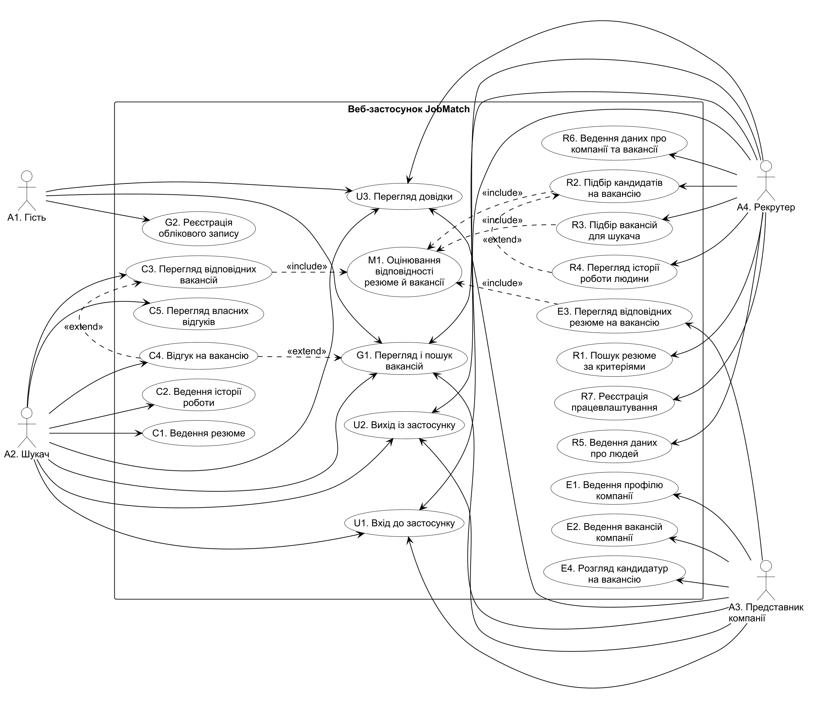

# Специфікація вимог до Веб-застосунку кадрової агенції «JobMatch»

Виконала: Макаренко Марина, група ІПС-41

Версія 1.0 від 27.09.2026

## 1. Вступ

### 1.1. Мета

Документ вичерпно й однозначно для Замовника і Розробника описує спостережувану поведінку Веб-застосунку JobMatch у формі варіантів використання, а також функціональні вимоги загального характеру, нефункціональні вимоги та обмеження щодо розроблення. Документ є підставою для UX-проєктування, проєктування архітектури, програмування і тестування Веб-застосунку JobMatch.

### 1.2. Сфера охоплення

Документ охоплює всі варіанти використання Веб-застосунку JobMatch чотирма акторами — Гостем, Шукачем, Представником компанії і Рекрутером — та загальні вимоги до Веб-застосунку JobMatch. Документ уточнює функції з п. 4.1.1 і нефункціональні вимоги з пп. 4.1.3–4.5 Технічного завдання. Ділові процеси Замовника, цілі створення і техніко-економічні показники описано в Технічному завданні; цей документ їх не повторює.

### 1.3. Визначення, познаки та скорочення

| Термін або скорочення | Визначення |
|------|--------------|
| Веб-застосунок JobMatch | Веб-застосунок кадрової агенції «JobMatch», вимоги до якого визначає цей документ |
| Замовник | ТОВ «Кадрова агенція «ПрофіКадр» |
| Розробник | Макаренко Марина, група ІПС-41 |
| Людина | Особа, дані якої зберігає Веб-застосунок JobMatch: резюме, освіта, історія роботи. Людину вносить Рекрутер або вона реєструється сама як Шукач |
| Резюме | Особисті дані людини, статус пошуку роботи, бажана посада і бажана зарплата |
| Запис історії роботи | Відомості про одне місце роботи людини: компанія, посада, зарплата, дата початку, дата завершення або «досі» |
| Стаж | Сума тривалостей усіх записів історії роботи людини; тривалість запису без дати завершення рахують до поточної дати |
| Рівень освіти | Одне зі значень у порядку зростання: середня, професійно-технічна, бакалавр, магістр, доктор філософії |
| Вакансія | Пропозиція роботи компанії: посада, зарплата, мінімальний рівень освіти, мінімальний досвід, вимоги, місто, статус «відкрита» або «закрита» |
| Кандидатура | Зв'язок «людина — вакансія» зі статусом «Нова», «Запрошено», «Відхилено» або «Працевлаштовано» та джерелом «Шукач» (відгук) або «Рекрутер» (пропозиція) |
| Відгук | Кандидатура, яку створив Шукач на відкриту вакансію |
| Працевлаштування | Подія, яку реєструє Рекрутер: Веб-застосунок JobMatch змінює статус кандидатури на «Працевлаштовано», додає запис в історію роботи людини, закриває вакансію і змінює статус людини на «не шукає роботу» |
| Оцінка відповідності | Ціле число 0–100 (%), яке обчислює варіант використання M1 для пари «резюме — вакансія» як суму балів чотирьох критеріїв |
| Поріг | Мінімальна оцінка відповідності, з якої резюме або вакансія потрапляє до результату підбору; за замовчуванням 50 % |
| Діагностичне повідомлення | Повідомлення про помилку з трьох частин: «Сутність помилки. Як виправити зараз. Як запобігти надалі.» |
| UC | Use case — варіант використання (прецедент) |
| ТЗ | Технічне завдання |
| SRS | Software Requirements Specification — специфікація вимог |
| RUP | Rational Unified Process — Раціональний уніфікований процес |
| БД | База даних |
| LCP | Largest Contentful Paint — час відображення найбільшого елемента основного контенту сторінки |
| INP | Interaction to Next Paint — затримка між дією користувача і наступним оновленням сторінки |
| WCAG | Web Content Accessibility Guidelines — настанови з доступності вебвмісту |
| CSRF | Cross-Site Request Forgery — підробка міжсайтового запиту |
| NFR | Non-Functional Requirement — нефункціональна вимога |

### 1.4. Посилання

1. Технічне завдання на розроблення Веб-застосунку кадрової агенції «JobMatch», версія 1.0 від 16.09.2026, файл «Лаба1_ТЗ_JobMatch_Макаренко».
2. Закон України «Про захист персональних даних» від 01.06.2010 № 2297-VI (чинна редакція станом на 27.09.2026).
3. Закон України «Про електронні комунікації» від 16.12.2020 № 1089-IX (чинна редакція станом на 27.09.2026).
4. Закон України «Про зайнятість населення» від 05.07.2012 № 5067-VI, ст. 11 (чинна редакція станом на 27.09.2026).
5. Закон України «Про рекламу» від 03.07.1996 № 270/96-ВР, ст. 24-1 (чинна редакція станом на 27.09.2026).
6. Web Content Accessibility Guidelines (WCAG) 2.1, W3C Recommendation від 05.06.2018, оновлена редакція від 21.09.2023, https://www.w3.org/TR/WCAG21/.
7. ISO/IEC 25010:2023 «Systems and software engineering — Systems and software Quality Requirements and Evaluation (SQuaRE) — Product quality model».
8. ISO/IEC/IEEE 29148:2018 «Systems and software engineering — Life cycle processes — Requirements engineering» (національний відповідник — ДСТУ IEEE/ISO/IEC 29148-2025).
9. OWASP Top 10:2021, https://owasp.org/Top10/.
10. OMG Unified Modeling Language, версія 2.5.1, грудень 2017, https://www.omg.org/spec/UML/2.5.1/.
11. PlantUML, версія 1.2026.10, https://plantuml.com/.

### 1.5. Стислий зміст

Веб-застосунок JobMatch підтримує ведення бази резюме, компаній і вакансій кадрової агенції, автоматичний підбір кандидатів на вакансію і вакансій для людини за оцінкою відповідності, розгляд кандидатур компаніями, облік працевлаштувань і публічний каталог вакансій.

Розділ 2 містить реєстри акторів і варіантів використання, діаграму варіантів використання, припущення і залежності. Розділ 3 містить стислі описи всіх варіантів використання з пов'язаними нефункціональними вимогами (3.1), перелік критичних варіантів використання, повний опис критичного варіанта використання R2 і вимоги до Веб-застосунку JobMatch загалом (3.2). Розділ 4 містить матрицю відстежуваності вимог і джерельний текст діаграми.

## 2. Загальний опис

### 2.1. Огляд прецедентів

Стислий опис акторів подано в табл. 1.

Таблиця 1 — Реєстр акторів Веб-застосунку JobMatch

| Код | Актор | Стислий опис діяльності |
|--|---|-------------|
| A1 | Гість | Незареєстрований відвідувач Веб-застосунку JobMatch — людина, що шукає роботу, або представник компанії, який ще не співпрацює з агенцією. Гість переглядає каталог відкритих вакансій і шукає в ньому вакансії за посадою, компанією, містом і зарплатою, читає довідку та відомості про агенцію, реєструє обліковий запис шукача або представника компанії, щоб скористатися послугами агенції. |
| A2 | Шукач | Людина, що шукає роботу і зареєструвалася у Веб-застосунку JobMatch. Шукач веде своє резюме (особисті дані, освіта, статус пошуку роботи, бажана посада і зарплата) та історію роботи, переглядає вакансії, відповідні його резюме, відгукується на них і стежить за станом своїх кандидатур, щоб отримати роботу без звернень до рекрутера телефоном. |
| A3 | Представник компанії | Співробітник компанії-клієнта агенції, який зареєстрував обліковий запис представника і профіль компанії. Представник компанії веде профіль компанії та її вакансії, переглядає резюме, відповідні вакансіям компанії, розглядає кандидатури, запропоновані рекрутером або подані шукачами, і запрошує кандидата на співбесіду або відхиляє кандидатуру, щоб закрити вакансію відповідним працівником. |
| A4 | Рекрутер | Працівник агенції, обліковий запис якого створив системний адміністратор Замовника. Рекрутер веде дані всіх людей, компаній і вакансій, шукає резюме за освітою, компаніями, посадами, зарплатами і статусом, підбирає кандидатів на вакансію і вакансії для людини, переглядає історію роботи людини, пропонує кандидатів компаніям і реєструє працевлаштування, щоб збільшити кількість працевлаштувань агенції. |

Список варіантів використання подано в табл. 2. Код варіанта використання починається з літери, що позначає основного актора: G — Гість, C — Шукач, E — Представник компанії, R — Рекрутер; U — варіанти використання, спільні для кількох акторів; M — включений варіант використання без власного актора.

Таблиця 2 — Реєстр варіантів використання Веб-застосунку JobMatch

| Код | Основний актор | Найменування | Сутність |
|--|----|----|---------|
| U1 | Шукач, Представник компанії, Рекрутер | Вхід до застосунку | Користувач вводить e-mail і пароль, щоб отримати доступ до функцій своєї ролі. |
| U2 | Шукач, Представник компанії, Рекрутер | Вихід із застосунку | Користувач завершує сеанс, щоб інша особа на тому самому пристрої не отримала доступу до його даних. |
| U3 | Гість, Шукач, Представник компанії, Рекрутер | Перегляд довідки | Користувач читає відповіді на типові запитання, завантажує Настанову користувача і переглядає контакти агенції, щоб самостійно розібратися з виконанням дії. |
| G1 | Гість (також Шукач, Представник компанії, Рекрутер) | Перегляд і пошук вакансій | Користувач переглядає відкриті вакансії і фільтрує їх за посадою, компанією, містом і мінімальною зарплатою, щоб знайти вакансії, які його цікавлять. |
| G2 | Гість | Реєстрація облікового запису | Гість створює обліковий запис шукача з резюме або обліковий запис представника компанії з профілем компанії, щоб отримати доступ до особистого кабінету. |
| C1 | Шукач | Ведення резюме | Шукач переглядає і редагує особисті дані, статус пошуку роботи, бажану посаду і зарплату, додає і видаляє записи освіти, щоб резюме відповідало його актуальним даним. |
| C2 | Шукач | Ведення історії роботи | Шукач додає, редагує і видаляє записи історії роботи, щоб Веб-застосунок JobMatch правильно враховував його посади і стаж під час оцінювання відповідності. |
| C3 | Шукач | Перегляд відповідних вакансій | Шукач отримує список відкритих вакансій, упорядкований за оцінкою відповідності його резюме, щоб вибрати вакансії для відгуку. |
| C4 | Шукач | Відгук на вакансію | Шукач з картки відкритої вакансії відгукується на неї, щоб компанія розглянула його кандидатуру. |
| C5 | Шукач | Перегляд власних відгуків | Шукач переглядає свої кандидатури та їх статуси, щоб знати рішення компаній без звернень до рекрутера. |
| E1 | Представник компанії | Ведення профілю компанії | Представник компанії переглядає і редагує назву, місто, адресу, контакти і опис компанії, щоб шукачі й рекрутери бачили актуальні дані компанії. |
| E2 | Представник компанії | Ведення вакансій компанії | Представник компанії додає, редагує, закриває, повторно відкриває і видаляє вакансії своєї компанії, щоб каталог і підбір містили актуальні вакансії. |
| E3 | Представник компанії | Перегляд відповідних резюме на вакансію | Представник компанії отримує список резюме, упорядкований за оцінкою відповідності вакансії його компанії, щоб оцінити ринок кандидатів і звернутися до агенції. |
| E4 | Представник компанії | Розгляд кандидатур на вакансію | Представник компанії переглядає кандидатури на вакансію і запрошує кандидата на співбесіду або відхиляє кандидатуру, щоб повідомити агенції і шукачу своє рішення. |
| R1 | Рекрутер | Пошук резюме за критеріями | Рекрутер шукає резюме за мінімальним рівнем освіти, компанією, в якій людина працювала, посадою, діапазоном зарплати і статусом, щоб отримати список людей для подальшої роботи. |
| R2 | Рекрутер | Підбір кандидатів на вакансію | Рекрутер отримує впорядкований за оцінкою відповідності список резюме для відкритої вакансії і пропонує кандидатів компанії, щоб закрити вакансію відповідним працівником. |
| R3 | Рекрутер | Підбір вакансій для шукача | Рекрутер отримує впорядкований за оцінкою відповідності список відкритих вакансій для людини, щоб запропонувати їй роботу. |
| R4 | Рекрутер | Перегляд історії роботи людини | Рекрутер переглядає картку людини з освітою та хронологічною історією роботи, щоб оцінити досвід кандидата. |
| R5 | Рекрутер | Ведення даних про людей | Рекрутер додає, переглядає, редагує і видаляє людину разом з резюме, освітою та історією роботи, щоб база резюме агенції була повною й актуальною. |
| R6 | Рекрутер | Ведення даних про компанії та вакансії | Рекрутер додає, переглядає, редагує і видаляє компанію, додає, редагує і видаляє її вакансії, щоб вести компанії-клієнти, які не працюють у Веб-застосунку JobMatch самостійно. |
| R7 | Рекрутер | Реєстрація працевлаштування | Рекрутер реєструє працевлаштування за кандидатурою, щоб однією дією оновити історію роботи людини, статус людини, вакансію і облік працевлаштувань агенції. |
| M1 | — (включений) | Оцінювання відповідності резюме й вакансії | Веб-застосунок JobMatch обчислює оцінку відповідності пари «резюме — вакансія» за чотирма критеріями зі складовими оцінки; M1 включають C3, E3, R2, R3. |

Відношення між варіантами використання:

- «include»: C3, E3, R2 і R3 включають M1 — оцінювання відповідності є обов'язковою частиною кожного з них;
- «extend»: C4 розширює G1 і C3 у точці «картка вакансії» — Шукач відгукується з картки вакансії, відкритої з каталогу або зі списку відповідних вакансій;
- «extend»: R4 розширює R2 у точці «крок 4 основного потоку» — Рекрутер відкриває картку кандидата з історією роботи зі списку підбору.

Діаграму варіантів використання подано на рис. 1. Засіб побудови діаграми — PlantUML версії 1.2026.10 (текстовий опис діаграми мовою PlantUML, розміщення — Graphviz). Вибір PlantUML зумовлений тим, що Розробник зберігає джерельний текст діаграм у Git разом з кодом, а той самий засіб будує діаграми класів, послідовності і придатності для наступних лабораторних робіт. Джерельний текст діаграми наведено в п. 4.3.

{width=100%}

### 2.2. Припущення і залежності

#### 2.2.1. Доступність внутрішніх і зовнішніх програмно-апаратних компонентів

1. Припущення: Замовник до 16.11.2026 орендує віртуальний сервер, доменне ім'я і TLS-сертифікат згідно з п. 4.3.1 ТЗ; до цієї дати Розробник демонструє Веб-застосунок JobMatch на власному ноутбуці з СКБД H2.
2. Припущення: усі програмні компоненти (Java 21, Spring Boot 3.5, Thymeleaf, Hibernate, H2, PostgreSQL 16, JUnit 5, Mockito, Playwright) розповсюджуються за вільними ліцензіями (Apache 2.0, EPL, MPL, PostgreSQL License) і не потребують ліцензійних платежів Замовника.
3. Залежність: Spring Boot 3.5 — остання гілка 3.x. Розробник відстежує завершення безкоштовної підтримки гілки 3.5; перехід на наступну мажорну версію Spring Boot належить до еволюції Веб-застосунку JobMatch (п. 4.3.2 ТЗ).
4. Залежність: первинне наповнення залежить від копій Google-таблиць, які Замовник передає Розробнику до 26.10.2026 (п. 4.1.2 ТЗ). Затримка передавання зсуває первинне наповнення на той самий строк.
5. Припущення: Веб-застосунок JobMatch не взаємодіє з зовнішніми програмними системами: актори-системи відсутні, інтеграції з Google Workspace, поштовим сервером і порталами вакансій не заплановано. Про зміну статусу кандидатури користувач дізнається у Веб-застосунку JobMatch (C5, E4).

#### 2.2.2. Умови експлуатації

1. Припущення: Замовник працює в одному офісі без філій; рекрутери працюють у робочий час, Гість, Шукач і Представник компанії звертаються до Веб-застосунку JobMatch цілодобово.
2. Припущення: користувачі працюють на пристроях і в браузерах, указаних у пп. 4.4, 4.5 ТЗ, з доступом до мережі Інтернет на швидкості від 10 Мбіт/с.
3. Припущення: системний адміністратор Замовника (за сумісництвом) виконує резервне копіювання, оновлення сервера і керування обліковими записами рекрутерів скриптом БД згідно з п. 4.3.2 ТЗ.
4. Припущення: мова інтерфейсу і всіх даних — українська; зарплати вказуються в гривнях на місяць.
5. Залежність: рекрутери — впевнені користувачі ПК без досвіду роботи з ATS; тривалість навчання за Настановою користувача обмежує NFR-U-1.

#### 2.2.3. Законодавчі та регулятивні обмеження

1. Закон України «Про захист персональних даних» № 2297-VI. Резюме, освіта, історія роботи і контакти людей і представників компаній є персональними даними. Володілець персональних даних — Замовник, мета обробки — сприяння працевлаштуванню. Наслідки для Веб-застосунку JobMatch:
    - Шукач надає згоду на обробку персональних даних під час реєстрації (G2); для людей, перенесених з Google-таблиць, Замовник володіє згодами, отриманими раніше (припущення);
    - склад персональних даних обмежено даними, потрібними для мети обробки (NFR-D-5); дата народження необов'язкова і не бере участі в оцінюванні відповідності;
    - Шукач переглядає і виправляє свої дані самостійно (C1, C2); видалення даних людини на її вимогу виконує Рекрутер (R5);
    - доступ до резюме мають лише Рекрутер і Шукач — власник резюме; Представник компанії бачить резюме без контактних даних і лише в межах E3, E4 (FR-2);
    - Веб-застосунок JobMatch захищає персональні дані від несанкціонованого доступу (NFR-R-7).
2. Закон України «Про електронні комунікації» № 1089-IX. Закон регулює постачальників електронних комунікаційних послуг; Веб-застосунок JobMatch таких послуг не надає. Залежність: доступність Веб-застосунку JobMatch залежить від постачальника доступу до мережі Інтернет і хостинг-провайдера, з якими Замовник укладає договори згідно з цим Законом.
3. Закон України «Про зайнятість населення» № 5067-VI, ст. 11, ч. 3, і Закон України «Про рекламу» № 270/96-ВР, ст. 24-1, забороняють в оголошеннях про вакансії вимоги щодо віку кандидатів, пропозицію роботи лише жінкам або лише чоловікам (крім специфічної роботи) та вимоги, не пов'язані з характером роботи. Наслідки для Веб-застосунку JobMatch: вакансія не містить полів віку і статі; під полем «Вимоги» форм E2 і R6 Веб-застосунок JobMatch показує підказку про цю заборону; M1 не використовує дату народження, стать і інші ознаки, не пов'язані з кваліфікацією. Відповідальність за текст вимог несе автор вакансії — Представник компанії або Рекрутер.

#### 2.2.4. Професійні стандарти де-юре і де-факто

1. WCAG 2.1, рівень AA — вимоги до доступності (NFR-U-2…NFR-U-7).
2. ISO/IEC 25010:2023 — модель якості, за якою згруповано нефункціональні вимоги п. 3.2.4.
3. ISO/IEC/IEEE 29148:2018 — правила формулювання вимог; вимоги п. 3.2 записано за шаблоном [Умова] [Суб'єкт] [Дія] [Об'єкт] [Обмеження].
4. OWASP Top 10:2021 — перелік ризиків безпеки вебзастосунків, від яких захищає NFR-R-7.
5. Core Web Vitals (Google, де-факто) — метрики LCP і INP для NFR-P-1, NFR-P-2.
6. UML 2.5.1 — нотація діаграми варіантів використання.
7. Google Java Style Guide (де-факто) — стандарт кодування (NFR-S-5).

## 3. Опис вимог

### 3.1. Опис варіантів використання

#### 3.1.1. U1. Вхід до застосунку

**Ідентифікатор:** U1. **Основний актор:** Шукач, Представник компанії, Рекрутер. **Інші актори:** відсутні. **Зв'язки:** відсутні; успішне виконання U1 є передумовою всіх варіантів використання з кодами C, E, R.

**Стислий опис.** Користувач відкриває сторінку входу, вводить e-mail і пароль. Веб-застосунок JobMatch перевіряє пару «e-mail — пароль» і ознаку активності облікового запису та відкриває стартову сторінку ролі: Шукачу — «Моє резюме», Представнику компанії — «Моя компанія», Рекрутеру — «Панель рекрутера». Якщо користувач перед входом відкрив захищену сторінку, Веб-застосунок JobMatch після входу повертає його на цю сторінку. У разі неправильної пари або неактивного облікового запису Веб-застосунок JobMatch показує одне повідомлення «Неправильний e-mail або пароль» без уточнення, яке з полів неправильне, і зберігає введений e-mail у формі.

**Нефункціональні вимоги.** Надійність (безпека): Веб-застосунок JobMatch порівнює пароль з хешем BCrypt і не зберігає пароль у відкритому вигляді. Зручність використання: поля «E-mail» і «Пароль» мають видимі підписи і атрибути автозаповнення браузера. Продуктивність: Веб-застосунок JobMatch виконує вхід ≤ 2 с.

#### 3.1.2. U2. Вихід із застосунку

**Ідентифікатор:** U2. **Основний актор:** Шукач, Представник компанії, Рекрутер. **Інші актори:** відсутні. **Зв'язки:** відсутні.

**Стислий опис.** Користувач натискає «Вийти» в шапці сторінки. Веб-застосунок JobMatch завершує сеанс, анулює ідентифікатор сеансу і відкриває головну сторінку з повідомленням «Ви вийшли із застосунку». Після виходу кнопка «Назад» браузера не відкриває сторінок особистого кабінету без повторного входу.

**Нефункціональні вимоги.** Надійність (безпека): запит виходу захищено CSRF-токеном.

#### 3.1.3. U3. Перегляд довідки

**Ідентифікатор:** U3. **Основний актор:** Гість, Шукач, Представник компанії, Рекрутер. **Інші актори:** відсутні. **Зв'язки:** відсутні.

**Стислий опис.** Користувач натискає «Допомога» в шапці будь-якої сторінки. Веб-застосунок JobMatch відкриває сторінку допомоги з відповідями на типові запитання, згрупованими за ролями, і посиланням на завантаження Настанови користувача у форматі PDF. Зі сторінки допомоги користувач переходить на сторінку «Про агенцію» з адресою, телефоном, e-mail агенції та відомостями про обробку персональних даних.

**Нефункціональні вимоги.** On-line допомога: вимоги NFR-H-1…NFR-H-4. Доступність: сторінка допомоги має ієрархію заголовків, за якою програма екранного доступу переходить між розділами.

#### 3.1.4. G1. Перегляд і пошук вакансій

**Ідентифікатор:** G1. **Основний актор:** Гість. **Інші актори:** Шукач, Представник компанії, Рекрутер (виконують G1 так само, як Гість). **Зв'язки:** розширюється варіантом використання C4 у точці «картка вакансії».

**Стислий опис.** Користувач відкриває сторінку «Вакансії». Веб-застосунок JobMatch показує відкриті вакансії від найновішої: посада, компанія, місто, зарплата, дата створення. Користувач фільтрує список за посадою (частина назви без урахування регістру), компанією, містом і мінімальною зарплатою; Веб-застосунок JobMatch зберігає значення фільтрів в адресі сторінки, тому посилання на відфільтрований список відкриває той самий результат. Якщо жодна вакансія не задовольняє фільтри, Веб-застосунок JobMatch показує повідомлення «Вакансій за заданими умовами не знайдено» і кнопку «Скинути фільтри». Користувач відкриває картку вакансії з вимогами, мінімальним рівнем освіти, мінімальним досвідом і даними компанії (назва, місто, вебсайт, опис). Для Шукача картка відкритої вакансії містить кнопку «Відгукнутися» (C4); для Гостя — пропозицію увійти або зареєструватися.

**Нефункціональні вимоги.** Продуктивність: Веб-застосунок JobMatch фільтрує список до 2 000 вакансій ≤ 2 с. Зручність використання: мінімальна зарплата приймає лише ціле невід'ємне число; у разі іншого значення Веб-застосунок JobMatch показує діагностичне повідомлення біля поля. Доступність: таблиця або список вакансій доступні з клавіатури, кожне поле фільтра має підпис.

#### 3.1.5. G2. Реєстрація облікового запису

**Ідентифікатор:** G2. **Основний актор:** Гість. **Інші актори:** відсутні. **Зв'язки:** відсутні.

**Стислий опис.** Гість відкриває сторінку «Реєстрація», вибирає роль «Шукач» або «Представник компанії» і вводить e-mail, пароль і підтвердження пароля. Шукач додатково вводить обов'язкові дані резюме (прізвище, ім'я, телефон, місто, домашня адреса) і позначає згоду на обробку персональних даних; Веб-застосунок JobMatch створює обліковий запис і резюме зі статусом «шукає роботу». Представник компанії додатково вводить дані компанії (назва, місто, адреса, телефон, e-mail; вебсайт і опис — необов'язкові); Веб-застосунок JobMatch створює обліковий запис і профіль компанії, пов'язаний з ним. Після реєстрації Веб-застосунок JobMatch відкриває сторінку входу з повідомленням «Реєстрацію завершено. Увійдіть з указаними e-mail і паролем». Якщо e-mail уже зареєстровано або назва компанії вже існує, Веб-застосунок JobMatch показує діагностичне повідомлення і зберігає решту введених даних.

**Нефункціональні вимоги.** Надійність (безпека): пароль містить від 8 символів; Веб-застосунок JobMatch зберігає лише хеш пароля BCrypt. Зручність використання: поля компанії відображаються лише після вибору ролі «Представник компанії». Доступність: перемикач ролі доступний з клавіатури і має текстовий підпис.

#### 3.1.6. C1. Ведення резюме

**Ідентифікатор:** C1. **Основний актор:** Шукач. **Інші актори:** відсутні. **Зв'язки:** відсутні.

**Стислий опис.** Шукач відкриває «Моє резюме» і бачить своє резюме, записи освіти і дату останнього оновлення. Шукач редагує особисті дані (прізвище, ім'я, по батькові, дата народження, телефон, e-mail, місто, домашня адреса), статус пошуку роботи («шукає» / «не шукає»), бажану посаду, бажану зарплату (грн/міс) і відомості «Про себе» (до 1 000 символів). Обов'язкові поля — прізвище, ім'я, телефон, e-mail, місто, домашня адреса, статус. Шукач додає запис освіти (рівень, навчальний заклад, спеціальність, рік завершення) і видаляє запис освіти після підтвердження. Після збереження Веб-застосунок JobMatch оновлює дату останнього оновлення резюме. Резюме зі статусом «не шукає» не потрапляє до результату R2 і E3.

**Нефункціональні вимоги.** Зручність використання: у разі помилки валідації Веб-застосунок JobMatch зберігає всі введені значення і показує діагностичне повідомлення біля кожного помилкового поля. On-line допомога: під полями «Бажана посада» і «Бажана зарплата» Веб-застосунок JobMatch показує підказку про їхній вплив на оцінку відповідності.

#### 3.1.7. C2. Ведення історії роботи

**Ідентифікатор:** C2. **Основний актор:** Шукач. **Інші актори:** відсутні. **Зв'язки:** відсутні.

**Стислий опис.** Шукач відкриває «Історія роботи» і бачить свої записи від найновішого: компанія, посада, зарплата, період роботи, а також сумарний стаж. Шукач додає запис (назва компанії, посада, зарплата — необов'язкова, дата початку, дата завершення — порожня означає «досі»), редагує запис і видаляє запис після підтвердження. Веб-застосунок JobMatch відхиляє запис, у якому дата завершення раніша за дату початку або дата початку пізніша за поточну дату, і показує діагностичне повідомлення.

**Нефункціональні вимоги.** Зручність використання: поля дат приймають формат ДД.ММ.РРРР і мають підказку формату. Доступність: таблиця історії роботи має заголовки стовпців, пов'язані з комірками.

#### 3.1.8. C3. Перегляд відповідних вакансій

**Ідентифікатор:** C3. **Основний актор:** Шукач. **Інші актори:** відсутні. **Зв'язки:** включає M1; розширюється варіантом використання C4 у точці «картка вакансії».

**Стислий опис.** Шукач відкриває «Відповідні вакансії». Веб-застосунок JobMatch обчислює оцінку відповідності (M1) резюме Шукача і кожної відкритої вакансії та показує вакансії з оцінкою не нижчою за поріг 50 % за спаданням оцінки, далі за посадою: посада, компанія, місто, зарплата, оцінка і її складові. Шукач змінює поле «Мін. оцінка, %» (ціле 0–100) і натискає «Оновити»; Веб-застосунок JobMatch перераховує список. Якщо список порожній, Веб-застосунок JobMatch пропонує кнопку «Показати часткові збіги (від 25 %)» і посилання на «Моє резюме» з порадою вказати бажану посаду та історію роботи. Для вакансії, на яку Шукач уже має кандидатуру, Веб-застосунок JobMatch показує статус кандидатури.

**Нефункціональні вимоги.** Продуктивність: Веб-застосунок JobMatch обчислює список для 2 000 відкритих вакансій ≤ 2 с. On-line допомога: біля заголовка стовпця «Оцінка» Веб-застосунок JobMatch показує посилання на пояснення критеріїв оцінки в довідці.

#### 3.1.9. C4. Відгук на вакансію

**Ідентифікатор:** C4. **Основний актор:** Шукач. **Інші актори:** Представник компанії (розглядає відгук в E4), Рекрутер (бачить відгук у переліку кандидатур). **Зв'язки:** розширює G1 і C3 у точці «картка вакансії».

**Стислий опис.** Шукач у картці відкритої вакансії натискає «Відгукнутися» і підтверджує дію. Веб-застосунок JobMatch створює кандидатуру зі статусом «Нова» і джерелом «Шукач», показує повідомлення «Ви відгукнулися на вакансію \<посада\> (\<компанія\>)» і замінює кнопку позначкою зі статусом кандидатури. Якщо кандидатура Шукача на цю вакансію вже існує (відгук або пропозиція рекрутера), картка показує її статус замість кнопки; повторний запит (подвійне натискання, інша вкладка) Веб-застосунок JobMatch відхиляє з повідомленням «Кандидатура вже існує». Якщо вакансію закрито до підтвердження, Веб-застосунок JobMatch показує повідомлення «Вакансію закрито — відгук недоступний».

**Нефункціональні вимоги.** Надійність: обмеження унікальності пари «вакансія — людина» в БД гарантує щонайбільше одну кандидатуру на пару.

#### 3.1.10. C5. Перегляд власних відгуків

**Ідентифікатор:** C5. **Основний актор:** Шукач. **Інші актори:** відсутні. **Зв'язки:** відсутні.

**Стислий опис.** Шукач відкриває «Мої відгуки». Веб-застосунок JobMatch показує всі кандидатури Шукача від найновішої: посада, компанія, дата створення, джерело («Мій відгук» або «Пропозиція рекрутера»), статус («Нова», «Запрошено», «Відхилено», «Працевлаштовано»). Шукач відкриває картку вакансії з рядка кандидатури. Якщо кандидатур немає, Веб-застосунок JobMatch показує посилання на «Відповідні вакансії».

**Нефункціональні вимоги.** Доступність: Веб-застосунок JobMatch передає статус кандидатури текстом, а не лише кольором (WCAG 2.1, критерій 1.4.1).

#### 3.1.11. E1. Ведення профілю компанії

**Ідентифікатор:** E1. **Основний актор:** Представник компанії. **Інші актори:** відсутні. **Зв'язки:** відсутні.

**Стислий опис.** Представник компанії відкриває «Моя компанія» і бачить профіль компанії. Представник редагує назву (унікальну серед компаній), місто, адресу, телефон, e-mail, вебсайт і опис (до 2 000 символів). Якщо компанія з такою назвою вже існує, Веб-застосунок JobMatch показує діагностичне повідомлення і зберігає введені дані у формі.

**Нефункціональні вимоги.** Зручність використання: поле «Вебсайт» приймає адресу з протоколом http або https; Веб-застосунок JobMatch перевіряє формат поля «E-mail».

#### 3.1.12. E2. Ведення вакансій компанії

**Ідентифікатор:** E2. **Основний актор:** Представник компанії. **Інші актори:** відсутні. **Зв'язки:** відсутні.

**Стислий опис.** Представник компанії відкриває «Вакансії» і бачить усі вакансії своєї компанії зі статусом і кількістю кандидатур. Представник додає вакансію (посада, зарплата в грн/міс, мінімальний рівень освіти або «будь-яка», мінімальний досвід 0–40 років, вимоги до 2 000 символів, місто) — Веб-застосунок JobMatch створює її зі статусом «відкрита»; редагує вакансію; закриває відкриту і повторно відкриває закриту вакансію; видаляє вакансію після підтвердження. У запиті підтвердження видалення Веб-застосунок JobMatch повідомляє кількість кандидатур, які буде видалено разом з вакансією. Зі списку Представник переходить до E3 і E4 для кожної вакансії.

**Нефункціональні вимоги.** On-line допомога: під полем «Вимоги» Веб-застосунок JobMatch показує підказку про заборону вимог щодо віку і статі (п. 2.2.3). Зручність використання: закрита вакансія зникає з каталогу G1 і з підбору одразу після закриття.

#### 3.1.13. E3. Перегляд відповідних резюме на вакансію

**Ідентифікатор:** E3. **Основний актор:** Представник компанії. **Інші актори:** відсутні. **Зв'язки:** включає M1.

**Стислий опис.** Представник компанії біля вакансії своєї компанії натискає «Відповідні резюме». Веб-застосунок JobMatch обчислює оцінку відповідності (M1) вакансії і кожного резюме зі статусом «шукає роботу» та показує резюме з оцінкою не нижчою за поріг 50 % за спаданням оцінки: ім'я і перша літера прізвища, бажана посада, бажана зарплата, найвищий рівень освіти, стаж, оцінка і її складові. Контактних даних людини Веб-застосунок JobMatch Представнику компанії не показує — зв'язок з кандидатом встановлює Рекрутер. Представник змінює поріг так само, як у C3.

**Нефункціональні вимоги.** Продуктивність: Веб-застосунок JobMatch обчислює список для 10 000 резюме ≤ 2 с. Надійність (безпека): Веб-застосунок JobMatch відповідає кодом 404 на запит E3 для вакансії іншої компанії.

#### 3.1.14. E4. Розгляд кандидатур на вакансію

**Ідентифікатор:** E4. **Основний актор:** Представник компанії. **Інші актори:** Шукач (бачить рішення в C5), Рекрутер (бачить рішення в переліку кандидатур і реєструє працевлаштування в R7). **Зв'язки:** відсутні.

**Стислий опис.** Представник компанії біля вакансії своєї компанії натискає «Кандидатури». Веб-застосунок JobMatch показує кандидатури від найновішої: ім'я кандидата, бажана посада, стаж, освіта, джерело («Шукач» або «Рекрутер»), коментар рекрутера, дата, статус. Для кандидатури зі статусом «Нова» Представник натискає «Запросити» — Веб-застосунок JobMatch змінює статус на «Запрошено» — або «Відхилити» — Веб-застосунок JobMatch після підтвердження змінює статус на «Відхилено». Для кандидатур з іншими статусами кнопки рішення відсутні.

**Нефункціональні вимоги.** Надійність: якщо статус кандидатури змінився після відкриття сторінки (наприклад, Рекрутер зареєстрував працевлаштування), Веб-застосунок JobMatch відхиляє рішення з повідомленням про поточний статус і оновлює рядок.

#### 3.1.15. R1. Пошук резюме за критеріями

**Ідентифікатор:** R1. **Основний актор:** Рекрутер. **Інші актори:** відсутні. **Зв'язки:** відсутні.

**Стислий опис.** Рекрутер відкриває «Резюме» і задає будь-яку комбінацію критеріїв: мінімальний рівень освіти, компанія, в якій людина працювала (частина назви), посада (частина назви — бажана посада або посада з історії роботи), зарплата від і до (бажана зарплата), статус пошуку роботи. Веб-застосунок JobMatch показує людей, які задовольняють усі задані критерії, за прізвищем: ПІБ, бажана посада, бажана зарплата, найвищий рівень освіти, стаж, місто, статус. Без критеріїв Веб-застосунок JobMatch показує всіх людей. Рекрутер відкриває картку людини (R4) з рядка результату. Якщо «зарплата від» більша за «зарплата до», Веб-застосунок JobMatch показує діагностичне повідомлення і не виконує пошук.

**Нефункціональні вимоги.** Продуктивність: Веб-застосунок JobMatch виконує пошук у базі з 10 000 резюме ≤ 2 с. Зручність використання: Веб-застосунок JobMatch зберігає критерії в адресі сторінки і показує їх заповненими після повернення з картки людини.

#### 3.1.16. R2. Підбір кандидатів на вакансію

**Ідентифікатор:** R2. **Основний актор:** Рекрутер. **Інші актори:** Представник компанії (розглядає запропоновану кандидатуру в E4). **Зв'язки:** включає M1; розширюється варіантом використання R4 у кроці 4 основного потоку.

**Стислий опис.** Рекрутер з панелі рекрутера або з картки компанії вибирає відкриту вакансію і отримує список резюме зі статусом «шукає роботу», упорядкований за оцінкою відповідності з порогом 50 % і складовими оцінки. Рекрутер переглядає картку кандидата з історією роботи і пропонує кандидата компанії з необов'язковим коментарем до 500 символів; Веб-застосунок JobMatch створює кандидатуру зі статусом «Нова» і джерелом «Рекрутер». R2 — критичний варіант використання; повний опис з потоками подій і спеціальними вимогами наведено в п. 3.2.2.

#### 3.1.17. R3. Підбір вакансій для шукача

**Ідентифікатор:** R3. **Основний актор:** Рекрутер. **Інші актори:** відсутні. **Зв'язки:** включає M1.

**Стислий опис.** Рекрутер у картці людини натискає «Підібрати вакансії». Веб-застосунок JobMatch обчислює оцінку відповідності (M1) резюме людини і кожної відкритої вакансії та показує вакансії з оцінкою не нижчою за поріг 50 % за спаданням оцінки, далі за посадою: посада, компанія, місто, зарплата, оцінка і її складові. Рекрутер змінює поріг і переходить до часткових збігів (від 25 %) так само, як у R2. З рядка вакансії Рекрутер переходить до підбору кандидатів на цю вакансію (R2), де пропонує людину компанії.

**Нефункціональні вимоги.** Продуктивність: Веб-застосунок JobMatch обчислює список для 2 000 відкритих вакансій ≤ 2 с.

#### 3.1.18. R4. Перегляд історії роботи людини

**Ідентифікатор:** R4. **Основний актор:** Рекрутер. **Інші актори:** відсутні. **Зв'язки:** розширює R2 у кроці 4 основного потоку.

**Стислий опис.** Рекрутер відкриває картку людини з результату R1, зі списку підбору R2 або з переліку кандидатур. Веб-застосунок JobMatch показує резюме, записи освіти, історію роботи в хронологічному порядку від найновішого запису (компанія, посада, зарплата, період, тривалість) і сумарний стаж, а також кандидатури людини зі статусами. З картки Рекрутер переходить до редагування (R5) і до підбору вакансій (R3), повертається до попереднього списку і друкує картку засобами браузера.

**Нефункціональні вимоги.** Зручність використання: друкована версія картки містить лише дані людини без шапки, меню і кнопок і вміщує картку з історією до 10 записів на одну сторінку A4.

#### 3.1.19. R5. Ведення даних про людей

**Ідентифікатор:** R5. **Основний актор:** Рекрутер. **Інші актори:** відсутні. **Зв'язки:** відсутні.

**Стислий опис.** Рекрутер додає людину (склад і обов'язкові поля резюме — як у C1), записи її освіти і історії роботи (склад — як у C2; компанію Рекрутер вибирає з бази агенції або вводить назву вручну), переглядає картку (R4), редагує будь-які з цих даних і видаляє людину. Перед видаленням Веб-застосунок JobMatch запитує підтвердження і повідомляє, що разом з людиною буде видалено освіту, історію роботи, кандидатури і пов'язаний обліковий запис шукача. Людина, яку додав Рекрутер, не має облікового запису.

**Нефункціональні вимоги.** Надійність: Веб-застосунок JobMatch видаляє людину і всі пов'язані з нею дані однією транзакцією. Зручність використання: якщо людина з таким e-mail або телефоном уже існує, Веб-застосунок JobMatch під час додавання показує попередження з посиланням на наявну картку.

#### 3.1.20. R6. Ведення даних про компанії та вакансії

**Ідентифікатор:** R6. **Основний актор:** Рекрутер. **Інші актори:** відсутні. **Зв'язки:** відсутні.

**Стислий опис.** Рекрутер відкриває «Компанії», шукає компанію за назвою, додає компанію (склад даних — як у E1), переглядає картку компанії з її вакансіями, редагує і видаляє компанію. У картці компанії Рекрутер додає, редагує і видаляє вакансії компанії (склад даних — як у E2), закриває і повторно відкриває вакансії та запускає підбір кандидатів (R2). Перед видаленням компанії Веб-застосунок JobMatch запитує підтвердження і повідомляє кількість вакансій і кандидатур, які буде видалено; у записах історії роботи людей Веб-застосунок JobMatch зберігає назву видаленої компанії.

**Нефункціональні вимоги.** On-line допомога: підказка під полем «Вимоги» вакансії — як у E2. Надійність: Веб-застосунок JobMatch видаляє компанію разом з вакансіями і кандидатурами однією транзакцією.

#### 3.1.21. R7. Реєстрація працевлаштування

**Ідентифікатор:** R7. **Основний актор:** Рекрутер. **Інші актори:** Шукач і Представник компанії (бачать статус «Працевлаштовано» в C5 і E4). **Зв'язки:** відсутні.

**Стислий опис.** Рекрутер відкриває «Кандидатури», фільтрує їх за статусом і біля кандидатури зі статусом «Запрошено» натискає «Зареєструвати працевлаштування». Веб-застосунок JobMatch показує форму з датою початку роботи (за замовчуванням — поточна дата) і даними, які буде змінено. Рекрутер натискає «Підтвердити». Веб-застосунок JobMatch змінює статус кандидатури на «Працевлаштовано», додає в історію роботи людини запис (компанія, посада і зарплата вакансії, дата початку, без дати завершення), закриває вакансію, змінює статус людини на «не шукає роботу» і показує повідомлення «Працевлаштування \<ПІБ\> на вакансію \<посада\> (\<компанія\>) зареєстровано».

**Нефункціональні вимоги.** Надійність: Веб-застосунок JobMatch виконує чотири зміни однією транзакцією і в разі помилки повертає БД до стану перед операцією. Зручність використання: дата початку роботи не пізніша за поточну дату + 90 днів; інакше Веб-застосунок JobMatch показує діагностичне повідомлення.

#### 3.1.22. M1. Оцінювання відповідності резюме й вакансії

**Ідентифікатор:** M1. **Основний актор:** відсутній (включений варіант використання). **Інші актори:** відсутні. **Зв'язки:** включається варіантами використання C3, E3, R2, R3.

**Стислий опис.** Для пари «резюме — вакансія» Веб-застосунок JobMatch обчислює оцінку 0–100 як суму балів чотирьох критеріїв. Посада (до 55): бажана посада людини або посада з її історії роботи збігається з посадою вакансії без урахування регістру або назва однієї посади входить в іншу цілими словами — 55; посади мають спільне слово довжиною від 4 символів — 25; інакше — 0. Зарплата (до 15): бажана зарплата не вказана або не перевищує зарплату вакансії — 15; не перевищує 115 % зарплати вакансії — 7; інакше — 0. Освіта (15): найвищий рівень освіти людини не нижчий за вимогу вакансії або вимоги немає — 15; інакше — 0. Досвід (до 15): стаж не менший за вимогу вакансії — 15; не менший за половину вимоги — 7; інакше — 0. Без збігу посади оцінка не перевищує 45, тому за порогу 50 % до списку потрапляють лише люди з повним або частковим збігом посади. M1 враховує лише людей зі статусом «шукає роботу» під час підбору кандидатів і лише відкриті вакансії під час підбору вакансій. Результат M1 містить загальну оцінку і бали кожного критерію; включальний варіант використання сортує результат за спаданням оцінки, далі за прізвищем або посадою.

**Нефункціональні вимоги.** Продуктивність: Веб-застосунок JobMatch оцінює 10 000 пар ≤ 2 с. Придатність до експлуатації: додавання нового критерію не змінює C3, E3, R2, R3 (NFR-S-3). Обмеження проєктування: M1 не використовує дату народження, стать та інші ознаки, не пов'язані з кваліфікацією (п. 2.2.3).

### 3.2. Спеціальні вимоги

#### 3.2.1. Критичні варіанти використання

Критерії критичності: К1 — Веб-застосунок JobMatch без підтримки варіанта використання неприйнятний для хоча б одного актора; К2 — варіант використання зумовлює окремий модуль архітектури; К3 — варіант використання знижує ризик невідповідності Веб-застосунку JobMatch призначенню з ТЗ (SMART-цілі п. 3.2 ТЗ).

Таблиця 3 — Критичні варіанти використання

| Код | Найменування | К1 | К2 | К3 | Обґрунтування |
|--|-----|--|--|--|-----------|
| R2 | Підбір кандидатів на вакансію | + | + | + | Основна функція для Рекрутера (функція 1 п. 4.1.1 ТЗ); зумовлює модуль підбору з сервісом оцінювання; безпосередньо забезпечує SMART-ціль 1 (≤ 10 хв на 10 кандидатів) і SMART-ціль 4 (кількість працевлаштувань) |
| M1 | Оцінювання відповідності резюме й вакансії | — | + | + | Зумовлює окремий модуль критеріїв оцінки, спільний для C3, E3, R2, R3; помилка в M1 знецінює всі чотири варіанти підбору |
| R7 | Реєстрація працевлаштування | + | + | + | Без R7 агенція не веде облік основного результату діяльності; потребує транзакції над чотирма сутностями; дає дані для перевірки SMART-цілі 4 |
| R1 | Пошук резюме за критеріями | + | — | + | Пряма операція Постановки задачі; без R1 Рекрутер повертається до пошуку в таблицях (SMART-ціль 1) |
| G2 | Реєстрація облікового запису | + | — | + | Без G2 Шукач і Представник компанії не отримують доступу до особистих кабінетів; забезпечує SMART-ціль 3 (≥ 300 шукачів і ≥ 30 компаній) |
| U1 | Вхід до застосунку | + | + | — | Зумовлює модуль автентифікації і розмежування доступу за ролями; без U1 жоден актор, крім Гостя, не працює з Веб-застосунком JobMatch |

Для повного опису вибрано R2 — єдиний варіант використання, що відповідає всім трьом критеріям і безпосередньо пов'язаний з двома SMART-цілями.

#### 3.2.2. Повний опис варіанта використання R2 «Підбір кандидатів на вакансію»

**1. Найменування і стислий опис**

Найменування: R2. Підбір кандидатів на вакансію. Основний актор: Рекрутер. Інший актор: Представник компанії (отримує запропоновану кандидатуру в E4).

Рекрутер отримує для відкритої вакансії впорядкований за оцінкою відповідності список резюме людей, які шукають роботу, переглядає картки кандидатів з історією роботи і пропонує одного або кількох кандидатів компанії з коментарем, щоб компанія розглянула кандидатури і агенція закрила вакансію.

**2. Потік подій**

Варіант використання починається, коли Рекрутер, який увійшов у Веб-застосунок JobMatch, відкриває «Панель рекрутера» або картку компанії.

*2.1. Основний потік подій*

1. Рекрутер відкриває «Панель рекрутера» і в таблиці відкритих вакансій натискає «Підібрати кандидатів» біля вакансії (або те саме з картки компанії).
2. Веб-застосунок JobMatch відображає сторінку «Підбір кандидатів»: параметри вакансії (компанія, посада, зарплата, мінімальна освіта, мінімальний досвід, місто) та поле «Мін. оцінка, %» зі значенням 50.
3. Веб-застосунок JobMatch обчислює оцінку відповідності (M1) для кожного резюме зі статусом «шукає роботу» і показує резюме з оцінкою ≥ 50 % за спаданням оцінки: ПІБ, бажана посада, бажана зарплата, освіта, стаж, оцінка (%) і складові оцінки.
4. Рекрутер натискає ПІБ кандидата — Веб-застосунок JobMatch відкриває картку людини з історією роботи (R4); Рекрутер повертається до списку.
5. Рекрутер натискає «Запропонувати» біля кандидата; Веб-застосунок JobMatch показує форму з полем «Коментар для компанії» (необов'язкове, ≤ 500 символів).
6. Рекрутер вводить коментар і натискає «Підтвердити».
7. Веб-застосунок JobMatch створює кандидатуру (статус «Нова», джерело «Рекрутер»), показує повідомлення «Кандидатуру \<ПІБ\> запропоновано на вакансію \<посада\> (\<компанія\>)» і в рядку кандидата замість кнопки показує позначку «Запропоновано: Нова».
8. Рекрутер повторює кроки 4–7 для інших кандидатів або повертається на панель рекрутера. Варіант використання завершується.

*2.2. Альтернативні потоки подій*

**A1. Немає кандидатів з оцінкою не нижчою за поріг (крок 3).** Якщо жодне резюме не має оцінки ≥ заданого порогу N:

1. Веб-застосунок JobMatch показує повідомлення «Немає кандидатів з оцінкою від N %» і кнопку «Показати часткові збіги (від 25 %)».
2. Рекрутер натискає кнопку.
3. Веб-застосунок JobMatch встановлює поріг 25 % і показує список згідно з кроком 3 основного потоку. Перехід до кроку 4 основного потоку.

**A2. Зміна порогу (кроки 2–3).**

1. Рекрутер змінює значення поля «Мін. оцінка, %» і натискає «Оновити».
2. Якщо значення — ціле число від 0 до 100, Веб-застосунок JobMatch перераховує список із новим порогом. Перехід до кроку 4 основного потоку.
3. Якщо значення не ціле або поза межами 0–100, Веб-застосунок JobMatch показує діагностичне повідомлення «Мінімальна оцінка має бути цілим числом від 0 до 100. Введіть, наприклад, 50. Значення задає відсоток відповідності від 0 до 100.» і залишає попередній поріг і попередній список.

**A3. Кандидатура вже існує (крок 5).**

1. Якщо Рекрутер раніше запропонував цього кандидата на цю вакансію або кандидат сам відгукнувся на неї, Веб-застосунок JobMatch у рядку кандидата замість кнопки «Запропонувати» показує статус наявної кандидатури.
2. Якщо повторний запит створення все ж надійшов (подвійне натискання, інша вкладка браузера), Веб-застосунок JobMatch показує повідомлення «Кандидатура вже існує» і не створює дублікат. Перехід до кроку 8 основного потоку.

**A4. Вакансію закрито (кроки 1–2).** Якщо вакансія має статус «закрита»:

1. Веб-застосунок JobMatch показує повідомлення «Вакансію закрито — підбір недоступний» і посилання «До відкритих вакансій».
2. Рекрутер переходить за посиланням на панель рекрутера. Варіант використання завершується.

**A5. Коментар перевищує 500 символів (крок 6).**

1. Веб-застосунок JobMatch показує біля поля діагностичне повідомлення «Коментар довший за 500 символів. Скоротіть текст до 500 символів. Лічильник під полем показує кількість введених символів.», зберігає введений текст у формі і не створює кандидатуру.
2. Рекрутер скорочує коментар. Перехід до кроку 6 основного потоку.

**A6. Скасування пропозиції (крок 6).**

1. Рекрутер натискає «Скасувати».
2. Веб-застосунок JobMatch закриває форму без змін у БД. Перехід до кроку 4 або 8 основного потоку на вибір Рекрутера.

**A7. Вакансію або людину видалено іншим користувачем (кроки 1–7).**

1. Веб-застосунок JobMatch відповідає кодом 404 і показує сторінку «404 — Не знайдено» з посиланням на панель рекрутера.
2. Рекрутер переходить на панель рекрутера. Варіант використання завершується.

**3. Спеціальні вимоги**

1. Продуктивність: для бази до 10 000 резюме Веб-застосунок JobMatch виконує крок 3 і перерахунок в A1, A2 ≤ 2 с.
2. Зручність використання (прозорість): для кожного кандидата Веб-застосунок JobMatch показує бали чотирьох критеріїв (посада, зарплата, освіта, досвід), сума яких дорівнює оцінці.
3. Доступність: таблиця кандидатів має заголовки стовпців, усі кнопки і посилання доступні з клавіатури з видимим фокусом, контраст тексту ≥ 4,5:1; Веб-застосунок JobMatch позначає повідомлення кроку 7 і A1 як повідомлення про стан для програми екранного доступу (WCAG 2.1, критерій 4.1.3).
4. Зручність використання: Рекрутер, який пройшов навчання за Настановою користувача, підбирає і пропонує 10 кандидатів на вакансію ≤ 10 хв (SMART-ціль 1 ТЗ).

**4. Передумови**

1. Рекрутер увійшов у Веб-застосунок JobMatch (U1).
2. У БД є щонайменше одна відкрита вакансія.

**5. Пост-умови**

1. У БД додано рівно одну кандидатуру на кожне підтвердження кроку 6, або БД не змінено.
2. R2 за будь-якого сценарію залишає дані резюме і вакансії без змін.
3. Для пари «вакансія — людина» в БД існує щонайбільше одна кандидатура.

**6. Точки розширення**

Крок 4 основного потоку — розширювальний варіант використання R4 «Перегляд історії роботи людини»: Рекрутер відкриває картку кандидата і після перегляду повертається до списку підбору з тим самим порогом.

#### 3.2.3. Функціональні вимоги до Веб-застосунку JobMatch загалом

- **FR-1.** Коли неавтентифікований користувач запитує сторінку особистого кабінету, Веб-застосунок JobMatch має перенаправити його на сторінку входу (U1).
- **FR-2.** Коли автентифікований користувач запитує сторінку, яка не належить його ролі, Веб-застосунок JobMatch має відповісти кодом 403 і сторінкою «Доступ заборонено». Коли Шукач або Представник компанії запитує запис, що не належить йому (резюме іншої людини, вакансію або кандидатуру іншої компанії), Веб-застосунок JobMatch має відповісти кодом 404.
- **FR-3.** Коли користувач запитує неіснуючу адресу або видалений запис, Веб-застосунок JobMatch має відповісти кодом 404 і сторінкою «404 — Не знайдено» з посиланнями на головну сторінку і стартову сторінку ролі. Коли під час обробки запиту виникає внутрішня помилка, Веб-застосунок JobMatch має відповісти кодом 500 і сторінкою з поясненням і контактами агенції та записати подробиці помилки в журнал сервера.
- **FR-4.** Коли введені дані не проходять перевірку, Веб-застосунок JobMatch має показати діагностичне повідомлення з трьох частин («Сутність помилки. Як виправити зараз. Як запобігти надалі.») біля кожного помилкового поля і зберегти всі введені значення.
- **FR-5.** Перед кожним видаленням і перед реєстрацією працевлаштування Веб-застосунок JobMatch має запитати підтвердження із зазначенням об'єкта дії.
- **FR-6.** Веб-застосунок JobMatch має показувати на кожній сторінці шапку з логотипом (посилання на головну сторінку), пунктами «Вакансії», меню ролі, «Допомога» і «Увійти / Реєстрація» або «\<e-mail\> · Вийти», а на внутрішніх сторінках — «хлібні крихти».
- **FR-7.** Веб-застосунок JobMatch має показувати дати у форматі ДД.ММ.РРРР, зарплати — цілим числом з позначкою «грн/міс», стаж — у роках і місяцях, оцінку відповідності — у відсотках.
- **FR-8.** Коли користувач друкує картку людини засобами браузера, Веб-застосунок JobMatch має застосувати таблицю стилів для друку без шапки, меню і кнопок.
- **FR-9.** Коли сеанс користувача неактивний 30 хв, Веб-застосунок JobMatch має завершити сеанс; наступний запит до особистого кабінету перенаправляє користувача на сторінку входу.
- **FR-10.** Веб-застосунок JobMatch має використовувати адреси сторінок, побудовані за ієрархією розділів (`/vacancies/{id}`, `/me/resume`, `/company/vacancies/{id}/applications`, `/recruiter/people/{id}`).

#### 3.2.4. Нефункціональні вимоги до Веб-застосунку JobMatch загалом

**Зручність використання (Usability), включно з доступністю**

- **NFR-U-1.** Рекрутер після навчання за Настановою користувача тривалістю ≤ 1 год має виконувати кожен варіант використання R1–R7 без звернення до Розробника.
- **NFR-U-2.** Веб-застосунок JobMatch має відповідати критеріям успіху WCAG 2.1 рівня AA на всіх сторінках; перевірці на приймальних випробуваннях підлягають критерії 1.1.1, 1.3.1, 1.4.1, 1.4.3, 1.4.4, 2.1.1, 2.4.3, 2.4.7, 3.1.1, 3.3.1, 3.3.2, 4.1.3.
- **NFR-U-3.** Веб-застосунок JobMatch має відображати текст з контрастом до фону ≥ 4,5:1, а великий текст (від 18 pt) — ≥ 3:1.
- **NFR-U-4.** Користувач має виконувати кожен варіант використання лише з клавіатури; Веб-застосунок JobMatch має показувати видимий фокус на кожному інтерактивному елементі в порядку читання сторінки.
- **NFR-U-5.** Веб-застосунок JobMatch має позначати кожне поле форми видимим підписом, програмно пов'язаним з полем, і позначати обов'язкові поля текстом, а не лише кольором; діагностичне повідомлення має бути програмно пов'язане з полем.
- **NFR-U-6.** Веб-застосунок JobMatch має задавати мову сторінки атрибутом `lang="uk"`.
- **NFR-U-7.** На екрані шириною від 360 px і за масштабу 200 % Веб-застосунок JobMatch має відображати сторінку без горизонтальної прокрутки сторінки; широку таблицю користувач прокручує горизонтально в межах її блоку.

**Надійність (Reliability)**

- **NFR-R-1.** За умови працездатності мережі Інтернет і сервера хостинг-провайдера Веб-застосунок JobMatch має працювати без відмов упродовж місяця з імовірністю ≥ 0,95.
- **NFR-R-2.** Системний адміністратор Замовника має виконувати повне резервне копіювання БД щонеділі о 23:00 і зберігати 8 останніх копій на носії, окремому від сервера Веб-застосунку JobMatch.
- **NFR-R-3.** Після пошкодження БД системний адміністратор Замовника має відновлювати БД з останньої резервної копії ≤ 30 хв; після перезавантаження сервера служба Веб-застосунку JobMatch має відновлювати роботу автоматично ≤ 10 хв.
- **NFR-R-4.** Веб-застосунок JobMatch має виконувати кожну операцію зміни даних однією транзакцією: у разі помилки на будь-якому кроці операції Веб-застосунок JobMatch повертає БД до стану перед операцією.
- **NFR-R-5.** БД має гарантувати обмеженнями цілісності унікальність e-mail облікового запису, назви компанії і пари «вакансія — людина» в кандидатурах.
- **NFR-R-6.** Веб-застосунок JobMatch має записувати в журнал сервера кожну помилку з кодом 500 з датою, часом, адресою запиту і стеком викликів; технічні подробиці не мають потрапляти на сторінку користувача.
- **NFR-R-7.** Веб-застосунок JobMatch має захищати дані від ризиків OWASP Top 10:2021 A01 (порушення контролю доступу — перевірка ролі і власника на сервері для кожного запиту), A02 (криптографічні збої — паролі лише як хеші BCrypt, передавання лише через HTTPS на хостингу), A03 (ін'єкції — параметризовані запити JPA, екранування виводу Thymeleaf), A05 (неправильне налаштування безпеки — заголовки безпеки Spring Security), A07 (збої автентифікації — CSRF-токени, анулювання сеансу під час виходу) згідно з НД ТЗІ 2.5-010-03 і ISO/IEC 27001:2022 (п. 4.2.1 ТЗ).

**Продуктивність (Performance)**

- **NFR-P-1.** Для з'єднання від 10 Мбіт/с Веб-застосунок JobMatch має відображати основний контент кожної сторінки (LCP) ≤ 2,5 с.
- **NFR-P-2.** Веб-застосунок JobMatch має реагувати на першу взаємодію користувача з контентом (INP) ≤ 100 мс.
- **NFR-P-3.** Веб-застосунок JobMatch має завершувати обробку дії користувача (збереження форми, пошук, фільтрація, зміна статусу) ≤ 2 с.
- **NFR-P-4.** Для бази до 10 000 резюме Веб-застосунок JobMatch має виконувати підбір кандидатів на вакансію (R2, E3) ≤ 2 с.
- **NFR-P-5.** Веб-застосунок JobMatch має обслуговувати 50 одночасних сеансів (9 рекрутерів і 41 зовнішній користувач) з дотриманням NFR-P-3 і NFR-P-4 на сервері з параметрами п. 4.3.1 ТЗ.

**Придатність до експлуатації (Supportability), включно з масштабовністю**

- **NFR-S-1.** Веб-застосунок JobMatch має дотримуватися NFR-P-3 і NFR-P-4 для обсягів БД до 10 000 людей, 1 000 компаній і 2 000 вакансій без змін коду.
- **NFR-S-2.** Перехід з СКБД H2 на PostgreSQL 16 має виконуватися зміною параметрів підключення в конфігураційному файлі без змін коду і зі спільною міграцією схеми Flyway `V1__schema.sql`.
- **NFR-S-3.** Розробник має додавати новий критерій оцінки відповідності (M1) додаванням одного класу критерію без змін коду варіантів використання C3, E3, R2, R3.
- **NFR-S-4.** Модульні тести мають покривати ≥ 70 % рядків коду шарів Service і Domain; кожен критерій M1 має окремий модульний тест.
- **NFR-S-5.** Код Java має відповідати Google Java Style Guide.
- **NFR-S-6.** Розробник має постачати Веб-застосунок JobMatch одним виконуваним JAR-файлом і конфігураційним файлом; системний адміністратор Замовника має розгортати нову версію за інструкцією з розгортання ≤ 15 хв.

**Обмеження проєктування (Design constraints)**

- **NFR-D-1.** Розробник має реалізувати Веб-застосунок JobMatch мовою Java 21 (збирання JDK 25 з `--release 21`) на Spring Boot 3.5 (Spring MVC, Spring Security, Spring Data JPA / Hibernate, Bean Validation) з шаблонами Thymeleaf, HTML5 і CSS3 і збиранням Maven.
- **NFR-D-2.** Веб-застосунок JobMatch має зберігати дані в СКБД H2 2.x у файловому режимі з режимом сумісності PostgreSQL (розроблення і демонстрація) або PostgreSQL 16 (хостинг); схему мають задавати міграції Flyway (`V1__schema.sql`), демонстраційні початкові дані — скрипт `V2__seed.sql`, який виконується лише в локальному режимі.
- **NFR-D-3.** Веб-застосунок JobMatch має мати багатошарову архітектуру MVC: Presentation → Service → Repository → Domain; шар Presentation звертається до шару Repository лише через шар Service.
- **NFR-D-4.** Веб-застосунок JobMatch має функціонувати в браузерах Google Chrome ≥ 120, Mozilla Firefox ≥ 120, Apple Safari ≥ 17, Microsoft Edge ≥ 120.
- **NFR-D-5.** Веб-застосунок JobMatch має зберігати про людину лише дані, перелічені в C1 і C2; перелік не містить паспортних даних, фото, ідентифікаційного номера, статі і сімейного стану.
- **NFR-D-6.** Функціональні тести інтерфейсу Розробник має реалізувати на Playwright у Google Chrome, модульні — на JUnit 5 і Mockito, інтеграційні — на Spring MockMvc.

**On-line документування та система допомоги**

- **NFR-H-1.** Веб-застосунок JobMatch має показувати посилання «Допомога» в шапці кожної сторінки.
- **NFR-H-2.** Сторінка допомоги має містити для кожної ролі відповідь щонайменше на одне типове запитання до кожного варіанта використання цієї ролі і пояснення критеріїв оцінки відповідності M1.
- **NFR-H-3.** Сторінка допомоги має надавати для завантаження Настанову користувача у форматі PDF з окремим розділом для кожного актора.
- **NFR-H-4.** Під полем з нестандартним форматом (дата, зарплата, мінімальна оцінка) Веб-застосунок JobMatch має показувати підказку формату з прикладом значення.
- **NFR-H-5.** Розробник має документувати кожен публічний клас і метод шарів Service і Domain коментарями Javadoc.

## 4. Допоміжна інформація

### 4.1. Зміст документа

1. Вступ — 1.1 Мета; 1.2 Сфера охоплення; 1.3 Визначення, познаки та скорочення; 1.4 Посилання; 1.5 Стислий зміст.
2. Загальний опис — 2.1 Огляд прецедентів (табл. 1, табл. 2, рис. 1); 2.2 Припущення і залежності.
3. Опис вимог — 3.1 Опис варіантів використання (3.1.1–3.1.22); 3.2 Спеціальні вимоги: 3.2.1 Критичні варіанти використання (табл. 3), 3.2.2 Повний опис R2, 3.2.3 Функціональні вимоги загалом, 3.2.4 Нефункціональні вимоги загалом.
4. Допоміжна інформація — 4.1 Зміст; 4.2 Матриця відстежуваності; 4.3 Джерельний текст діаграми.

### 4.2. Матриця відстежуваності «функція ТЗ — варіант використання»

Таблиця 4 — Відповідність функцій п. 4.1.1 ТЗ варіантам використання

| № функції ТЗ | Функція (п. 4.1.1 ТЗ) | Варіанти використання |
|--|--------|------|
| 1 | Підбір кандидатів на вакансію | R2, M1, R4 |
| 2 | Підбір вакансій для людини | R3, C3, M1 |
| 3 | Пошук резюме за критеріями | R1 |
| 4 | Перегляд історії роботи людини | R4 |
| 5 | Реєстрація працевлаштування | R7 |
| 6 | Розгляд кандидатур компанією | E4, E3 |
| 7 | Ведення даних про людей | R5 |
| 8 | Ведення даних про компанії та вакансії | R6 |
| 9 | Публічний каталог вакансій | G1 |
| 10 | Відгук на вакансію та стеження за відгуками | C4, C5 |
| 11 | Самостійне ведення резюме та історії роботи | C1, C2 |
| 12 | Самостійне ведення профілю компанії та вакансій | E1, E2 |
| 13 | Реєстрація, вхід і вихід | G2, U1, U2 |
| 14 | Довідка | U3 |

### 4.3. Джерельний текст діаграми варіантів використання (PlantUML)

Файл `uc_diagram.puml`; команда побудови: `plantuml -tpng -charset UTF-8 uc_diagram.puml`.

```
@startuml uc_diagram
left to right direction
skinparam defaultFontName "Arial"
skinparam defaultFontSize 14
skinparam dpi 200
skinparam shadowing false
skinparam nodesep 14
skinparam ranksep 40
skinparam usecase {
  BackgroundColor #FFFFFF
  BorderColor #000000
}
skinparam rectangle {
  BorderColor #000000
}
skinparam actor {
  BorderColor #000000
  BackgroundColor #FFFFFF
}
skinparam ArrowColor #000000

actor "A1. Гість" as A1
actor "A2. Шукач" as A2
actor "A3. Представник\nкомпанії" as A3
actor "A4. Рекрутер" as A4

rectangle "Веб-застосунок JobMatch" {
  ' ліва колонка — Гість і Шукач
  usecase "G2. Реєстрація\nоблікового запису" as G2
  usecase "C1. Ведення резюме" as C1
  usecase "C2. Ведення історії\nроботи" as C2
  usecase "C3. Перегляд відповідних\nвакансій" as C3
  usecase "C4. Відгук на вакансію" as C4
  usecase "C5. Перегляд власних\nвідгуків" as C5

  ' центральна колонка — спільні
  usecase "U3. Перегляд довідки" as U3
  usecase "G1. Перегляд і пошук\nвакансій" as G1
  usecase "U1. Вхід до застосунку" as U1
  usecase "U2. Вихід із застосунку" as U2
  usecase "M1. Оцінювання\nвідповідності\nрезюме й вакансії" as M1

  ' права колонка — Представник компанії і Рекрутер
  usecase "E1. Ведення профілю\nкомпанії" as E1
  usecase "E2. Ведення вакансій\nкомпанії" as E2
  usecase "E3. Перегляд відповідних\nрезюме на вакансію" as E3
  usecase "E4. Розгляд кандидатур\nна вакансію" as E4
  usecase "R1. Пошук резюме\nза критеріями" as R1
  usecase "R2. Підбір кандидатів\nна вакансію" as R2
  usecase "R3. Підбір вакансій\nдля шукача" as R3
  usecase "R4. Перегляд історії\nроботи людини" as R4
  usecase "R5. Ведення даних\nпро людей" as R5
  usecase "R6. Ведення даних про\nкомпанії та вакансії" as R6
  usecase "R7. Реєстрація\nпрацевлаштування" as R7
}

' --- A1 Гість ---
A1 --> G2
A1 --> G1
A1 --> U3

' --- A2 Шукач ---
A2 --> C1
A2 --> C2
A2 --> C3
A2 --> C4
A2 --> C5
A2 --> U1
A2 --> U2
A2 --> G1
A2 --> U3

' --- A3 Представник компанії (праворуч) ---
E1 <-- A3
E2 <-- A3
E3 <-- A3
E4 <-- A3
U1 <-- A3
U2 <-- A3
G1 <-- A3
U3 <-- A3

' --- A4 Рекрутер (праворуч) ---
R1 <-- A4
R2 <-- A4
R3 <-- A4
R4 <-- A4
R5 <-- A4
R6 <-- A4
R7 <-- A4
U1 <-- A4
U2 <-- A4
G1 <-- A4
U3 <-- A4

' --- include / extend ---
C3 ..> M1 : <<include>>
M1 <.. E3 : <<include>>
M1 <.. R2 : <<include>>
M1 <.. R3 : <<include>>
C4 ..> G1 : <<extend>>
C4 .[norank].> C3 : <<extend>>
R4 .[norank].> R2 : <<extend>>

' --- розміщення колонок ---
C1 -[hidden]-> U1
C2 -[hidden]-> U2
C5 -[hidden]-> M1
G2 -[hidden]-> U3
U1 -[hidden]-> E1
U2 -[hidden]-> R5
U3 -[hidden]-> R6
G1 -[hidden]-> R1
M1 -[hidden]-> R4
U2 -[hidden]-> R7
U1 -[hidden]-> E2
U1 -[hidden]-> E4
@enduml
```
