# Проєктування досвіду користувача Веб-застосунку кадрової агенції «JobMatch»

Виконала: Макаренко Марина, група ІПС-41

Версія 1.0 від 14.11.2026

Підстава: Технічне завдання (лаб. робота 1) і Специфікація вимог (лаб. робота 2). Актори, коди й найменування варіантів використання (UC) — за табл. 1, 2 лаб. роботи 2. За каркасом Дж. Гаррета рівню стратегії відповідає ТЗ, рівню вмісту — специфікація вимог, рівню структури — цей документ (модель вмісту, User Flow), Wireflow критичного UC R2 — перехід до рівня детального проєктування сторінок.

Інструментальні засоби: User Flow — Graphviz 16 (dot) з генератором на Python і пост-обробкою SVG, растеризація — rsvg-convert; Low-Fidelity Wireflow — HTML/CSS + SVG, растеризація — Google Chrome у режимі headless. Вихідні файли — каталог `lab3/src/`, зображення — `lab3/img/`.

## 1. Високорівневі завдання акторів (крок 1)

**A1. Гість** заходить до JobMatch, щоб:

- Т1.1. Знайти відповідну відкриту вакансію і оцінити її умови без реєстрації (G1).
- Т1.2. Отримати доступ до особистого кабінету як шукач або як представник компанії (G2, далі U1).
- Т1.3. Дізнатися, як працює агенція, і зв'язатися з нею (U3).

**A2. Шукач** заходить, щоб:

- Т2.1. Представити себе роботодавцям: підтримувати актуальне резюме, освіту та історію роботи (C1, C2).
- Т2.2. Знайти роботу й відгукнутися: переглянути вакансії, які йому підходять, і подати відгук (C3 з M1, G1, C4).
- Т2.3. Стежити за станом відгуків і пропозицій рекрутера (C5).

**A3. Представник компанії** заходить, щоб:

- Т3.1. Підтримувати актуальний профіль компанії (E1).
- Т3.2. Публікувати і вести вакансії компанії (E2).
- Т3.3. Знайти й відібрати кандидатів: переглянути відповідні резюме і прийняти рішення щодо кандидатур (E3 з M1, E4).

**A4. Рекрутер** заходить, щоб:

- Т4.1. Підібрати й запропонувати компанії кандидатів на відкриту вакансію (R2 з M1, R4) — критичне завдання, SMART-цілі 1 і 4.
- Т4.2. Знайти людей за критеріями й вести їхні дані (R1, R4, R5).
- Т4.3. Підібрати вакансії конкретному шукачу (R3 з M1).
- Т4.4. Вести дані компаній-клієнтів та їхніх вакансій (R6).
- Т4.5. Зареєструвати працевлаштування (R7) — SMART-ціль 4.

Спільні завдання зареєстрованих акторів A2–A4: Т0.1 — увійти й вийти (U1, U2); Т0.2 — отримати довідку (U3, також A1).

## 2. Попередні рішення щодо інформаційної архітектури (крок 2)

### 2.1. Система організації

**Тип структури — ієрархічна.** Корінь — «Головна»; рівень 1 — публічні сторінки і три кабінети ролей; рівень 2 — сторінки завдань кабінету; рівень 3 — картки й форми. Матричну структуру відхилено: ролі мають неперетинні права (ролі Spring Security), тож перехресні шляхи між кабінетами лише заплутали б користувача. Послідовну структуру використано локально — у потоці R2 (список → форма пропозиції → результат).

**Принцип організації — за аудиторією (роллю) на рівні 1 і за завданнями на рівні 2.** Обґрунтування:

1. Чотири актори мають різні завдання (п. 1) і різні права; поділ на кабінети `/me`, `/company`, `/recruiter` збігається з розмежуванням доступу і дає кожному лише його пункти меню.
2. Пункти меню кабінету — це завдання з п. 1 (наприклад, рекрутер: «Панель» — Т4.1, «Резюме» — Т4.2, «Компанії» — Т4.4, «Кандидатури» — Т4.5), тому користувач шукає не сутність, а дію, яку хоче виконати.
3. Публічна частина спільна для всіх ролей: каталог вакансій G1 і довідка U3 доступні з шапки будь-якої сторінки.

Хронологічний принцип застосовано лише всередині сторінок як порядок сортування (вакансії, відгуки, кандидатури — від найновіших), алфавітний — у пошуку резюме R1 (за прізвищем).

### 2.2. Перелік сторінок та ієрархія

37 сторінок: 8 публічних, 8 — Шукача, 7 — Представника компанії, 14 — Рекрутера. Кожна сторінка відповідає одній URL з п. 7 DESIGN; «[група]» — пункт навігації, а не окрема сторінка.

- **Головна** `/`
    - Вакансії `/vacancies`
        - Вакансія `/vacancies/{id}`
    - Вхід `/login`
    - Реєстрація `/register`
    - Допомога `/help`
        - Про агенцію й контакти `/about`
    - Помилка 404 / 500 (будь-яка URL)
    - [група] Кабінет шукача — меню «Моє резюме · Історія роботи · Відповідні вакансії · Мої відгуки»
        - Моє резюме `/me/resume` (стартова сторінка Шукача)
            - Редагування резюме `/me/resume/edit`
            - Додавання освіти `/me/education/new`
        - Історія роботи `/me/work`
            - Новий запис роботи `/me/work/new`
            - Редагування запису роботи `/me/work/{id}/edit`
        - Відповідні вакансії `/me/matches` → Вакансія
        - Мої відгуки `/me/applications` → Вакансія
    - [група] Кабінет компанії — меню «Моя компанія · Вакансії»
        - Моя компанія `/company` (стартова сторінка Представника)
            - Редагування моєї компанії `/company/edit`
        - Вакансії компанії `/company/vacancies`
            - Нова вакансія `/company/vacancies/new`
            - Редагування вакансії `/company/vacancies/{id}/edit`
            - Відповідні резюме `/company/vacancies/{id}/matches`
            - Кандидатури на вакансію `/company/vacancies/{id}/applications`
    - [група] Кабінет рекрутера — меню «Панель · Резюме · Компанії · Кандидатури»
        - Панель рекрутера `/recruiter` (стартова сторінка Рекрутера)
            - Підбір кандидатів `/recruiter/vacancies/{id}/matches`
        - Резюме `/recruiter/people`
            - Нова людина `/recruiter/people/new`
            - Картка людини `/recruiter/people/{id}`
                - Редагування людини `/recruiter/people/{id}/edit`
                - Підбір вакансій `/recruiter/people/{id}/matches`
        - Компанії `/recruiter/companies`
            - Нова компанія `/recruiter/companies/new`
            - Картка компанії `/recruiter/companies/{id}` → Підбір кандидатів
                - Редагування компанії `/recruiter/companies/{id}/edit`
                - Нова вакансія компанії `/recruiter/companies/{id}/vacancies/new`
                - Редагування вакансії компанії `/recruiter/vacancies/{id}/edit`
        - Кандидатури `/recruiter/applications`

Перелік достатній: кожен UC має щонайменше одну сторінку (табл. 1), і ненадлишковий: кожна сторінка підтримує хоча б один UC. Глибина — не більше 3 переходів від стартової сторінки ролі до будь-якої сторінки (найглибша — «Нова вакансія компанії»: Компанії → Картка компанії → Нова вакансія компанії).

### 2.3. Система іменування

Правила: ім'я сторінки — іменник або іменникова група (заголовок `<h1>`, `<title>` і остання ланка хлібних крихт збігаються); кнопки — дієслово в наказовому способі, що називає результат («Підібрати кандидатів», «Запропонувати», «Зберегти»); статуси — ті самі слова для всіх ролей: вакансія «відкрита / закрита», людина «шукає / не шукає роботу», кандидатура «Нова / Запрошено / Відхилено / Працевлаштовано».

Таблиця 2.1 — Основні позначки навігації

| Позначка | Де | Обґрунтування |
|----------|-----|-------------------|
| Головна (логотип JobMatch) | шапка | де-факто стандарт Home / Головна |
| Вакансії | шапка | де-факто Search / Browse; термін аналогів Work.ua, robota.ua |
| Допомога | шапка | де-факто Help / FAQ |
| Про агенцію й контакти | Допомога | де-факто About + Contact, об'єднано: обидві сторінки малі |
| Увійти / Реєстрація; ‹e-mail› · Вийти | шапка | де-факто Sign in / Sign up; e-mail показує, під ким виконано вхід |
| Моє резюме · Історія роботи · Відповідні вакансії · Мої відгуки | меню Шукача | DESIGN п. 7; «Мої відгуки» — термін Work.ua і robota.ua |
| Моя компанія · Вакансії | меню Представника | DESIGN п. 7; сторінка має заголовок «Вакансії компанії» |
| Панель · Резюме · Компанії · Кандидатури | меню Рекрутера | DESIGN п. 7; терміни агенції |

Розрізнюваність: назви форм додавання й редагування в різних кабінетах уточнено об'єктом («Нова вакансія» у Представника, «Нова вакансія компанії» у Рекрутера; «Редагування моєї компанії» і «Редагування компанії»). Пункт меню Представника «Вакансії» збігається з пунктом шапки «Вакансії»; розрізнення — заголовок «Вакансії компанії», хлібні крихти «Моя компанія › Вакансії компанії» і візуально окреме меню ролі.

Терміни інтерфейсу: «резюме» — дані людини разом з освітою; «кандидатура» — зв'язок людини з вакансією; «відгук» — кандидатура з джерелом «Шукач»; «пропозиція» — кандидатура з джерелом «Рекрутер»; «оцінка відповідності» — результат M1 у відсотках.

### 2.4. Система навігації

1. **Глобальна навігація — шапка на всіх сторінках:** логотип → Головна; «Вакансії»; меню ролі; «Допомога»; «Увійти / Реєстрація» або «‹e-mail› · Вийти». Активний пункт меню виділено.
2. **Локальна навігація — меню ролі** (2–4 пункти); після входу U1 відкривається стартова сторінка ролі: Шукачу — «Моє резюме», Представнику — «Моя компанія», Рекрутеру — «Панель рекрутера».
3. **Хлібні крихти** на внутрішніх сторінках: «Панель › Підбір кандидатів», «Резюме › Картка людини», «Компанії › Картка компанії › Нова вакансія компанії».
4. **Контекстні посилання:** ПІБ у таблицях → Картка людини; посада вакансії → Вакансія; «Підібрати кандидатів» на Панелі рекрутера і в Картці компанії; «Назад до підбору» в Картці людини; «Підібрати вакансії» в Картці людини; рядок «Підбору вакансій» → Підбір кандидатів на цю вакансію; посилання порожніх станів («Скинути фільтри», «Показати часткові збіги (від 25 %)», «Моє резюме»).
5. **Сторінка помилки 404 / 500** — пояснення і посилання на Головну або на стартову сторінку ролі.

Таблиця 2.2 — Перевірка правила 7 ± 2

| Набір елементів | Елементи | Кількість |
|---------------|-------------------------|-----|
| Шапка Гостя | Головна, Вакансії, Допомога, Увійти, Реєстрація | 5 |
| Шапка Шукача | Головна, Вакансії, 4 пункти меню, Допомога, Вийти | 8 |
| Шапка Представника | Головна, Вакансії, 2 пункти меню, Допомога, Вийти | 6 |
| Шапка Рекрутера | Головна, Вакансії, 4 пункти меню, Допомога, Вийти | 8 |
| Фільтри G1 | посада, компанія, місто, зарплата від | 4 |
| Критерії R1 | освіта, компанія, посада, зарплата від, зарплата до, статус | 6 |
| Параметри вакансії R2 | компанія, посада, зарплата, мін. освіта, мін. досвід, місто | 6 |
| Стовпці таблиці R2 | ПІБ, посада, зарплата, освіта, стаж, оцінка, дія | 7 |

Усі набори вкладаються в 5–9 елементів; найдовші (8) — шапки Шукача і Рекрутера, де 4 пункти меню ролі візуально згруповано.

### 2.5. Система пошуку

1. **Фасетний пошук вакансій G1** (сторінка «Вакансії»): посада (частина назви без урахування регістру), компанія, місто, зарплата від. Значення фільтрів зберігаються в адресі сторінки (посиланням можна поділитися, кнопка «Назад» відновлює результат), порожній результат — повідомлення «Вакансій за заданими умовами не знайдено» і «Скинути фільтри». Форма «Знайти» на Головній (посада, місто) відкриває ту саму сторінку з фільтрами.
2. **Пошук резюме за критеріями R1** (сторінка «Резюме»): мінімальний рівень освіти (список), компанія з історії роботи, посада (бажана або з історії), зарплата від–до, статус пошуку. Критерії поєднуються через «і», результат упорядковано за прізвищем, критерії зберігаються після повернення з картки людини.
3. **Підбір як «розумний пошук» (M1)** на сторінках «Відповідні вакансії» (C3), «Відповідні резюме» (E3), «Підбір кандидатів» (R2), «Підбір вакансій» (R3): запитом є не ключові слова, а сам об'єкт (резюме або вакансія). Результат ранжовано за оцінкою 0–100 з поясненням складових (посада 55, зарплата 15, освіта 15, досвід 15), поріг 50 % за замовчуванням змінюється полем «Мін. оцінка, %», для порожнього результату пропонуються часткові збіги від 25 %.
4. **Пошук компанії за назвою** на сторінці «Компанії» (R6).

Глобального повнотекстового пошуку немає: чотири типи об'єктів мають різні атрибути, і структуровані фільтри точніші за пошук за словом.

### 2.6. Урахування стандартів, принципів і аналогів

Таблиця 2.3 — Як принципи вплинули на рішення

| Джерело | Принцип | Рішення в JobMatch |
|-----------|-------------|------------------------------------|
| ISO/IEC/IEEE 23026, розд. 9 | Однакова структура сторінок, зрозумілі заголовки, стійкі URL | Спільний шаблон (шапка, крихти, контент); `<title>` = ім'я сторінки; URL відбивають ієрархію: `/recruiter/people/{id}` |
| ISO/IEC/IEEE 23026, розд. 9 | Кожна сторінка досяжна навігацією; інформативні сторінки помилок | Усі сторінки — з меню, крихт або контекстних посилань; 404 / 500 з поясненням і посиланням |
| ISO 9241-110 | Придатність до завдання | Поріг 50 % за замовчуванням; стартова сторінка ролі; підбір з Панелі за 1 натискання |
| ISO 9241-110 | Самоописовість | Крихти, активний пункт меню, складові оцінки, лічильник символів, позначка «Запропоновано: Нова» |
| ISO 9241-110 | Відповідність очікуванням | Де-факто назви сторінок; однакові статуси кандидатури для всіх ролей |
| ISO 9241-110 | Придатність до навчання | «Допомога» з FAQ за ролями і Настановою PDF; підказки під полями «Бажана посада», «Вимоги» |
| ISO 9241-110 | Керованість | «Скасувати» у формах, «Назад до підбору», фільтри в URL, підтвердження перед видаленням |
| ISO 9241-110 | Толерантність до помилок | Повідомлення з 3 частин; введені дані зберігаються; унікальність кандидатури («Кандидатура вже існує») |
| ISO 9241-110 | Індивідуалізація | Користувач задає поріг оцінки; інших налаштувань свідомо немає |
| Д. Браун | Об'єкти | Вакансія, Резюме, Кандидатура мають життєвий цикл; стан показано позначками в рядках |
| Д. Браун | Вибір; цілеспрямована навігація | Одне меню ролі з 2–4 пунктів і шапка; інших меню немає |
| Д. Браун | Розкриття | Список → картка → форма; складові оцінки поруч з оцінкою |
| Д. Браун | Приклади | Підказки-приклади в полях (посада «Бухгалтер», поріг «50») |
| Д. Браун | Парадний вхід | Шапка і крихти на кожній сторінці; Головна — лише призначення, пошук і вхід |
| Д. Браун | Множинна класифікація | Вакансію знаходять через каталог, «Відповідні вакансії», Панель, Картку компанії |
| Д. Браун | Зростання | Нова роль — нова гілка `/роль/…`; новий критерій M1 не змінює сторінок |
| Б. Скотт, Т. Нейл | Прямі дії; легким дотиком | Закрити / відкрити вакансію, запросити / відхилити кандидатуру — кнопками в рядку таблиці |
| Б. Скотт, Т. Нейл | Не залишаючи сторінку | Форма пропозиції — діалог на «Підборі кандидатів»; результат — у тому ж рядку |
| Б. Скотт, Т. Нейл | Очевидність запрошень | Порожній стан з кнопкою «Показати часткові збіги»; «Увійдіть, щоб відгукнутися» для Гостя |
| Б. Скотт, Т. Нейл | Анімації; миттєва реакція | Анімацій немає (мінімум JavaScript); відповідь на дію ≤ 2 с, повідомлення одразу після дії |
| Work.ua, robota.ua | Типізація сторінок сайтів вакансій | Публічний каталог «Вакансії» з фільтрами; окремі кабінети шукача й роботодавця; «Мої відгуки» |
| Djinni | Підбір за очікуваннями кандидата | Бажана посада і зарплата в резюме як основа M1; «Відповідні вакансії» з оцінкою |

Таблиця 2.4 — Використані патерни інтерфейсу (UI-patterns.com, GoodUI)

| Патерн | Де застосовано |
|----------|------------------------------|
| Faceted search / Table filter | Вакансії (G1), Резюме (R1) |
| Data table with sort | Панель рекрутера, Резюме, Підбір кандидатів, Кандидатури |
| Breadcrumbs | усі внутрішні сторінки |
| Inline status badge | «Запропоновано: Нова», статуси кандидатур, «Закрита» |
| Confirmation for destructive actions | видалення записів, відхилення кандидатури, працевлаштування |
| Empty state with suggestion | Підбір кандидатів, Відповідні вакансії, Мої відгуки, Вакансії |
| Progressive disclosure | поля компанії в Реєстрації після вибору ролі; складові оцінки |
| Modal / inline form | форма «Запропонувати кандидата» |
| Input feedback, character counter | діагностичні повідомлення біля полів; лічильник «Коментар для компанії» |
| Action-oriented button labels (GoodUI) | «Підібрати кандидатів», «Запропонувати», «Зареєструвати працевлаштування» |

## 3. Модель вмісту сторінок (крок 3)

Таблиця 1 — Опис вмісту сторінок Веб-застосунку для варіантів використання

Частина 1. Спільні сторінки (усі актори)

| Ім'я сторінки | Завдання | Актор | Код | Найменування UC | Елемент даних | Операція з даними |
|-------------|------------|-----------|------|-------------|-------------------------|--------------------|
| Вхід | Т0.1 Увійти й вийти | Шукач, Представник компанії, Рекрутер | U1 | Вхід до застосунку | E-mail, пароль | Введення; перевірка пари за хешем BCrypt; перехід на стартову сторінку ролі |
| Усі сторінки (шапка) | Т0.1 Увійти й вийти | Шукач, Представник компанії, Рекрутер | U2 | Вихід із застосунку | Сеанс користувача | Анулювання сеансу; перехід на Головну |
| Допомога | Т0.2, Т1.3 Отримати довідку | Усі актори | U3 | Перегляд довідки | Розділи FAQ за ролями; файл Настанови (PDF) | Читання; завантаження файлу |
| Про агенцію й контакти | Т0.2, Т1.3 Отримати довідку | Усі актори | U3 | Перегляд довідки | Адреса, телефон, e-mail агенції; відомості про обробку персональних даних | Читання |
| Помилка 404 / 500 | Повернутися до роботи | Усі актори | — | (будь-який UC: запис не знайдено або збій) | Код і текст помилки; посилання | Читання; перехід на Головну або стартову сторінку ролі |

Частина 2. Гість

| Ім'я сторінки | Завдання | Актор | Код | Найменування UC | Елемент даних | Операція з даними |
|-------------|------------|-----------|------|-------------|-------------------------|--------------------|
| Головна | Т1.1 Знайти вакансію | Гість (також A2–A4) | G1 | Перегляд і пошук вакансій | Посада, місто (форма «Знайти») | Введення; перехід до «Вакансії» з фільтрами |
| Вакансії | Т1.1 Знайти вакансію | Гість (також A2–A4) | G1 | Перегляд і пошук вакансій | Фільтри: посада, компанія, місто, зарплата від; список: посада, компанія, місто, зарплата, дата створення | Введення фільтрів; вибірка відкритих вакансій; сортування від найновішої; скидання фільтрів |
| Вакансія | Т1.1 Знайти вакансію | Гість (також A2–A4) | G1 | Перегляд і пошук вакансій | Посада, зарплата, місто, вимоги, мін. освіта, мін. досвід; компанія: назва, місто, вебсайт, опис | Читання; для Гостя — посилання «Увійти» / «Реєстрація» |
| Реєстрація | Т1.2 Отримати доступ до кабінету | Гість | G2 | Реєстрація облікового запису | Роль; e-mail, пароль, підтвердження; Шукач: прізвище, ім'я, телефон, місто, домашня адреса, згода на обробку ПД; Представник: назва компанії, місто, адреса, телефон, e-mail, вебсайт, опис | Введення; перевірка унікальності e-mail і назви компанії; створення облікового запису і резюме або профілю компанії; перехід на «Вхід» |

Частина 3. Шукач

| Ім'я сторінки | Завдання | Актор | Код | Найменування UC | Елемент даних | Операція з даними |
|-------------|------------|-----------|------|-------------|-------------------------|--------------------|
| Моє резюме | Т2.1 Представити себе роботодавцям | Шукач | C1 | Ведення резюме | Особисті дані, статус пошуку, бажана посада й зарплата, про себе, записи освіти, дата оновлення | Читання; видалення запису освіти після підтвердження |
| Редагування резюме | Т2.1 Представити себе роботодавцям | Шукач | C1 | Ведення резюме | Прізвище, ім'я, по батькові, дата народження, телефон, e-mail, місто, домашня адреса, статус пошуку, бажана посада, бажана зарплата, про себе (≤ 1000) | Редагування; валідація; збереження; оновлення дати |
| Додавання освіти | Т2.1 Представити себе роботодавцям | Шукач | C1 | Ведення резюме | Рівень освіти, навчальний заклад, спеціальність, рік завершення | Введення; створення запису освіти |
| Історія роботи | Т2.1 Представити себе роботодавцям | Шукач | C2 | Ведення історії роботи | Записи: компанія, посада, зарплата, період; сумарний стаж | Читання; обчислення стажу; видалення запису після підтвердження |
| Новий запис роботи | Т2.1 Представити себе роботодавцям | Шукач | C2 | Ведення історії роботи | Назва компанії, посада, зарплата, дата початку, дата завершення (порожня — «досі») | Введення; валідація дат; створення запису |
| Редагування запису роботи | Т2.1 Представити себе роботодавцям | Шукач | C2 | Ведення історії роботи | Ті самі поля | Редагування; валідація дат; збереження |
| Відповідні вакансії | Т2.2 Знайти роботу й відгукнутися | Шукач | C3 | Перегляд відповідних вакансій | Відкриті вакансії: посада, компанія, місто, зарплата; оцінка і складові; «Мін. оцінка, %»; статус наявної кандидатури | Фільтрація за порогом; сортування; перерахунок; перехід до картки вакансії |
| Відповідні вакансії | Т2.2 Знайти роботу й відгукнутися | — (включений) | M1 | Оцінювання відповідності резюме й вакансії | Людина: бажана посада, посади з історії, бажана зарплата, освіта, стаж; вакансія: посада, зарплата, мін. освіта, мін. досвід | Обчислення 4 критеріїв і суми 0–100 (так само в C3, E3, R2, R3) |
| Вакансії, Вакансія | Т2.2 Знайти роботу й відгукнутися | Шукач | G1 | Перегляд і пошук вакансій | Як для Гостя | Читання; фільтрація |
| Вакансія | Т2.2 Знайти роботу й відгукнутися | Шукач | C4 | Відгук на вакансію | Вакансія (статус); кандидатура: статус «Нова», джерело «Шукач» | Підтвердження; перевірка унікальності пари; створення кандидатури |
| Мої відгуки | Т2.3 Стежити за відгуками | Шукач | C5 | Перегляд власних відгуків | Кандидатури: посада, компанія, дата, джерело, статус | Читання; сортування від найновішої; перехід до вакансії |

Частина 4. Представник компанії

| Ім'я сторінки | Завдання | Актор | Код | Найменування UC | Елемент даних | Операція з даними |
|-------------|------------|-----------|------|-------------|-------------------------|--------------------|
| Моя компанія | Т3.1 Підтримувати профіль компанії | Представник компанії | E1 | Ведення профілю компанії | Назва, місто, адреса, телефон, e-mail, вебсайт, опис | Читання |
| Редагування моєї компанії | Т3.1 Підтримувати профіль компанії | Представник компанії | E1 | Ведення профілю компанії | Ті самі поля (опис ≤ 2000) | Редагування; перевірка унікальності назви; збереження |
| Вакансії компанії | Т3.2 Вести вакансії | Представник компанії | E2 | Ведення вакансій компанії | Вакансії компанії: посада, зарплата, місто, статус, кількість кандидатур | Читання; закриття / відкриття; видалення разом з кандидатурами після підтвердження |
| Нова вакансія | Т3.2 Вести вакансії | Представник компанії | E2 | Ведення вакансій компанії | Посада, зарплата, мін. освіта або «будь-яка», мін. досвід 0–40, вимоги ≤ 2000, місто | Введення; валідація; створення зі статусом «відкрита» |
| Редагування вакансії | Т3.2 Вести вакансії | Представник компанії | E2 | Ведення вакансій компанії | Ті самі поля | Редагування; збереження |
| Відповідні резюме | Т3.3 Знайти й відібрати кандидатів | Представник компанії | E3 | Перегляд відповідних резюме на вакансію | Резюме «шукає роботу»: ім'я і перша літера прізвища, бажана посада, бажана зарплата, освіта, стаж, оцінка і складові; «Мін. оцінка, %» | Обчислення (M1); фільтрація за порогом; сортування; контакти не показуються |
| Кандидатури на вакансію | Т3.3 Знайти й відібрати кандидатів | Представник компанії | E4 | Розгляд кандидатур на вакансію | Кандидатури: ім'я, бажана посада, стаж, освіта, джерело, коментар рекрутера, дата, статус | Читання; зміна статусу «Нова» → «Запрошено» або → «Відхилено» (з підтвердженням) |

Частина 5. Рекрутер

| Ім'я сторінки | Завдання | Актор | Код | Найменування UC | Елемент даних | Операція з даними |
|-------------|------------|-----------|------|-------------|-------------------------|--------------------|
| Панель рекрутера | Т4.1 Підібрати й запропонувати кандидатів | Рекрутер | R2 | Підбір кандидатів на вакансію | Відкриті вакансії: компанія, посада, зарплата, місто, кількість кандидатур | Читання; вибір вакансії |
| Картка компанії | Т4.1 Підібрати й запропонувати кандидатів | Рекрутер | R2 | Підбір кандидатів на вакансію | Вакансії компанії зі статусами | Вибір вакансії («Підібрати кандидатів») |
| Підбір кандидатів | Т4.1 Підібрати й запропонувати кандидатів | Рекрутер | R2 | Підбір кандидатів на вакансію | Параметри вакансії; «Мін. оцінка, %»; кандидати: ПІБ, бажана посада, бажана зарплата, освіта, стаж, оцінка, складові; коментар для компанії; кандидатура | Обчислення (M1); фільтрація; сортування; створення кандидатури (докладно — табл. 2) |
| Картка людини | Т4.1, Т4.2 | Рекрутер | R4 | Перегляд історії роботи людини | Резюме, освіта, історія роботи (компанія, посада, зарплата, період, тривалість), сумарний стаж, кандидатури людини | Читання; обчислення стажу; друк; повернення до списку |
| Резюме | Т4.2 Знайти людей і вести дані | Рекрутер | R1 | Пошук резюме за критеріями | Критерії: мін. освіта, компанія, посада, зарплата від–до, статус; результат: ПІБ, бажана посада, бажана зарплата, освіта, стаж, місто, статус | Введення критеріїв; валідація «від ≤ до»; вибірка; сортування за прізвищем |
| Нова людина | Т4.2 Знайти людей і вести дані | Рекрутер | R5 | Ведення даних про людей | Резюме (як C1), записи освіти, записи історії роботи (компанія з бази або вручну) | Введення; попередження про дублікат e-mail або телефону; створення |
| Редагування людини | Т4.2 Знайти людей і вести дані | Рекрутер | R5 | Ведення даних про людей | Ті самі дані | Редагування; додавання і видалення записів освіти та історії роботи; збереження |
| Картка людини | Т4.2 Знайти людей і вести дані | Рекрутер | R5 | Ведення даних про людей | Людина з освітою, історією роботи, кандидатурами, обліковим записом | Видалення після підтвердження однією транзакцією |
| Підбір вакансій | Т4.3 Підібрати вакансії шукачу | Рекрутер | R3 | Підбір вакансій для шукача | Відкриті вакансії: посада, компанія, місто, зарплата, оцінка, складові; «Мін. оцінка, %» | Обчислення (M1); фільтрація; сортування; перехід до підбору кандидатів (R2) |
| Компанії | Т4.4 Вести компанії та вакансії | Рекрутер | R6 | Ведення даних про компанії та вакансії | Назва, місто, кількість відкритих вакансій | Пошук за назвою; читання |
| Нова компанія; Редагування компанії | Т4.4 Вести компанії та вакансії | Рекрутер | R6 | Ведення даних про компанії та вакансії | Як в E1 | Введення / редагування; перевірка унікальності назви; збереження |
| Картка компанії | Т4.4 Вести компанії та вакансії | Рекрутер | R6 | Ведення даних про компанії та вакансії | Дані компанії; вакансії компанії зі статусами | Читання; закриття / відкриття вакансії; видалення вакансії або компанії після підтвердження |
| Нова вакансія компанії; Редагування вакансії компанії | Т4.4 Вести компанії та вакансії | Рекрутер | R6 | Ведення даних про компанії та вакансії | Як в E2 | Введення / редагування; збереження |
| Кандидатури | Т4.5 Зареєструвати працевлаштування | Рекрутер | R7 | Реєстрація працевлаштування | Кандидатури: вакансія, компанія, ПІБ, джерело, статус; фільтр за статусом; дата початку роботи | Фільтрація; підтвердження; транзакція: статус «Працевлаштовано», запис історії роботи, закриття вакансії, статус людини «не шукає» |

## 4. Уточнена модель вмісту для критичного варіанта використання R2 (крок 4)

Таблиця 2 — Уточнений опис вмісту сторінок Веб-застосунку для критичного варіанта використання R2 «Підбір кандидатів на вакансію»

Основний потік R2 «Підбір кандидатів на вакансію». Завдання — Т4.1 «Підібрати й запропонувати кандидатів», актор — Рекрутер (для всіх рядків).

| Ім'я сторінки | Завдання | Актор | Код | Крок | Елемент даних | Операція з даними |
|--------------|----------|-----------|-------|---------------|-----------------------|--------------------|
| Панель рекрутера (або Картка компанії) | Т4.1 | Рекрутер | 1 | Вибір вакансії | Відкриті вакансії: компанія, посада, зарплата, місто, кількість кандидатур; id вакансії | Читання; натискання «Підібрати кандидатів» |
| Підбір кандидатів | Т4.1 | Рекрутер | 2 | Відображення параметрів вакансії | Компанія, посада, зарплата, мін. освіта, мін. досвід, місто; «Мін. оцінка, %» = 50 | Читання вакансії; значення порогу за замовчуванням |
| Підбір кандидатів | Т4.1 | Рекрутер | 3 | Обчислення і показ списку | Резюме «шукає роботу»: ПІБ, бажана посада, бажана зарплата, освіта, стаж; оцінка (%), складові: посада, зарплата, освіта, досвід | Обчислення оцінки (M1); відбір ≥ 50 %; сортування за спаданням оцінки, далі за прізвищем |
| Картка людини | Т4.1 | Рекрутер | 4 | Перегляд картки з історією роботи (R4) | Особисті дані, освіта, історія роботи, сумарний стаж, кандидатури | Читання; повернення «Назад до підбору» |
| Підбір кандидатів (форма пропозиції) | Т4.1 | Рекрутер | 5 | Відкриття форми пропозиції | ПІБ кандидата; посада і компанія вакансії; поле «Коментар для компанії» (необов'язкове, ≤ 500) | Натискання «Запропонувати»; відображення форми |
| Підбір кандидатів (форма пропозиції) | Т4.1 | Рекрутер | 6 | Введення коментаря і підтвердження | Коментар; лічильник символів | Введення; валідація довжини; натискання «Підтвердити» |
| Підбір кандидатів | Т4.1 | Рекрутер | 7 | Створення кандидатури | Кандидатура: вакансія, людина, джерело «Рекрутер», статус «Нова», коментар, дата; повідомлення «Кандидатуру ‹ПІБ› запропоновано…»; позначка «Запропоновано: Нова» | Перевірка унікальності пари; створення запису; оновлення рядка |
| Підбір кандидатів; Панель рекрутера | Т4.1 | Рекрутер | 8 | Повтор або повернення | Список кандидатів; пункт меню «Панель» | Повтор кроків 4–7 або перехід на панель |

Альтернативні потоки R2 (у порядку специфікації лаб. роботи 2; код — потік і номер кроку).

| Ім'я сторінки | Завдання | Актор | Код | Крок | Елемент даних | Операція з даними |
|--------------|----------|-----------|-------|---------------|-----------------------|--------------------|
| Підбір кандидатів | Т4.1 | Рекрутер | A1.1 | Немає кандидатів ≥ порогу N (крок 3) | Поріг N; повідомлення «Немає кандидатів з оцінкою від N %»; кнопка «Показати часткові збіги (від 25 %)» | Відображення порожнього стану |
| Підбір кандидатів | Т4.1 | Рекрутер | A1.2 | Вибір часткових збігів | Кнопка «Показати часткові збіги (від 25 %)» | Натискання |
| Підбір кандидатів | Т4.1 | Рекрутер | A1.3 | Показ часткових збігів | Поріг 25 %; список як у кроці 3 | Перерахунок (M1); відбір ≥ 25 %; перехід до кроку 4 |
| Підбір кандидатів | Т4.1 | Рекрутер | A2.1 | Зміна порогу (кроки 2–3) | «Мін. оцінка, %»; кнопка «Оновити» | Введення; натискання |
| Підбір кандидатів | Т4.1 | Рекрутер | A2.2 | Перерахунок за коректним порогом | Ціле 0–100; список | Валідація; перерахунок (M1); перехід до кроку 4 |
| Підбір кандидатів | Т4.1 | Рекрутер | A2.3 | Недопустимий поріг | Введене значення; діагностичне повідомлення з 3 частин; попередні поріг і список | Валідація; відображення повідомлення; список без змін |
| Підбір кандидатів | Т4.1 | Рекрутер | A3.1 | Кандидатура вже існує (крок 5) | Статус і джерело наявної кандидатури в рядку замість «Запропонувати» | Читання кандидатур вакансії |
| Підбір кандидатів | Т4.1 | Рекрутер | A3.2 | Повторний запит створення | Повідомлення «Кандидатура вже існує» | Перевірка унікальності пари; дублікат не створюється; перехід до кроку 8 |
| Підбір кандидатів | Т4.1 | Рекрутер | A4.1 | Вакансію закрито (кроки 1–2) | Статус вакансії «закрита»; повідомлення «Вакансію закрито — підбір недоступний»; посилання «До відкритих вакансій» | Читання статусу; підбір не виконується |
| Панель рекрутера | Т4.1 | Рекрутер | A4.2 | Повернення на панель | Посилання «До відкритих вакансій» | Перехід; UC завершено |
| Підбір кандидатів (форма пропозиції) | Т4.1 | Рекрутер | A5.1 | Коментар > 500 символів (крок 6) | Коментар; лічильник; діагностичне повідомлення з 3 частин | Валідація; текст збережено у формі; кандидатуру не створено |
| Підбір кандидатів (форма пропозиції) | Т4.1 | Рекрутер | A5.2 | Скорочення коментаря | Коментар | Редагування; перехід до кроку 6 |
| Підбір кандидатів (форма пропозиції) | Т4.1 | Рекрутер | A6.1 | Скасування пропозиції (крок 6) | Кнопка «Скасувати» | Натискання |
| Підбір кандидатів | Т4.1 | Рекрутер | A6.2 | Закриття форми | — | Закриття форми без змін у БД; перехід до кроку 4 або 8 |
| Помилка 404 | Т4.1 | Рекрутер | A7.1 | Вакансію або людину видалено (кроки 1–7) | Код 404; текст «404 — Не знайдено»; посилання «На панель» | Пошук запису за id — не знайдено; відображення сторінки помилки |

## 5. User Flow для всіх акторів (крок 5)

User Flow побудовано на підставі табл. 1 у Graphviz (`lab3/src/build_diagrams.py` генерує файли `uf_*.dot`; після розкладки dot скрипт дорисовує в SVG групи сторінок і процеси, rsvg-convert створює PNG). Для читабельності діаграму розділено на огляд (рис. 1) і діаграми акторів (рис. 2–5); великі потоки Шукача і Рекрутера подано двома частинами. Кожна діаграма акторів — композиція Task Flow, обведених рамками завдань з п. 1.

Відхилення від нотації табл. 1 завдання:

1. Дії користувача на сторінці перелічено під рискою в прямокутнику сторінки; підпис стрілки називає елемент керування, що виконує перехід.
2. Початок і результат — еліпси; результат має потовщений контур.
3. Незворотний перехід позначено поперечною рискою біля вістря стрілки, а не посередині.
4. Ромб позначає і рішення користувача, і перевірку застосунку (валідація, наявність результатів).
5. Однакові літери в з'єднувачах позначають одну точку: з'єднувач унизу збирає повернення до сторінки, з'єднувач угорі веде на неї (так усунуто довгі зворотні стрілки); з'єднувач з підписом «до рис. N» — продовження на іншому рисунку.
6. Групою сторінок позначено кабінети ролей (рис. 1) і пари форм «Нова … · Редагування …» зі спільним макетом.
7. Додатковий елемент — пунктирна рамка завдання (Task Flow).

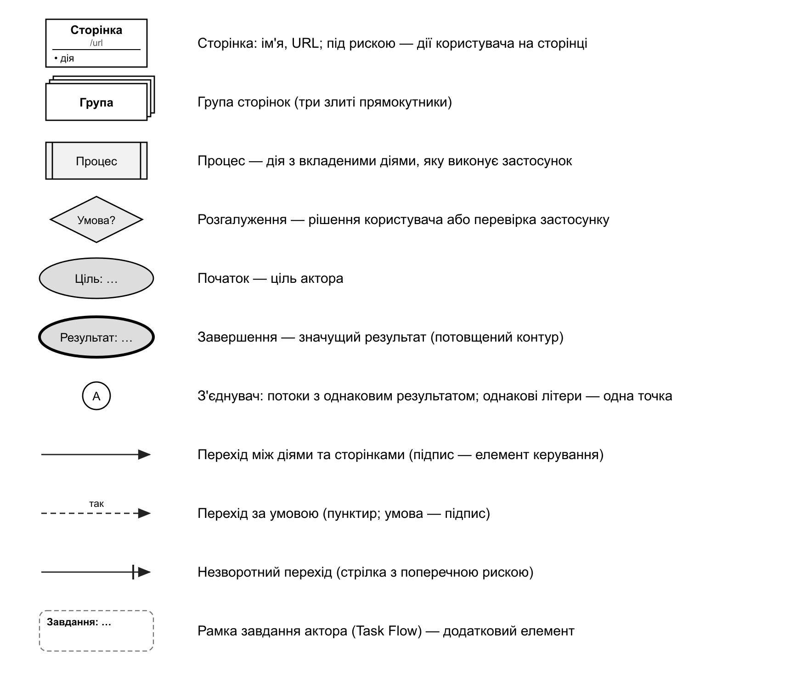{width=13cm}

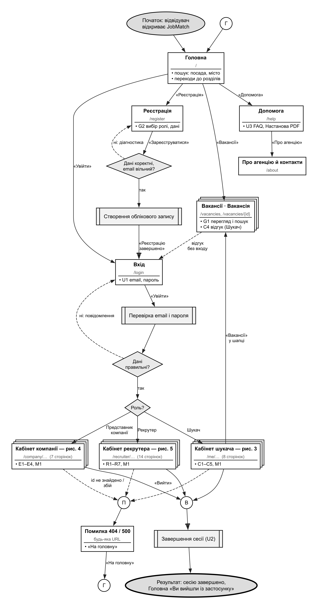{height=22cm}

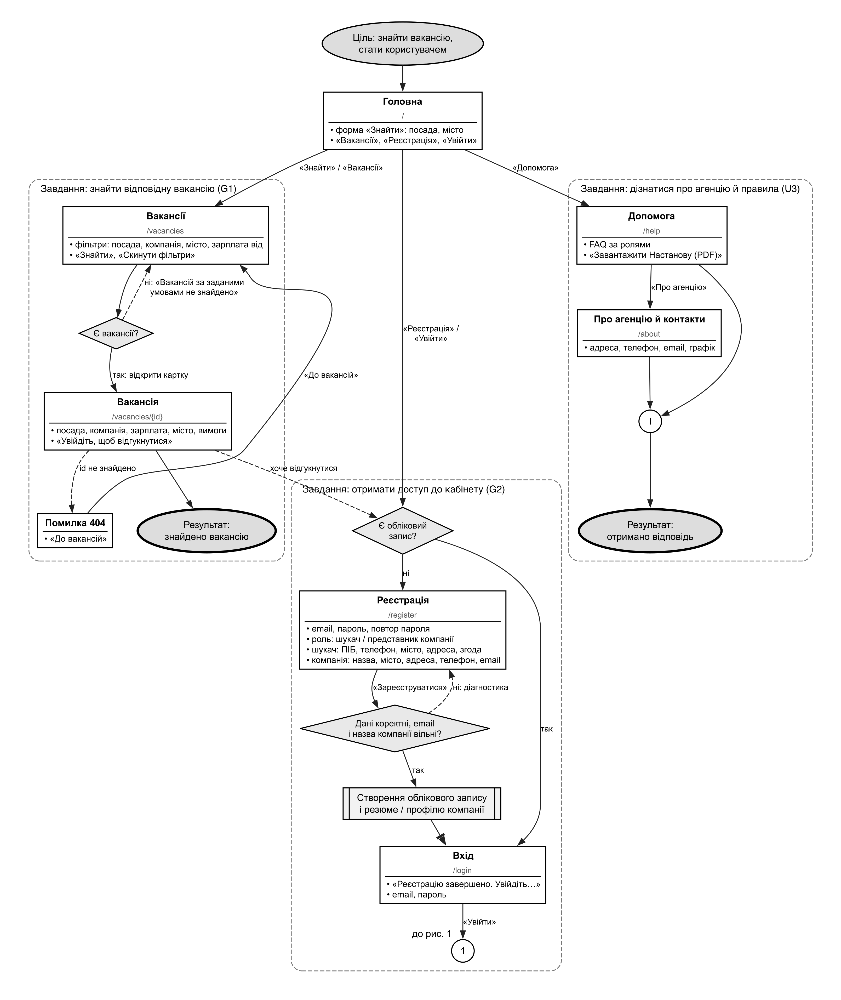{width=100%}

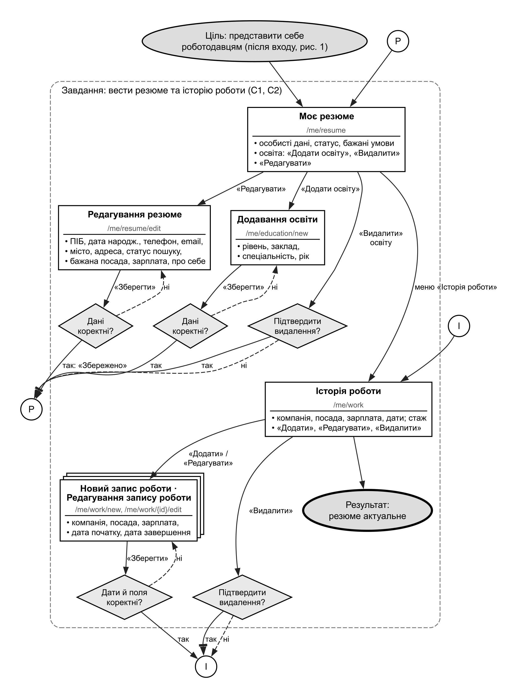{height=21cm}

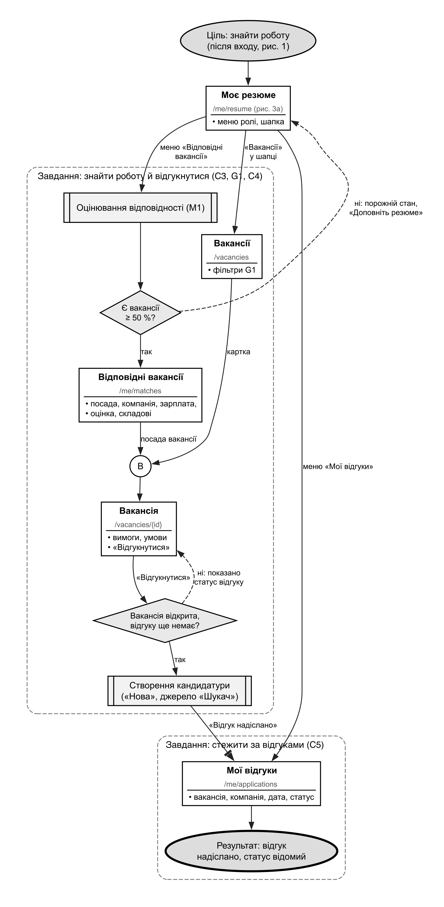{height=22cm}

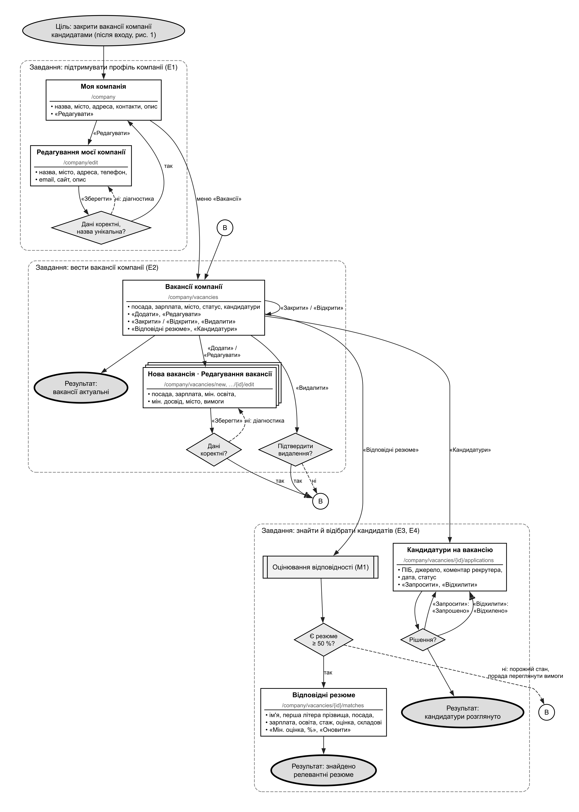{height=22cm}

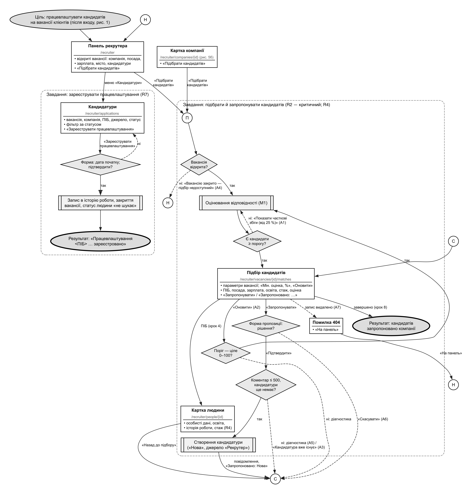{width=100%}

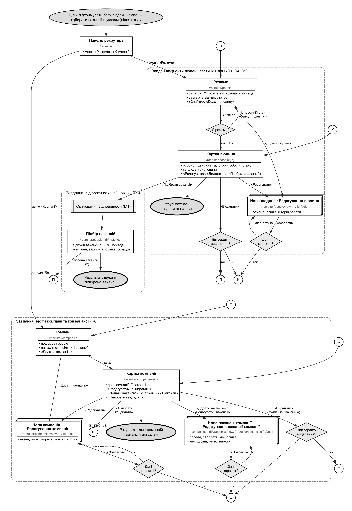{height=22cm}

## 6. Low-Fidelity Wireflow критичного варіанта використання R2 (крок 6)

Wireflow побудовано на підставі табл. 2 як HTML-сторінки з абсолютно позиціонованими вайрфреймами і стрілками SVG (`lab3/src/wf_main.html`, `wf_alt1.html`, `wf_alt2.html`, спільний стиль `wf.css`); зображення отримано скриншотом Google Chrome у режимі headless. Палітра — чорний, сірий, білий; сірі смуги позначають дані-заповнювачі, темна кнопка — основну дію, пунктирна овальна позначка — стан. Стрілки підписано номером кроку основного потоку або кодом альтернативного потоку і дією користувача; коло «Еn» — перехід до екрана n.

Екрани: Е1 — Панель рекрутера; Е2 — Підбір кандидатів (поріг 50 %); Е3 — Картка людини (R4); Е4 — форма пропозиції з полем «Коментар для компанії»; Е5 — кандидатуру створено (повідомлення і позначка «Запропоновано: Нова»); Е6 — порожній стан з «Показати часткові збіги (від 25 %)»; Е7 — часткові збіги; Е8 — недопустимий поріг; Е9 — кандидатура вже існує; Е10 — вакансію закрито; Е11 — коментар довший за 500 символів, «Скасувати»; Е12 — «404 — Не знайдено». Діагностичні повідомлення мають 3 речення: сутність помилки, як виправити зараз, як запобігти надалі.

Таблиця 6.1 — Відповідність кроків R2 екранам Wireflow

| Потік R2 | Екрани | Перехід |
|---------|---------|------------------------|
| Основний, кроки 1–3 | Е1 → Е2 | «Підібрати кандидатів» |
| Основний, крок 4 | Е2 ↔ Е3 | ПІБ; «Назад до підбору» |
| Основний, кроки 5–7 | Е2 → Е4 → Е5 | «Запропонувати»; «Підтвердити» |
| Основний, крок 8 | Е5 → Е2 або Е1 | наступний кандидат; меню «Панель» |
| A1 | Е2 → Е6 → Е7 | «Показати часткові збіги (від 25 %)» |
| A2 | Е2 → Е8 → Е2 | «Оновити» з недопустимим / коректним порогом |
| A3 | Е4 → Е9 | повторне «Підтвердити» |
| A4 | Е1 → Е10 → Е1 | «До відкритих вакансій» |
| A5, A6 | Е4 → Е11 → Е5 або Е2 | «Підтвердити» після скорочення; «Скасувати» |
| A7 | Е1–Е4 → Е12 → Е1 | «На панель» |

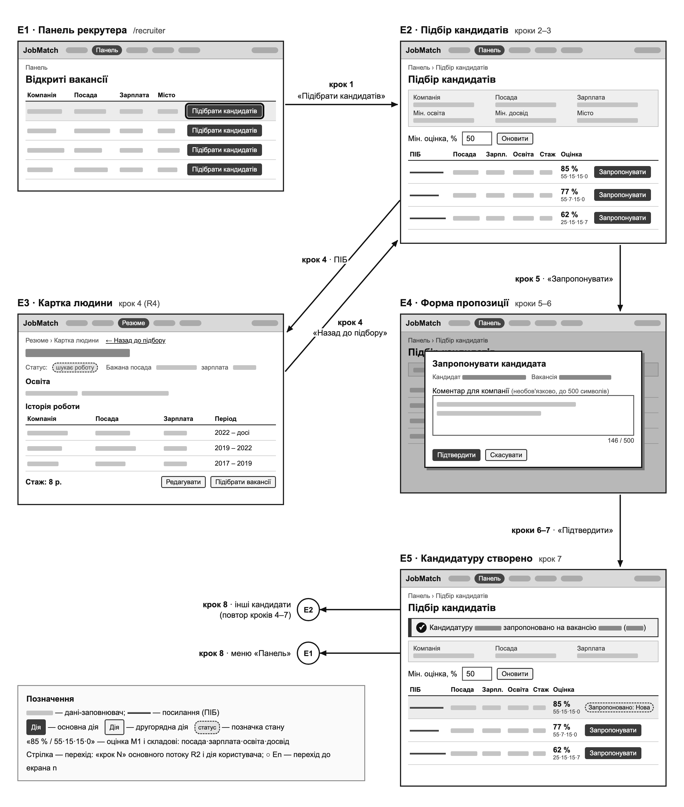{width=100%}

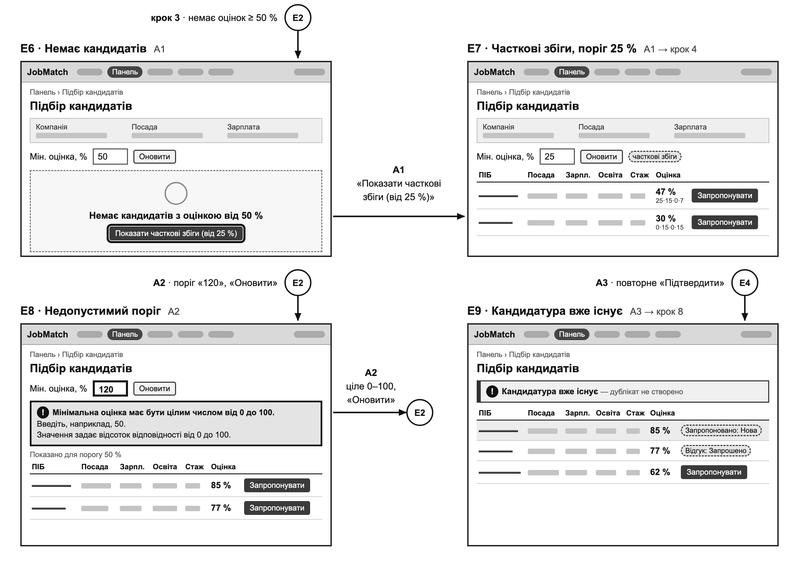{width=100%}

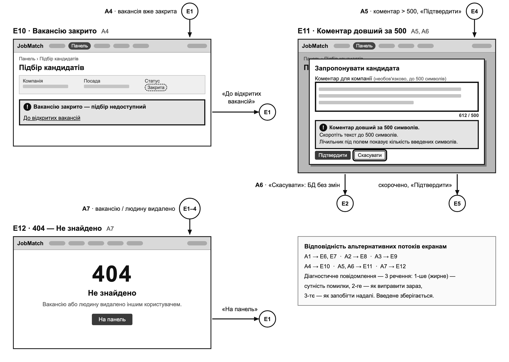{width=100%}

## 7. Оновлення табл. 1 і 2 лаб. роботи 2

Змін немає: перелік акторів (табл. 1 лаб. роботи 2) і перелік варіантів використання (табл. 2 лаб. роботи 2) достатні для всіх завдань кроку 1 і всіх сторінок кроку 2.
