# Проєктування та документування архітектури Веб-застосунку кадрової агенції «JobMatch»

Виконала: Макаренко Марина, група ІПС-41

Версія 1.0 від 14.11.2026

Підстава: ТЗ (лаб. робота 1), Специфікація вимог (лаб. робота 2: реєстр UC, повний опис критичного UC R2), проєкт досвіду користувача (лаб. робота 3: перелік сторінок, попередні рішення щодо інформаційної архітектури, User Flow, Wireflow R2). Методологія — ICONIX, кроки 1–10: об'єктна модель → діаграма придатності → діаграма послідовності → діаграма класів проєктування. Діаграму класів проєктування звірено з реалізацією (Spring Boot, пакет `ua.knu.jobmatch`): класи, атрибути й методи на діаграмах збігаються з кодом.

## 1. Засоби і домовленості щодо документування (кроки 2, 3)

### 1.1. Засоби побудови діаграм

Усі діаграми побудовано текстовим засобом **PlantUML 1.2026.10** (https://plantuml.com/) з розкладкою **Graphviz (dot)**; зображення PNG отримано командою `plantuml -tpng -charset UTF-8 <файл>.puml`. Вихідні файли — `lab4/puml/*.puml`, зображення — `lab4/img/`. Текстовий формат зберігається в репозиторії разом із кодом, тому зміни діаграм видно в історії Git поруч зі змінами класів. Діаграму придатності побудовано вбудованими елементами PlantUML `actor`, `boundary`, `control`, `entity`.

### 1.2. Рамкові домовленості (крок 2) і їх застосування

| Домовленість | Застосування |
|---|---|
| Імена елементів діаграм — латиницею | Класи, атрибути, операції, полюси асоціацій, елементи діаграми придатності: `Person`, `findCandidates()`, `CandidateMatchingPage` |
| Класи, інтерфейси, переліки — іменники предметної галузі з прописної літери | `Vacancy`, `WorkRecord`, `MatchCriterion`, `EducationLevel` |
| Атрибути, полюси асоціацій, операції — з малої літери | `desiredSalary`, `workRecords`, `experienceYears()` |
| Літерали переліків і константи — прописними | `SEARCHING`, `NOT_SEARCHING`, `DEFAULT_THRESHOLD` |
| Складені імена — суцільні, кожне наступне слово з прописної | `requiredExperienceYears`, `existsByVacancyIdAndPersonId()` |

Виняток із правила для констант — літерали з підкресленням (`NOT_SEARCHING`, `DEFAULT_THRESHOLD`): це стандартна конвенція Java для констант, і імена збігаються з кодом.

### 1.3. Додаткові домовленості (результат 8)

1. **Українською** подано: заголовки діаграм, примітки, умови фрагментів `alt`/`opt`/`loop`, підписи переходів на діаграмі придатності, повідомлення актору й текст інтерфейсу в лапках «…». На діаграмі придатності під латинським ім'ям елемента дрібним шрифтом наведено його українську назву (назву сторінки з лаб. роботи 3 або дію).
2. **Стереотипи ICONIX** на діаграмі придатності: «boundary» — сторінка або форма (у реалізації — шаблон Thymeleaf і URL); «control» — дія застосунку (у реалізації — метод контролера або сервісу); «entity» — сутність предметної галузі (у реалізації — JPA-сутність пакета `domain`). Імена: boundary — іменник із суфіксом `Page`/`Card`/`Form`; control — дієслово у lowerCamelCase; entity — ім'я класу об'єктної моделі.
3. **Стереотипи на діаграмах класів проєктування** відповідають анотаціям Spring і видам типів Java: «Entity», «Service», «Controller», «ControllerAdvice», «Component», «Configuration», «Specification», «record», «interface», «enumeration». Класи фреймворку, потрібні для розуміння зв'язків (`JpaRepository`, `UserDetailsService`, `RuntimeException`, `User`), мають сіру заливку.
4. **Не показано**: get- і set-методи; захищені конструктори без параметрів, яких вимагає JPA; параметри методів-обробників, які впроваджує Spring MVC (`Model`, `BindingResult`, `RedirectAttributes`, `HttpServletRequest`, `@AuthenticationPrincipal`). Однотипні методи-обробники контролера об'єднано в один рядок через «/» (наприклад, `newPerson() / createPerson(form)`).
5. **Посилання на інші сутності** подано полюсом асоціації з ім'ям ролі, а не атрибутом (`Person "person 1" *-- "workRecords 0..*" WorkRecord`). Необов'язкові атрибути (NULL у БД) мають кратність `[0..1]`. Видимість: `-` private, `+` public, `~` package-private; статичні члени підкреслено.
6. **Діаграми послідовності**: лінія життя біна Spring (одиночки) — `:ClassName`, лінія життя об'єкта — `ім'я : Class`; повідомлення — справжні імена методів із коду; відповідь — пунктирна стрілка з типом результату; альтернативні потоки — фрагменти з кодом потоку R2 в умові (`A3: …`).
7. Великі діаграми поділено на частини, щоб їх можна було прочитати на сторінці A4: діаграма придатності — 2 частини, діаграма послідовності — 4, діаграма класів проєктування — 6 (за пакетами).

## 2. Об'єктна модель предметної галузі (кроки 4, 5)

### 2.1. Діаграма класів аналізу

Об'єктну модель побудовано за іменниками реєстру UC (табл. 2 лаб. роботи 2), повного опису R2, глосарію і назв сторінок та елементів даних wireframe R2 (табл. 2 лаб. роботи 3). Класи подано без атрибутів і методів.

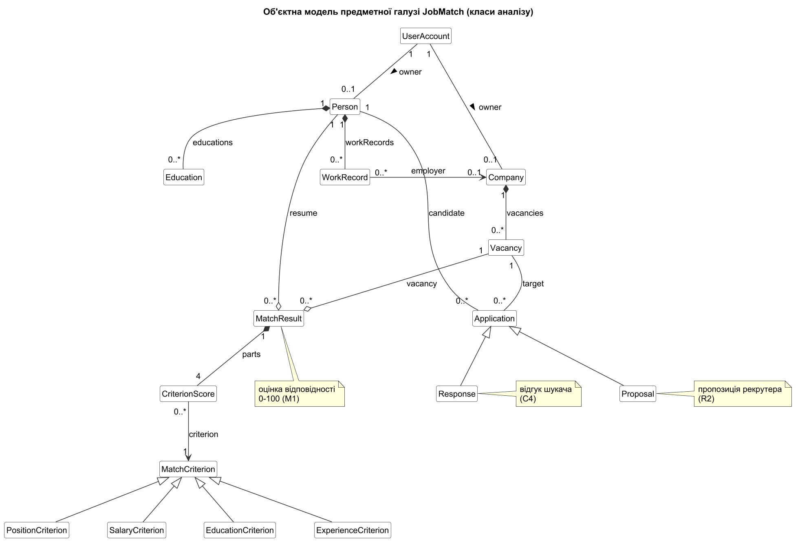{width=100%}

Таблиця 2.1 — Класи об'єктної моделі

| Клас | Поняття | Відношення |
|---|---|---|
| UserAccount | Обліковий запис (e-mail, пароль, роль) | асоціація з Person і Company (власник, 0..1) |
| Person | Людина / резюме | композиція Education, WorkRecord; асоціація з Application |
| Education | Запис освіти | частина Person |
| WorkRecord | Запис історії роботи | частина Person; асоціація з Company (0..1 — компанія з бази або лише назва) |
| Company | Компанія-клієнт | композиція Vacancy |
| Vacancy | Вакансія | частина Company; асоціація з Application |
| Application | Кандидатура (зв'язок людини з вакансією) | узагальнення Response, Proposal |
| Response, Proposal | Відгук шукача (C4), пропозиція рекрутера (R2) | спеціалізації Application |
| MatchResult | Оцінка відповідності 0–100 (M1) | агрегація пари Person–Vacancy; композиція 4 CriterionScore |
| CriterionScore | Складова оцінки (бали і пояснення) | асоціація з MatchCriterion |
| MatchCriterion | Критерій відповідності | узагальнення 4 критеріїв: Position, Salary, Education, Experience |

Композицію застосовано там, де частина не існує без цілого (видалення людини видаляє освіту й історію роботи, видалення компанії — її вакансії; у БД — `ON DELETE CASCADE`). Агрегацію MatchResult застосовано, бо оцінка лише посилається на резюме й вакансію, які існують незалежно від неї. Узагальнення відбиває терміни інтерфейсу: «відгук» і «пропозиція» — види кандидатури (п. 2.3 лаб. роботи 3), чотири критерії — види критерію M1.

### 2.2. Перевірка застосування об'єктів у варіантах використання (крок 5)

Таблиця 2.2 — Об'єкти моделі у варіантах використання

| Об'єкт | Варіанти використання |
|---|---|
| UserAccount | U1, U2, G2; R5, R6 (видалення разом із людиною / компанією) |
| Person | C1, C3, C4, C5, E3, R1–R5, R7 |
| Education | C1, R1 (мін. освіта), R4, R5, M1 (критерій «Освіта») |
| WorkRecord | C2, R1 (компанія, посада), R4, R5, R7, M1 (посада, досвід) |
| Company | G1, G2, E1, E2, R6, R7 |
| Vacancy | G1, C3, C4, E2–E4, R2, R3, R6, R7 |
| Application, Response, Proposal | C4, C5, E4, R2 (кроки 5–7, A3), R7 |
| MatchResult, CriterionScore, MatchCriterion | M1 і включальні C3, E3, R2, R3 |

Кожен об'єкт використано щонайменше в одному UC; кожна сутність R2 (Vacancy, Person, Education, WorkRecord, Application) є в моделі. Цілі моделювання UC в ICONIX забезпечено: реєстр (22 UC) охоплює всі операції постановки №8 і лише їх (табл. 4.2 лаб. роботи 2); для R2 описано основний потік і 7 альтернативних; спільний сценарій M1 виокремлено як включений у C3, E3, R2, R3. Речення опису R2 мають структуру «іменник — дієслово теперішнього часу — іменник» («Рекрутер натискає «Запропонувати»», «Веб-застосунок JobMatch створює кандидатуру»), а іменники збігаються з класами моделі.

### 2.3. Уникнення типових помилок побудови об'єктної моделі (ICONIX)

- У моделі немає класів інтерфейсу (сторінок, форм, кнопок) — вони з'являються лише на діаграмі придатності як «boundary».
- Немає класу «Система» чи «Агенція»: застосунок не моделює сам себе; немає класів-акторів — роль є властивістю облікового запису.
- Атрибутів і методів на цьому етапі немає; відношення визначено за правилами: композиція — лише за спільного життєвого циклу, агрегація — за посилання на незалежні об'єкти, узагальнення — за відношення «є видом».
- Назви класів узято зі словника предметної галузі (глосарій SRS), а не з таблиць БД (`Application`, а не `PersonVacancyLink`).
- Узагальнення Response/Proposal у проєкті згорнуто в атрибут `Application.source : ApplicationSource`, бо поведінка обох видів однакова; критерії M1 залишилися окремими класами, бо мають різні правила (патерн Strategy).

## 3. Діаграма придатності для критичного UC R2 (крок 6)

Діаграму побудовано за повним описом R2 (п. 3.2.2 лаб. роботи 2), уточненою моделлю вмісту (табл. 2 лаб. роботи 3) і Wireflow (екрани Е1–Е12): іменники-сторінки → «boundary», дієслова застосунку → «control», іменники-дані → «entity». Для читабельності діаграму поділено: ч. 1 — відкриття і обчислення підбору (кроки 1–3; A1, A2, A4, A7), ч. 2 — картка кандидата і створення кандидатури (кроки 4–8; A3, A4, A5, A6, A7).

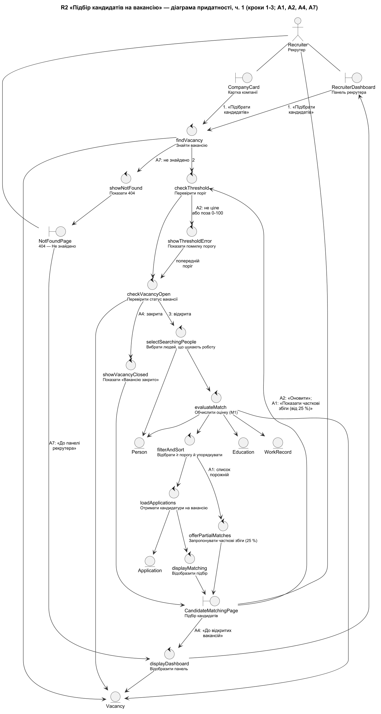{height=23cm}

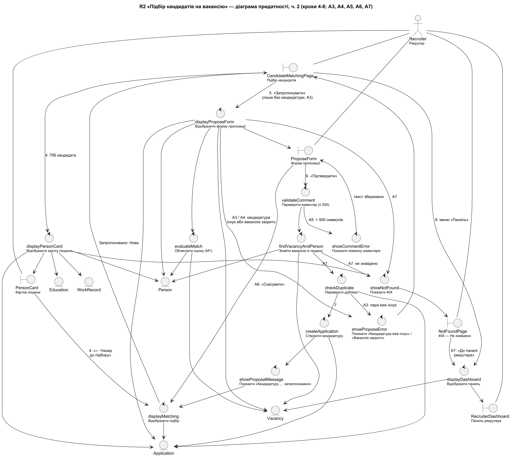{width=100%}

Таблиця 3.1 — Відповідність потоків R2 елементам діаграми придатності

| Потік R2 | Boundary | Control | Entity |
|---|---|---|---|
| Кроки 1–2 | RecruiterDashboard, CompanyCard → CandidateMatchingPage | findVacancy, checkThreshold, checkVacancyOpen | Vacancy |
| Крок 3 | CandidateMatchingPage | selectSearchingPeople, evaluateMatch, filterAndSort, loadApplications, displayMatching | Person, Education, WorkRecord, Vacancy, Application |
| Крок 4 (R4) | PersonCard → CandidateMatchingPage («← Назад до підбору») | displayPersonCard, displayMatching | Person, Education, WorkRecord, Application |
| Кроки 5–7 | ProposeForm | displayProposeForm, evaluateMatch, validateComment, findVacancyAndPerson, checkDuplicate, createApplication, showProposalMessage | Vacancy, Person, Application |
| Крок 8 | RecruiterDashboard | displayDashboard | Vacancy |
| A1 | CandidateMatchingPage | offerPartialMatches → checkThreshold (поріг 25) | — |
| A2 | CandidateMatchingPage | checkThreshold, showThresholdError (попередній поріг) | — |
| A3 | CandidateMatchingPage | loadApplications (позначка замість кнопки); displayProposeForm і checkDuplicate → showProposeError | Application |
| A4 | CandidateMatchingPage → RecruiterDashboard | checkVacancyOpen, showVacancyClosed; displayProposeForm → showProposeError | Vacancy |
| A5 | ProposeForm | validateComment, showCommentError | — |
| A6 | ProposeForm → CandidateMatchingPage | displayMatching | Application |
| A7 | NotFoundPage → RecruiterDashboard | showNotFound, displayDashboard | — |

Правила діаграми придатності дотримано: актор пов'язаний лише з boundary; boundary взаємодіє лише з control; control звертається до entity та до інших control; зв'язків boundary–entity і entity–entity немає; кожен перехід між boundary проходить через control. Кожне речення основного потоку і кожен альтернативний потік мають щонайменше один control.

Результати аналізу придатності: (1) у кроці 3 потрібне читання наявних кандидатур вакансії (control `loadApplications`), щоб реалізувати A3.1 ще до натискання «Запропонувати»; (2) поріг оцінки — параметр запиту, а не сутність; щоб у A2 залишити попередній поріг, форма передає його прихованим полем `prev` (у проєкті — `MatchThreshold.parse(raw, prev, model)`); (3) перевірку дубліката і статусу вакансії треба виконувати на сервері і під час відкриття форми, і під час створення, бо A3.2 виникає за подвійного натискання, в іншій вкладці або за застарілим посиланням. Нових класів об'єктна модель не потребувала; зміни в описі R2 — у розд. 7.

## 4. Рішення з реалізації (крок 7)

### 4.1. Інформаційна архітектура

#### 4.1.1. Система організації

Попередні рішення лаб. роботи 3 підтверджено: **ієрархічна структура**, **організація за аудиторією (роллю) на рівні 1 і за завданнями на рівні 2**. Рівень 1 реалізовано префіксами URL, які збігаються з правилами доступу Spring Security (`SecurityConfig.filterChain()`): публічні сторінки — `permitAll`, `/me/**` — роль CANDIDATE, `/company/**` — EMPLOYER, `/recruiter/**` — RECRUITER. Після входу `AccountPrincipal.homeUrl()` відкриває стартову сторінку ролі. Хронологічний принцип застосовано як порядок у списках (вакансії, відгуки, кандидатури — від найновіших), алфавітний — у пошуку резюме R1 і списку компаній.

Таблиця 4.1 — Остаточний перелік сторінок (40)

| Розділ (рівень 1) | Пункти меню | Сторінки (URL) |
|---|---|---|
| Публічні (10) | Вакансії · Допомога | Головна `/`, Вакансії `/vacancies`, Вакансія `/vacancies/{id}`, Вхід `/login`, Реєстрація `/register`, Допомога `/help`, Про агенцію `/about`, помилки 403 / 404 / 500 |
| Шукач (7) | Моє резюме · Історія роботи · Відповідні вакансії · Мої відгуки | `/me/resume` (з формою освіти), `/me/resume/edit`, `/me/work`, `/me/work/new`, `/me/work/{id}/edit`, `/me/matches`, `/me/applications` |
| Представник компанії (7) | Моя компанія · Вакансії компанії | `/company`, `/company/edit`, `/company/vacancies`, `/company/vacancies/new`, `/company/vacancies/{id}/edit`, `/company/vacancies/{id}/matches`, `/company/vacancies/{id}/applications` |
| Рекрутер (16) | Панель · Резюме · Компанії · Кандидатури | `/recruiter`, `/recruiter/vacancies/{id}/matches` (R2), `/recruiter/vacancies/{id}/propose` (R2, кроки 5–6), `/recruiter/people` (R1), `/recruiter/people/new`, `/recruiter/people/{id}` (R4, освіта та історія роботи), `/recruiter/people/{id}/edit`, `/recruiter/people/{id}/matches` (R3), `/recruiter/companies`, `/recruiter/companies/new`, `/recruiter/companies/{id}`, `/recruiter/companies/{id}/edit`, `/recruiter/companies/{id}/vacancies/new`, `/recruiter/vacancies/{id}/edit`, `/recruiter/applications`, `/recruiter/applications/{id}/hire` (R7) |

Глибина — до 3 переходів від стартової сторінки ролі. Зміни відносно лаб. роботи 3 (37 сторінок): додано сторінки «Пропозиція кандидата», «Реєстрація працевлаштування» і 403; сторінку «Додавання освіти» замінено вбудованою формою на «Моє резюме» (розд. 7).

#### 4.1.2. Система найменувань

Правила лаб. роботи 3 застосовано без змін: ім'я сторінки — іменникова група, що збігається з `<title>`, `<h1>` і останньою ланкою «хлібних крихт» (запис `Crumb.of(…)` у кожному методі-обробнику); кнопки — дієслово в наказовому способі («Підібрати кандидатів», «Запропонувати», «Підтвердити», «Зареєструвати працевлаштування»). Позначки статусів мають одне джерело — поле `label` переліків `VacancyStatus` («Відкрита / Закрита»), `JobStatus` («Шукає роботу / Не шукає»), `ApplicationStatus` («Нова / Запрошено / Відхилено / Працевлаштовано»), `ApplicationSource`, `EducationLevel`, `Role`, тому для всіх ролей вони однакові. Позначки на додаток до де-факто стандартних (Головна, Вакансії, Допомога, Увійти, Реєстрація, Вийти): меню ролей (табл. 4.1); «Вакансії компанії» замість «Вакансії» в меню Представника (усуває збіг із пунктом шапки «Вакансії», зазначений у п. 2.3 лаб. роботи 3); «Мін. оцінка, %», «Показати часткові збіги (від 25 %)», «Запропоновано: Нова» / «Відгукнувся: Нова» в підборі; «Про агенцію та контакти», «Настанова користувача (PDF)» у футері; у шапці після входу — «‹e-mail› · ‹роль›».

#### 4.1.3. Система навігації

1. **Глобальна** — фрагмент `fragments :: header` на всіх сторінках: логотип → Головна, «Вакансії», меню ролі, «Допомога», «Увійти / Реєстрація» або «‹e-mail› · ‹роль›» і «Вийти»; посилання «Перейти до вмісту» для клавіатури.
2. **Локальна** — меню ролі з 2–4 пунктів; активний пункт виділено за поточною адресою (`GlobalControllerAdvice.currentPath()`), зокрема «Панель» активна і на сторінках підбору `/recruiter/vacancies/…`.
3. **«Хлібні крихти»** — фрагмент `fragments :: crumbs` на внутрішніх сторінках, напр. «Головна › Панель рекрутера › Підбір кандидатів › Пропозиція кандидата», «Головна › Резюме › ‹ПІБ› › Підбір вакансій».
4. **Контекстна** — «Підібрати кандидатів» на Панелі рекрутера і в Картці компанії; ПІБ у таблицях → Картка людини (з Підбору — з параметрами `from={vacancyId}&minScore=N`, тому на картці є «← Назад до підбору» поруч із «← До списку резюме»); «Підібрати вакансії» в Картці людини; назва компанії в Підборі → Картка компанії; посилання порожніх станів.
5. **Допоміжна** — футер (`fragments :: footer`): «Про агенцію та контакти», «Допомога», «Настанова користувача (PDF)»; сторінка 404 з посиланнями «На головну», «До вакансій», для Рекрутера — «До панелі рекрутера»; сторінки 403 і 500 — з посиланням «На головну».

#### 4.1.4. Система пошуку

1. **Фасетний пошук вакансій G1** (`/vacancies`): посада, компанія, місто, зарплата від; `CompanyService.searchOpen()` → `VacancySpecifications.openMatching()`. Критерії — параметри GET в адресі (посиланням можна поділитися, «Назад» відновлює результат); порожній результат — «За вашими умовами відкритих вакансій немає» і «Показати всі вакансії». Форма «Знайти» (посада, місто) на Головній відкриває ту саму сторінку з фільтрами.
2. **Пошук резюме R1** (`/recruiter/people`): ім'я, мін. освіта, компанія, посада, зарплата від–до, статус; `PersonService.search()` → `PersonSpecifications.matching()` (предикати Criteria API, з'єднання «і», сортування за прізвищем). Якщо «зарплата від» більша за «до», `SearchErrors.checkRange()` показує повідомлення з 3 частин і не застосовує діапазон; нечислове значення фільтра — `SearchErrors.report()`.
3. **Підбір як «розумний пошук» M1** (`/recruiter/vacancies/{id}/matches`, `/recruiter/people/{id}/matches`, `/me/matches`, `/company/vacancies/{id}/matches`): запит — сам об'єкт (вакансія або резюме), результат ранжовано `MatchingService` з поясненням складових; поріг — параметр `minScore` в адресі.
4. **Пошук компанії за назвою** (`/recruiter/companies?q=`).

Глобального повнотекстового пошуку немає: чотири типи об'єктів мають різні атрибути, і структуровані фільтри точніші.

#### 4.1.5. Уникнення 10 помилок інформаційної архітектури за Я. Нільсеном (додаток А)

| № | Помилка | Як уникнуто в JobMatch |
|---|---|---|
| 1 | Відсутня структура | Ієрархія з 3 рівнів (табл. 4.1); пов'язані об'єкти мають взаємні посилання: вакансія → компанія, людина → освіта, історія роботи, кандидатури, вакансія → підбір кандидатів |
| 2 | Пошук не інтегровано зі структурою | Результати пошуку й підбору показано всередині кабінету з активним пунктом меню і «хлібними крихтами»; з рядка результату — до картки, з картки — до наступної дії; критерії в URL |
| 3 | Немає цільових сторінок категорій | Кожна гілка має оглядову сторінку: «Вакансії», «Моє резюме», «Моя компанія», «Панель рекрутера», «Резюме», «Компанії», «Кандидатури»; «хлібні крихти» ведуть на них |
| 4 | Надмірна поліієрархія | Кожен об'єкт має одне місце в ієрархії (вакансія — у компанії, запис роботи — у людини); інші шляхи до нього — лише пошук і підбір, без дублювання категорій |
| 5 | Погана інтеграція з вкладеними сайтами | Мікросайтів немає; Допомога, Про агенцію, Настанова — у тому самому шаблоні з тією самою шапкою |
| 6 | Невидима навігація | Шапка і меню ролі видимі на кожній сторінці, текстові посилання без випадних списків і рекламних блоків |
| 7 | Неконтрольовані елементи навігації | Анімацій, меню за наведенням і каруселей немає; JavaScript (`app.js`) лише підтверджує незворотні дії і розкриває форми за натисканням |
| 8 | Неузгоджена навігація | Один фрагмент `header` для всіх сторінок; набір пунктів залежить лише від ролі й не змінюється між сторінками |
| 9 | Забагато технік навігації | Чотири техніки: глобальне меню, меню ролі, «хлібні крихти», контекстні посилання (+ футер); мегаменю, тегів, хмар і карти сайту немає |
| 10 | Вигадані назви пунктів меню | Терміни аналогів (Work.ua, robota.ua) і агенції: «Вакансії», «Резюме», «Мої відгуки», «Кандидатури», «Допомога»; позначки статусів однакові для всіх ролей |

### 4.2. Технологічні рішення

**Мови.** Java 21 (збирання JDK 25 з `--release 21`) — строгі типи, записи (`record`) для об'єктів-значень, зріла екосистема Spring; HTML5 + CSS3 (власна адаптивна таблиця стилів), мінімальний JavaScript (`app.js`); SQL — DDL міграцій.

**Архітектурні стилі.** Клієнт-сервер із серверним рендерингом; **MVC** (Spring MVC: контролер — модель `Model` — подання Thymeleaf); **багатошарова архітектура** «Presentation (`web`, `web.form`, шаблони) → Service (`service`, `matching`) → Repository (`repository`) → Domain (`domain`)» (рис. 14); **Post/Redirect/Get** — кожен POST завершується переадресацією з flash-повідомленням (`propose()` → `redirect:/recruiter/vacancies/{id}/matches?minScore=N`); стан сторінок підбору й пошуку — у параметрах GET.

Таблиця 4.2 — Патерни проєктування (GoF, GRASP та ін.), наявні в коді

| Патерн | Де застосовано | Навіщо |
|---|---|---|
| Strategy (GoF) | `MatchCriterion` + `PositionCriterion`, `SalaryCriterion`, `EducationCriterion`, `ExperienceCriterion`; Spring впроваджує `List<MatchCriterion>` у порядку `@Order(1..4)` | Новий критерій — новий `@Component` без змін C3, E3, R2, R3 (вимога M1) |
| Facade (GoF) | `MatchingService`: `evaluate()`, `findCandidates()`, `findVacancies()` | Один вхід до M1 для 4 контролерів; приховує репозиторії, критерії, `Clock` |
| Pure Fabrication (GRASP) | `MatchingService`, сервіси `ApplicationService`, `PersonService`, `CompanyService`, `AccountService` | Оцінювання й транзакції не належать жодній сутності |
| Creator (GRASP) | `Company.addVacancy()`, `Person.addEducation()`, `Person.addWorkRecord()`, `Person.hire()` (створює `WorkRecord`), `ApplicationService.create()` (створює `Application`) | Об'єкт створює той, хто містить або агрегує створюване |
| Information Expert (GRASP) | `Person.highestEducation()`, `Person.experienceYears()`, `Person.experienceText()`, `WorkRecord.months()`, `Vacancy.isOpen()`, `EducationLevel.isAtLeast()`, `ApplicationStatus.isFinal()` | Обчислення виконує власник даних; критерії M1 лише запитують результат |
| Controller (GRASP) | `RecruiterMatchController` (R2, R3), `RecruiterController`, `CandidateController`, `EmployerController`, `PublicController`, `AuthController` | Системні події (HTTP-запити) отримує контролер, згрупований за роллю і UC |
| Low Coupling, High Cohesion (GRASP) | Залежності лише вниз по шарах; контролери поділено за ролями, критерії — за правилами | Локалізація змін (розд. 6.2) |
| Repository (Fowler, DDD) | `PersonRepository`, `VacancyRepository`, `ApplicationRepository`, `CompanyRepository`, `UserAccountRepository` (Spring Data JPA) | Доступ до даних без SQL у сервісах |
| Specification (Evans) | `PersonSpecifications.matching()`, `VacancySpecifications.openMatching()` | Довільні комбінації фільтрів R1, G1 параметризованими предикатами |
| DTO / Form Object | Пакет `web.form`: `ProposeForm`, `PersonForm`, `VacancyForm` тощо; `of()`, `applyTo()`, `toEntity()` | Валідація Bean Validation на межі; сутності не прив'язано до HTML-форм |
| Value Object | `MatchResult`, `CriterionScore`, `Crumb` (Java records) | Незмінні результати без ідентичності |
| Dependency Injection / IoC | Впровадження через конструктор у всіх бінах; `Clock` з `AppConfig` | Підміна залежностей у тестах (`MatchingServiceTest`, `ApplicationServiceTest`) |
| Template View | Шаблони Thymeleaf і фрагменти `fragments.html` (header, crumbs, messages, footer, score) | Однакова структура сторінок |

Свідома відмова: Template Method для базового CRUD-контролера (передбачений у ТЗ) не застосовано — контролери ролей мають різні правила доступу (`EmployerController.myVacancy()` повертає 404 для чужої вакансії) і різні шаблони, спільна база дала б умовні гілки замість спрощення.

Таблиця 4.3 — Патерни досвіду взаємодії (J. Tidwell, Designing Interfaces, 2020)

| Патерн | Де застосовано |
|---|---|
| Feature, Search, and Browse | Головна (форма «Знайти»: посада, місто; останні 6 вакансій; «Переглянути вакансії (N)») → Вакансії (фільтри) → Вакансія |
| Dashboard | Панель рекрутера: кількість людей, що шукають роботу, нових і запрошених кандидатур, таблиця відкритих вакансій |
| Help Systems | Допомога (FAQ), підказки під полями, Настанова (PDF) у футері |
| Clear Entry Points | Головна з двома основними діями; стартова сторінка ролі після входу |
| Deep Links | Фільтри G1, R1 і поріг `minScore` в адресі сторінки |
| Escape Hatch | «Скасувати» у формах, «← Назад до підбору», «← До панелі рекрутера», посилання на сторінках 403/404/500 |
| Breadcrumbs | Усі внутрішні сторінки |
| Sign-In Tools | Блок «‹e-mail› · ‹роль› · Вийти» в шапці |
| Sitemap Footer | Футер із посиланнями «Про агенцію», «Допомога», «Настанова» |
| Visual Framework, Center Stage | Спільний каркас (шапка, крихти, повідомлення, вміст, футер); основна таблиця в центрі |
| Titled Sections | Картка людини: «Історія роботи», «Освіта», «Кандидатури» |
| Overview Plus Detail | Підбір / Резюме → Картка людини; Компанії → Картка компанії |
| Datatips | Складові оцінки: підказка `title` з поясненням балів критерію |
| Button Groups, Prominent "Done" Button | «Підтвердити» (основна) і «Скасувати» (другорядна) у формах |
| Preview | Сторінка «Пропозиція кандидата» показує оцінку і складові до підтвердження; «Реєстрація працевлаштування» — дані, які буде змінено |
| Cancelability | «Скасувати» без змін у БД (R2 A6), `confirm()` перед видаленням |
| Structured Format, Input Hints | Телефон `+380XXXXXXXXX`, поля дат; підказки «Ціле число 0–100», «Порожнє поле — працює досі»; лічильник «N / 500 символів» під полями з обмеженням довжини |
| Forgiving Format | Обрізання пробілів (`Forms.trim()`, `StringTrimmerEditor`), e-mail без урахування регістру |
| Drop-down Chooser | Рівень освіти, статус пошуку, статус кандидатури |
| Good Defaults and Smart Prefills | Поріг 50 %, статус «Шукає роботу», мін. досвід 0, дата початку роботи — сьогодні, роль «Шукач» |
| Error Messages | Повідомлення з 3 частин (`BusinessException`: what / fixNow / prevent) біля полів і над формою |

Таблиця 4.4 — Патерни інтерфейсу користувача (B. Scott, T. Neil, Designing Web Interfaces, 2009)

| Патерн | Де застосовано |
|---|---|
| Always-Visible Tools (Contextual Tools) | Кнопки дій у рядках таблиць: «Підібрати кандидатів», «Запропонувати», «Запросити / Відхилити», «Зареєструвати працевлаштування», «Закрити / Відкрити» |
| Dialog Inlay (Inlays) | Форми «+ Додати запис» історії роботи й освіти розкриваються в Картці людини і на «Моє резюме» без переходу на іншу сторінку |
| Call to Action Invitation (Static Invitations) | Форма «Знайти», «Переглянути вакансії (N)», «Зареєструватися» на Головній; «Показати часткові збіги (від 25 %)» у порожньому стані |
| Progressive Disclosure | Поля компанії в Реєстрації з'являються після вибору ролі; складові оцінки поруч із загальною оцінкою |
| Refining Search (Lookup) | Фільтри G1, R1, поріг підбору зі збереженням критеріїв у формі; некоректний фільтр — повідомлення, а не порожній результат |
| Static Single-Page Process | Пропозиція кандидата і реєстрація працевлаштування — одна сторінка з підтвердженням |

Свідомо не застосовано **Dialog Overlay** (модальне вікно пропозиції з лаб. роботи 3) і **Transitions**: політика CSP `script-src 'self'` і мінімальний JavaScript (лише підтвердження, розкриття форм і лічильник символів), доступність із клавіатури й робота кнопки «Назад» мають пріоритет; результат дії показано одразу після переадресації (принцип «React Immediately»).

**Технології конструювання.** Spring Boot 3.5.6: Spring MVC, Spring Security (BCrypt, ролі, CSRF, заголовки CSP і Referrer-Policy, сеансове cookie `HttpOnly`, `SameSite=Lax`, тайм-аут 30 хв), Spring Data JPA / Hibernate, Bean Validation; Thymeleaf + thymeleaf-extras-springsecurity6 (екранування виводу — захист від XSS); Flyway; Maven; IntelliJ IDEA; Git. Тести: JUnit 5, Mockito, Spring MockMvc — 73 модульні та інтеграційні тести (класи `PersonTest`, `CriteriaTest`, `MatchingServiceTest`, `ApplicationServiceTest`, `CandidateMatchingIntegrationTest`); функціональні UI-тести Playwright у Chrome — 78 сценаріїв (27 + 51); усі тести проходять.

**Реалізація БД.** Локально — **H2 2.x у файловому режимі** з сумісністю PostgreSQL (`jdbc:h2:file:./data/jobmatch;MODE=PostgreSQL;DATABASE_TO_LOWER=TRUE`), сервер на порту 8090. Схему створюють міграції **Flyway**: `V1__schema.sql` — таблиці, обмеження, індекси; `V2__seed.sql` (каталог `db/seed`, лише локальний режим; профіль `prod` його не виконує) — демонстраційні дані (облікові записи трьох ролей, компанії, вакансії, резюме, кандидатури). Hibernate працює в режимі `ddl-auto=validate` — лише перевіряє відповідність сутностей схемі. Для хостингу — **PostgreSQL 16** у профілі `prod` (`application-prod.properties`, параметри підключення з оточення `DATABASE_URL`, `DATABASE_USER`, `DATABASE_PASSWORD`), той самий DDL.

Таблиця 4.5 — Таблиці БД (за `V1__schema.sql`) і класи

| Таблиця | Клас | Ключові стовпці й обмеження |
|---|---|---|
| `user_account` | UserAccount | PK `id`; `email` UNIQUE; `password_hash` (BCrypt); `role` CHECK (CANDIDATE, EMPLOYER, RECRUITER); `enabled`; `created_at` |
| `company` | Company | PK `id`; `owner_user_id` → user_account UNIQUE, ON DELETE SET NULL; `name` UNIQUE; `city`, `address`, `phone`, `email`; `website`, `description` NULL |
| `person` | Person | PK `id`; `user_id` → user_account UNIQUE, ON DELETE SET NULL; ПІБ, `birth_date`, контакти, `city`, `home_address`; `job_status` CHECK; `desired_position`, `desired_salary` CHECK 1000..1000000; `about`; `updated_at`; індекси `job_status`, `last_name` |
| `education` | Education | PK `id`; `person_id` → person ON DELETE CASCADE; `level` CHECK (5 рівнів); `institution`, `specialty`; `graduation_year` CHECK 1950..2035 |
| `work_record` | WorkRecord | PK `id`; `person_id` → person ON DELETE CASCADE; `company_id` → company ON DELETE SET NULL; `company_name`, `position`, `salary`; `start_date`, `end_date` NULL; CHECK `end_date >= start_date` |
| `vacancy` | Vacancy | PK `id`; `company_id` → company ON DELETE CASCADE; `position`, `salary` CHECK; `required_education` NULL; `required_experience_years` CHECK 0..40; `requirements`, `city`; `status` CHECK (OPEN, CLOSED); `created_at`; індекс `status` |
| `application` | Application | PK `id`; `vacancy_id` → vacancy, `person_id` → person (обидва ON DELETE CASCADE); `source`, `status` CHECK; `comment` ≤ 500; `created_at`; UNIQUE (`vacancy_id`, `person_id`) — забезпечує пост-умову R2 «щонайбільше одна кандидатура на пару» |

## 5. Діаграма послідовності для критичного UC R2 (крок 8)

Діаграму побудовано з діаграми придатності: boundary → шаблон Thymeleaf, control → методи контролера й сервісів, entity → JPA-сутності та репозиторії. Поділ на 4 частини: ч. 1 — кроки 1–3 на рівні контролера з A1, A2, A4, A7; ч. 2 — деталізація кроку 3 (`findCandidates()` і M1); ч. 3 — кроки 4–5 (картка людини, форма пропозиції) з A3, A4, A7; ч. 4 — кроки 6–8 з A3, A5, A6, A7.

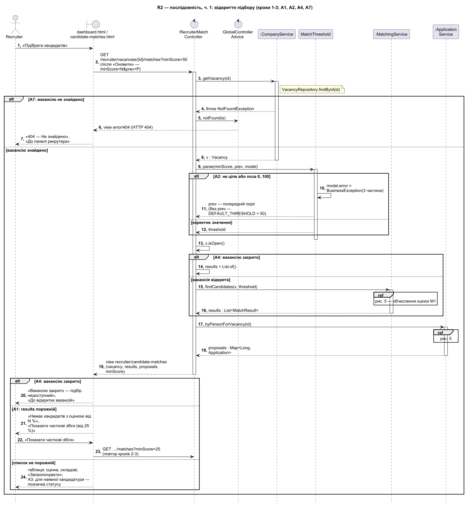{width=100%}

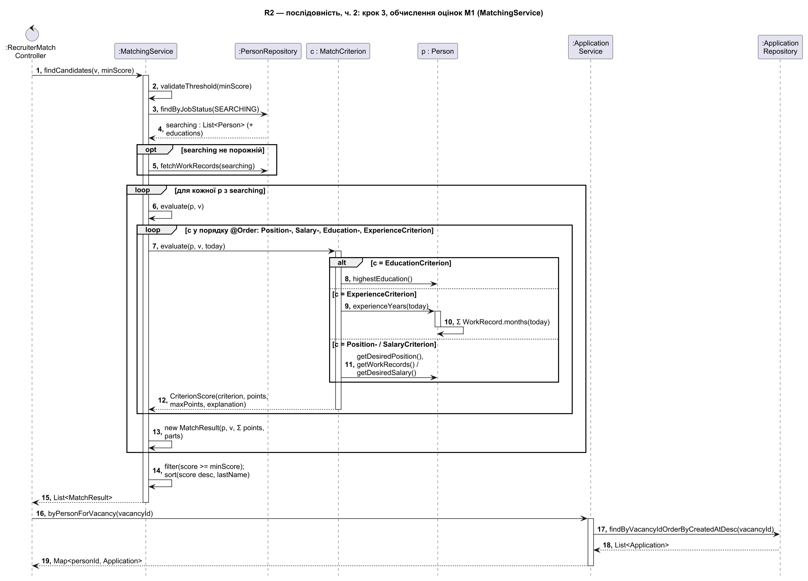{width=100%}

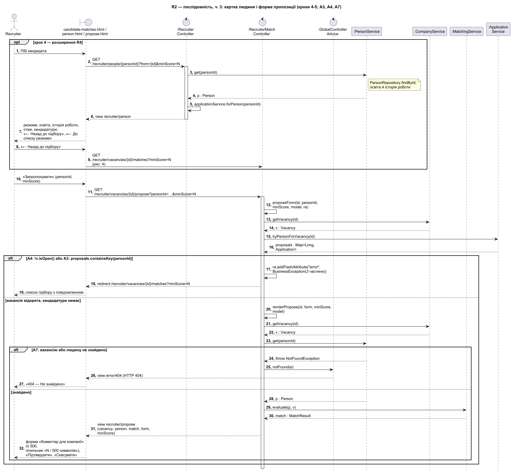{width=100%}

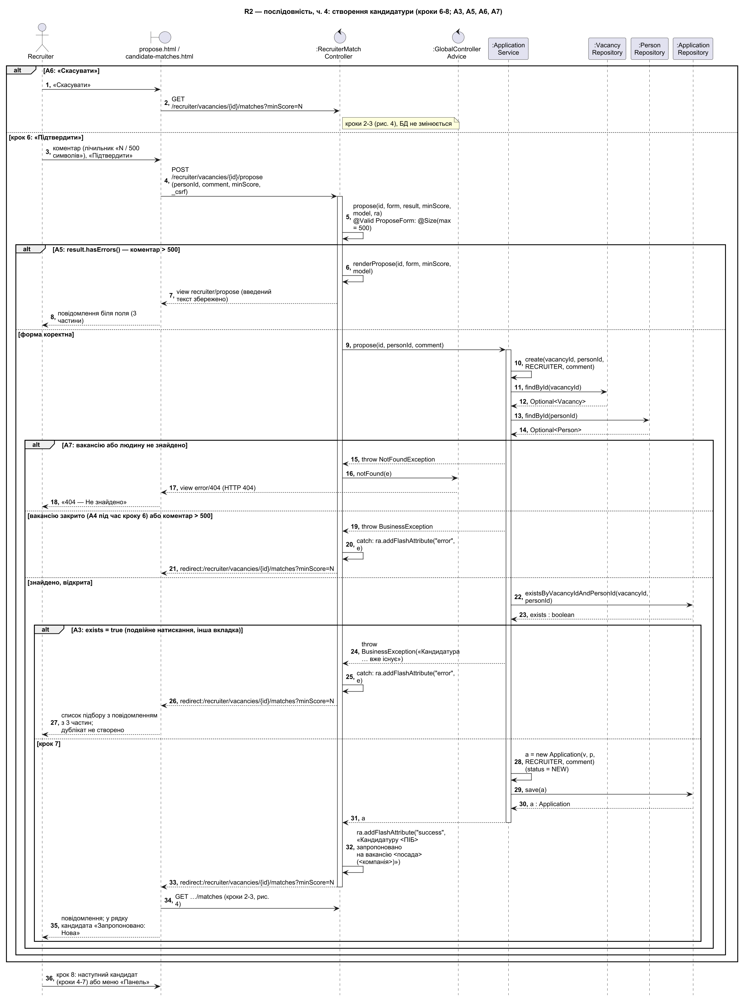{width=100%}

Таблиця 5.1 — Покриття потоків R2 діаграмою послідовності

| Потік | Рисунок, фрагмент | Ключові повідомлення |
|---|---|---|
| Кроки 1–3 | рис. 4, 5 | `candidates()`, `getVacancy()`, `MatchThreshold.parse()`, `findCandidates()`, `findByJobStatus()`, `fetchWorkRecords()`, `evaluate()`, `byPersonForVacancy()` |
| Крок 4 (R4) | рис. 6, `opt` | GET `/recruiter/people/{id}?from=…&minScore=N`, `RecruiterController.person()`, `PersonService.get()`; «← Назад до підбору» |
| Кроки 5–7 | рис. 6, 7 | `proposeForm()`, `byPersonForVacancy()`, `renderPropose()`, `MatchingService.evaluate()`, `propose()`, `ApplicationService.propose()`, `existsByVacancyIdAndPersonId()`, `save()` |
| A1 | рис. 4, `alt [A1: results порожній]` | повторний GET з `minScore=25` |
| A2 | рис. 4, `alt [A2: …]` | `MatchThreshold.parse(minScore, prev, model)` → попередній поріг `prev` (без нього — `DEFAULT_THRESHOLD`) + повідомлення |
| A3 | рис. 4 (позначка в рядку); рис. 6 `alt [… A3: proposals.containsKey(personId)]`; рис. 7 `alt [A3: exists = true]` | `proposeForm()` → redirect із flash-повідомленням; `existsByVacancyIdAndPersonId()` → `BusinessException` → `propose()` перехоплює і переадресовує до списку підбору |
| A4 | рис. 4, `alt [A4: вакансію закрито]`; рис. 6 (закрито до відкриття форми); рис. 7 (закрито під час кроку 6) | `v.isOpen()`; redirect із flash-повідомленням; `BusinessException` у `create()` |
| A5 | рис. 7, `alt [A5: result.hasErrors()]` | `@Size(max = 500)`, `renderPropose()` |
| A6 | рис. 7, `alt [A6: «Скасувати»]` | GET `…/matches?minScore=N`, БД не змінюється |
| A7 | рис. 4, 6, 7, `alt [A7: …]` | `NotFoundException` → `GlobalControllerAdvice.notFound()` → `error/404` |

Типових помилок діаграм послідовності уникнуто: повідомлення — реальні методи класів, а не текст потоку; кожен альтернативний потік R2 має фрагмент; поведінку розподілено за експертами (стаж обчислює `Person`, тривалість запису — `WorkRecord`); бізнес-правила зосереджено в сервісах (`ApplicationService.create()`, `MatchingService.validateThreshold()`), контролер лише попередньо перевіряє стан перед показом форми і перетворює `BusinessException` на повідомлення; діаграма узгоджена з діаграмою придатності (кожен control з табл. 3.1 має повідомлення).

## 6. Діаграма класів проєктування (кроки 9, 10)

### 6.1. Діаграма

Повідомлення діаграм послідовності R2 і «робочих» діаграм решти UC (C1–C5, E1–E4, R1, R3–R7) відображено як методи класів; атрибути й типи визначено за технологічними рішеннями п. 4.2. Діаграму поділено за пакетами.

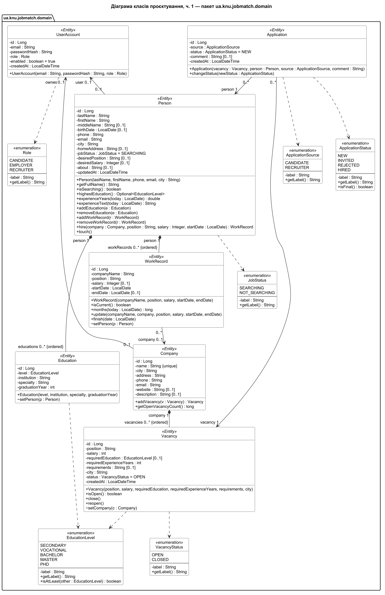{height=23cm}

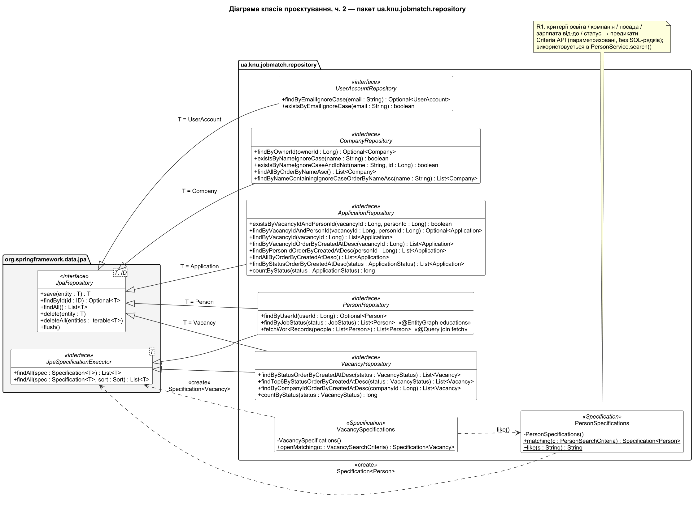{width=100%}

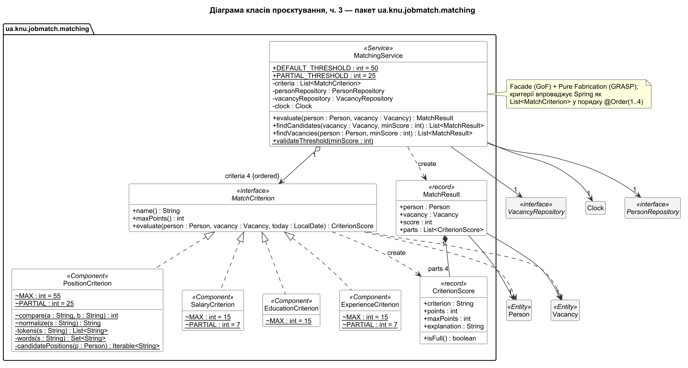{width=100%}

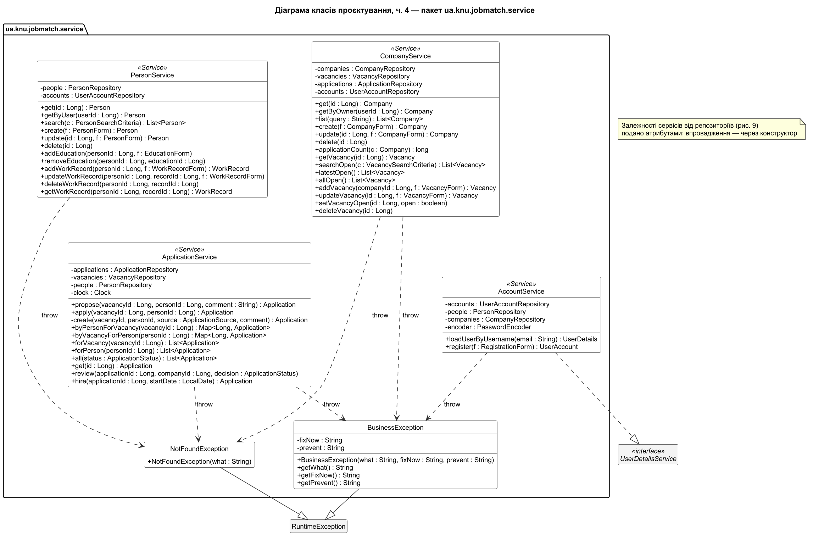{width=100%}

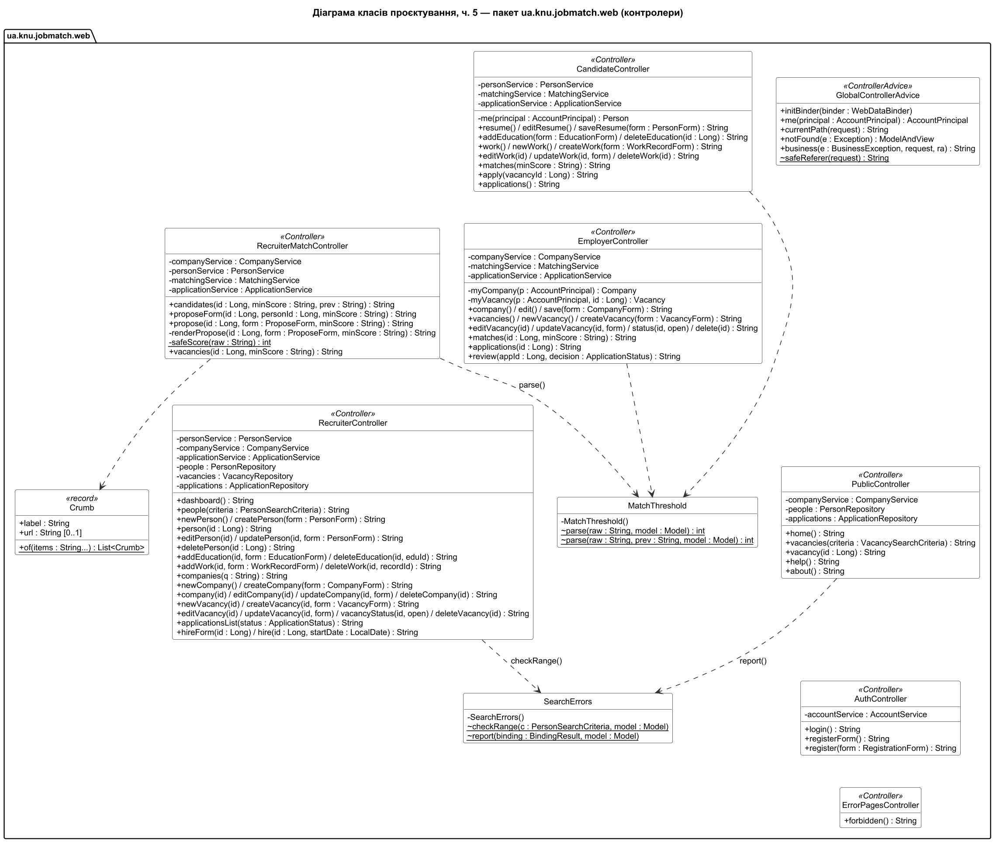{width=100%}

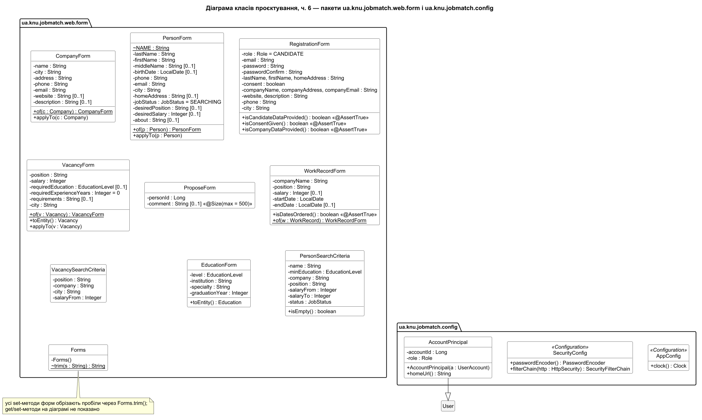{width=100%}

Таблиця 6.1 — Повідомлення діаграми послідовності R2 → методи класів (крок 9)

| Повідомлення (рис. 4–7) | Клас, метод |
|---|---|
| GET `/recruiter/vacancies/{id}/matches` | `RecruiterMatchController.candidates(id, minScore)` |
| знайти вакансію | `CompanyService.getVacancy(id)` → `VacancyRepository.findById(id)` |
| перевірити поріг | `MatchThreshold.parse(raw, prev, model)`, `MatchingService.validateThreshold(minScore)` |
| перевірити статус вакансії | `Vacancy.isOpen()` |
| вибрати людей, що шукають роботу | `PersonRepository.findByJobStatus(SEARCHING)`, `fetchWorkRecords(people)` |
| обчислити оцінку | `MatchingService.evaluate(p, v)`, `MatchCriterion.evaluate(p, v, today)`, `Person.highestEducation()`, `Person.experienceYears(today)`, `WorkRecord.months(today)` |
| відібрати й упорядкувати | `MatchingService.findCandidates(v, minScore)` |
| наявні кандидатури | `ApplicationService.byPersonForVacancy(vacancyId)` → `ApplicationRepository.findByVacancyIdOrderByCreatedAtDesc()` |
| картка людини | `RecruiterController.person(id)`, `PersonService.get(id)`, `ApplicationService.forPerson(id)` |
| форма пропозиції | `RecruiterMatchController.proposeForm()` (перевірка `Vacancy.isOpen()` і `ApplicationService.byPersonForVacancy()`), `renderPropose()` |
| створити кандидатуру | `RecruiterMatchController.propose()`, `ApplicationService.propose()` → `create()`, `ApplicationRepository.existsByVacancyIdAndPersonId()`, `save()`, конструктор `Application(vacancy, person, source, comment)` |
| показати 404 / повідомлення про помилку | `GlobalControllerAdvice.notFound(e)`; `RecruiterMatchController.propose()` — `catch (BusinessException)` + `RedirectAttributes.addFlashAttribute("error", e)` |

### 6.2. Відповідність прагматичним критеріям якості ICONIX (крок 10)

- **Зв'язність (coupling) — слабка.** Залежності спрямовано лише вниз по шарах (рис. 14); пакет `domain` не залежить від сервісів і веб-шару (лише анотації JPA). `MatchingService` залежить від абстракції `MatchCriterion`, а не від конкретних критеріїв; залежності впроваджуються через конструктор. Компроміс: `RecruiterController` і `PublicController` для лічильників панелі та стану відгуку на картці вакансії читають репозиторії напряму, оминаючи сервіси; це лише читання, без бізнес-правил.
- **Зчеплення (cohesion) — сильне.** Кожен клас має одну відповідальність: критерій — одне правило M1; `Person` — дані резюме та похідні величини; `RecruiterMatchController` — лише R2, R3; `MatchThreshold` — лише розбір порогу; `SearchErrors` — лише повідомлення про некоректні фільтри; `GlobalControllerAdvice` — лише перетворення винятків на сторінки й повідомлення. `CompanyService` поєднує компанії й вакансії як один агрегат «компанія → вакансії» (композиція на рис. 8).
- **Достатність (sufficiency).** Класи мають усі операції, потрібні UC: кожне повідомлення діаграм послідовності є методом (табл. 6.1), кожен control діаграми придатності — методом контролера або сервісу (табл. 3.1).
- **Повнота (completeness).** Інтерфейс класу охоплює всю поведінку абстракції: `Vacancy` — `isOpen()`, `close()`, `reopen()`; `Application` — `changeStatus()` із захистом остаточних статусів (`ApplicationStatus.isFinal()`); `Person` — додавання й видалення освіти та записів роботи, `hire()`; `ApplicationService` — `propose()`, `apply()`, `review()`, `hire()`. Виняток зазначено в розд. 7: `PersonService.updateWorkRecord()` є, але Рекрутер не має сторінки редагування наявного запису роботи.
- **Примітивність (primitiveness).** Кожна операція виконує одну дію: `evaluate()` оцінює одну пару, `findCandidates()` відбирає й упорядковує; `experienceYears()` і `experienceText()` розділено; `propose()` і `apply()` делегують спільному `create()` без дублювання перевірок.
- **Реалізовність.** Обидві діаграми реалізовано рішеннями п. 4.2 і перевірено тестами (`MatchingServiceTest`, `ApplicationServiceTest`, `CandidateMatchingIntegrationTest` — MockMvc для основного потоку R2 і потоків A1–A5, A7).

## 7. Зміни до варіантів використання лаб. роботи 2 і рішень лаб. роботи 3

Таблиця 7.1 — Уточнення, внесені під час проєктування

| № | Місце | Було | Стало | Причина |
|---|---|---|---|---|
| 1 | R5; лаб. 3, сторінки «Нова людина», «Редагування людини» | Записи освіти й історії роботи вводяться і редагуються у формах «Нова людина» / «Редагування людини» | Форми «Нова людина» і «Редагування людини» містять лише дані резюме; освіту й історію роботи Рекрутер додає й видаляє вбудованими формами на «Картці людини» `/recruiter/people/{id}` (POST `/people/{id}/education`, `/people/{id}/work`, `…/delete`); після створення людини застосунок відкриває картку з повідомленням «Додайте освіту та історію роботи» | Записи освіти й роботи — окремі сутності зі своєю валідацією; на картці Рекрутер одразу бачить результат (стаж, історію) |
| 2 | C1; лаб. 3, сторінка «Додавання освіти» `/me/education/new` | Окрема сторінка | Вбудована форма на «Моє резюме» (POST `/me/education`) | Те саме рішення, що в п. 1, для Шукача |
| 3 | Меню Представника компанії | «Моя компанія · Вакансії» | «Моя компанія · Вакансії компанії» | Усунуто збіг із пунктом шапки «Вакансії» |
| 4 | R2, кроки 5–6, A6; лаб. 3, табл. 2.3, 2.4 | Форма пропозиції — діалог на сторінці «Підбір кандидатів» | Окрема сторінка «Пропозиція кандидата» `/recruiter/vacancies/{id}/propose` з оцінкою і її складовими; «Скасувати» повертає до підбору з тим самим порогом | CSP `script-src 'self'`, мінімальний JavaScript, доступність, Post/Redirect/Get |
| 5 | R2, A3, A4 (крок 5) | A3 і A4 перевіряються під час створення кандидатури і відкриття підбору | Під час відкриття форми пропозиції (GET) застосунок також перевіряє, що вакансія відкрита і кандидатури ще немає; інакше — повернення до списку підбору з повідомленням із 3 частин. Помилки кроку 6 (A3.2, вакансію закрито) також показуються на списку підбору, а не на попередній сторінці | Форму можна відкрити за застарілим посиланням або в іншій вкладці |
| 6 | R2, A5 | Повідомлення біля поля після перевищення 500 символів; лічильник символів | Під полем — лічильник «N / 500 символів», браузер не дає ввести понад 500 (`maxlength`); серверна перевірка `@Size(max = 500)` у `ProposeForm` і в `ApplicationService.create()` спрацьовує для запиту в обхід форми — повідомлення з 3 частин біля поля, текст збережено | Помилці запобігає інтерфейс, а не лише повідомлення |
| 7 | R2, A3.2 | Повідомлення «Кандидатура вже існує» | «Кандидатура ‹ПІБ› на цю вакансію вже існує.» + як виправити + як запобігти | Єдиний формат діагностичних повідомлень |
| 8 | M1, критерій «Посада» | Одна назва посади містить іншу | Одна назва містить іншу як послідовність цілих слів («Java-розробник» і «JavaScript-розробник» дають лише частковий збіг 25 за спільним словом, а не 55) | Усунуто хибні повні збіги за частиною слова |
| 9 | R7; лаб. 3, перелік сторінок | Дія на сторінці «Кандидатури» | Окрема сторінка «Реєстрація працевлаштування» `/recruiter/applications/{id}/hire` з датою початку і даними, які буде змінено | Підтвердження незворотної дії над 4 сутностями |
| 10 | Лаб. 3, сторінки помилок | 404 / 500 | Додано 403 (`/error/403`) для доступу до чужого кабінету | Розмежування доступу за ролями |
| 11 | R1, G1 | Повідомлення лише для «зарплата від» > «до» | Для обох випадків некоректного фільтра (діапазон, нечислове значення) — повідомлення з 3 частин, некоректний фільтр не застосовується, інші фільтри діють | Користувач бачить причину замість порожнього результату |

Таблиця 7.2 — Розбіжності специфікації й реалізації, що залишаються

| Місце | Вимога | Стан реалізації |
|---|---|---|
| R5 | Попередження про дублікат e-mail або телефону під час додавання людини | Не реалізовано |
| R5 | Рекрутер редагує наявний запис історії роботи | Лише додавання й видалення; `PersonService.updateWorkRecord()` використовує тільки Шукач (C2) |
| R5 | Вибір компанії з бази агенції в записі історії роботи | Лише введення назви; зв'язок із `company` встановлює R7 (`Person.hire()`) |
| U3 | Настанова користувача (PDF) | Посилання у футері є, файл `docs/Nastanova_JobMatch.pdf` додається на етапі лаб. роботи 6 |
| Архітектура | Контролери звертаються до даних лише через сервіси | `RecruiterController` і `PublicController` читають репозиторії напряму для лічильників панелі та стану відгуку — свідомий компроміс (розд. 6.2) |

## 8. Інші робочі продукти

Діаграма шарів і розгортання (рис. 14) показує розміщення пакетів на сервері застосунку, напрям залежностей між шарами та зв'язок із БД.

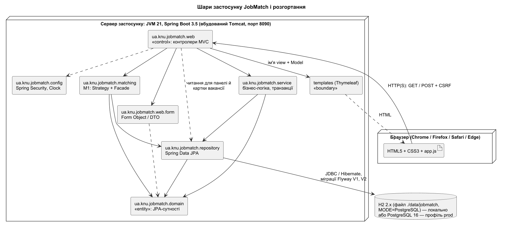{width=100%}
