# Конструювання і тестування Веб-застосунку кадрової агенції «JobMatch»

Виконала: Макаренко Марина, група ІПС-41

Версія 1.0 від 14.11.2026

Підстава: Технічне завдання (лаб. робота 1), Специфікація вимог (лаб. робота 2), User Flow і Wireflow (лаб. робота 3), діаграми класів проєктування (лаб. робота 4). Коди варіантів використання (UC), функціональних (FR) і нефункціональних (NFR) вимог — за лаб. роботою 2. Критичний UC — **R2 «Підбір кандидатів на вакансію»**.

Результати роботи за переліком завдання: 1) застосунок, зібраний і запущений на ноутбуці (розд. 1, 6); 2) модульні тести у форматі табл. 1 (розд. 5); 3) тести функцій R2 у форматі табл. 2 (розд. 7); 4) спеціальні прийоми (розд. 4, 11); 5) тести решти функцій у форматі табл. 3 (розд. 8); 6) нефункціональне тестування на хості не виконувалось, наведено локальні вимірювання (розд. 12); 7) ER-діаграма, скрипти БД, огляд інтерфейсу, перелік виправлених дефектів (розд. 2, 9, 10).

## 1. Загальні відомості

**Технології.** Java 21 (ціль компіляції), Spring Boot 3.5.6: Spring MVC, Spring Security, Spring Data JPA / Hibernate, Bean Validation; шаблони Thymeleaf, HTML5, CSS3 (власна таблиця стилів), 35 рядків JavaScript (підтвердження незворотних дій, показ форм, лічильник символів). Міграції БД — Flyway. СКБД — H2 2.3 у файловому режимі з режимом сумісності PostgreSQL (ноутбук), PostgreSQL 16 — профіль `prod` (той самий DDL). Збирання — Maven 3.10 (тести виконано на OpenJDK 27.0.1). Обсяг коду — 59 класів Java (3 460 рядків), 5 тестових класів, 35 шаблонів Thymeleaf.

**Збирання і запуск.**

```
cd jobmatch
mvn spring-boot:run                      # або:
mvn package && java -jar target/jobmatch-1.0.0.jar
```

Адреса: http://localhost:8090. Під час першого запуску Flyway створює БД у файлі `./data/jobmatch.mv.db` і виконує скрипти `db/migration/V1__schema.sql` і `db/seed/V2__seed.sql` (`spring.flyway.locations=classpath:db/migration,classpath:db/seed`). Повернення до початкових даних — зупинити застосунок і видалити каталог `./data`. Для PostgreSQL: `java -jar target/jobmatch-1.0.0.jar --spring.profiles.active=prod` і змінні оточення `DATABASE_URL`, `DATABASE_USER`, `DATABASE_PASSWORD`; профіль `prod` виконує лише `db/migration` — демонстраційні дані на сервер не потрапляють. Демонстраційні облікові записи (3 рекрутери, 5 шукачів, 4 представники компаній) мають спільний пароль, вказаний у коментарі на початку `db/seed/V2__seed.sql`.

**Інструменти тестування.** JUnit 5 (параметризовані тести `@ParameterizedTest`, вкладені `@Nested`), Mockito (підробні репозиторії), AssertJ, Spring MockMvc і Spring Security Test (інтеграційні тести на H2 у пам'яті з даними Flyway), Playwright 1.56.1 у Google Chrome 157 (функціональні тести інтерфейсу). Кожен тест Playwright має анотації «кроки», «очікувана реакція» і «дані», з яких скриптом `lab5/src/gen_tables.py` сформовано табл. 2 і 3.

```
cd jobmatch && mvn test                       # 73 тести JUnit (62 модульні + 11 інтеграційних)
cd jobmatch/e2e && npm ci && ./run-all.sh   # 78 тестів Playwright; скрипт перед кожним набором запускає застосунок на :8090 зі свіжими початковими даними
```

Підсумок останнього запуску (14.11.2026): JUnit — 73 тести, 0 відмов, 0 помилок; Playwright — 27 тестів R2 і 51 тест решти функцій, усі пройдено. Сирі результати — `lab5/data/` (звіти Surefire XML, `results-r2.json`, `results-functions.json`).

## 2. Кроки 1–3. База даних

### 2.1. Остаточний склад таблиць

Порівняно з лаб. роботою 4 склад таблиць не змінився; уточнено типи, обмеження CHECK і індекси. Перелічувані значення зберігаються рядками (`@Enumerated(EnumType.STRING)`), щоб скрипти однаково працювали в H2 і PostgreSQL.

Таблиця 2.1 — Таблиці БД JobMatch

| Таблиця | Поля (тип; обмеження) | Зв'язки |
|--------------|-----------------------------------------|----------------|
| user_account | id BIGINT PK; email VARCHAR(100) NOT NULL UNIQUE; password_hash VARCHAR(100) (BCrypt); role VARCHAR(20) CHECK ∈ {CANDIDATE, EMPLOYER, RECRUITER}; enabled BOOLEAN; created_at TIMESTAMP | 1 : 0..1 з person і company |
| person | id PK; user_id FK UNIQUE NULL; last_name, first_name VARCHAR(50) NOT NULL; middle_name VARCHAR(50); birth_date DATE; phone VARCHAR(13) NOT NULL; email VARCHAR(100) NOT NULL; city VARCHAR(60) NOT NULL; home_address VARCHAR(200); job_status CHECK ∈ {SEARCHING, NOT_SEARCHING}; desired_position VARCHAR(100); desired_salary INTEGER CHECK 1000..1000000; about VARCHAR(1000); updated_at | user_account (ON DELETE SET NULL); індекси за job_status, last_name |
| education | id PK; person_id FK NOT NULL; level CHECK ∈ {SECONDARY, VOCATIONAL, BACHELOR, MASTER, PHD}; institution VARCHAR(150); specialty VARCHAR(100); graduation_year CHECK 1950..2035 | person (CASCADE) |
| company | id PK; owner_user_id FK UNIQUE NULL; name VARCHAR(120) UNIQUE; city VARCHAR(60); address VARCHAR(200); phone VARCHAR(13); email VARCHAR(100); website VARCHAR(200); description VARCHAR(2000) | user_account (SET NULL) |
| work_record | id PK; person_id FK NOT NULL; company_id FK NULL; company_name VARCHAR(120); position VARCHAR(100); salary CHECK 0..1000000; start_date DATE NOT NULL; end_date DATE NULL = «досі»; CHECK end_date ≥ start_date | person (CASCADE), company (SET NULL) |
| vacancy | id PK; company_id FK NOT NULL; position VARCHAR(100); salary CHECK 1000..1000000; required_education (як level, NULL = будь-яка); required_experience_years CHECK 0..40; requirements VARCHAR(2000); city VARCHAR(60); status CHECK ∈ {OPEN, CLOSED}; created_at | company (CASCADE); індекс за status |
| application | id PK; vacancy_id FK, person_id FK NOT NULL; source CHECK ∈ {CANDIDATE, RECRUITER}; status CHECK ∈ {NEW, INVITED, REJECTED, HIRED}; comment VARCHAR(500); created_at; UNIQUE (vacancy_id, person_id) | vacancy (CASCADE), person (CASCADE) |

Обмеження цілісності NFR-R-5 забезпечено ключами UNIQUE: e-mail облікового запису, назва компанії, пара «вакансія — людина» (повторна кандидатура R2 A3 неможлива навіть за одночасних запитів).

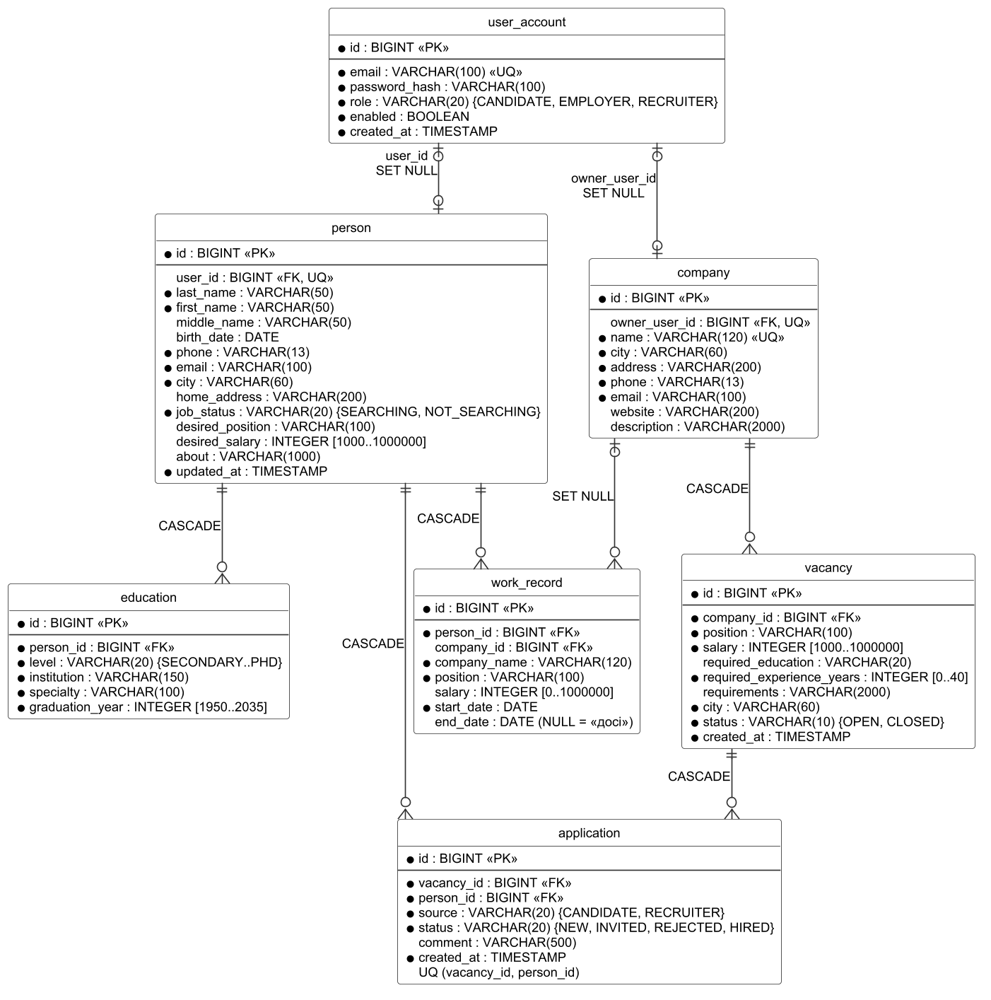{width=88%}

### 2.2. Службові класи доступу до БД

Шар Repository — інтерфейси Spring Data JPA; SQL генерує Hibernate з параметрами, конкатенації рядків SQL немає.

Таблиця 2.2 — Репозиторії та запити, що підтримують R2

| Клас | Методи, використані в R2 та суміжних UC | Призначення |
|----------------|------------------------------|--------------------------|
| PersonRepository | `findByJobStatus(SEARCHING)` з `@EntityGraph("educations")`; `fetchWorkRecords(List<Person>)` — JPQL `left join fetch p.workRecords`; `findById` | Кандидати для M1 двома запитами замість N+1 (R2 крок 3) |
| VacancyRepository | `findById`; `findByStatusOrderByCreatedAtDesc(OPEN)` з `@EntityGraph("company")` | Вакансія R2 (кроки 1–2), відкриті вакансії для R3, C3 |
| ApplicationRepository | `existsByVacancyIdAndPersonId`; `findByVacancyIdOrderByCreatedAtDesc` (+ person); `save` | Позначки «Запропоновано / Відгукнувся» (крок 7, A3), створення кандидатури |
| CompanyRepository, UserAccountRepository | `findByOwnerId`, `existsByNameIgnoreCase`; `findByEmailIgnoreCase` | Власник компанії (E1–E4), вхід (U1) |
| PersonSpecifications, VacancySpecifications | `matching(PersonSearchCriteria)`, `openMatching(VacancySearchCriteria)` — JPA Criteria API | Динамічні фільтри R1, G1 з екрануванням `%`, `_`, `\` у LIKE |

### 2.3. Скрипти створення і первинного заповнення

`jobmatch/src/main/resources/db/migration/V1__schema.sql` — DDL (7 таблиць, 5 індексів), `jobmatch/src/main/resources/db/seed/V2__seed.sql` — початкові дані: 12 облікових записів, 6 компаній, 12 вакансій (11 відкритих), 12 людей, 15 записів освіти, 16 записів історії роботи, 4 кандидатури; наприкінці лічильники ідентифікаторів зсунуто на 100, щоб нові записи не перетиналися з початковими. Hibernate працює в режимі `ddl-auto=validate` — розбіжність сутностей і схеми зупиняє запуск.

R2 читає, але не формує таблиці user_account (облікові записи рекрутерів), company, vacancy, person, education, work_record; формує лише application. Для кожної з шести таблиць дібрано записи п'яти розмірів (довжини полів — у символах).

Таблиця 2.3 — Записи мінімального … максимального розміру в таблицях, які використовує R2

| Таблиця | Мінімальний | Майже мінімальний | Типовий | Майже максимальний | Максимальний |
|-----------|----------|----------|----------|----------|----------|
| user_account (e-mail ≤ 100) | id 3 r@pk.ua — 7 (рекрутер), id 7 — 7 | id 11 — 14 | id 1, 4 — 24–25 | id 5 — 28 | id 8 — 94 |
| person | id 1 «Бо Ян»: лише обов'язкові поля, ПІБ 4, без освіти й історії | id 2 «Лі Ія»: ПІБ 4, посада «QA» (2), 1 освіта, 1 запис роботи без зарплати | id 3–10: ПІБ 20–25, адреса 16–27, «Про себе» 0–110 | id 11: ПІБ 51, e-mail 62, адреса 190, посада 84, зарплата 999 999, «Про себе» 935 | id 12: ПІБ 133 (3 × ≤ 50), e-mail 94, місто 59, адреса 192, посада 90, зарплата 1 000 000, «Про себе» 1000, 3 освіти, 3 записи роботи |
| company | id 5 «Ок»: назва 2, без сайту й опису | id 3 «АгроПлюс»: без сайту, опис 52 | id 4, 2: назва 9–14, опис 60–83 | id 1 «ТехноСофт»: опис 117 | id 6: назва 117, адреса 170, e-mail 83, сайт 122, опис 1980 |
| vacancy | id 12 «ІТ»: посада 2, зарплата 1000, освіта будь-яка, досвід 0, без вимог | id 10 «Бухгалтер»: без вимог | id 2–9: вимоги 28–50 | id 1 «Java-розробник»: вимоги 101 | id 11 «Аналітик даних»: вимоги 1890, освіта Магістр |
| education (за людиною) | людина id 1 — 0 записів | id 2 — 1 запис (середня, 32) | id 3, 5–10 — 1 запис | id 4, 11 — 2 записи | id 12 — 3 записи, запис id 15: заклад 101, спеціальність 62 (PhD) |
| work_record (за людиною) | людина id 1 — 0 записів | id 2 — 1 запис без зарплати, поточний | id 4–7, 9, 10 — 1 запис | id 3, 8, 11 — 2 записи | id 12 — 3 записи (стаж 12 р. 4 міс.) |

Особливі записи для умов R2: людина id 10 зі статусом «не шукає» (не потрапляє в підбір), закрита вакансія id 4 (A4), вакансія id 12 без кандидатів з оцінкою ≥ 50 % (A1), кандидатура «Шевченко → Java-розробник» від рекрутера і «Коваленко → QA-інженер» від шукача (A3).

## 3. Кроки 4–5. Остаточний графічний інтерфейс

**Уточнення порівняно з Wireflow лаб. роботи 3.** Екрани Е1–Е12 реалізовано без зміни послідовності переходів; уточнено:

- форма пропозиції (Е4) — окрема сторінка з картою кандидата й оцінкою, а не діалог: працює без JavaScript, адреса придатна для закладки, кнопка «Назад» браузера повертає до списку;
- складові оцінки (Посада 55, Зарплата 15, Освіта 15, Досвід 15) — кольорові позначки «x/max» з поясненням у підказці `title`; колір дублюється числом;
- на Е2 показано кількість знайдених кандидатів («Кандидатів з оцінкою від 50 %: 4») і параметри вакансії в один рядок;
- для A1 кнопку «Показати часткові збіги (від 25 %)» показано лише за порогу > 25 %; за меншого порогу — порада змінити вимоги вакансії або додати резюме;
- під полем коментаря — лічильник «N / 500 символів» (оновлюється під час введення, `aria-live="polite"`), атрибут `maxlength`; довжину повторно перевіряє сервер (A5);
- за недопустимого порогу (A2) список будується з попереднім порогом: форма передає його прихованим полем `prev`;
- картка людини, відкрита з таблиці підбору, має посилання «← Назад до підбору» з тим самим порогом (точка розширення R4);
- якщо вакансію закрито або кандидатура вже існує, запит форми пропозиції (GET і POST) перенаправляє на список підбору з повідомленням із трьох частин (A3, A4);
- поза R2: на головній сторінці — форма пошуку вакансій (Посада, Місто); у пошуку резюме (R1) — повідомлення, якщо «зарплата від» більша за «до».

Діаграми класів лаб. роботи 4 уточнено без нових класів шару Service: додано `MatchThreshold` (розбір поля «Мін. оцінка, %» з попереднім порогом), `SearchErrors` (повідомлення про некоректні фільтри), `ErrorPagesController` (сторінка 403), `Crumb` (хлібні крихти). Класи критеріїв, `MatchingService`, `ApplicationService` відповідають лаб. роботі 4.

**Допомога в будь-який момент сесії.** Пункт «Допомога» є в шапці кожної сторінки для всіх ролей (FR-6, NFR-H-1), у підвалі — посилання «Допомога» і «Настанова користувача (PDF)». Сторінка `/help` містить відповіді на часті питання, зокрема пояснення критеріїв оцінки, і кнопку «Завантажити Настанову користувача (PDF)». Файл Настанови (`/docs/Nastanova_JobMatch.pdf`) — результат лаб. роботи 6; до його додавання посилання повертає 404.

Таблиця 3.1 — Застосовані принципи організації діалогу

| Принцип | Як реалізовано в JobMatch |
|----------------|--------------------------------|
| ISO 9241-110: придатність до завдання | Рекрутер переходить з панелі до підбору одним натисканням; поріг 50 % встановлено за замовчуванням; оцінка розкладена на 4 складові |
| ISO 9241-110: самоописовість; Шнейдерман — інформативний зворотний зв'язок | Повідомлення з назвою об'єкта: «Кандидатуру Петренко Іван Олегович запропоновано на вакансію «Java-розробник» (ТехноСофт)»; позначка «Запропоновано: Нова» в рядку |
| ISO 9241-110: відповідність очікуванням; Шнейдерман — узгодженість | Однакові шапка, хлібні крихти, розміщення кнопок (основна дія ліворуч, «Скасувати» праворуч), однакові назви дій на всіх сторінках |
| ISO 9241-110: толерантність до помилок; Шнейдерман — запобігання помилкам і легке скасування | Кнопку «Запропонувати» приховано для наявних кандидатур (A3); `maxlength` у полях; підтвердження перед видаленням і працевлаштуванням (FR-5); введені дані зберігаються після помилки |
| ISO 9241-110: керованість; Шнейдерман — внутрішній локус контролю | Немає автоматичних переходів; «Скасувати» у кожній формі; фільтри застосовуються лише кнопкою |
| Шнейдерман — зниження навантаження на пам'ять; Тогняцціні — видимий стан | Параметри вакансії видно над списком кандидатів; активний пункт меню виділено; хлібні крихти |
| Тогняцціні — закон Фіттса, читабельність | Кнопки висотою від 32 px, відступи між кнопками 8 px; контраст тексту ≥ 4,5:1 (токени кольорів у `:root`) |
| Яблонські — закон Хіка, обмеження пам'яті 7 ± 2 | Меню ролі — 2–4 пункти; одна основна кнопка в рядку таблиці |

## 4. Крок 6. Безпечне програмування і валідація даних

**Формат діагностичних повідомлень.** Порушення бізнес-правил описує `BusinessException(what, fixNow, prevent)`; фрагмент `messages` виводить його згори сторінки червоним блоком з трьома частинами (`role="alert"`). Помилки полів форм — повідомлення Bean Validation з трьох речень під полем і в загальному блоці згори форми. Приклади з коду:

- `ApplicationService.create`: «Кандидатура Кравчук Олена Василівна на цю вакансію вже існує.» / «Відкрийте розділ «Кандидатури», щоб переглянути її статус.» / «Кнопка подання неактивна для вже поданих кандидатур — не відкривайте форму в кількох вкладках.»;
- `MatchThreshold.parse`: «Мінімальна оцінка «abc» має бути цілим числом від 0 до 100.» / «Введіть ціле число від 0 до 100, наприклад 50, і натисніть «Оновити».» / «Використовуйте кнопку «Показати часткові збіги» для порогу 25 %.»;
- `ProposeForm.comment` (`@Size(max = 500)`): «Коментар довший за 500 символів. Скоротіть коментар до 500 символів. Пишіть 2–3 речення про сильні сторони кандидата.»;
- `PersonForm.phone` (`@Pattern ^\+380\d{9}$`): «Телефон має неправильний формат. Введіть номер у форматі +380XXXXXXXXX (9 цифр після +380). Вводьте номер без пробілів і дужок.»;
- `SearchErrors.report`: «Фільтр зарплати містить нечислове значення «abc» — фільтр не застосовано.» / «Введіть суму цифрами без пробілів, наприклад 30000…» / «Використовуйте стрілки поля або вводьте лише цифри.»;
- `SearchErrors.checkRange` (R1): «Зарплата «від» (90000) більша за «до» (50000) — діапазон зарплати не застосовано.» / «Поміняйте значення місцями або виправте одне з них і натисніть «Знайти».» / «Вказуйте в полі «від» меншу суму, ніж у полі «до».».

**Позаштатні ситуації.** `GlobalControllerAdvice`: `NotFoundException` і нечисловий ідентифікатор у шляху → 404 «Не знайдено» з посиланнями на головну, вакансії і (для рекрутера) панель; `BusinessException` → повернення на попередню сторінку з повідомленням (адресу `Referer` прийнято лише з власного хоста — захист від відкритого перенаправлення). Внутрішні помилки → сторінка 500 без технічних подробиць. Рядкові параметри обрізаються (`StringTrimmerEditor`), порожні рядки стають `null`.

**Прийоми захисту (NFR-R-7, OWASP Top 10).**

- A01 Контроль доступу: правила `SecurityConfig` за префіксами `/me/**` (CANDIDATE), `/company/**` (EMPLOYER), `/recruiter/**` (RECRUITER); чужа роль → 403 «Доступ заборонено», неавтентифікований → сторінка входу. Перевірка власника на сервері: `EmployerController.myVacancy` повертає 404 для вакансії іншої компанії; `ApplicationService.review` — для кандидатури іншої компанії; шукач працює лише зі своїм резюме (`findByUserId`). Представник компанії бачить кандидатів у форматі «Ім'я П.» без контактів.
- A02 Криптографія: паролі — BCrypt (`BCryptPasswordEncoder`, cost 10); на хостингу — HTTPS (`server.forward-headers-strategy=framework`).
- A03 Ін'єкції: лише похідні запити Spring Data, JPQL з параметрами і Criteria API (`PersonSpecifications`, `VacancySpecifications`); у LIKE-шаблонах екрановано `\`, `%`, `_` (`PersonSpecifications.like`). XSS: Thymeleaf `th:text` екранує вивід; `th:utext` не використано.
- A05 Налаштування: Content-Security-Policy `default-src 'self'; img-src 'self' data:; style-src 'self'; script-src 'self'; frame-ancestors 'none'; form-action 'self'` (немає вбудованих стилів і скриптів), `X-Frame-Options: DENY`, `X-Content-Type-Options: nosniff`, `Referrer-Policy: strict-origin-when-cross-origin`, `Cache-Control: no-store`.
- A07 Автентифікація: CSRF-токен у кожній POST-формі (Spring Security), вихід лише методом POST з анулюванням сеансу, cookie сеансу `HttpOnly` і `SameSite=Lax`, тайм-аут сеансу 30 хв (FR-9); повідомлення про невдалий вхід не розкриває, що саме неправильне — e-mail чи пароль.
- Цілісність: кожна операція зміни даних — одна транзакція `@Transactional` (NFR-R-4); дублікат кандидатури відсікає і сервіс, і ключ UNIQUE.

## 5. Кроки 7–8. Модульне тестування класів R2

Стратегія — поєднання еквівалентного розбиття, аналізу граничних значень і припущення про помилки (Тестування_Лаба5, Копленд). Для числових діапазонів перевірено межі й сусідні значення (поріг 0, 1, 50, 99, 100 і −1, 101, `Integer.MIN_VALUE`, `Integer.MAX_VALUE`; коментар 0, 1, 500 і 501 символ; зарплата рівно 100 %, 100 % + 1 грн, рівно 115 %, 115 % + 1 грн; стаж рівно половина вимоги і на місяць менше; дата працевлаштування +90 і +91 день). Залежності від БД замінено підробними об'єктами Mockito, поточну дату — фіксованим `Clock` (14.11.2026). Для критеріїв M1 «некоректні дані» — значення неприпустимих класів щодо критерію (немає збігу, відсутні дані), на які метод має повернути 0 балів, а не завершитися помилкою.

Модульних тестів — 62 (з урахуванням параметризованих випадків): CriteriaTest — 31, MatchingServiceTest — 15, ApplicationServiceTest — 11, PersonTest — 5. Усі пройшли; відмов немає, тому стовпець «Спостережена реакція методу» не потрібен.

Таблиця 1 — Модульні тести для класів на підтримку R2 «Підбір кандидатів на вакансію»

<!-- T1:BEGIN -->
+--------------------------+------------------------------+--------------------------------+------------------------------+
| Метод                    | Ім'я змінної                 | Значення змінної               | Очікувана реакція методу     |
+==========================+==============================+================================+==============================+
| **Клас 1 PositionCriterion** — критерій «Посада» (55 / 25 / 0) для кроку 3. Змінні: person.desiredPosition,             |
| person.workRecords, vacancy.position. Техніки: еквівалентне розбиття (повний збіг, частковий збіг, немає збігу),        |
| граничні значення (спільне слово рівно 4 символи), припущення про помилки (регістр, підрядок усередині слова).          |
+-------------------------------------------------------------------------------------------------------------------------+
| *Коректні дані*                                                                                                         |
+--------------------------+------------------------------+--------------------------------+------------------------------+
| evaluate                 | desiredPosition; position    | «Java-розробник»;              | 55 (точний збіг, типовий)    |
|                          |                              | «Java-розробник»               |                              |
+--------------------------+------------------------------+--------------------------------+------------------------------+
| evaluate                 | desiredPosition; position    | «JAVA-РОЗРОБНИК»;              | 55 (регістр не враховується) |
|                          |                              | «java-розробник»               |                              |
+--------------------------+------------------------------+--------------------------------+------------------------------+
| evaluate                 | desiredPosition; position    | «Java»; «Java-розробник»       | 55 (назва входить цілим      |
|                          |                              |                                | словом)                      |
+--------------------------+------------------------------+--------------------------------+------------------------------+
| evaluate                 | desiredPosition; position    | «QA»; «QA-інженер»             | 55 (мінімальна назва, 2      |
|                          |                              |                                | символи)                     |
+--------------------------+------------------------------+--------------------------------+------------------------------+
| evaluate                 | desiredPosition; position    | «Розробник ПЗ»;                | 25 (спільне слово ≥ 4        |
|                          |                              | «Java-розробник»               | символів)                    |
+--------------------------+------------------------------+--------------------------------+------------------------------+
| evaluate                 | desiredPosition; position    | «Java-тестувальник»;           | 25 (спільне слово «java» —   |
|                          |                              | «Java-розробник»               | рівно 4 символи, межа)       |
+--------------------------+------------------------------+--------------------------------+------------------------------+
| evaluate                 | desiredPosition;             | null; [«Java-розробник» з      | 55 (посада з історії роботи) |
|                          | workRecords; position        | 01.01.2020]; «Java-розробник»  |                              |
+--------------------------+------------------------------+--------------------------------+------------------------------+
| *Некоректні дані*                                                                                                       |
+--------------------------+------------------------------+--------------------------------+------------------------------+
| evaluate                 | desiredPosition; position    | «Агроном»; «Java-розробник»    | 0 (немає збігу)              |
+--------------------------+------------------------------+--------------------------------+------------------------------+
| evaluate                 | desiredPosition; position    | «ІТ»; «Архітектор рішень»      | 0 («іт» усередині слова не є |
|                          |                              |                                | збігом; регресійний тест     |
|                          |                              |                                | дефекту 2)                   |
+--------------------------+------------------------------+--------------------------------+------------------------------+
| evaluate                 | desiredPosition;             | null; []; «Логіст»             | 0 (посад немає)              |
|                          | workRecords; position        |                                |                              |
+--------------------------+------------------------------+--------------------------------+------------------------------+
| compare                  | a; b                         | «pm lead»; «pm assistant»      | 0 (слова коротші за 4        |
|                          |                              |                                | символи не враховуються)     |
+--------------------------+------------------------------+--------------------------------+------------------------------+
| **Клас 2 SalaryCriterion** — критерій «Зарплата» (15 / 7 / 0). Змінні: person.desiredSalary, vacancy.salary. Техніки:   |
| граничні значення (100 %, 115 %), еквівалентне розбиття.                                                                |
+-------------------------------------------------------------------------------------------------------------------------+
| *Коректні дані*                                                                                                         |
+--------------------------+------------------------------+--------------------------------+------------------------------+
| evaluate                 | desiredSalary; salary        | 1000; 1000                     | 15 (мінімальні значення,     |
|                          |                              |                                | рівність)                    |
+--------------------------+------------------------------+--------------------------------+------------------------------+
| evaluate                 | desiredSalary; salary        | 85000; 85000                   | 15 (рівність, типовий)       |
+--------------------------+------------------------------+--------------------------------+------------------------------+
| evaluate                 | desiredSalary; salary        | null; 5000                     | 15 (бажану зарплату не       |
|                          |                              |                                | вказано)                     |
+--------------------------+------------------------------+--------------------------------+------------------------------+
| evaluate                 | desiredSalary; salary        | 85001; 85000                   | 7 (на 1 грн вище)            |
+--------------------------+------------------------------+--------------------------------+------------------------------+
| evaluate                 | desiredSalary; salary        | 97750; 85000                   | 7 (рівно 115 %, межа)        |
+--------------------------+------------------------------+--------------------------------+------------------------------+
| *Некоректні дані*                                                                                                       |
+--------------------------+------------------------------+--------------------------------+------------------------------+
| evaluate                 | desiredSalary; salary        | 97751; 85000                   | 0 (115 % + 1 грн)            |
+--------------------------+------------------------------+--------------------------------+------------------------------+
| evaluate                 | desiredSalary; salary        | 1000000; 1000                  | 0 (максимальна бажана при    |
|                          |                              |                                | мінімальній запропонованій;  |
|                          |                              |                                | без переповнення int)        |
+--------------------------+------------------------------+--------------------------------+------------------------------+
| **Клас 3 EducationCriterion** — критерій «Освіта» (15 / 0). Змінні: рівні освіти людини (person.educations),            |
| vacancy.requiredEducation. Техніки: еквівалентне розбиття за рівнями, граничні значення (рівний рівень, на один нижче). |
+-------------------------------------------------------------------------------------------------------------------------+
| *Коректні дані*                                                                                                         |
+--------------------------+------------------------------+--------------------------------+------------------------------+
| evaluate                 | educations;                  | [Бакалавр]; Бакалавр           | 15 (рівність, межа)          |
|                          | requiredEducation            |                                |                              |
+--------------------------+------------------------------+--------------------------------+------------------------------+
| evaluate                 | educations;                  | [Магістр]; Бакалавр            | 15                           |
|                          | requiredEducation            |                                |                              |
+--------------------------+------------------------------+--------------------------------+------------------------------+
| evaluate                 | educations;                  | [PhD]; PhD                     | 15 (максимальний рівень)     |
|                          | requiredEducation            |                                |                              |
+--------------------------+------------------------------+--------------------------------+------------------------------+
| evaluate                 | educations;                  | []; null                       | 15 (вимоги немає)            |
|                          | requiredEducation            |                                |                              |
+--------------------------+------------------------------+--------------------------------+------------------------------+
| evaluate                 | educations;                  | [Бакалавр, Магістр]; Магістр   | 15 (береться найвищий        |
|                          | requiredEducation            |                                | рівень)                      |
+--------------------------+------------------------------+--------------------------------+------------------------------+
| *Некоректні дані*                                                                                                       |
+--------------------------+------------------------------+--------------------------------+------------------------------+
| evaluate                 | educations;                  | [Середня]; Професійно-технічна | 0 (на один рівень нижче)     |
|                          | requiredEducation            |                                |                              |
+--------------------------+------------------------------+--------------------------------+------------------------------+
| evaluate                 | educations;                  | [Бакалавр]; Магістр            | 0                            |
|                          | requiredEducation            |                                |                              |
+--------------------------+------------------------------+--------------------------------+------------------------------+
| evaluate                 | educations;                  | []; Середня                    | 0 (освіту не вказано)        |
|                          | requiredEducation            |                                |                              |
+--------------------------+------------------------------+--------------------------------+------------------------------+
| **Клас 4 ExperienceCriterion** — критерій «Досвід» (15 / 7 / 0). Змінні: стаж з person.workRecords на дату today =      |
| 14.11.2026, vacancy.requiredExperienceYears. Техніки: граничні значення (0, рівно вимога, рівно половина, 40 років).    |
+-------------------------------------------------------------------------------------------------------------------------+
| *Коректні дані*                                                                                                         |
+--------------------------+------------------------------+--------------------------------+------------------------------+
| evaluate                 | стаж;                        | 0; 0                           | 15 (мінімальні значення)     |
|                          | requiredExperienceYears      |                                |                              |
+--------------------------+------------------------------+--------------------------------+------------------------------+
| evaluate                 | стаж;                        | 3 р. (14.11.2023–14.11.2026);  | 15 (рівно вимога)            |
|                          | requiredExperienceYears      | 3                              |                              |
+--------------------------+------------------------------+--------------------------------+------------------------------+
| evaluate                 | стаж;                        | 40 р. (поточний запис, endDate | 15 (максимальна вимога;      |
|                          | requiredExperienceYears      | = null); 40                    | поточний запис — до          |
|                          |                              |                                | сьогодні)                    |
+--------------------------+------------------------------+--------------------------------+------------------------------+
| evaluate                 | стаж;                        | 18 міс.; 3                     | 7 (рівно половина, межа)     |
|                          | requiredExperienceYears      |                                |                              |
+--------------------------+------------------------------+--------------------------------+------------------------------+
| *Некоректні дані*                                                                                                       |
+--------------------------+------------------------------+--------------------------------+------------------------------+
| evaluate                 | стаж;                        | 17 міс.; 3                     | 0 (на місяць менше половини) |
|                          | requiredExperienceYears      |                                |                              |
+--------------------------+------------------------------+--------------------------------+------------------------------+
| **Клас 5 MatchingService** — Facade M1: оцінка пари «резюме — вакансія» і підбір кандидатів (R2, кроки 2–3, A1, A2);    |
| репозиторії — Mockito. Техніки: еквівалентне розбиття, граничні значення порогу, припущення про помилки (порожній       |
| список, сортування).                                                                                                    |
+-------------------------------------------------------------------------------------------------------------------------+
| *Коректні дані*                                                                                                         |
+--------------------------+------------------------------+--------------------------------+------------------------------+
| evaluate                 | person; vacancy              | Java-розробник, 80 000,        | score = 100; складові [55,   |
|                          |                              | Бакалавр, 5 р.;                | 15, 15, 15]                  |
|                          |                              | Java-розробник, 85 000,        |                              |
|                          |                              | Бакалавр, 3 р.                 |                              |
+--------------------------+------------------------------+--------------------------------+------------------------------+
| evaluate                 | person; vacancy              | Агроном, 30 000, Магістр, 10   | score = 45 < 50 (без збігу   |
|                          |                              | р.; та сама вакансія           | посади — нижче порогу;       |
|                          |                              |                                | регресійний тест дефекту 1)  |
+--------------------------+------------------------------+--------------------------------+------------------------------+
| findCandidates           | люди «шукає»; minScore       | [15 %, 77 %, 100 %]; 50        | [100, 77] за спаданням;      |
|                          |                              |                                | fetchWorkRecords викликано   |
|                          |                              |                                | один раз                     |
+--------------------------+------------------------------+--------------------------------+------------------------------+
| findCandidates           | люди «шукає»; minScore       | [Агроном, 15 %]; 50 і 0        | [] (A1) і 1 результат        |
+--------------------------+------------------------------+--------------------------------+------------------------------+
| findCandidates           | люди «шукає»; minScore       | []; 50                         | []; fetchWorkRecords не      |
|                          |                              |                                | викликано                    |
+--------------------------+------------------------------+--------------------------------+------------------------------+
| findVacancies            | відкриті вакансії; minScore  | [QA-інженер, Java-розробник];  | лише «Java-розробник» (id 1) |
|                          |                              | 50                             |                              |
+--------------------------+------------------------------+--------------------------------+------------------------------+
| validateThreshold (через | minScore                     | 0, 1, 50, 99, 100              | виняток не виникає; 1        |
| findCandidates)          |                              |                                | результат                    |
+--------------------------+------------------------------+--------------------------------+------------------------------+
| *Некоректні дані*                                                                                                       |
+--------------------------+------------------------------+--------------------------------+------------------------------+
| validateThreshold (через | minScore                     | −1, 101, Integer.MIN_VALUE,    | IllegalArgumentException     |
| findCandidates)          |                              | Integer.MAX_VALUE              |                              |
+--------------------------+------------------------------+--------------------------------+------------------------------+
| **Клас 6 ApplicationService** — створення кандидатури рекрутером (R2, кроки 5–7, A3, A4, A5, A7) і реєстрація           |
| працевлаштування (R7); репозиторії — Mockito. Техніки: граничні значення довжини коментаря і дати, припущення про       |
| помилки (дублікат, відсутні записи).                                                                                    |
+-------------------------------------------------------------------------------------------------------------------------+
| *Коректні дані*                                                                                                         |
+--------------------------+------------------------------+--------------------------------+------------------------------+
| propose                  | vacancyId; personId; comment | 1; 3; null                     | кандидатура NEW, джерело     |
|                          |                              |                                | RECRUITER, коментар null;    |
|                          |                              |                                | save викликано               |
+--------------------------+------------------------------+--------------------------------+------------------------------+
| propose                  | vacancyId; personId; comment | 1; 3; «a» (1 символ)           | кандидатуру збережено з      |
|                          |                              |                                | коментарем «a»               |
+--------------------------+------------------------------+--------------------------------+------------------------------+
| propose                  | vacancyId; personId; comment | 1; 3; «к» × 500                | кандидатуру збережено,       |
|                          |                              |                                | коментар 500 символів        |
+--------------------------+------------------------------+--------------------------------+------------------------------+
| hire                     | applicationId; startDate     | 7 (статус INVITED); сьогодні + | статус HIRED; вакансію       |
|                          |                              | 90 днів                        | закрито; людина «не шукає»;  |
|                          |                              |                                | один поточний запис роботи   |
|                          |                              |                                | «Java-розробник»             |
+--------------------------+------------------------------+--------------------------------+------------------------------+
| *Некоректні дані*                                                                                                       |
+--------------------------+------------------------------+--------------------------------+------------------------------+
| propose                  | comment                      | «к» × 501                      | BusinessException «…500…»;   |
|                          |                              |                                | save не викликано (A5)       |
+--------------------------+------------------------------+--------------------------------+------------------------------+
| propose                  | existsByVacancyIdAndPersonId | true                           | BusinessException «…вже      |
|                          |                              |                                | існує»; save не викликано    |
|                          |                              |                                | (A3)                         |
+--------------------------+------------------------------+--------------------------------+------------------------------+
| propose                  | vacancy.status               | CLOSED                         | BusinessException            |
|                          |                              |                                | «…закрито…» (A4)             |
+--------------------------+------------------------------+--------------------------------+------------------------------+
| propose                  | vacancyId                    | 99 (немає в БД)                | NotFoundException (A7)       |
+--------------------------+------------------------------+--------------------------------+------------------------------+
| propose                  | personId                     | 99 (немає в БД)                | NotFoundException (A7)       |
+--------------------------+------------------------------+--------------------------------+------------------------------+
| hire                     | статус кандидатури           | NEW                            | BusinessException            |
|                          |                              |                                | «…«Запрошено»…»              |
+--------------------------+------------------------------+--------------------------------+------------------------------+
| hire                     | startDate                    | сьогодні + 91 день             | BusinessException; вакансія  |
|                          |                              |                                | лишається відкритою          |
+--------------------------+------------------------------+--------------------------------+------------------------------+
| **Клас 7 Person, Application** — стаж і освіта кандидата для таблиці підбору (крок 3) і картки (крок 4), статуси        |
| кандидатури. Техніки: граничні значення (немає записів), припущення про помилки (поточний запис без дати завершення).   |
+-------------------------------------------------------------------------------------------------------------------------+
| *Коректні дані*                                                                                                         |
+--------------------------+------------------------------+--------------------------------+------------------------------+
| experienceText,          | workRecords; today           | 01.07.2019–31.03.2022 (32      | «7 р. 3 міс.»; 7.3           |
| experienceYears          |                              | міс.) і 01.04.2022–досі (55    |                              |
|                          |                              | міс.); 14.11.2026              |                              |
+--------------------------+------------------------------+--------------------------------+------------------------------+
| experienceText           | workRecords                  | []                             | «0 р. 0 міс.»                |
+--------------------------+------------------------------+--------------------------------+------------------------------+
| highestEducation         | educations                   | []                             | Optional.empty()             |
+--------------------------+------------------------------+--------------------------------+------------------------------+
| hire                     | поточний запис; company,     | «Old» з 01.01.2020; ТехноСофт, | 2 записи, поточний лише      |
|                          | position, salary, startDate  | «New», 50000, 14.11.2026       | «New»; isSearching() = false |
+--------------------------+------------------------------+--------------------------------+------------------------------+
| *Некоректні дані*                                                                                                       |
+--------------------------+------------------------------+--------------------------------+------------------------------+
| Application.changeStatus | поточний; новий статус       | REJECTED; INVITED              | IllegalStateException        |
|                          |                              |                                | (остаточний статус не        |
|                          |                              |                                | змінюється)                  |
+--------------------------+------------------------------+--------------------------------+------------------------------+
<!-- T1:END -->

## 6. Кроки 9–10. Інтерфейс, інтеграційне тестування і збирання

**Реалізація інтерфейсу.** 35 шаблонів Thymeleaf зі спільними фрагментами (`fragments.html`: заголовок сторінки, шапка, хлібні крихти, повідомлення, поля форм, підвал), одна таблиця стилів `app.css` (160 рядків). Дефекти HTML і шаблонів виявлено засобами IntelliJ IDEA та помилками розбору Thymeleaf під час тестів MockMvc і Playwright (дефект 5 розд. 10). Тексти інтерфейсу перевірено оглядом: однакові назви дій, типографський апостроф ’ у повідомленнях.

**Інтеграційне тестування.** `CandidateMatchingIntegrationTest` (11 тестів) запускає повний контекст Spring Boot з профілем `test` (H2 у пам'яті, ті самі скрипти Flyway) і перевіряє через MockMvc ланцюжок інтерфейсів Controller → Service → Repository → БД для R2: `RecruiterMatchController` ↔ `MatchThreshold` / `MatchingService` / `ApplicationService` ↔ репозиторії ↔ схема і початкові дані; разом із фільтрами Spring Security (ролі, CSRF) і `GlobalControllerAdvice`. Після кожного тесту контекст перестворюється (`@DirtiesContext`), тому тести незалежні.

Таблиця 6.1 — Інтеграційні тести R2

| Тест | Запит | Перевірено |
|-------------------|----------------|--------------------------|
| mainFlowShowsRankedCandidates | GET /recruiter/vacancies/1/matches | 200, шаблон `recruiter/candidate-matches`, minScore = 50, 4 кандидати, є «Петренко Іван Олегович», немає «Олійник» (не шукає) |
| proposeCreatesApplication | POST …/1/propose (personId = 3, коментар, CSRF) | перенаправлення на `…/matches?minScore=50`, flash-повідомлення з ПІБ, у БД +1 кандидатура |
| partialMatchesShowMore | GET …/1/matches?minScore=25 | кандидатів більше 4 (A1) |
| emptyStateOffersPartial | GET /recruiter/vacancies/12/matches | 0 кандидатів, кнопка «Показати часткові збіги» (A1) |
| invalidThresholdFallsBackWithMessage | GET …/1/matches?minScore=150 | minScore = 50, повідомлення «від 0 до 100» (A2) |
| duplicateProposalRejected | POST …/1/propose (personId = 4, Referer) | перенаправлення з помилкою «вже існує», кількість кандидатур не змінилась (A3) |
| closedVacancyNotMatched | GET /recruiter/vacancies/4/matches | 0 кандидатів, «Вакансію закрито» (A4) |
| longCommentKeepsFormAndText | POST …/1/propose (коментар 501 символ) | 200, шаблон форми, помилка поля `comment`, текст збережено, кандидатуру не створено (A5) |
| deletedVacancyGives404 | GET /recruiter/vacancies/999/matches | 404, сторінка «404» (A7) |
| candidateCannotOpenRecruiterPage | GET …/1/matches від шукача | 403 (FR-2) |
| anonymousRedirectedToLogin | GET …/1/matches без входу | перенаправлення на `/login` (FR-1) |

Інтеграційне тестування виявило дефект 4 (LazyInitializationException під час формування повідомлення після `propose`) — виправлено, тест `proposeCreatesApplication` є регресійним.

**Збирання.** Застосунок зібрано командою `mvn package` у виконуваний JAR `jobmatch/target/jobmatch-1.0.0.jar` (NFR-S-6) і запущено на ноутбуці (macOS 26, http://localhost:8090). На безкоштовному публічному хості застосунок не розгортався; профіль `prod` для PostgreSQL підготовлено.

## 7. Крок 11. Тестування функцій критичного UC R2

R2 підтримує одна функція, формулювання якої збігається з назвою UC, тому формулювання не наводиться. Тести спроєктовано для базового потоку і всіх альтернативних потоків A1–A7 (SRS, п. 3.2.2) і автоматизовано в `jobmatch/e2e/tests/r2-candidate-matching.spec.ts`. Розмір сценарію («мінімальний» … «максимальний») визначено довжиною коментаря (0, 1, 96, 499, 500 символів) і значенням порогу (0, 1, 50, 99, 100).

Таблиця 7.1 — Покриття потоків R2 тестами

| Потік | Коректні | Некоректні | Пояснення |
|----------|-------|-------|------------------------------|
| Базовий | 5 + 1 | 1 | Коментар 0/1/96/499/500 символів; крок 4 (картка R4) — окремий тест; некоректний — підмінений `personId=abc` в адресі |
| A1 | 2 | — | Умова A1 — порожній результат; власних вхідних даних, крім порогу, немає (недопустимий поріг — це A2). Перевірено поріг за замовчуванням (50) з переходом до часткових збігів і максимальний (100) |
| A2 | 5 | 3 | Межі 0, 1, 50, 99, 100; некоректні −1, «abc», 101 |
| A3 | 2 | 1 | Стан «Запропоновано» і «Відгукнувся»; повторне підтвердження з другої вкладки |
| A4 | 1 | 1 | Перегляд закритої вакансії; закриття вакансії під час заповнення форми |
| A5 | — | 2 | Потік за визначенням описує некоректне введення (> 500 символів); коректні межі 499 і 500 перевірено в базовому потоці; некоректні — 501 (мінімальний) і 1000 (максимальний) |
| A6 | 1 | — | «Скасувати» не має вхідних даних, тому один тест і жодного некоректного |
| A7 | — | 2 | Потік виникає лише для неіснуючих записів (видалена вакансія, видалена людина); коректних даних для нього немає |

Усі 27 тестів пройшли; відмов немає, тому стовпець «Спостережена реакція Веб-застосунку» не додано. <!-- T2S:BEGIN -->
results-r2.json: 27 тестів (пройдено — 27); запуск 2026-11-14 15:45:55 UTC, тривалість 11.9 с.
<!-- T2S:END -->

Таблиця 2 — Тести для функцій на підтримку R2 «Підбір кандидатів на вакансію»

<!-- T2:BEGIN -->
+---------+-------------------+------------+---------------------------------------------+--------------------------------+
| №       | Умова виконання   | Потік      | Кроки тесту («що натиснути, які дані в які  | Очікувана реакція              |
|         |                   |            | поля ввести»)                               | Веб-застосунку                 |
+=========+===================+============+=============================================+================================+
| **Базовий потік — коректні дані**                                                                                       |
+---------+-------------------+------------+---------------------------------------------+--------------------------------+
| T2-01   | мінімальний:      | Базовий    | Панель рекрутера → «Підібрати кандидатів»   | Повідомлення «Кандидатуру      |
|         | коментар порожній |            | біля «Java-розробник» → «Запропонувати»     | Петренко Іван Олегович         |
|         | (коментар: 0      |            | біля «Петренко Іван Олегович» → поле        | запропоновано на вакансію      |
|         | символів)         |            | «Коментар» порожнє → «Підтвердити»          | «Java-розробник» (ТехноСофт)»; |
|         |                   |            |                                             | у рядку — «Запропоновано:      |
|         |                   |            |                                             | Нова»                          |
+---------+-------------------+------------+---------------------------------------------+--------------------------------+
| T2-02   | майже             | Базовий    | Підбір для «Java-розробник» →               | Повідомлення про пропозицію;   |
|         | мінімальний:      |            | «Запропонувати» біля «Бондар Марія» →       | статус «Запропоновано: Нова»   |
|         | коментар 1 символ |            | коментар «+» → «Підтвердити»                |                                |
+---------+-------------------+------------+---------------------------------------------+--------------------------------+
| T2-03   | типовий: коментар | Базовий    | Підбір для «Java-розробник» →               | Повідомлення про пропозицію;   |
|         | 96 символів       |            | «Запропонувати» біля «Григоренко-Задорожна» | статус «Запропоновано: Нова»   |
|         |                   |            | → типовий коментар → «Підтвердити»          |                                |
+---------+-------------------+------------+---------------------------------------------+--------------------------------+
| T2-04   | майже             | Базовий    | Підбір для «QA-інженер» → «Запропонувати»   | Повідомлення про пропозицію;   |
|         | максимальний:     |            | біля «Лі Ія» → коментар 499 символів →      | статус «Запропоновано: Нова»   |
|         | коментар 499      |            | «Підтвердити»                               |                                |
|         | символів          |            |                                             |                                |
+---------+-------------------+------------+---------------------------------------------+--------------------------------+
| T2-05   | максимальний:     | Базовий    | Підбір для «QA-інженер» (мін. оцінка 0) →   | Повідомлення про пропозицію;   |
|         | коментар 500      |            | «Запропонувати» біля                        | статус «Запропоновано: Нова»   |
|         | символів          |            | «Верховинець-Залізняк…» → коментар 500      |                                |
|         |                   |            | символів → «Підтвердити»                    |                                |
+---------+-------------------+------------+---------------------------------------------+--------------------------------+
| **Базовий потік — некоректні дані**                                                                                     |
+---------+-------------------+------------+---------------------------------------------+--------------------------------+
| T2-06   | типовий:          | Базовий    | Відкрити адресу                             | Сторінка «404 — Не знайдено»,  |
|         | підмінений        |            | /recruiter/vacancies/1/propose?personId=abc | кандидатура не створюється     |
|         | ідентифікатор     |            |                                             |                                |
|         | кандидата         |            |                                             |                                |
|         | (personId = abc)  |            |                                             |                                |
+---------+-------------------+------------+---------------------------------------------+--------------------------------+
| **Базовий потік, крок 4 (розширення R4) — коректні дані**                                                               |
+---------+-------------------+------------+---------------------------------------------+--------------------------------+
| T2-27   | перегляд картки й | Базовий    | Підбір для «Java-розробник» → натиснути     | Картка людини з особистими     |
|         | історії кандидата |            | «Петренко Іван Олегович»                    | даними, освітою й історією     |
|         |                   |            |                                             | роботи (2 записи, стаж 7 р. 3  |
|         |                   |            |                                             | міс.)                          |
+---------+-------------------+------------+---------------------------------------------+--------------------------------+
| **Альтернативний потік A1 — коректні дані**                                                                             |
+---------+-------------------+------------+---------------------------------------------+--------------------------------+
| T2-07   | типовий: порожній | A1         | Компанії → «Ок» → «Підібрати кандидатів»    | Повідомлення «Немає кандидатів |
|         | список → часткові |            | біля «ІТ» (поріг 50) → «Показати часткові   | з оцінкою від 50 %.» і кнопка; |
|         | збіги             |            | збіги (від 25 %)»                           | після натискання — список з    |
|         |                   |            |                                             | порогом 25 % (усі оцінки ≥ 25  |
|         |                   |            |                                             | %)                             |
+---------+-------------------+------------+---------------------------------------------+--------------------------------+
| T2-08   | максимальний      | A1         | Відкрити підбір для вакансії «ІТ» з порогом | Повідомлення «Немає кандидатів |
|         | поріг 100 % без   |            | 100                                         | з оцінкою від 100 %.» і кнопка |
|         | кандидатів (мін.  |            |                                             | «Показати часткові збіги»      |
|         | оцінка = 100)     |            |                                             |                                |
+---------+-------------------+------------+---------------------------------------------+--------------------------------+
| **Альтернативний потік A2 — коректні дані**                                                                             |
+---------+-------------------+------------+---------------------------------------------+--------------------------------+
| T2-09   | мінімальний: мін. | A2         | Підбір для «Java-розробник» → поле «Мін.    | Список кандидатів з оцінкою ≥  |
|         | оцінка 0          |            | оцінка, %» = 0 → «Оновити»                  | 0 %, відсортований за          |
|         |                   |            |                                             | спаданням; повідомлень про     |
|         |                   |            |                                             | помилку немає                  |
+---------+-------------------+------------+---------------------------------------------+--------------------------------+
| T2-10   | майже             | A2         | Підбір для «Java-розробник» → поле «Мін.    | Список кандидатів з оцінкою ≥  |
|         | мінімальний: мін. |            | оцінка, %» = 1 → «Оновити»                  | 1 %, відсортований за          |
|         | оцінка 1          |            |                                             | спаданням; повідомлень про     |
|         |                   |            |                                             | помилку немає                  |
+---------+-------------------+------------+---------------------------------------------+--------------------------------+
| T2-11   | типовий: мін.     | A2         | Підбір для «Java-розробник» → поле «Мін.    | Список кандидатів з оцінкою ≥  |
|         | оцінка 50         |            | оцінка, %» = 50 → «Оновити»                 | 50 %, відсортований за         |
|         |                   |            |                                             | спаданням; повідомлень про     |
|         |                   |            |                                             | помилку немає                  |
+---------+-------------------+------------+---------------------------------------------+--------------------------------+
| T2-12   | майже             | A2         | Підбір для «Java-розробник» → поле «Мін.    | Список кандидатів з оцінкою ≥  |
|         | максимальний:     |            | оцінка, %» = 99 → «Оновити»                 | 99 %, відсортований за         |
|         | мін. оцінка 99    |            |                                             | спаданням; повідомлень про     |
|         |                   |            |                                             | помилку немає                  |
+---------+-------------------+------------+---------------------------------------------+--------------------------------+
| T2-13   | максимальний:     | A2         | Підбір для «Java-розробник» → поле «Мін.    | Список кандидатів з оцінкою ≥  |
|         | мін. оцінка 100   |            | оцінка, %» = 100 → «Оновити»                | 100 %, відсортований за        |
|         |                   |            |                                             | спаданням; повідомлень про     |
|         |                   |            |                                             | помилку немає                  |
+---------+-------------------+------------+---------------------------------------------+--------------------------------+
| **Альтернативний потік A2 — некоректні дані**                                                                           |
+---------+-------------------+------------+---------------------------------------------+--------------------------------+
| T2-14   | мінімальний: мін. | A2         | Підбір для «Java-розробник» → поле «Мін.    | Діагностичне повідомлення      |
|         | оцінка «-1» (мін. |            | оцінка, %» = -1 → «Оновити»                 | «Мінімальна оцінка … має бути  |
|         | оцінка = -1)      |            |                                             | цілим числом від 0 до 100» з   |
|         |                   |            |                                             | трьома частинами; список       |
|         |                   |            |                                             | побудовано з порогом 50 %      |
+---------+-------------------+------------+---------------------------------------------+--------------------------------+
| T2-15   | типовий: мін.     | A2         | Підбір для «Java-розробник» → поле «Мін.    | Діагностичне повідомлення      |
|         | оцінка «abc»      |            | оцінка, %» = abc → «Оновити»                | «Мінімальна оцінка … має бути  |
|         | (мін. оцінка =    |            |                                             | цілим числом від 0 до 100» з   |
|         | abc)              |            |                                             | трьома частинами; список       |
|         |                   |            |                                             | побудовано з порогом 50 %      |
+---------+-------------------+------------+---------------------------------------------+--------------------------------+
| T2-16   | максимальний:     | A2         | Підбір для «Java-розробник» → поле «Мін.    | Діагностичне повідомлення      |
|         | мін. оцінка «101» |            | оцінка, %» = 101 → «Оновити»                | «Мінімальна оцінка … має бути  |
|         | (мін. оцінка =    |            |                                             | цілим числом від 0 до 100» з   |
|         | 101)              |            |                                             | трьома частинами; список       |
|         |                   |            |                                             | побудовано з порогом 50 %      |
+---------+-------------------+------------+---------------------------------------------+--------------------------------+
| **Альтернативний потік A3 — коректні дані**                                                                             |
+---------+-------------------+------------+---------------------------------------------+--------------------------------+
| T2-17   | типовий:          | A3         | Підбір для «Java-розробник» → рядок         | Кнопки «Запропонувати» немає;  |
|         | кандидата вже     |            | «Шевченко Оксана»                           | показано «Запропоновано: Нова» |
|         | запропоновано     |            |                                             |                                |
+---------+-------------------+------------+---------------------------------------------+--------------------------------+
| T2-18   | кандидат сам      | A3         | Підбір для «QA-інженер» → рядок «Коваленко  | Кнопки «Запропонувати» немає;  |
|         | відгукнувся       |            | Дмитро»                                     | показано «Відгукнувся: Нова»   |
+---------+-------------------+------------+---------------------------------------------+--------------------------------+
| **Альтернативний потік A3 — некоректні дані**                                                                           |
+---------+-------------------+------------+---------------------------------------------+--------------------------------+
| T2-19   | типовий: повторне | A3         | Відкрити форму пропозиції «Кравчук Олена» → | Друга спроба: повідомлення     |
|         | підтвердження з   |            | «Агроном» у двох вкладках → «Підтвердити» в | «Кандидатура … вже існує» з    |
|         | другої вкладки    |            | першій, потім у другій                      | трьома частинами; дублікат не  |
|         | (дві вкладки)     |            |                                             | створено                       |
+---------+-------------------+------------+---------------------------------------------+--------------------------------+
| **Альтернативний потік A4 — коректні дані**                                                                             |
+---------+-------------------+------------+---------------------------------------------+--------------------------------+
| T2-20   | типовий: підбір   | A4         | Відкрити підбір для закритої вакансії       | Повідомлення «Вакансію закрито |
|         | для закритої      |            | «Project manager»                           | — підбір недоступний» і        |
|         | вакансії          |            |                                             | посилання «До відкритих        |
|         |                   |            |                                             | вакансій»; таблиці кандидатів  |
|         |                   |            |                                             | немає                          |
+---------+-------------------+------------+---------------------------------------------+--------------------------------+
| **Альтернативний потік A4 — некоректні дані**                                                                           |
+---------+-------------------+------------+---------------------------------------------+--------------------------------+
| T2-21   | типовий: вакансію | A4         | Відкрити форму пропозиції «Мельник Сергій»  | Повідомлення «Вакансію         |
|         | закрили під час   |            | → «Бухгалтер»; в іншій вкладці закрити      | «Бухгалтер» закрито —          |
|         | заповнення форми  |            | вакансію; натиснути «Підтвердити»           | кандидатури не приймаються»;   |
|         |                   |            |                                             | кандидатура не створюється     |
+---------+-------------------+------------+---------------------------------------------+--------------------------------+
| **Альтернативний потік A5 — некоректні дані**                                                                           |
+---------+-------------------+------------+---------------------------------------------+--------------------------------+
| T2-22   | типовий: коментар | A5         | Форма пропозиції «Ткаченко Андрій» →        | Діагностичне повідомлення      |
|         | 501 символів      |            | «Водій-експедитор» → вставити коментар 501  | «Коментар довший за 500        |
|         |                   |            | символів (обійти maxlength) → «Підтвердити» | символів. Скоротіть коментар…  |
|         |                   |            |                                             | Пишіть 2–3 речення…»; введений |
|         |                   |            |                                             | текст збережено; кандидатура   |
|         |                   |            |                                             | не створюється                 |
+---------+-------------------+------------+---------------------------------------------+--------------------------------+
| T2-23   | максимальний:     | A5         | Форма пропозиції «Ткаченко Андрій» →        | Діагностичне повідомлення      |
|         | коментар 1000     |            | «Водій-експедитор» → вставити коментар 1000 | «Коментар довший за 500        |
|         | символів          |            | символів (обійти maxlength) → «Підтвердити» | символів. Скоротіть коментар…  |
|         |                   |            |                                             | Пишіть 2–3 речення…»; введений |
|         |                   |            |                                             | текст збережено; кандидатура   |
|         |                   |            |                                             | не створюється                 |
+---------+-------------------+------------+---------------------------------------------+--------------------------------+
| **Альтернативний потік A6 — коректні дані**                                                                             |
+---------+-------------------+------------+---------------------------------------------+--------------------------------+
| T2-24   | типовий:          | A6         | Підбір для «Frontend-розробник» (мін.       | Повернення до списку підбору;  |
|         | «Скасувати» у     |            | оцінка 25) → «Запропонувати» біля «Петренко | кандидатура не створена        |
|         | формі пропозиції  |            | Іван Олегович» → ввести коментар →          | (кнопка «Запропонувати»        |
|         |                   |            | «Скасувати»                                 | доступна)                      |
+---------+-------------------+------------+---------------------------------------------+--------------------------------+
| **Альтернативний потік A7 — некоректні дані**                                                                           |
+---------+-------------------+------------+---------------------------------------------+--------------------------------+
| T2-25   | типовий: вакансію | A7         | Відкрити адресу підбору для неіснуючої      | Сторінка «404 — Не знайдено» з |
|         | видалено          |            | вакансії /recruiter/vacancies/999/matches   | посиланням на панель рекрутера |
+---------+-------------------+------------+---------------------------------------------+--------------------------------+
| T2-26   | людину видалено   | A7         | Відкрити форму пропозиції для неіснуючої    | Сторінка «404 — Не знайдено»   |
|         |                   |            | людини                                      |                                |
|         |                   |            | /recruiter/vacancies/1/propose?personId=999 |                                |
+---------+-------------------+------------+---------------------------------------------+--------------------------------+
<!-- T2:END -->

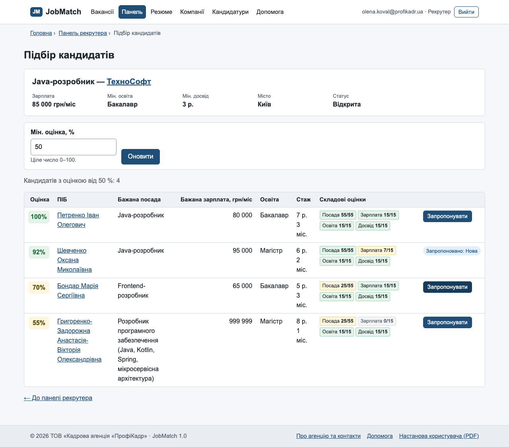{width=92%}

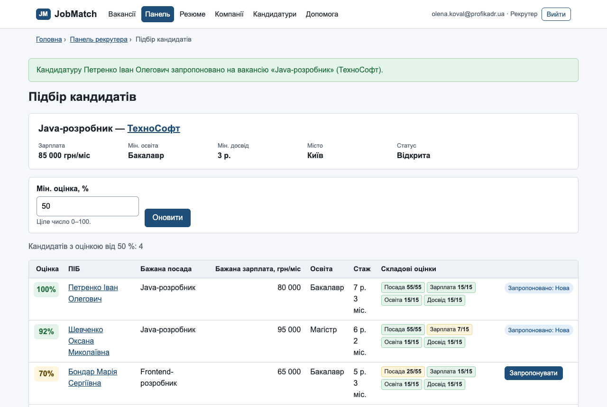{width=92%}

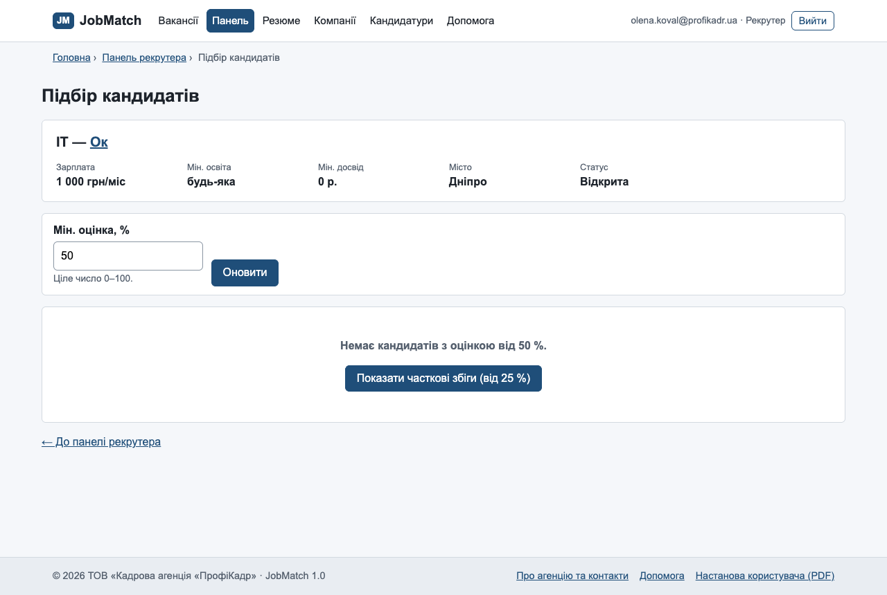{width=92%}

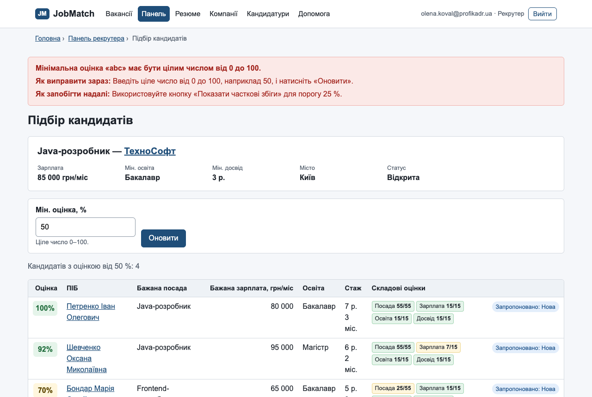{width=92%}

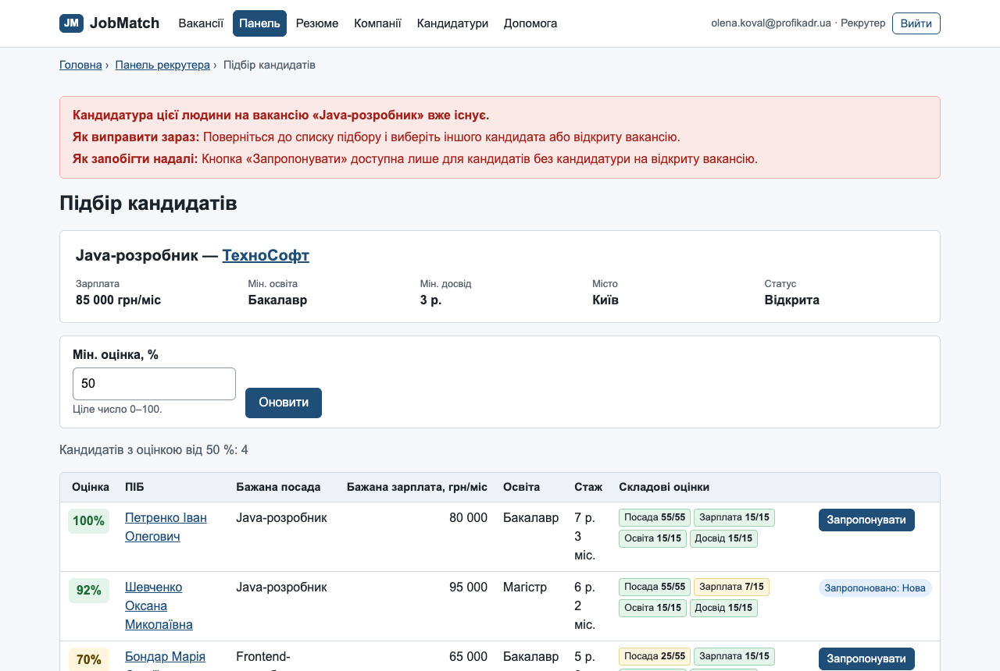{width=92%}

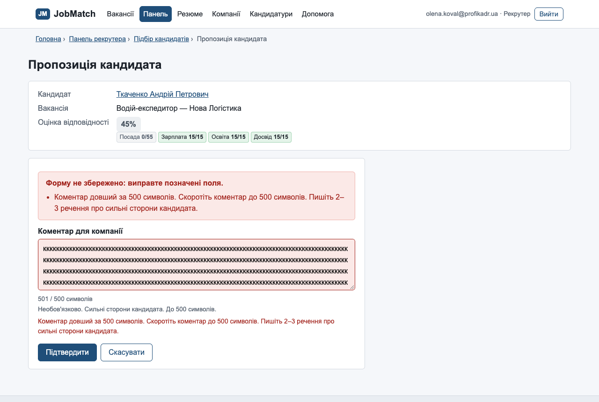{width=92%}

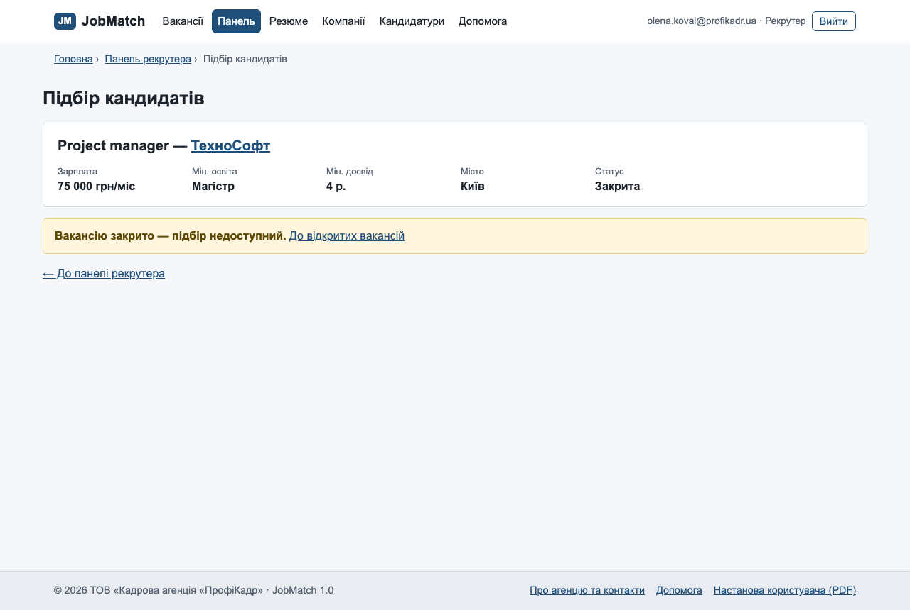{width=92%}

## 8. Крок 12. Тестування решти функцій

Тести решти UC (табл. 2 лаб. роботи 2) і загальних вимог FR-1…FR-3 автоматизовано в `jobmatch/e2e/tests/functions.spec.ts`. Для кожної функції з вхідними даними є тести на коректних і некоректних даних; для функцій з полями змінної довжини (U1, G1, G2, R1) — мінімальний, типовий і максимальний сценарії. Функції перегляду U3, C5, E3, R3, R4 не мають власних вхідних даних, тому для них наведено лише коректні сценарії; некоректні звернення до їхніх сторінок (чужа роль, неіснуючий запис) перевіряють F21.1, F21.2 і F14.2. Функції C3, E3, R3 виконують той самий M1, що й R2, тому для них достатньо типового сценарію і перевірки порогу (C3). Тести, що змінюють дані (G2, C1, C2, E2, R5, R6, R7), створюють і видаляють власні записи або виконуються на окремих записах початкових даних. Усі 51 тест пройшли. <!-- T3S:BEGIN -->
results-functions.json: 51 тест (пройдено — 51); запуск 2026-11-14 15:46:15 UTC, тривалість 20.1 с.
<!-- T3S:END -->

<!-- T3:BEGIN -->
Таблиця 3 — Тести для функцій Веб-застосунку JobMatch, частина 1: Вхід, вихід, довідка, вакансії, реєстрація (U1–U3, G1–G2)

+---------+-------------+-------------------+-----------------------------------+------------------------------+
| №       | Функція     | Умови виконання   | Кроки тесту («що натиснути, які   | Очікувана реакція            |
|         |             |                   | дані в які поля ввести»)          | Веб-застосунку               |
+=========+=============+===================+===================================+==============================+
| F1.1    | U1 Вхід     | Коректні дані —   | «Увійти» → E-mail r@pk.ua, пароль | Відкрито «Панель рекрутера»; |
|         |             | мінімальний:      | (демо) → «Увійти»                 | у шапці — «r@pk.ua ·         |
|         |             | найкоротший       |                                   | Рекрутер»                    |
|         |             | e-mail (r@pk.ua)  |                                   |                              |
+---------+-------------+-------------------+-----------------------------------+------------------------------+
| F1.2    |             | Коректні дані —   | «Увійти» → E-mail                 | Відкрито «Моє резюме»        |
|         |             | типовий: шукач    | ivan.petrenko@example.com, пароль |                              |
|         |             |                   | → «Увійти»                        |                              |
+---------+-------------+-------------------+-----------------------------------+------------------------------+
| F1.3    |             | Коректні дані —   | «Увійти» → E-mail довжиною 94     | Відкрито «Моє резюме» з ПІБ  |
|         |             | максимальний:     | символи (шукач                    | максимальної довжини         |
|         |             | e-mail 94 символи | Верховинець-Залізняк), пароль →   |                              |
|         |             |                   | «Увійти»                          |                              |
+---------+-------------+-------------------+-----------------------------------+------------------------------+
| F1.4    |             | Некоректні дані — | «Увійти» → E-mail                 | Повідомлення «Неправильний   |
|         |             | типовий:          | olena.koval@profikadr.ua, пароль  | e-mail або пароль.» з трьома |
|         |             | неправильний      | wrong-password → «Увійти»         | частинами; залишається       |
|         |             | пароль            |                                   | сторінка «Вхід»              |
+---------+-------------+-------------------+-----------------------------------+------------------------------+
| F2.1    | U2 Вихід    | Коректні дані —   | Увійти як рекрутер → «Вийти» у    | Головна сторінка з           |
|         |             | типовий           | шапці                             | повідомленням «Ви вийшли із  |
|         |             |                   |                                   | застосунку.»; у шапці —      |
|         |             |                   |                                   | «Увійти», «Реєстрація»       |
+---------+-------------+-------------------+-----------------------------------+------------------------------+
| F2.2    |             | Некоректні дані — | Увійти як рекрутер → «Вийти» →    | Перенаправлення на сторінку  |
|         |             | типовий: кабінет  | відкрити /recruiter               | «Вхід»                       |
|         |             | після виходу      |                                   |                              |
+---------+-------------+-------------------+-----------------------------------+------------------------------+
| F3.1    | U3 Довідка  | Коректні дані —   | Головна → «Допомога»              | Сторінка «Допомога» з        |
|         |             | типовий: гість    |                                   | частими питаннями і          |
|         |             |                   |                                   | посиланням «Завантажити      |
|         |             |                   |                                   | Настанову користувача (PDF)» |
+---------+-------------+-------------------+-----------------------------------+------------------------------+
| F4.1    | G1 Пошук    | Коректні дані —   | Головна → «Вакансії»              | Таблиця 11 відкритих         |
|         | вакансій    | мінімальний: без  |                                   | вакансій; закритої «Project  |
|         |             | фільтрів          |                                   | manager» немає               |
+---------+-------------+-------------------+-----------------------------------+------------------------------+
| F4.2    |             | Коректні дані —   | «Вакансії» → Посада = java,       | 1 вакансія «Java-розробник», |
|         |             | типовий: посада   | Зарплата від = 50000 → «Знайти»   | ТехноСофт, 85 000            |
|         |             | «java», зарплата  |                                   |                              |
|         |             | від 50000         |                                   |                              |
+---------+-------------+-------------------+-----------------------------------+------------------------------+
| F4.3    |             | Коректні дані —   | «Вакансії» → Посада = розробник,  | Повідомлення «За вашими      |
|         |             | максимальний: усі | Компанія = ТехноСофт, Місто =     | умовами відкритих вакансій   |
|         |             | 4 фільтри, немає  | Київ, Зарплата від = 1000000 →    | немає.» з порадою прибрати   |
|         |             | результатів       | «Знайти»                          | фільтр                       |
+---------+-------------+-------------------+-----------------------------------+------------------------------+
| F4.4    |             | Некоректні дані — | Відкрити                          | Діагностичне повідомлення    |
|         |             | типовий: зарплата | /vacancies?salaryFrom=abc         | «Фільтр зарплати містить     |
|         |             | «abc»             |                                   | нечислове значення «abc» —   |
|         |             |                   |                                   | фільтр не застосовано.»;     |
|         |             |                   |                                   | показано всі вакансії        |
+---------+-------------+-------------------+-----------------------------------+------------------------------+
| F4.5    | G1 Картка   | Коректні дані —   | «Вакансії» → «Java-розробник»     | Картка: зарплата 85 000      |
|         | вакансії    | типовий           |                                   | грн/міс, мін. освіта         |
|         |             |                   |                                   | Бакалавр, мін. досвід 3 р.,  |
|         |             |                   |                                   | вимоги, опис компанії; для   |
|         |             |                   |                                   | гостя — запрошення увійти    |
+---------+-------------+-------------------+-----------------------------------+------------------------------+
| F5.1    | G2          | Коректні дані —   | «Реєстрація» → тип «Шукач         | Сторінка «Вхід» з            |
|         | Реєстрація  | мінімальний:      | роботи», e-mail a@b.ua, пароль і  | повідомленням «Реєстрацію    |
|         |             | шукач, пароль 8   | повтор 12345678, прізвище «Ко»,   | завершено. Увійдіть з        |
|         |             | символів          | ім'я «Ян», домашня адреса «вул.   | указаними e-mail і           |
|         |             |                   | Й, 1», телефон +380501112233,     | паролем.»; вхід з цими       |
|         |             |                   | місто «Київ», згода ✓ → «Створити | даними відкриває «Моє        |
|         |             |                   | обліковий запис»                  | резюме»                      |
+---------+-------------+-------------------+-----------------------------------+------------------------------+
| F5.2    |             | Коректні дані —   | «Реєстрація» → тип «Представник   | Повідомлення «Реєстрацію     |
|         |             | типовий:          | компанії», e-mail hr@novatech.ua, | завершено…»; після входу —   |
|         |             | представник       | пароль (демо), назва «НоваТех»,   | сторінка «НоваТех» (Моя      |
|         |             | компанії          | адреса «вул. Січових Стрільців,   | компанія)                    |
|         |             |                   | 12», e-mail компанії              |                              |
|         |             |                   | jobs@novatech.ua, телефон, місто  |                              |
|         |             |                   | → «Створити обліковий запис»      |                              |
+---------+-------------+-------------------+-----------------------------------+------------------------------+
| F5.3    |             | Коректні дані —   | «Реєстрація» → шукач: e-mail 100  | Повідомлення «Реєстрацію     |
|         |             | максимальний:     | символів, пароль 64 символи,      | завершено…»                  |
|         |             | поля граничної    | прізвище й ім'я по 50 символів,   |                              |
|         |             | довжини           | адреса 200 символів, місто 60     |                              |
|         |             |                   | символів, згода ✓ → «Створити     |                              |
|         |             |                   | обліковий запис»                  |                              |
+---------+-------------+-------------------+-----------------------------------+------------------------------+
| F5.4    |             | Некоректні дані — | «Реєстрація» → шукач з e-mail     | Повідомлення «Форму не       |
|         |             | типовий: e-mail   | ivan.petrenko@example.com, згоду  | збережено…» зі змістом «Не   |
|         |             | уже               | не позначено → «Створити          | надано згоду на обробку      |
|         |             | зареєстровано,    | обліковий запис»                  | персональних даних…»;        |
|         |             | без згоди         |                                   | введені дані збережено у     |
|         |             |                   |                                   | формі                        |
+---------+-------------+-------------------+-----------------------------------+------------------------------+
| F5.5    |             | Некоректні дані — | «Реєстрація» → пароль 1234567,    | Повідомлення під полями:     |
|         |             | мінімальний:      | телефон 0671234567 → «Створити    | «Пароль має містити від 8 до |
|         |             | пароль 7          | обліковий запис»                  | 64 символів…», «Телефон має  |
|         |             | символів, телефон |                                   | неправильний формат…»        |
|         |             | без +380          |                                   |                              |
+---------+-------------+-------------------+-----------------------------------+------------------------------+

Таблиця 3, частина 2: Функції Шукача (C1–C5)

+---------+-------------+---------------------------+-----------------------------------+------------------------------+
| №       | Функція     | Умови виконання           | Кроки тесту («що натиснути, які   | Очікувана реакція            |
|         |             |                           | дані в які поля ввести»)          | Веб-застосунку               |
+=========+=============+===========================+===================================+==============================+
| F6.1    | C1 Ведення  | Коректні дані — типовий:  | Шукач → «Моє резюме» →            | Повідомлення «Резюме         |
|         | резюме      | зміна бажаної зарплати    | «Редагувати» → Бажана зарплата =  | збережено.»; у резюме — «82  |
|         |             |                           | 82000 → «Зберегти»                | 000 грн»                     |
+---------+-------------+---------------------------+-----------------------------------+------------------------------+
| F6.2    |             | Коректні дані —           | «Моє резюме» → «+ Додати освіту»  | Повідомлення «Запис про      |
|         |             | мінімальний/максимальний: | → Рівень «Магістр», заклад «КПІ», | освіту додано.» (рядок 2035  |
|         |             | додати й видалити освіту  | спеціальність «ІПЗ», рік 2035 →   | у таблиці освіти), потім     |
|         |             |                           | «Додати»; потім «Видалити» біля   | «Запис про освіту видалено.» |
|         |             |                           | запису → підтвердити              |                              |
+---------+-------------+---------------------------+-----------------------------------+------------------------------+
| F6.3    |             | Некоректні дані —         | «Моє резюме» → «Редагувати» →     | Форма не зберігається; під   |
|         |             | типовий: телефон і        | Телефон = 067-123-45-67, Бажана   | полями — «Телефон має        |
|         |             | зарплата поза межами      | зарплата = 999 → «Зберегти»       | неправильний формат…» і      |
|         |             |                           |                                   | «Бажана зарплата менша за    |
|         |             |                           |                                   | 1000 грн…»                   |
+---------+-------------+---------------------------+-----------------------------------+------------------------------+
| F7.1    | C2 Історія  | Коректні дані — типовий:  | «Історія роботи» → «+ Додати      | Повідомлення «Запис історії  |
|         | роботи      | додати, редагувати,       | запис» → компанія «Стартап»,      | роботи додано.»,             |
|         |             | видалити запис            | посада «Стажер», 2018-06-01 –     | «…збережено.», «…видалено.»; |
|         |             |                           | 2018-08-31 → «Зберегти»;          | стаж змінюється відповідно   |
|         |             |                           | «Редагувати» → посада             |                              |
|         |             |                           | «Java-стажер» → «Зберегти»;       |                              |
|         |             |                           | «Видалити» → підтвердити          |                              |
+---------+-------------+---------------------------+-----------------------------------+------------------------------+
| F7.2    |             | Некоректні дані —         | «Історія роботи» → «+ Додати      | Повідомлення «Дата           |
|         |             | типовий: дата завершення  | запис» → 2024-05-01 – 2024-04-01  | завершення раніша за дату    |
|         |             | раніша за початок         | → «Зберегти»                      | початку. Виправте одну з     |
|         |             |                           |                                   | дат…»; запис не додано       |
+---------+-------------+---------------------------+-----------------------------------+------------------------------+
| F8.1    | C3          | Коректні дані — типовий   | Шукач Петренко → «Відповідні      | Першою у списку —            |
|         | Відповідні  |                           | вакансії»                         | «Java-розробник» з оцінкою   |
|         | вакансії    |                           |                                   | 100 %; показано складові     |
|         |             |                           |                                   | оцінки                       |
+---------+-------------+---------------------------+-----------------------------------+------------------------------+
| F8.2    |             | Некоректні дані —         | «Відповідні вакансії» → Мін.      | Діагностичне повідомлення    |
|         |             | типовий: мін. оцінка «x»  | оцінка = x → «Оновити»            | «…має бути цілим числом від  |
|         |             |                           |                                   | 0 до 100»; список з порогом  |
|         |             |                           |                                   | 50 %                         |
+---------+-------------+---------------------------+-----------------------------------+------------------------------+
| F9.1    | C4 Відгук   | Коректні дані — типовий   | Шукач Петренко → «Вакансії» →     | Повідомлення «Відгук         |
|         | на вакансію |                           | «QA-інженер» → «Відгукнутися»     | надіслано…»; на картці —     |
|         |             |                           |                                   | «Ваш відгук: Нова»           |
+---------+-------------+---------------------------+-----------------------------------+------------------------------+
| F9.2    |             | Некоректні дані —         | Шукач → відкрити /vacancies/4     | Повідомлення «Вакансію       |
|         |             | типовий: закрита вакансія | (закрита «Project manager»)       | закрито — подання кандидатур |
|         |             |                           |                                   | недоступне.»; кнопки         |
|         |             |                           |                                   | «Відгукнутися» немає         |
+---------+-------------+---------------------------+-----------------------------------+------------------------------+
| F10.1   | C5 Мої      | Коректні дані — типовий   | Шукач Петренко → «Мої відгуки»    | Таблиця кандидатур з рядком  |
|         | відгуки     |                           |                                   | «QA-інженер», ТехноСофт,     |
|         |             |                           |                                   | джерело «Відгук шукача»,     |
|         |             |                           |                                   | статус «Нова»                |
+---------+-------------+---------------------------+-----------------------------------+------------------------------+
| F10.2   |             | Коректні дані —           | Увійти як шукач ya@i.ua → «Мої    | Повідомлення «Ви ще не       |
|         |             | мінімальний: немає        | відгуки»                          | відгукувалися на вакансії.»  |
|         |             | відгуків                  |                                   | і посилання на відповідні    |
|         |             |                           |                                   | вакансії                     |
+---------+-------------+---------------------------+-----------------------------------+------------------------------+

Таблиця 3, частина 3: Функції Представника компанії (E1–E4)

+---------+-------------+---------------------------+-----------------------------------+------------------------------+
| №       | Функція     | Умови виконання           | Кроки тесту («що натиснути, які   | Очікувана реакція            |
|         |             |                           | дані в які поля ввести»)          | Веб-застосунку               |
+=========+=============+===========================+===================================+==============================+
| F11.1   | E1 Профіль  | Коректні дані — типовий   | Представник ТехноСофт → «Моя      | Повідомлення «Профіль        |
|         | компанії    |                           | компанія» → «Редагувати профіль»  | компанії збережено.»; у      |
|         |             |                           | → Сайт = https://technosoft.ua →  | профілі — новий сайт         |
|         |             |                           | «Зберегти»                        |                              |
+---------+-------------+---------------------------+-----------------------------------+------------------------------+
| F11.2   |             | Некоректні дані —         | «Редагувати профіль» → Сайт =     | Повідомлення «Адреса сайту   |
|         |             | типовий: сайт без https,  | technosoft.ua → «Зберегти»; потім | має неправильний формат…»;   |
|         |             | назва зайнята             | Назва = «АгроПлюс» → «Зберегти»   | потім «Компанія з назвою     |
|         |             |                           |                                   | «АгроПлюс» вже існує…»       |
+---------+-------------+---------------------------+-----------------------------------+------------------------------+
| F12.1   | E2 Ведення  | Коректні дані — типовий:  | «Вакансії компанії» → «+ Нова     | Повідомлення «Вакансію       |
|         | вакансій    | додати, редагувати,       | вакансія» → посада                | «DevOps-інженер»             |
|         |             | закрити, видалити         | «DevOps-інженер», 90000,          | опубліковано.», «Вакансію    |
|         |             |                           | Бакалавр, 3 р., Київ →            | збережено.», «Вакансію       |
|         |             |                           | «Зберегти»; «Редагувати» →        | закрито.», «Вакансію         |
|         |             |                           | зарплата 95000; «Закрити»;        | відкрито.», «Вакансію        |
|         |             |                           | «Відкрити»; «Видалити» →          | видалено.»                   |
|         |             |                           | підтвердити                       |                              |
+---------+-------------+---------------------------+-----------------------------------+------------------------------+
| F12.2   |             | Некоректні дані —         | «+ Нова вакансія» → посада «Х»,   | Повідомлення «Назва посади   |
|         |             | мінімальний/максимальний: | зарплата 999, досвід 41 →         | має бути від 2 до 100        |
|         |             | зарплата 999 і досвід 41  | «Зберегти»                        | символів…», «Зарплата менша  |
|         |             |                           |                                   | за 1000 грн…», «Досвід       |
|         |             |                           |                                   | більший за 40 років…»        |
+---------+-------------+---------------------------+-----------------------------------+------------------------------+
| F13.1   | E3          | Коректні дані — типовий   | «Вакансії компанії» → «Відповідні | Список кандидатів у форматі  |
|         | Відповідні  |                           | резюме» біля «Java-розробник»     | «Ім'я П.» без контактів, з   |
|         | резюме      |                           |                                   | оцінками і складовими        |
+---------+-------------+---------------------------+-----------------------------------+------------------------------+
| F14.1   | E4 Розгляд  | Коректні дані — типовий:  | «Вакансії компанії» →             | Повідомлення «Кандидата      |
|         | кандидатур  | запросити й відхилити     | «Кандидатури» біля                | запрошено на співбесіду…»    |
|         |             |                           | «Java-розробник» → «Запросити»    | (статус «Запрошено»), потім  |
|         |             |                           | біля «Оксана Ш.»; «Кандидатури»   | «Кандидатуру відхилено.»     |
|         |             |                           | біля «QA-інженер» → «Відхилити»   | (статус «Відхилено»); кнопок |
|         |             |                           | біля «Іван П.» → підтвердити      | рішення для них більше немає |
+---------+-------------+---------------------------+-----------------------------------+------------------------------+
| F14.2   |             | Некоректні дані —         | Представник ТехноСофт відкриває   | Сторінка «404 — Не знайдено» |
|         |             | типовий: чужа вакансія    | /company/vacancies/5/applications |                              |
|         |             |                           | (вакансія «Нова Логістика»)       |                              |
+---------+-------------+---------------------------+-----------------------------------+------------------------------+

Таблиця 3, частина 4: Функції Рекрутера та розмежування доступу (R1, R3–R7, FR-2, FR-3)

+---------+------------------+-------------------+------------------------------------+------------------------------+
| №       | Функція          | Умови виконання   | Кроки тесту («що натиснути, які    | Очікувана реакція            |
|         |                  |                   | дані в які поля ввести»)           | Веб-застосунку               |
+=========+==================+===================+====================================+==============================+
| F15.1   | R1 Пошук резюме  | Коректні дані —   | Рекрутер → «Резюме»                | Таблиця всіх резюме (усі     |
|         |                  | мінімальний: без  |                                    | статуси), впорядкована за    |
|         |                  | фільтрів          |                                    | прізвищем                    |
+---------+------------------+-------------------+------------------------------------+------------------------------+
| F15.2   |                  | Коректні дані —   | «Резюме» → Освіта не нижче =       | Резюме: Олійник Віктор,      |
|         |                  | типовий: освіта   | Магістр, Посада = java → «Знайти»  | Шевченко Оксана (+           |
|         |                  | не нижче          |                                    | Григоренко-Задорожна з       |
|         |                  | «Магістр», посада |                                    | посадою Java у бажаній)      |
|         |                  | «java»            |                                    |                              |
+---------+------------------+-------------------+------------------------------------+------------------------------+
| F15.3   |                  | Коректні дані —   | «Резюме» → ПІБ = пет, Посада =     | Одне резюме — Петренко Іван  |
|         |                  | максимальний: усі | java, Компанія = Глобал, Освіта =  | Олегович                     |
|         |                  | фільтри           | Бакалавр, Зарплата 50000–90000,    |                              |
|         |                  |                   | Статус = Шукає роботу → «Знайти»   |                              |
+---------+------------------+-------------------+------------------------------------+------------------------------+
| F15.4   |                  | Некоректні дані — | Відкрити                           | Діагностичне повідомлення    |
|         |                  | типовий: зарплата | /recruiter/people?salaryFrom=п'ять | «Фільтр зарплати містить     |
|         |                  | від «п'ять»       |                                    | нечислове значення…»;        |
|         |                  |                   |                                    | показано всі резюме          |
+---------+------------------+-------------------+------------------------------------+------------------------------+
| F16.1   | R3 Підбір        | Коректні дані —   | «Резюме» → «Петренко Іван          | Першою — «Java-розробник»,   |
|         | вакансій для     | типовий           | Олегович» → «Підібрати вакансії»   | ТехноСофт, 100 % (позначка   |
|         | шукача           |                   |                                    | поданої кандидатури)         |
+---------+------------------+-------------------+------------------------------------+------------------------------+
| F17.1   | R4 Історія       | Коректні дані —   | «Резюме» → «Верховинець-Залізняк…» | Картка з 3 записами історії  |
|         | роботи           | максимальний: 3   |                                    | роботи (поточний — «досі»),  |
|         |                  | записи, PhD       |                                    | 3 записами освіти, стажем 12 |
|         |                  |                   |                                    | р. 4 міс.                    |
+---------+------------------+-------------------+------------------------------------+------------------------------+
| F17.2   |                  | Коректні дані —   | «Резюме» → «Бо Ян»                 | Картка з текстом «Історію    |
|         |                  | мінімальний: без  |                                    | роботи не вказано.» і        |
|         |                  | історії           |                                    | «Освіту не вказано.», стаж 0 |
|         |                  |                   |                                    | р. 0 міс.                    |
+---------+------------------+-------------------+------------------------------------+------------------------------+
| F18.1   | R5 Ведення даних | Коректні дані —   | «Резюме» → «+ Нова людина» →       | Повідомлення «Резюме         |
|         | людей            | типовий: додати,  | прізвище «Демченко», ім'я «Олег»,  | Демченко Олег додано…»,      |
|         |                  | редагувати,       | телефон, e-mail, місто →           | «Запис історії роботи        |
|         |                  | додати запис      | «Зберегти»; «+ Додати запис»       | додано.», «Резюме            |
|         |                  | роботи, видалити  | роботи → «Додати»; «Редагувати» →  | збережено.», «Резюме         |
|         |                  |                   | місто «Львів»; «Видалити» →        | Демченко Олег видалено…»     |
|         |                  |                   | підтвердити (текст підтвердження з |                              |
|         |                  |                   | кількістю записів)                 |                              |
+---------+------------------+-------------------+------------------------------------+------------------------------+
| F18.2   |                  | Некоректні дані — | «+ Нова людина» → прізвище         | Повідомлення «Не вказано     |
|         |                  | типовий: порожнє  | порожнє, ім'я «Олег2» → «Зберегти» | прізвище…», «Ім’я містить    |
|         |                  | прізвище, цифри в |                                    | недопустимі символи…»;       |
|         |                  | імені             |                                    | людину не додано             |
+---------+------------------+-------------------+------------------------------------+------------------------------+
| F19.1   | R6 Компанії та   | Коректні дані —   | «Компанії» → «+ Нова компанія» →   | Повідомлення «Компанію       |
|         | вакансії         | типовий: додати   | «БудКом», Одеса, адреса, телефон,  | «БудКом» додано.», «Вакансію |
|         |                  | компанію і        | e-mail → «Зберегти»; «+ Нова       | «Виконроб» додано.»,         |
|         |                  | вакансію,         | вакансія» → «Виконроб», 40000 →    | «Компанію «БудКом» видалено  |
|         |                  | видалити          | «Зберегти»; «Видалити» компанію →  | разом з її вакансіями.»      |
|         |                  |                   | підтвердити                        |                              |
+---------+------------------+-------------------+------------------------------------+------------------------------+
| F19.2   |                  | Некоректні дані — | «+ Нова компанія» → Назва =        | Повідомлення «Компанія з     |
|         |                  | типовий: назва    | «ТехноСофт», решта полів коректні  | назвою «ТехноСофт» вже       |
|         |                  | вже існує         | → «Зберегти»                       | існує.» з порадою змінити    |
|         |                  |                   |                                    | назву                        |
+---------+------------------+-------------------+------------------------------------+------------------------------+
| F20.1   | R7               | Некоректні дані — | «Кандидатури» → фільтр «Запрошено» | Повідомлення «Дата початку   |
|         | Працевлаштування | максимальний:     | → «Зареєструвати працевлаштування» | роботи не вказана або        |
|         |                  | дата початку +91  | біля «Бондар Марія» → дата =       | пізніша за …»; статус        |
|         |                  | день              | сьогодні + 91 день → «Підтвердити» | кандидатури не змінено       |
|         |                  |                   | → підтвердити                      |                              |
+---------+------------------+-------------------+------------------------------------+------------------------------+
| F20.2   |                  | Коректні дані —   | «Кандидатури» → «Запрошено» →      | Повідомлення                 |
|         |                  | типовий: дата за  | «Зареєструвати працевлаштування»   | «Працевлаштування Бондар     |
|         |                  | замовчуванням     | біля «Бондар Марія» → дата         | Марія Сергіївна на вакансію  |
|         |                  |                   | сьогодні → «Підтвердити» →         | «Frontend-розробник»         |
|         |                  |                   | підтвердити                        | (ТехноСофт) зареєстровано.»; |
|         |                  |                   |                                    | вакансія закрита; статус     |
|         |                  |                   |                                    | людини «Не шукає»; в історії |
|         |                  |                   |                                    | роботи — новий запис «досі»  |
+---------+------------------+-------------------+------------------------------------+------------------------------+
| F20.3   |                  | Некоректні дані — | Відкрити форму працевлаштування    | Повідомлення                 |
|         |                  | типовий:          | для кандидатури зі статусом «Нова» | «Працевлаштування можна      |
|         |                  | кандидатура не    | (Коваленко → QA-інженер) і         | зареєструвати лише для       |
|         |                  | «Запрошено»       | натиснути «Підтвердити»            | кандидатури зі статусом      |
|         |                  |                   |                                    | «Запрошено»…»                |
+---------+------------------+-------------------+------------------------------------+------------------------------+
| F21.1   | Доступ за ролями | Некоректні дані — | Увійти як шукач → відкрити         | Сторінка «403 — Доступ       |
|         |                  | типовий: шукач    | /recruiter                         | заборонено»                  |
|         |                  | відкриває панель  |                                    |                              |
|         |                  | рекрутера         |                                    |                              |
+---------+------------------+-------------------+------------------------------------+------------------------------+
| F21.2   | Неіснуюча        | Некоректні дані — | Відкрити /no-such-page             | Сторінка «404 — Не знайдено» |
|         | сторінка         | типовий           |                                    | з посиланнями «На головну»,  |
|         |                  |                   |                                    | «До вакансій»                |
+---------+------------------+-------------------+------------------------------------+------------------------------+
<!-- T3:END -->

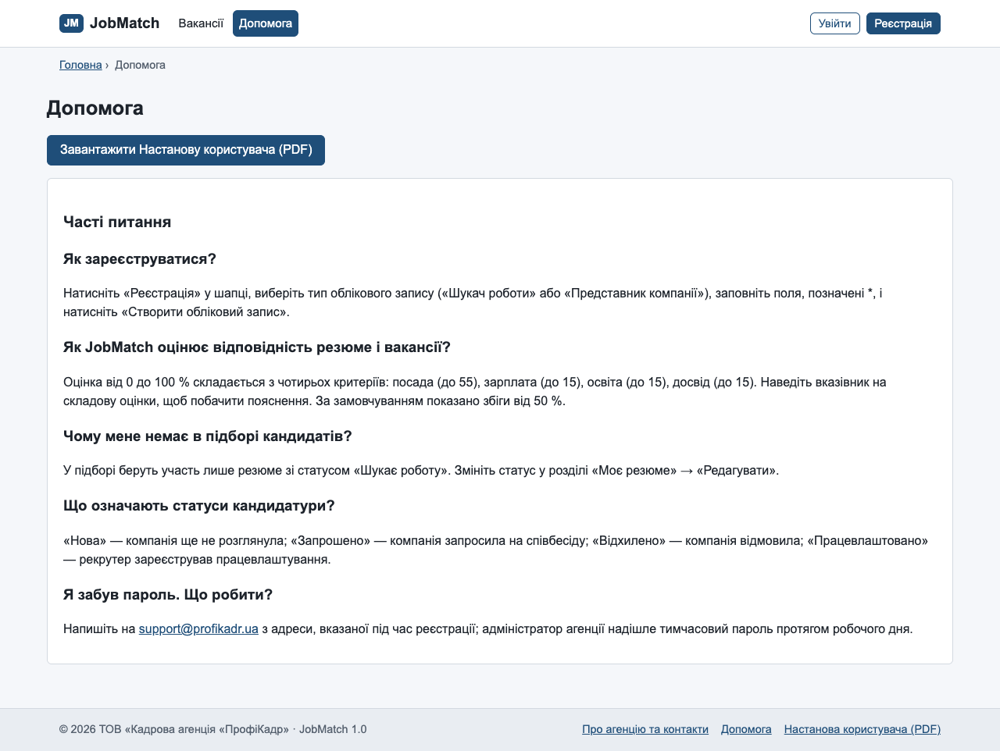{width=85%}

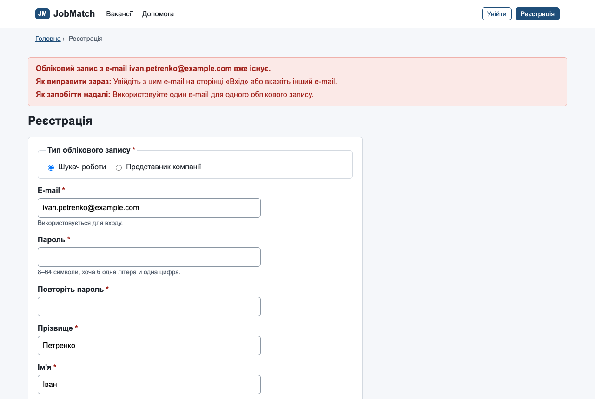{width=85%}

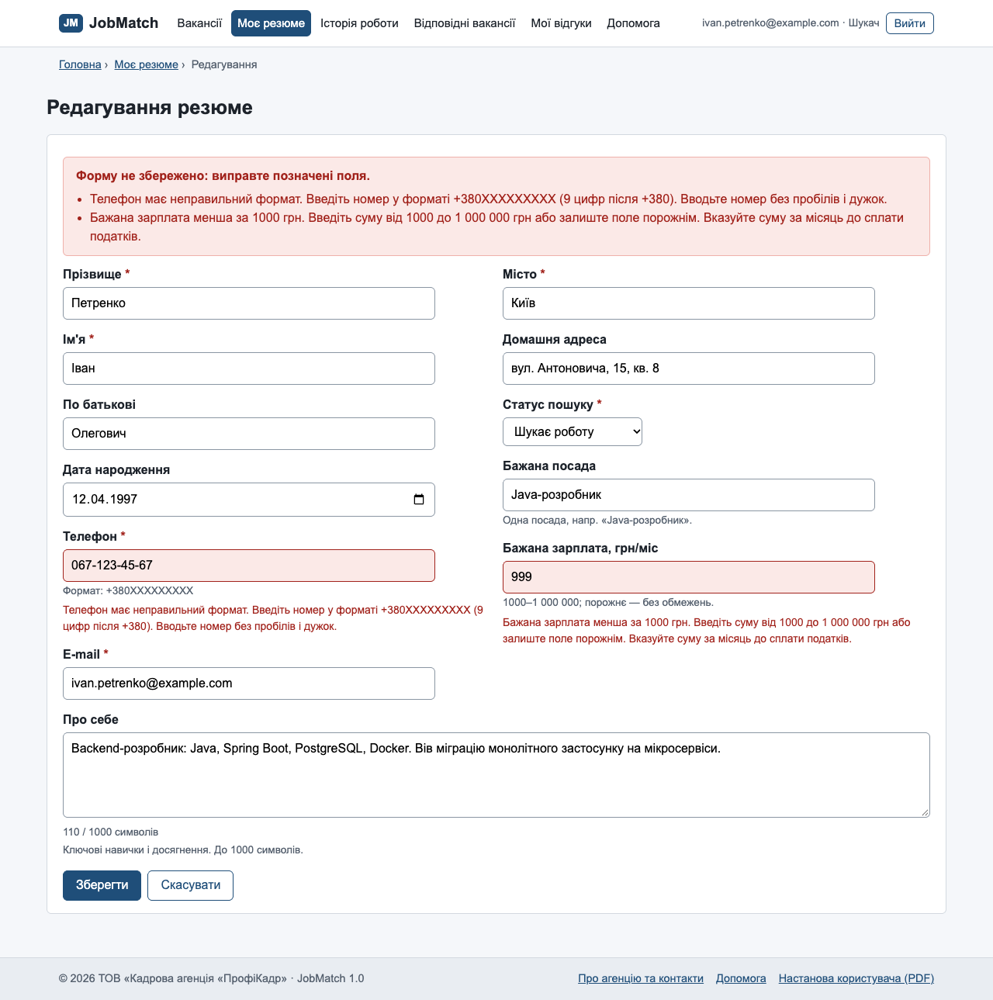{width=85%}

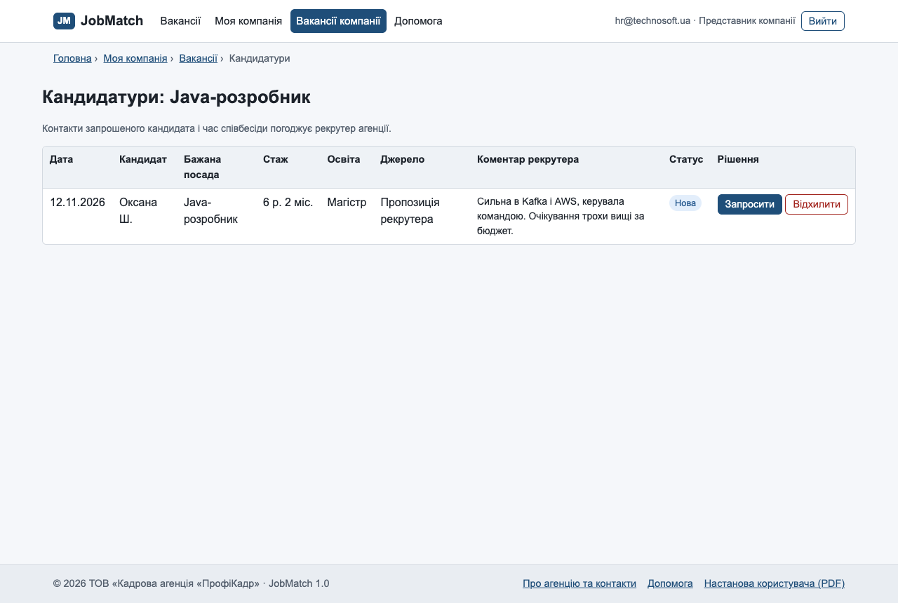{width=85%}

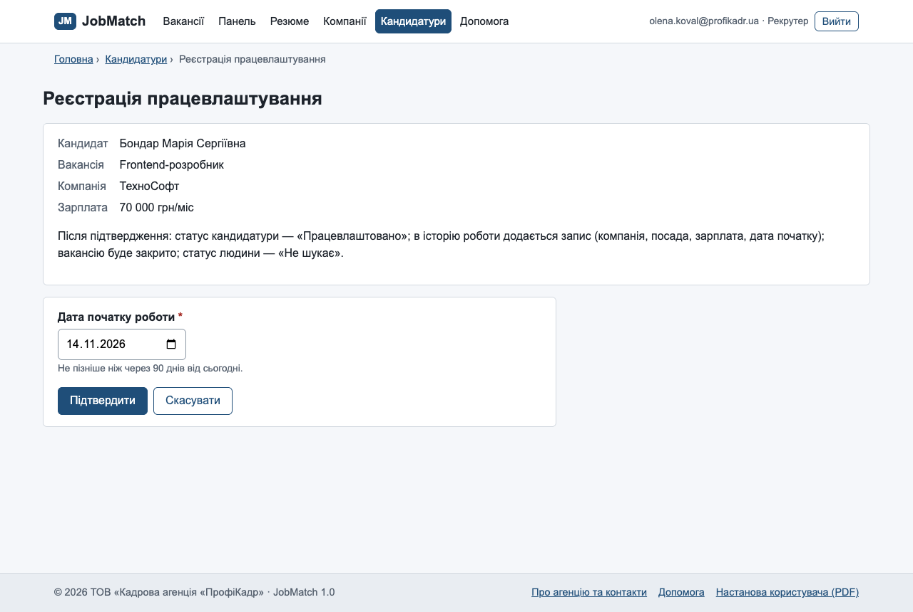{width=85%}

## 9. Крок 13. Огляд інтерфейсу на відповідність стандартам де-факто

### 9.1. Рамковий опитувальник (Стандарт_інтерф, частина II)

Таблиця 9.1 — Відповіді на питання рамкового опитувальника

| Питання | Відповідь | Обґрунтування |
|--------------------------|--------|--------------------------------|
| **1. Архітектура та навігація** | | |
| Структура відповідає цілям; схема навігації зрозуміла | Так | Організація за ролями: меню ролі з 2–4 пунктів, однакова шапка на всіх сторінках |
| Видно, де перебуває користувач | Так | Активний пункт меню, хлібні крихти, заголовок h1 і `<title>` «<сторінка> — JobMatch» |
| Легко знайти інформацію; є пошук | Так, частково | Форма пошуку вакансій на головній (Посада, Місто), фільтри G1 і R1; повнотекстового пошуку сайтом немає — для 30 сторінок за ролями не потрібен |
| Кількість і порядок пунктів навігації | Так | ≤ 7 пунктів у шапці для будь-якої ролі; порядок — за частотою завдань |
| Назви посилань відповідають назвам сторінок; посилання виділено | Так | «Підібрати кандидатів» → «Підбір кандидатів»; посилання підкреслені, колір відвіданих відрізняється |
| Посилання на головну виділено; на кожній сторінці видно назву сайту | Так | Логотип «JM JobMatch» ліворуч у шапці, у хлібних крихтах — «Головна» |
| Карта сайту | Ні | `sitemap.xml` не створено; публічних сторінок 6, вони всі є в шапці й підвалі |
| Користувач керує навігацією | Так | Немає автоматичних перенаправлень за таймером, кнопка «Назад» браузера працює (усі сторінки мають власну адресу) |
| **2. Планування і дизайн** | | |
| Розмір сторінки не перевищує вікно; планування повторюється | Так | Однаковий каркас «шапка — крихти — вміст — підвал»; на 375 px горизонтальної прокрутки сторінки немає, широкі таблиці прокручуються у власному блоці (виправлено дефект 12) |
| Чіткий фокус, вирівнювання й групування, контраст | Так | Одна основна кнопка на секцію, картки-групи, контраст тексту ≥ 4,5:1 |
| Планування не громіздке; естетика | Так | Ширина вмісту ≤ 1160 px, нейтральна палітра з одним основним кольором #1f4e79 |
| **3. Зміст** | | |
| Тексти зрозумілі й лаконічні, організовані блоками; помилок немає | Так | Тексти переглянуто; повідомлення — 1–3 речення |
| Мультимедіа | Не застосовується | Мультимедійних компонентів немає — завдання користувачів їх не потребують |
| Одиниці вимірювання зрозумілі | Так | «грн/міс», «р. міс.», «%» у заголовках стовпців і підписах полів (FR-7) |
| Дата і час створення сторінок | Так, для даних | Дата створення вакансії і кандидатури; для статичних сторінок — не потрібно |
| Контактні телефони, адреси з індексами | Так | Сторінка «Про агенцію та контакти»: адреса офісу, телефон, e-mail |
| **4. Форми та взаємодія** | | |
| Форми відповідають задачам, елементи згруповано, кнопка відправки зрозуміла | Так | Поля згруповано (`fieldset` для типу облікового запису), основна кнопка з дієсловом: «Підтвердити», «Зберегти», «Створити обліковий запис» |
| Логічна послідовність кроків, очевидний перехід далі | Так | Багатокрокових форм немає; після дії — повідомлення і повернення до списку |
| **5. Графіка і кольори** | | |
| Якість, альтернативний текст, обсяг графіки | Так | Растрових зображень немає; логотип — текст, піктограма — SVG 1 КБ; логотип має `aria-label` |
| Анімація | Ні | Не використовується |
| Вибір і кількість кольорів, узгодженість | Так | Основний, червоний (помилка), зелений (успіх), жовтий (частковий бал); колір завжди дублюється текстом або числом |
| Розрізнення в чорно-білому режимі | Так | Складові оцінки і статуси мають текстові значення; друкований вигляд — чорно-білий |
| **6. Оформлення тексту** | | |
| Розмір і колір шрифту, контраст | Так | Базовий шрифт 16 px, текст #1d232b на #f5f7fa (контраст 15:1), другорядний #55606e (6,5:1) |
| 10–12 слів у рядку; поля довкола тексту | Так, частково | Форми обмежено шириною 720 px; текст на сторінках допомоги — на всю ширину контейнера (до ~16 слів у рядку) |
| **7. Стійкість до помилок** | | |
| Не треба нічого запам'ятовувати між сторінками | Так | Параметри вакансії показано на сторінці підбору і на формі пропозиції; поріг зберігається під час переходу до картки кандидата і назад |
| Попередження перед незворотними діями; можливість скасувати | Так | Підтвердження з назвою об'єкта перед видаленням, відхиленням, працевлаштуванням (FR-5); «Скасувати» у формах |
| Помилки перехоплюються без звернення до сервера | Частково | `maxlength`, `type="email"`, `type="number"`, `type="date"`; основна перевірка — на сервері (форми з `novalidate`, щоб повідомлення мали формат із трьох частин) |
| Сторінки помилок корисні; порожні результати мають поради | Так | 404/403/500 з поясненням і посиланнями; «За вашими умовами відкритих вакансій немає» з порадою прибрати фільтр; A1 — кнопка часткових збігів |
| Контекстна допомога, структурована за задачами | Так, частково | Підказки під полями з нестандартним форматом (NFR-H-4), підказки складових оцінки; сторінка «Допомога» — 5 частих питань; Настанова за ролями — лаб. робота 6 |
| **8. Платформа** | | |
| Швидкість завантаження | Так | Локально TTFB ≤ 27 мс, LCP ≤ 40 мс (розд. 12) |
| Гіперпосилання працюють; немає пошкоджених зображень | Так, з винятком | Перевірено тестами Playwright; посилання на PDF Настанови поверне 404 до лаб. роботи 6 |
| Текст доступний пошуковим системам | Так | Серверний рендеринг HTML, `meta description`, ієрархія заголовків |
| Різні браузери і роздільні здатності | Частково | Перевірено Chrome 157 (1280 × 860, 375 × 760, 360 px); Firefox, Safari, Edge — ручна перевірка не задокументована |
| Нестандартні plug-in | Ні | Не використовуються |

### 9.2. Рамковий контрольний список (частина III)

Перевірку виконано вручну і скриптом Playwright (Chrome, 1280 × 860 і 375 × 760) на ноутбуці 14.11.2026.

Таблиця 9.2 — Результати перевірки за контрольним списком

| № | Пункт | Результат |
|---|----------------|------------------------------------|
| 1 | Обов'язкові поля позначено *; повідомлення про незаповнене поле | Так: * біля підпису (`aria-required` для програм екранного доступу); незаповнене поле — повідомлення з трьох частин (F5.4, F18.2). Пояснення «* — обов'язкове поле» над формами немає — відхилення від п. 1.1 частини I |
| 2 | Збереження і читання з БД для кожного поля | Так: тести F5.3 (усі поля граничної довжини), F6.1, F7.1, F11.1, F12.1, F18.1, F19.1 зберігають і перевіряють виведене значення |
| 3 | Передавання даних електронною поштою | Не застосовується: e-mail показано посиланнями `mailto:` |
| 4 | Значення в списках | Так: рівні освіти впорядковано за зростанням, статуси — за життєвим циклом; мета-елементи «будь-яка», «усі» на початку списку; список без вибору означає «без фільтра», тому повідомлення не потрібне |
| 5 | Опція за замовчуванням | Так: тип облікового запису «Шукач роботи», статус «Шукає роботу», поріг 50 %, дата працевлаштування — сьогодні; однакові в усіх формах |
| 6 | Елементи керування однакові; початкові значення перемикачів | Так: спільні фрагменти полів і кнопок; перемикач типу облікового запису має вибране значення |
| 7 | Текстові поля: розмір, припустимі / неприпустимі значення, телефон, e-mail, дати | Так: межі довжини 0/1/max/max + 1 (табл. 2, 3), телефон `+380XXXXXXXXX`, e-mail за `@Email` (до 100 символів, локальна частина ≤ 64), дата народження в минулому, рік освіти 1950–2035, дата завершення ≥ дати початку. Поштового індексу і часу у формах немає |
| 8 | Списки замість текстових полів | Так: рівень освіти, статус, тип облікового запису, мін. освіта вакансії — списки або перемикачі |
| 9 | Коректність повідомлень про помилки | Так: формат «Сутність. Як виправити зараз. Як запобігти надалі.», назва поля і допустимий формат у тексті |
| 10 | Розміщення форми і сторінки на екрані | До заповнення, після коректного і некоректного — блок повідомлення згори вмісту (y ≈ 200 px), поле з помилкою підсвічене. На ширині 360–375 px сторінки без таблиць не мають горизонтальної прокрутки; таблиці прокручуються у власному блоці. **Виявлено й виправлено (дефект 12):** на сторінках `/recruiter`, `/recruiter/vacancies/{id}/matches`, `/recruiter/applications`, `/recruiter/people/{id}` прокручувалася вся сторінка (на 76–578 px): прихований заголовок стовпця «Дія» (клас `.sr`, `position: absolute`) виходив за межі блоку прокрутки `.table-wrap`. Додано `position: relative` для `.table-wrap`; повторна перевірка — горизонтальної прокрутки немає |
| 11 | Відновлення значень після відправлення з помилками | Так: усі введені значення, крім паролів, повертаються у форму (F5.4, A5 — коментар 501 символ) |

Додаткові перевірки: порядок табуляції відповідає порядку читання (посилання «Перейти до вмісту» → логотип → меню → вхід → поля форми → підвал); фокус видно на кожному елементі (жовта рамка 3 px, рис. 14); з клавіатури рекрутер доходить до першої кнопки «Запропонувати» за 16 натискань Tab. Після помилки сервера фокус переходить на перше поле з помилкою (дефект 13, виправлено). Сторінки 403 і 404 повертають правильні коди і заголовки. Таблиця стилів для друку (FR-8) прибирає шапку, підвал, кнопки й форми; заголовки картки людини (ПІБ, «Історія роботи», «Освіта») зберігаються (дефект 14, виправлено).

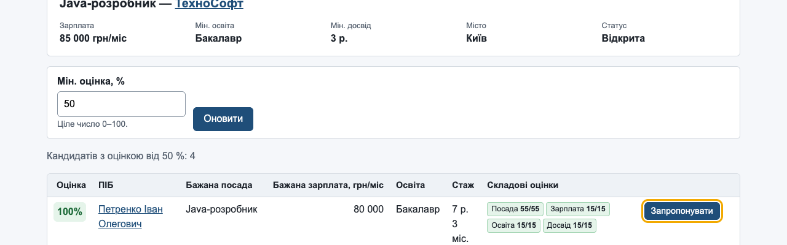{width=92%}

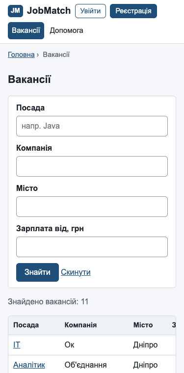{width=38%}

**Тестування локалізації** не застосовується: інтерфейс має одну мову (українська, `lang="uk"`).

## 10. Дефекти, виявлені та виправлені під час тестування

Таблиця 10.1 — Виправлені дефекти

| № | Дефект | Як виявлено | Виправлення | Регресійний тест |
|---|-------------------|----------|------------------|------------|
| 1 | Кандидати без збігу посади отримували 60 % (вище порогу 50 %) | Модульний тест MatchingService, огляд результатів R2 | Ваги критеріїв змінено на 55 / 15 / 15 / 15: без збігу посади оцінка ≤ 45 % | candidateWithoutPositionMatchStaysBelowDefaultThreshold |
| 2 | «ІТ» збігалося як підрядок у «архітектура» | Припущення про помилки, модульний тест PositionCriterion | Порівняння назв посад цілими словами | desiredPosition [8] |
| 3 | Апострофи зникали з повідомлень валідації («Імя») через інтерполяцію MessageFormat | Функціональний тест G2 | Замінено на типографський апостроф ’ | F5.4, F18.2 |
| 4 | LazyInitializationException під час формування повідомлення про пропозицію | Інтеграційний тест | Ініціалізація компанії вакансії в транзакції `ApplicationService` | proposeCreatesApplication, T2-01…T2-05 |
| 5 | Зарезервована змінна Thymeleaf `application` на сторінці працевлаштування | Функціональний тест R7 | Змінну моделі перейменовано на `candidacy` | F20.1–F20.3 |
| 6 | Нечисловий фільтр зарплати давав HTTP 400 | Функціональний тест G1, R1 (некоректні дані) | Фільтр ігнорується, показано діагностичне повідомлення | F4.4, F15.4 |
| 7 | E-mail з локальною частиною > 64 символів відхиляється | Функціональний тест G2 (максимальні дані) | Очікувана поведінка за RFC 5321; уточнено тестові дані (e-mail 100 символів з локальною частиною ≤ 64) | F5.3 |
| 8 | Порт 8080 зайнятий на ноутбуці | Запуск | Застосунок використовує порт 8090 | — |
| 9 | Вміст сторінок звужувався й центрувався (flex-елемент з `margin: auto` не розтягувався), порожній відступ над банером головної | Огляд скриншотів | Додано `width: 100%` для `.wrap` | Скриншоти `jobmatch/e2e/screenshots` |
| 10 | Повідомлення про дублікат кандидатури / закриту вакансію губилося через подвійне перенаправлення на форму пропозиції | Функціональний тест T2-19 після додавання перевірки у GET-запит форми | Перенаправлення на список підбору з повідомленням | T2-19, T2-21, duplicateProposalRejected |
| 11 | На ширині 375 px вміст торкався лівого краю (`.page` перевизначав бічні відступи `.wrap`), сітка фільтрів виходила за межі екрана | Огляд інтерфейсу на 375 px (крок 13) | `.page` задає лише верхній і нижній відступи; фільтри — `minmax(min(180px, 100%), 1fr)` | Скриншот 375 px (рис. 15) |
| 12 | На ширині 375 px сторінки з таблицями прокручувалися горизонтально: прихований заголовок «Дія» (`.sr`) виходив за межі непозиційованого `.table-wrap` | Огляд інтерфейсу на 375 px (крок 13, частина III) | `.table-wrap { position: relative; }` | Повторна перевірка на 360 і 375 px |
| 13 | Після помилки валідації на сервері фокус не переходив на поле з помилкою | Огляд інтерфейсу (частина I, п. 5.3) | `app.js` переводить фокус на перше поле з класом `invalid` | Перевірка з клавіатури |
| 14 | Під час друку картки людини зникали заголовки (ПІБ, «Історія роботи», «Освіта»), бо таблиця стилів для друку приховувала весь `.toolbar` | Перевірка FR-8 (друк засобами браузера) | Друк приховує лише кнопки й форми | Попередній перегляд друку |

## 11. Спеціальні прийоми

**Адаптивний дизайн.** Одна таблиця стилів з точкою перелому 760 px: меню переноситься в окремий рядок, двоколонкові форми і списки властивостей стають одноколонковими, зменшуються заголовки; сітка параметрів вакансії — `auto-fill, minmax(170px, 1fr)`. Широкі таблиці розміщено в блоці `.table-wrap` з `overflow-x: auto` (NFR-U-7). Окремої мобільної версії немає. Окрема таблиця стилів для друку (`@media print`, FR-8).

**Нефункціональні вимоги.** Продуктивність (NFR-P-3, NFR-P-4): підбір R2 виконує два запити — людей зі статусом «шукає» разом з освітою (`@EntityGraph`) і їхню історію роботи (`join fetch`), — а оцінювання M1 виконується в пам'яті без запиту на кожного кандидата; індекси за `job_status`, `vacancy.status`. Вимога «≤ 2 с для 10 000 резюме» на такому обсязі не перевірялась (у початкових даних 12 людей). Розширюваність (NFR-S-3): новий критерій — новий клас `MatchCriterion` з `@Component`, Spring передає список критеріїв у `MatchingService`. Доступність (NFR-U-2…U-6): `lang="uk"`, посилання «Перейти до вмісту», підписи `<label for>` для всіх полів, `aria-required`, `aria-describedby` для підказок, `role="alert"` / `role="status"` для повідомлень, заголовки стовпців таблиць, контраст за токенами кольорів у `:root`, видимий фокус `:focus-visible`, повна робота з клавіатури. Надійність: транзакції, обмеження CHECK і UNIQUE, сторінки 404/403/500.

**Безпека** — розд. 4.

**Пошукова оптимізація.** Серверний рендеринг, `meta description`, унікальний `<title>` кожної сторінки, ієрархія заголовків h1–h3, семантичні елементи `header`, `nav`, `main`, `footer`. Файли `sitemap.xml` і `robots.txt` не створено.

**Семантичні URL** (п. 4.1.2 ТЗ, FR-10) реалізовано: адреси за ієрархією розділів і ролей — `/vacancies/1`, `/me/resume`, `/company/vacancies/3/applications`, `/recruiter/people/12`, `/recruiter/vacancies/1/matches`, `/recruiter/vacancies/1/propose?personId=3`; параметри фільтрів — у рядку запиту, тому результати пошуку можна зберегти в закладках.

## 12. Кроки 14–15. Нефункціональне тестування

Кроки 14–15 не виконувались: застосунок не розгорнуто на публічному хості, а більшість онлайн-інструментів табл. 4 завдання (PageSpeed Insights, WebPageTest, Observatory, сканери безпеки, перевірка посилань і конфігурацій) перевіряють сайт за публічною адресою. Валідатори W3C приймають і завантажений файл, але цю перевірку також не виконано; сторінки застосунку на сторонні сервіси не надсилались.

Замість цього виконано локальні вимірювання на ноутбуці (Chrome 157 headless через Playwright, БД з початковими даними, після входу рекрутера; медіана з 5 завантажень). Це характеризує швидкість сервера і рендерингу без мережевої затримки і не замінює перевірки NFR-P-1 на хостингу.

Таблиця 12.1 — Локальні вимірювання часу відповіді сторінок

| Сторінка | TTFB, мс | LCP, мс | Макс. LCP, мс |
|----------------------------|--------|--------|--------|
| `/` (головна) | 6 | 20 | 20 |
| `/vacancies` | 6 | 20 | 20 |
| `/recruiter` (панель) | 10 | 20 | 20 |
| `/recruiter/vacancies/1/matches` (R2, поріг 50) | 12 | 20 | 40 |
| `/recruiter/vacancies/1/matches?minScore=0` (усі 11 «шукає») | 11 | 20 | 36 |
| `/recruiter/people` (R1) | 9 | 20 | 36 |
| `/recruiter/people/12` (картка, 3 + 3 записи) | 8 | 20 | 32 |
| `/recruiter/applications` | 6 | 20 | 20 |

Усі значення на два порядки менші за NFR-P-1 (LCP ≤ 2,5 с) і NFR-P-3 (≤ 2 с). Локально перевірено також відсутність горизонтальної прокрутки на 360 і 375 px (п. 9.2, пункт 10) і заголовки безпеки відповіді (розд. 4).
