# НАСТАНОВА КОРИСТУВАЧА ВЕБ-ЗАСТОСУНКУ «JobMatch»

Адреса Веб-застосунку: локальна — http://localhost:8090 (режим роботи на пристрої фахівця Замовника); передбачена — https://jobmatch.profikadr.ua (повнофункціональний режим після розгортання на домені).

Виконала: Макаренко Марина, група ІПС-41

Версія 1.0 від 14.11.2026. Підстава: Технічне завдання (ТЗ, лаб. робота 1, версія 1.0 від 16.09.2026), Специфікація вимог (SRS, лаб. робота 2, версія 1.0 від 27.09.2026), Опис UX-проєкту (лаб. робота 3, версія 1.0 від 14.11.2026), реалізація JobMatch 1.0 (лаб. робота 5). Коди варіантів використання (UC) і завдань акторів (Т1.1–Т4.5) — за лаб. роботами 2 і 3.

## 1 ПРИЗНАЧЕННЯ ПРОГРАМИ

### 1.1 Функціональне призначення

Веб-застосунок JobMatch замінює Google-таблиці кадрової агенції ТОВ «Кадрова агенція «ПрофіКадр» єдиною базою даних (БД) людей, компаній, вакансій і кандидатур. БД одночасно ведуть рекрутери агенції, люди, що шукають роботу, і представники компаній-клієнтів.

JobMatch автоматично оцінює відповідність резюме і вакансії за чотирма критеріями (посада, зарплата, освіта, досвід) і показує список кандидатів або вакансій, упорядкований за оцінкою, зі складовими оцінки. JobMatch зберігає історію роботи кожної людини і всі вакансії кожної компанії, шукає резюме за освітою, компаніями, посадами і зарплатами, однією дією рекрутера реєструє працевлаштування. Публічний каталог вакансій, самостійна реєстрація та особисті кабінети шукача і компанії переносять частину введення даних з рекрутерів на самих людей і компанії.

Актори (ролі) JobMatch:

- **Гість** — незареєстрований відвідувач;
- **Шукач** — людина, що шукає роботу, з обліковим записом шукача;
- **Представник компанії** — співробітник компанії-клієнта з обліковим записом компанії;
- **Рекрутер** — працівник агенції; обліковий запис рекрутера створює фахівець (системний адміністратор) Замовника (п. 3.2.15).

### 1.2 Експлуатаційне призначення

JobMatch — замовний корпоративний веб-застосунок з публічним каталогом вакансій та особистими кабінетами. Експлуатація JobMatch спрямована на SMART-цілі п. 3.2 ТЗ:

1. До 31.01.2027 скоротити середній час підбору 10 кандидатів на одну вакансію рекрутером з 60 хв до 10 хв включно.
2. До 31.01.2027 перенести в JobMatch 100 % резюме (близько 3 000) і всі відкриті вакансії (близько 200) з Google-таблиць.
3. Упродовж 12.2026–02.2027 забезпечити не менше 300 самостійних реєстрацій шукачів і не менше 30 реєстрацій компаній.
4. До 28.02.2027 збільшити кількість працевлаштувань агенції з 40 до 48 і більше на місяць.

JobMatch 1.0 працює в двох режимах (п. 2.2): локальному — на пристрої фахівця Замовника з вбудованою СКБД H2, і повнофункціональному — після розгортання на домені з СКБД PostgreSQL 16. Хостинг і резервне копіювання БД забезпечує фахівець Замовника (п. 4.3 ТЗ).

### 1.3 Склад функцій

Функції наведено за спаданням значущості для призначення JobMatch. Для кожної функції вказано актора (акторів) і варіанти використання. Зведений розподіл функцій за акторами подано в табл. 1.

Таблиця 1 — Доступність функцій акторам

| № | Функція | Гість | Шукач | Представник компанії | Рекрутер |
|-----|----------------|-----|------|--------------|------|
| 1.3.1 | Підбір кандидатів на вакансію | | | | + |
| 1.3.2 | Підбір вакансій для людини | | + (для себе) | | + |
| 1.3.3 | Пошук резюме за критеріями | | | | + |
| 1.3.4 | Перегляд історії роботи людини | | + (своєї) | | + |
| 1.3.5 | Реєстрація працевлаштування | | | | + |
| 1.3.6 | Перегляд відповідних резюме і розгляд кандидатур | | | + | |
| 1.3.7 | Ведення даних про людей | | | | + |
| 1.3.8 | Ведення даних про компанії та вакансії | | | | + |
| 1.3.9 | Перегляд і пошук вакансій | + | + | + | + |
| 1.3.10 | Відгук на вакансію і стеження за відгуками | | + | | |
| 1.3.11 | Ведення власного резюме та історії роботи | | + | | |
| 1.3.12 | Ведення профілю компанії та її вакансій | | | + | |
| 1.3.13 | Реєстрація, вхід і вихід | + (реєстрація) | + (вхід, вихід) | + (вхід, вихід) | + (вхід, вихід) |
| 1.3.14 | Довідка | + | + | + | + |

#### 1.3.1 Функція «Підбір кандидатів на вакансію» (Рекрутер; R2, M1, R4)

Рекрутер вибирає відкриту вакансію на «Панелі рекрутера» або в картці компанії і отримує список людей зі статусом «Шукає роботу» з оцінкою відповідності від заданого порогу (за замовчуванням 50 %) до 100 % включно, упорядкований за спаданням оцінки, далі за прізвищем. Для кожного кандидата JobMatch показує бали чотирьох критеріїв. Рекрутер відкриває картку кандидата з історією роботи і пропонує кандидата компанії з коментарем; JobMatch створює кандидатуру зі статусом «Нова» і джерелом «Пропозиція рекрутера».

Оцінка відповідності (M1) від 0 до 100 — сума балів:

- **Посада** (до 55): бажана посада людини або посада з її історії роботи збігається з посадою вакансії без урахування регістру або назва однієї посади входить в іншу цілими словами (дефіс і розділові знаки розділяють слова: «Розробник» входить у «Java-розробник») — 55; посади мають спільне слово довжиною від 4 символів включно — 25; інакше — 0;
- **Зарплата** (до 15): бажану зарплату не вказано або вона не перевищує зарплату вакансії — 15; перевищує не більше ніж на 15 % включно — 7; інакше — 0;
- **Освіта** (15): найвищий рівень освіти людини не нижчий за вимогу вакансії або вакансія вимагає «будь-яку» освіту — 15; інакше — 0;
- **Досвід** (до 15): сумарний стаж з історії роботи (поточна робота — до сьогодні) не менший за вимогу вакансії — 15; не менший за половину вимоги — 7; інакше — 0.

Без збігу посади оцінка не перевищує 45, тому за порогу 50 % список містить лише людей з повним або частковим збігом посади. Рівні освіти за зростанням: Середня, Професійно-технічна, Бакалавр, Магістр, Доктор філософії.

#### 1.3.2 Функція «Підбір вакансій для людини» (Рекрутер — R3; Шукач — C3)

Рекрутер у картці людини, а Шукач у розділі «Відповідні вакансії» отримує список відкритих вакансій з оцінкою M1 від заданого порогу до 100 % включно, упорядкований за спаданням оцінки, далі за посадою. Рекрутер з рядка вакансії пропонує людину компанії; Шукач з рядка вакансії відгукується на неї.

#### 1.3.3 Функція «Пошук резюме за критеріями» (Рекрутер; R1)

Рекрутер шукає резюме за будь-якою комбінацією критеріїв: прізвище або ім'я, посада (бажана або з історії роботи), компанія з історії роботи, мінімальний рівень освіти, діапазон бажаної зарплати (межі включно), статус пошуку роботи. JobMatch показує людей, які задовольняють усі задані критерії, за прізвищем.

#### 1.3.4 Функція «Перегляд історії роботи людини» (Рекрутер — R4; Шукач — своєї історії, C2)

Рекрутер відкриває «Картку людини»: особисті дані, освіта, історія роботи від найновішого запису (період, компанія, посада, зарплата), сумарний стаж у роках і місяцях, кандидатури людини. Рекрутер друкує картку засобами браузера; друкована сторінка містить лише дані людини без шапки, меню, кнопок і форм.

#### 1.3.5 Функція «Реєстрація працевлаштування» (Рекрутер; R7)

Рекрутер для кандидатури зі статусом «Запрошено» вказує дату початку роботи і підтверджує дію. JobMatch однією транзакцією змінює статус кандидатури на «Працевлаштовано», додає в історію роботи людини запис (компанія, посада і зарплата вакансії, дата початку, без дати завершення), закриває вакансію і змінює статус людини на «Не шукає».

#### 1.3.6 Функція «Перегляд відповідних резюме і розгляд кандидатур» (Представник компанії; E3, E4)

Представник компанії для відкритої вакансії своєї компанії переглядає резюме зі статусом «Шукає роботу» з оцінкою M1 (ім'я і перша літера прізвища, бажана посада і зарплата, освіта, стаж, оцінка і складові; контакти людини передає рекрутер). Представник компанії переглядає кандидатури на вакансію (відгуки шукачів і пропозиції рекрутера з коментарем) і для кандидатури зі статусом «Нова» натискає «Запросити» (статус «Запрошено») або «Відхилити» (статус «Відхилено»).

#### 1.3.7 Функція «Ведення даних про людей» (Рекрутер; R5)

Рекрутер додає людину (резюме), переглядає і редагує резюме, на «Картці людини» додає і видаляє записи освіти та історії роботи, видаляє людину разом з освітою, історією роботи, кандидатурами і обліковим записом шукача.

#### 1.3.8 Функція «Ведення даних про компанії та вакансії» (Рекрутер; R6)

Рекрутер шукає компанію за назвою, додає, переглядає, редагує і видаляє компанію; у картці компанії додає, редагує, закриває, відкриває і видаляє вакансії компанії та запускає підбір кандидатів.

#### 1.3.9 Функція «Перегляд і пошук вакансій» (Гість, Шукач, Представник компанії, Рекрутер; G1)

Користувач переглядає відкриті вакансії від найновішої, фільтрує їх за посадою, компанією, містом (частина назви без урахування регістру) і мінімальною зарплатою (включно) та відкриває картку вакансії з вимогами і даними компанії.

#### 1.3.10 Функція «Відгук на вакансію і стеження за відгуками» (Шукач; C4, C5)

Шукач відгукується на відкриту вакансію з картки вакансії або зі списку «Відповідні вакансії»; JobMatch створює кандидатуру зі статусом «Нова» і джерелом «Відгук шукача». Шукач переглядає свої кандидатури та їхні статуси: «Нова», «Запрошено», «Відхилено», «Працевлаштовано».

#### 1.3.11 Функція «Ведення власного резюме та історії роботи» (Шукач; C1, C2)

Шукач редагує особисті дані, статус пошуку роботи, бажану посаду і зарплату, відомості «Про себе», додає і видаляє записи освіти, додає, редагує і видаляє записи історії роботи.

#### 1.3.12 Функція «Ведення профілю компанії та її вакансій» (Представник компанії; E1, E2)

Представник компанії редагує профіль своєї компанії, додає, редагує, закриває, повторно відкриває і видаляє вакансії компанії.

#### 1.3.13 Функція «Реєстрація, вхід і вихід» (Гість — G2, U1; Шукач, Представник компанії, Рекрутер — U1, U2)

Гість реєструє обліковий запис шукача (одночасно створюється резюме) або представника компанії (одночасно створюється профіль компанії). Користувач входить за e-mail і паролем і виходить з JobMatch; після 30 хв неактивності JobMatch завершує сеанс. Забутий пароль замінює фахівець Замовника за листом користувача на support@profikadr.ua (п. 3.2.15).

#### 1.3.14 Функція «Довідка» (усі актори; U3)

Користувач відкриває сторінку «Допомога» з відповідями на типові запитання і посиланням на завантаження цієї Настанови у форматі PDF, а також сторінку «Про агенцію та контакти».

### 1.4 Відмінності від ТЗ і специфікації вимог

**Нереалізовані функції з ТЗ:**

1. Розгортання JobMatch на хостингу з доменом і TLS-сертифікатом (п. 4.3.1 ТЗ): JobMatch 1.0 передано для роботи в локальному режимі; профіль `prod` для PostgreSQL 16 підготовлено, дії з розгортання наведено в п. 3.1.2.
2. Первинне наповнення БД даними з Google-таблиць рекрутерів (п. 4.1.2 ТЗ): БД містить демонстраційні дані скрипту `V2__seed.sql` (додаток А).

**Змінені функції з ТЗ:**

1. Функція 7 «Ведення даних про людей»: рекрутер додає і видаляє записи освіти та історії роботи на «Картці людини»; форма «Редагування резюме» містить лише поля резюме. Запис історії роботи рекрутер змінює видаленням і додаванням нового запису. Назву компанії в записі історії роботи користувач вводить текстом; посилання на компанію з бази агенції створює лише реєстрація працевлаштування.
2. Функція 8 «Ведення даних про компанії та вакансії»: видалення компанії видаляє також обліковий запис її представника (запит підтвердження про це повідомляє).
3. Функція 13 «Реєстрація, вхід і вихід»: забутий пароль замінює фахівець Замовника вручну за листом на support@profikadr.ua (SQL-запит, п. 3.2.15).
4. П. 4.5 ТЗ (скрипти `schema.sql` і `data.sql`): схему і початкові дані задають міграції Flyway `V1__schema.sql` і `V2__seed.sql` (другу — лише в локальному режимі); JobMatch застосовує їх автоматично під час першого запуску.

**Нереалізовані варіанти використання:** реалізовано всі 22 варіанти використання з табл. 2 Лаби 2 (U1–U3, G1, G2, C1–C5, E1–E4, R1–R7, M1).

**Змінені порівняно з Лабою 2 варіанти використання:**

- U1 «Вхід до застосунку» — після входу JobMatch відкриває стартову сторінку ролі; після невдалої спроби поле «E-mail» порожнє.
- U3 «Перегляд довідки» — типові запитання подано одним переліком без поділу за ролями; сторінка «Про агенцію та контакти» містить адресу, телефон, e-mail і графік роботи агенції; перехід на неї — з підвалу сторінки.
- G1 «Перегляд і пошук вакансій» — таблиця містить стовпці «Посада», «Компанія», «Місто», «Зарплата, грн», «Освіта», «Досвід, р.»; порожній результат супроводжує текст «За вашими умовами відкритих вакансій немає.» і посилання «Показати всі вакансії»; картка вакансії показує назву, опис і адресу компанії.
- C1 «Ведення резюме» — поле «Домашня адреса» в редагуванні резюме не обов'язкове (у реєстрації — обов'язкове).
- C2 «Ведення історії роботи» — дати вводяться полем-календарем браузера; таблиця показує період у форматі ММ.РРРР.
- C3 «Перегляд відповідних вакансій» — кнопка «Відгукнутися» розташована в рядку вакансії; часткові збіги відкриває посилання «покажіть часткові збіги (від 25 %)»; після недопустимого значення «Мін. оцінка, %» JobMatch показує список з порогом 50 % (так само в E3 і R3).
- C4 «Відгук на вакансію» — JobMatch створює кандидатуру без додаткового запиту підтвердження і показує повідомлення «Відгук надіслано. Стан відгуку — у розділі «Мої відгуки».».
- C5 «Перегляд власних відгуків» — джерело кандидатури позначено «Відгук шукача» або «Пропозиція рекрутера».
- E2 «Ведення вакансій компанії» — кількість кандидатур на вакансію показує сторінка «Кандидатури»; запит підтвердження видалення повідомляє про видалення кандидатур без їх кількості.
- R1 «Пошук резюме за критеріями» — додано критерій «Прізвище або ім'я»; якщо «Бажана зарплата від» більша за «до», JobMatch показує діагностичне повідомлення і виконує пошук за іншими критеріями без діапазону зарплати.
- R2 «Підбір кандидатів на вакансію» — форму пропозиції подано окремою сторінкою «Пропозиція кандидата»; для наявної кандидатури або закритої вакансії JobMatch повертає рекрутера до списку підбору з діагностичним повідомленням (текст — табл. 4).
- R3 «Підбір вакансій для шукача» — кнопка «Запропонувати» в рядку вакансії відкриває форму пропозиції цієї людини на цю вакансію.
- R5 «Ведення даних про людей» — зміни функції 7 ТЗ (див. вище); під час додавання людини JobMatch перевіряє лише формат полів, без пошуку наявних карток з тим самим e-mail або телефоном.
- R6 «Ведення даних про компанії та вакансії» — зміна функції 8 ТЗ (див. вище).

## 2 УМОВИ ВИКОНАННЯ ПРОГРАМИ

### 2.1 Необхідний склад апаратних засобів

Таблиця 2 — Апаратні засоби

| Пристрій | Мінімальні характеристики | Користувачі |
|------|------------|------|
| ПК рекрутера | процесор від 2 ядер з частотою від 2 ГГц, ОЗП від 4 ГБ, монітор від 1366×768 | Рекрутер |
| ПК або ноутбук | ОЗП від 4 ГБ, екран від 1280×720 | Гість, Шукач, Представник компанії |
| Смартфон, планшет | ширина екрана від 360 px | Гість, Шукач, Представник компанії |
| Пристрій фахівця Замовника (локальний режим, сервер і клієнт одночасно) | процесор від 2 ядер з частотою від 2 ГГц, ОЗП від 4 ГБ, від 2 ГБ вільного місця на диску (JDK, Maven, JobMatch, БД) | фахівець Замовника; Рекрутер у межах офісної мережі |
| Сервер VPS (повнофункціональний режим) | 2 vCPU, ОЗП 4 ГБ, SSD 40 ГБ, розташування в Україні або ЄС | — |

Мережеве з'єднання клієнта — від 10 Мбіт/с (п. 4.1.3 ТЗ). На ширині екрана від 360 px JobMatch показує сторінку без горизонтальної прокрутки; широку таблицю користувач прокручує горизонтально в межах її блоку (рис. 1).

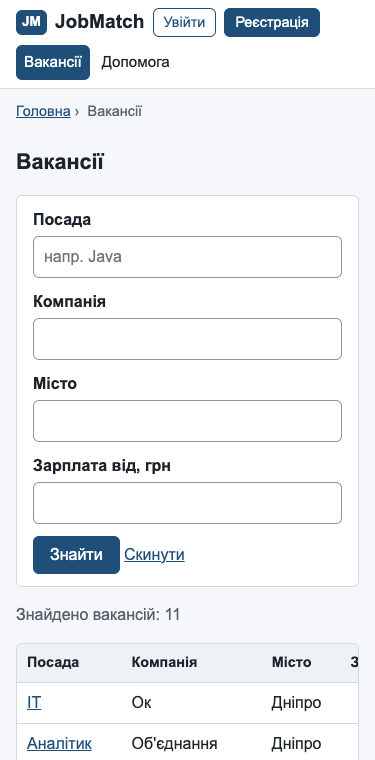{width=6cm}

### 2.2 Необхідний склад програмних засобів

**Клієнтський пристрій.** Браузер Google Chrome 120+, Mozilla Firefox 120+, Apple Safari 17+ або Microsoft Edge 120+ з увімкненими JavaScript і cookie. ОС: Windows 10/11, macOS 13+, Linux, Android 10+, iOS/iPadOS 16+.

JobMatch 1.0 працює в двох режимах.

**Режим 1 — на апаратному пристрої фахівця Замовника (локальний).** JobMatch і вбудована СКБД H2 (файл `./data/jobmatch.mv.db`) працюють на одному пристрої; користувач відкриває http://localhost:8090 на цьому пристрої, а рекрутер в офісній мережі — http://‹IP-адреса пристрою›:8090. Програмні засоби:

- ОС Windows 10/11, macOS 13+ або Linux;
- JDK 21 або новіший (наприклад, Eclipse Temurin 21) — для запуску;
- Apache Maven 3.9 або новіший — для збирання з початкового коду;
- Git 2.40 або новіший — для отримання коду з репозиторію.

**Режим 2 — повнофункціональний після розгортання на домені.** JobMatch працює як служба на сервері VPS і доступний з Інтернету за адресою https://jobmatch.profikadr.ua. Вимоги до домену і сервера:

- доменне ім'я (передбачене — jobmatch.profikadr.ua) і TLS-сертифікат; доступ лише через HTTPS (HTTP перенаправляється на HTTPS);
- ОС Ubuntu Server 24.04 LTS, Java 21 (JRE або JDK), СКБД PostgreSQL 16;
- зворотний проксі-сервер (наприклад, nginx 1.24+), який приймає HTTPS на порту 443 і передає запити на `http://127.0.0.1:8090` із заголовками `X-Forwarded-For` і `X-Forwarded-Proto`;
- змінні оточення `DATABASE_URL` (формат `jdbc:postgresql://‹хост›:5432/‹база›`), `DATABASE_USER`, `DATABASE_PASSWORD` і профіль Spring `prod`;
- служба systemd з автоматичним перезапуском JobMatch після перезавантаження сервера (відновлення до 10 хв включно, п. 4.2.3 ТЗ);
- доступність сервера від 99,5 % на місяць за договором з провайдером.

### 2.3 Вимоги до кваліфікації та компетентності користувачів

- **Гість, Шукач, Представник компанії** — навички роботи з браузером (перехід за посиланням, заповнення форми).
- **Рекрутер** — впевнений користувач ПК; перед початком роботи вивчає розділи 1, 3.2.10–3.2.14 і 4 цієї Настанови (до 1 год). Рекрутер обробляє персональні дані згідно із Законом України «Про захист персональних даних» і публікує вакансії без вимог до віку і статі (ст. 11-1 Закону України «Про зайнятість населення»).
- **Фахівець Замовника (системний адміністратор)** — робота з командним рядком, адміністрування Linux, PostgreSQL 16, запуск Java-застосунку як служби, мова SQL у межах запитів п. 3.2.15.

## 3 ВИКОНАННЯ ПРОГРАМИ

### 3.1 Завантаження та запуск програми

#### 3.1.1 Розгортання на пристрої фахівця Замовника (локальний режим)

Фахівець Замовника використовує матеріали, передані згідно з п. 4.6 і розд. 5 ТЗ: ZIP-архів (початковий код, скрипти БД, виконуваний JAR-файл `jobmatch-1.0.0.jar`, документація) і доступ до приватного репозиторію GitHub.

1. Встановлює JDK 21+ і Maven 3.9+ та перевіряє їх командами `java -version` (версія 21 або новіша) і `mvn -v` (версія 3.9 або новіша).
2. Отримує початковий код одним зі способів:
   - розпаковує ZIP-архів (пароль архіву директор Замовника отримав окремим каналом) у робочий каталог;
   - або виконує `git clone ‹адреса репозиторію з акта передавання›`.
3. Переходить у каталог `jobmatch` (містить файл `pom.xml`) і збирає JobMatch:

   ```
   cd jobmatch
   mvn -DskipTests package
   ```

   Maven завантажує залежності (перше збирання — до 5 хв за з'єднання від 10 Мбіт/с) і створює файл `target/jobmatch-1.0.0.jar`. Повідомлення `BUILD SUCCESS` підтверджує успішне збирання. Для запуску готового JAR-файлу з ZIP-архіву фахівець пропускає кроки 1 (Maven) і 3.

4. Запускає JobMatch з каталогу `app`:

   ```
   java -jar target/jobmatch-1.0.0.jar
   ```

   Під час першого запуску JobMatch створює каталог `data` і файл БД `data/jobmatch.mv.db`, виконує міграції Flyway `V1__schema.sql` (схема) і `V2__seed.sql` (демонстраційні дані, додаток А). Рядок журналу `Tomcat started on port 8090` і `Started JobMatchApplication` означає готовність до роботи (до 30 с).

5. Відкриває в браузері http://localhost:8090 — JobMatch показує сторінку «Головна» з переліком «Нові вакансії» (рис. 2).

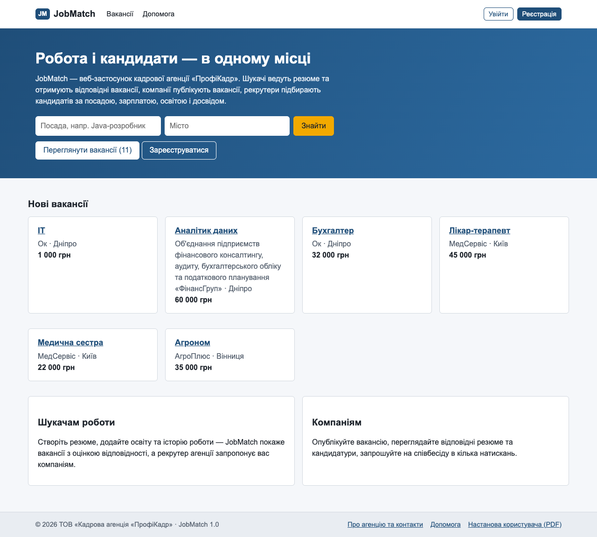{width=15cm}

**Повернення БД до демонстраційного стану.** Фахівець зупиняє JobMatch (Ctrl+C у вікні терміналу), видаляє файли `data/jobmatch.mv.db` і `data/jobmatch.trace.db` (за наявності) і повторює крок 4: JobMatch створює БД заново з демонстраційними даними. Перед видаленням фахівець створює резервну копію (п. 3.2.16).

**Доступ з офісної мережі.** Рекрутер на іншому ПК відкриває http://‹IP-адреса пристрою фахівця›:8090; брандмауер пристрою фахівця дозволяє вхідні з'єднання на порт 8090.

#### 3.1.2 Запуск у повнофункціональному режимі (профіль prod)

1. Фахівець Замовника створює в PostgreSQL 16 користувача і порожню БД:

   ```
   sudo -u postgres psql -c "CREATE USER jobmatch WITH PASSWORD '‹пароль›';"
   sudo -u postgres psql -c "CREATE DATABASE jobmatch OWNER jobmatch;"
   ```

2. Копіює `jobmatch-1.0.0.jar` у каталог `/opt/jobmatch`, задає змінні оточення і запускає JobMatch з профілем `prod`:

   ```
   export DATABASE_URL=jdbc:postgresql://localhost:5432/jobmatch
   export DATABASE_USER=jobmatch
   export DATABASE_PASSWORD='‹пароль›'
   java -jar /opt/jobmatch/jobmatch-1.0.0.jar --spring.profiles.active=prod
   ```

   Під час першого запуску JobMatch створює порожні таблиці (міграція Flyway `V1__schema.sql`). Профіль `prod` не завантажує демонстраційні дані: скрипт `db/seed/V2__seed.sql` виконується лише в локальному режимі.

3. Створює перший обліковий запис рекрутера (п. 3.2.15).

4. Оформлює запуск як службу systemd (`Restart=always`, змінні оточення в `EnvironmentFile`) і налаштовує зворотний проксі HTTPS для домену (п. 2.2, режим 2).
5. Відкриває https://jobmatch.profikadr.ua — JobMatch показує сторінку «Головна».

### 3.2 Виконання програми

Завдання акторів подано в порядку лаб. роботи 3. Кожне завдання починається з відкриття JobMatch у браузері (адреса — п. 3.1). Шапка кожної сторінки містить логотип «JobMatch» (перехід на «Головну»), пункт «Вакансії», меню ролі, пункт «Допомога» і кнопки «Увійти», «Реєстрація» (для Гостя) або e-mail і роль користувача та кнопку «Вийти». Меню ролі: Шукач — «Моє резюме», «Історія роботи», «Відповідні вакансії», «Мої відгуки»; Представник компанії — «Моя компанія», «Вакансії компанії»; Рекрутер — «Панель», «Резюме», «Компанії», «Кандидатури». Внутрішні сторінки містять ланцюжок навігації («Головна › …»). Поля, позначені *, обов'язкові; поля без позначки * користувач заповнює за наявності даних. Під текстовим полем з обмеженням довжини («Про себе», «Опис компанії», «Вимоги», «Коментар для компанії») JobMatch показує лічильник «N / ‹максимум› символів».

Повідомлення JobMatch мають вигляд: зелений блок — повідомлення про виконання дії (п. 4.2); червоний блок — діагностичне повідомлення з трьох частин (п. 4.1). Перед кожним видаленням, відхиленням кандидатури і реєстрацією працевлаштування браузер показує вікно підтвердження: «OK» виконує дію, «Скасувати» залишає дані без змін.

#### 3.2.1 Т1.1 Пошук відкритої вакансії (Гість; так само Шукач, Представник компанії, Рекрутер — G1)

1. Користувач натискає «Вакансії» в шапці або кнопку «Переглянути вакансії (N)» на «Головній». Інший спосіб — форма пошуку на «Головній»: користувач вводить «Посада» і (або) «Місто» і натискає «Знайти». JobMatch показує таблицю відкритих вакансій від найновішої і рядок «Знайдено вакансій: N» (рис. 3).
2. Користувач заповнює один або кілька фільтрів: «Посада», «Компанія», «Місто» (частина назви, без урахування регістру), «Зарплата від, грн» (ціле число; вакансії із зарплатою, рівною значенню, входять у результат) — і натискає «Знайти». JobMatch показує вакансії, які задовольняють усі фільтри; значення фільтрів зберігаються в адресі сторінки. Посилання «Скинути» очищує фільтри.
3. Користувач натискає назву посади. JobMatch показує картку вакансії: зарплату (грн/міс), мінімальну освіту, мінімальний досвід, дату публікації, вимоги, назву, опис і адресу компанії (рис. 4). Для Гостя картка відкритої вакансії містить посилання «увійдіть» і «зареєструйтеся».

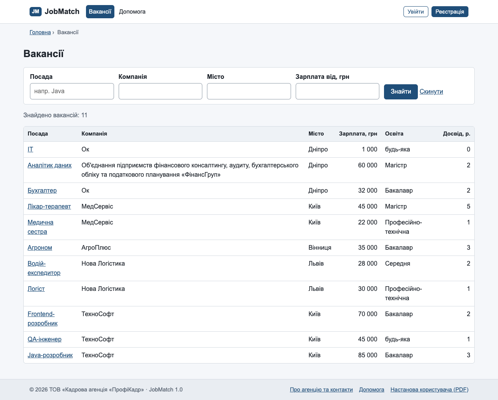{width=15cm}

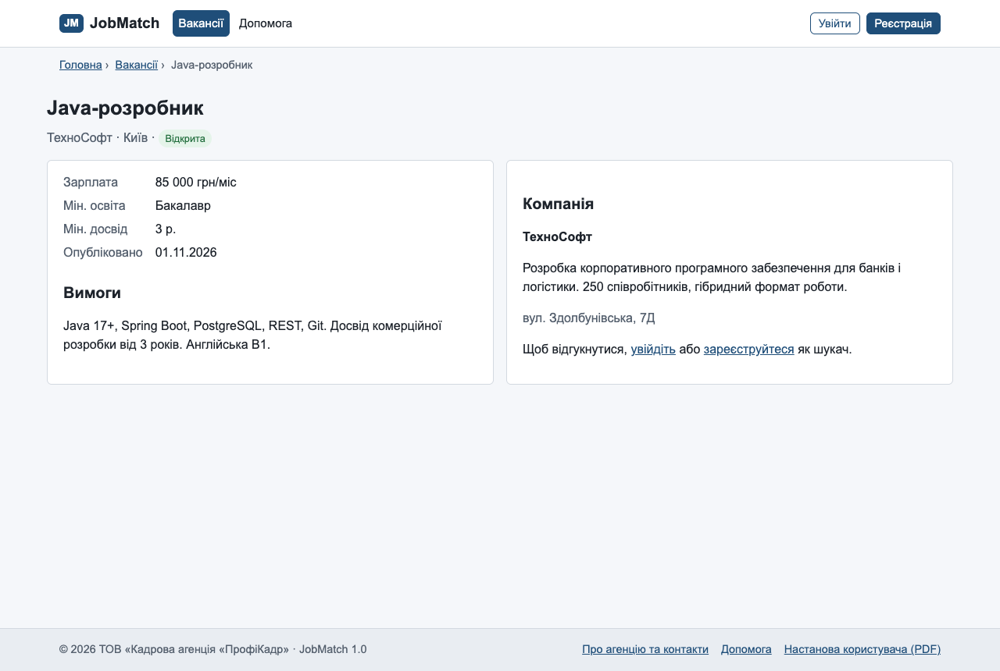{width=15cm}

#### 3.2.2 Т1.2 Отримання доступу до особистого кабінету (Гість — G2; далі U1)

**Реєстрація.**

1. Гість натискає «Реєстрація» в шапці. JobMatch показує форму «Реєстрація» (рис. 5).
2. Гість вибирає «Тип облікового запису»: «Шукач роботи» або «Представник компанії». JobMatch показує поля вибраного типу.
3. Гість вводить «E-mail», «Пароль» (від 8 до 64 символів включно), «Повторіть пароль», «Телефон» (формат `+380XXXXXXXXX`, 9 цифр після `+380`), «Місто» і:
   - Шукач роботи — «Прізвище», «Ім'я», «Домашня адреса» та позначає згоду на обробку персональних даних;
   - Представник компанії — «Назва компанії», «Адреса компанії», «E-mail компанії», «Сайт» (починається з `http://` або `https://`), «Опис компанії» (до 2 000 символів включно).
4. Гість натискає «Створити обліковий запис». JobMatch створює обліковий запис і резюме зі статусом «Шукає роботу» (Шукач) або профіль компанії (Представник компанії), відкриває сторінку «Вхід» з повідомленням «Реєстрацію завершено. Увійдіть з указаними e-mail і паролем.». Кнопка «Скасувати» відкриває «Головну» без змін.

У разі помилки JobMatch зберігає введені дані (крім паролів) і показує діагностичні повідомлення (рис. 6, п. 4.1).

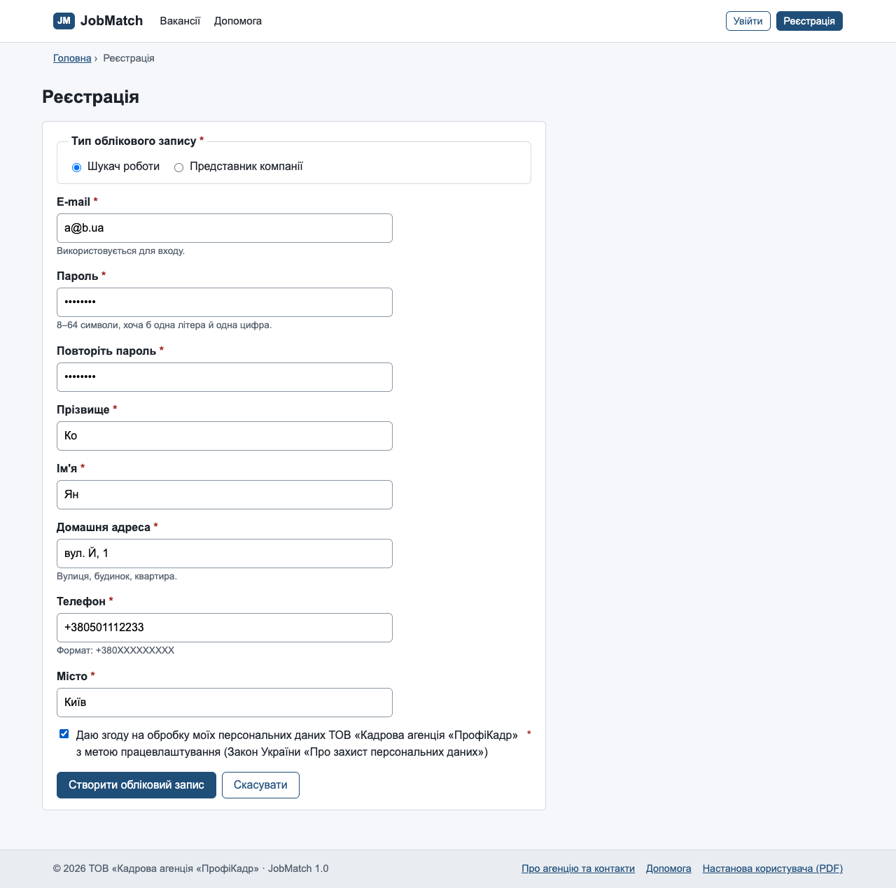{width=15cm}

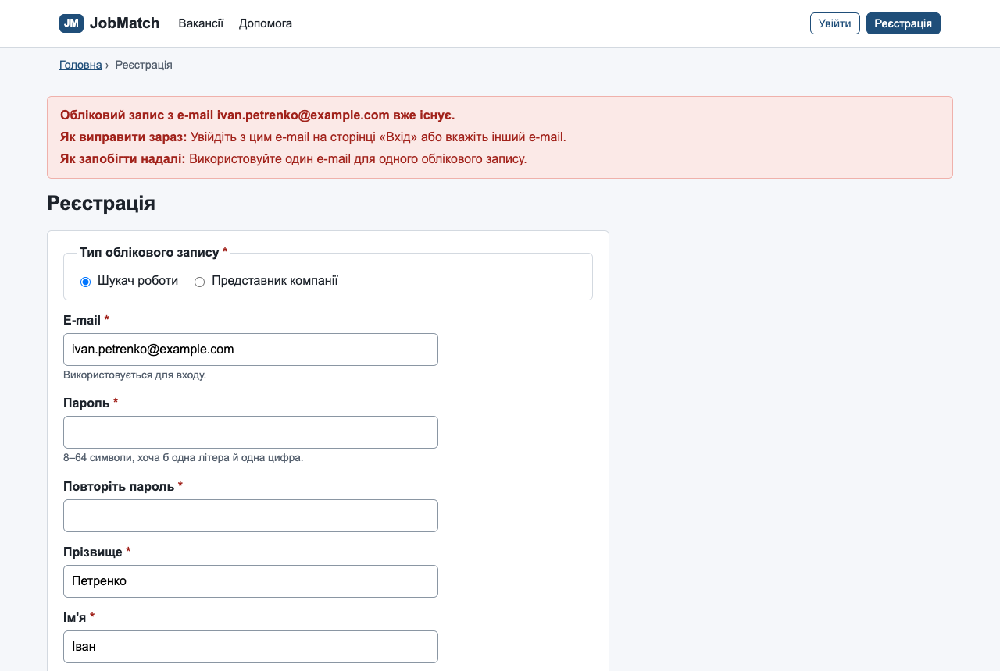{width=15cm}

**Вхід (U1; Шукач, Представник компанії, Рекрутер).**

1. Користувач натискає «Увійти» в шапці. JobMatch показує сторінку «Вхід» (рис. 7).
2. Користувач вводить «E-mail» і «Пароль» і натискає «Увійти». JobMatch відкриває стартову сторінку ролі: Шукачу — «Моє резюме», Представнику компанії — сторінку профілю компанії («Моя компанія»), Рекрутеру — «Панель рекрутера».
3. Якщо пара «e-mail — пароль» неправильна або обліковий запис неактивний, JobMatch показує повідомлення «Неправильний e-mail або пароль.» (рис. 8); користувач вводить дані повторно. Кількість спроб не обмежено.

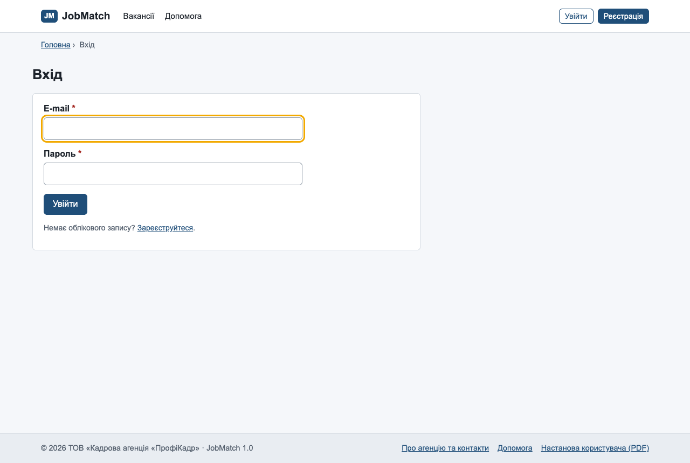{width=15cm}

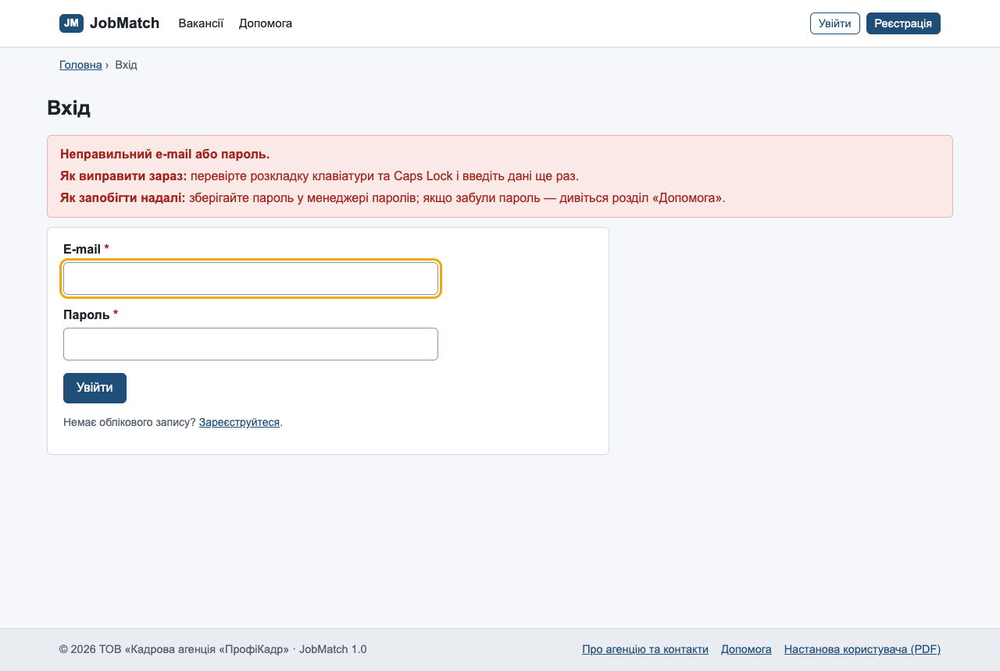{width=15cm}

Неавтентифікованого користувача, який відкриває сторінку особистого кабінету, JobMatch перенаправляє на сторінку «Вхід».

#### 3.2.3 Т1.3 Довідка і контакти агенції (усі актори — U3)

1. Користувач натискає «Допомога» в шапці. JobMatch показує сторінку «Допомога» з кнопкою «Завантажити Настанову користувача (PDF)» і розділом «Часті питання» (рис. 9).
2. Користувач натискає «Завантажити Настанову користувача (PDF)» — браузер зберігає файл `Nastanova_JobMatch.pdf`.
3. Користувач натискає «Про агенцію та контакти» в підвалі сторінки. JobMatch показує адресу, телефон, e-mail і графік роботи агенції.

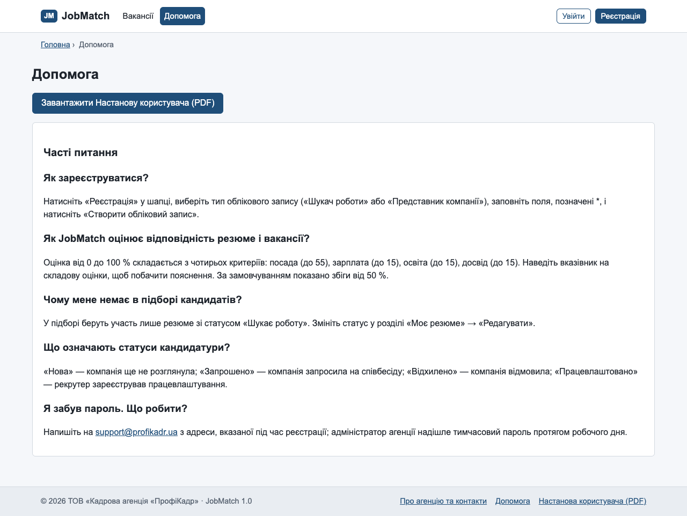{width=15cm}

#### 3.2.4 Т2.1 Ведення резюме, освіти та історії роботи (Шукач — C1, C2)

**Резюме (C1).**

1. Шукач входить (п. 3.2.2) і натискає «Моє резюме». JobMatch показує блок «Особисті дані» і таблицю «Освіта» (рис. 10).
2. Шукач натискає «Редагувати». JobMatch показує форму «Редагування резюме» з поточними даними.
3. Шукач змінює поля: «Прізвище», «Ім'я», «По батькові», «Дата народження», «Телефон», «E-mail», «Місто», «Домашня адреса», «Статус пошуку» («Шукає роботу» або «Не шукає»), «Бажана посада» (одна посада), «Бажана зарплата, грн/міс» (від 1 000 до 1 000 000 включно; порожнє поле — без обмежень), «Про себе» (до 1 000 символів включно) — і натискає «Зберегти». JobMatch зберігає резюме, оновлює дату останнього оновлення, відкриває «Моє резюме» з повідомленням «Резюме збережено.». У разі помилки JobMatch зберігає введені дані і показує повідомлення біля поля (рис. 11).

Бажана посада, освіта, історія роботи і бажана зарплата визначають оцінку відповідності (п. 1.3.1). Резюме зі статусом «Не шукає» не бере участі в підборі кандидатів.

**Освіта (C1).**

1. Шукач на сторінці «Моє резюме» натискає «+ Додати освіту». JobMatch показує форму «Новий запис про освіту».
2. Шукач вибирає «Рівень», вводить «Навчальний заклад», «Спеціальність», «Рік закінчення» (від 1950 до 2035 включно) і натискає «Додати». JobMatch показує повідомлення «Запис про освіту додано.».
3. Для видалення Шукач натискає «Видалити» в рядку запису і підтверджує дію. JobMatch показує повідомлення «Запис про освіту видалено.».

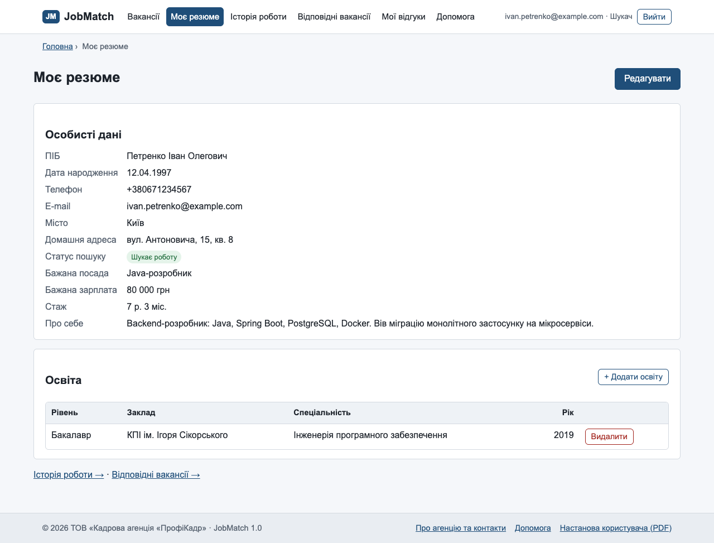{width=15cm}

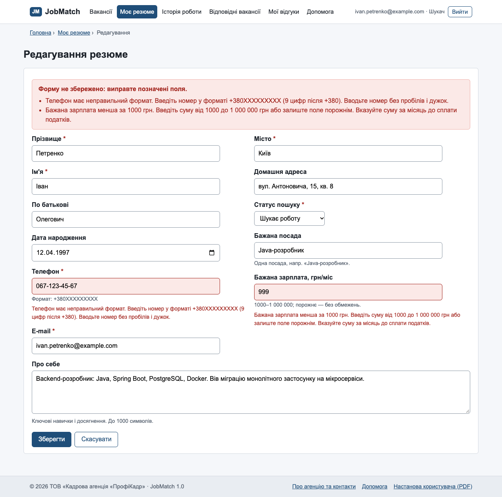{width=15cm}

**Історія роботи (C2).**

1. Шукач натискає «Історія роботи». JobMatch показує сумарний стаж і таблицю записів від найновішого: «Період», «Компанія», «Посада», «Зарплата, грн» (рис. 12).
2. Шукач натискає «+ Додати запис», вводить «Компанія», «Посада», «Зарплата, грн/міс» (від 0 до 1 000 000 включно), «Дата початку», «Дата завершення» (порожнє поле — «працюю досі») і натискає «Зберегти». JobMatch відкриває «Історію роботи» з повідомленням «Запис історії роботи додано.».
3. Для зміни запису Шукач натискає «Редагувати» в рядку, змінює поля і натискає «Зберегти» — повідомлення «Запис історії роботи збережено.».
4. Для видалення Шукач натискає «Видалити» в рядку і підтверджує дію — повідомлення «Запис історії роботи видалено.».

Дата початку і дата завершення не пізніші за поточну дату (поточна дата включно); дата завершення не раніша за дату початку (рівні дати допустимі).

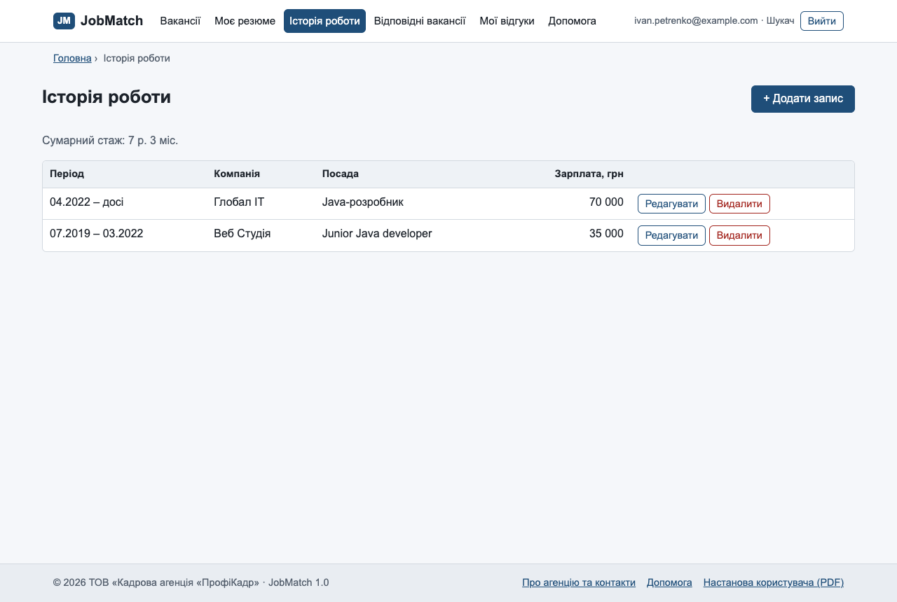{width=15cm}

#### 3.2.5 Т2.2 Пошук відповідних вакансій і відгук (Шукач — C3, G1, C4)

1. Шукач натискає «Відповідні вакансії». JobMatch показує відкриті вакансії з оцінкою від 50 % включно: «Оцінка», «Посада», «Компанія», «Зарплата, грн», «Складові» (бали критеріїв; наведення вказівника на складову показує пояснення) і стовпець «Відгук» (рис. 13).
2. Шукач змінює «Мін. оцінка, %» (ціле число від 0 до 100 включно) і натискає «Оновити». JobMatch перераховує список. Для іншого значення JobMatch показує діагностичне повідомлення і список з порогом 50 %.
3. Якщо список порожній, JobMatch показує текст «Немає вакансій з оцінкою від N %.» і посилання «покажіть часткові збіги (від 25 %)»; Шукач натискає посилання — JobMatch показує вакансії з оцінкою від 25 % включно.
4. Шукач натискає «Відгукнутися» в рядку вакансії або в картці вакансії (п. 3.2.1). JobMatch створює кандидатуру зі статусом «Нова» і відкриває картку вакансії з повідомленням «Відгук надіслано. Стан відгуку — у розділі «Мої відгуки».» і позначкою «Ваш відгук: Нова» (рис. 14). У списку «Відповідні вакансії» замість кнопки JobMatch показує позначку «Подано: ‹статус›».

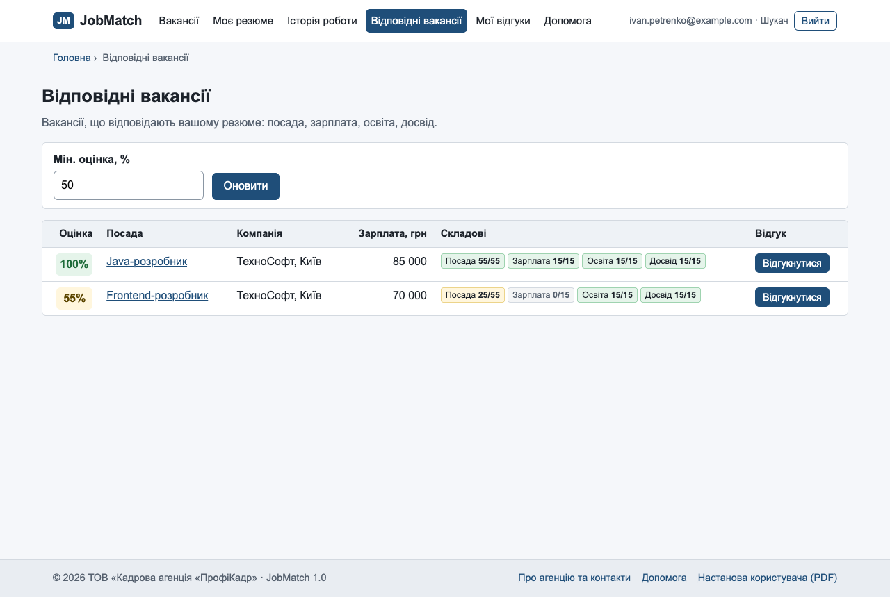{width=15cm}

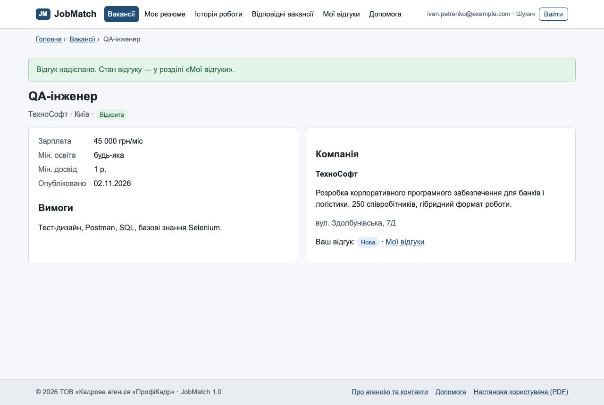{width=15cm}

#### 3.2.6 Т2.3 Стеження за станом відгуків і пропозицій (Шукач — C5)

1. Шукач натискає «Мої відгуки». JobMatch показує кандидатури від найновішої: «Дата», «Вакансія», «Компанія», «Джерело» («Відгук шукача» або «Пропозиція рекрутера»), «Статус» (рис. 15).
2. Шукач натискає назву вакансії — JobMatch відкриває картку вакансії.

Значення статусів: «Нова» — компанія ще не розглянула; «Запрошено» — компанія запросила на співбесіду; «Відхилено» — компанія відмовила; «Працевлаштовано» — рекрутер зареєстрував працевлаштування. Якщо кандидатур немає, JobMatch показує текст «Ви ще не відгукувалися на вакансії.» і посилання «Переглянути відповідні вакансії».

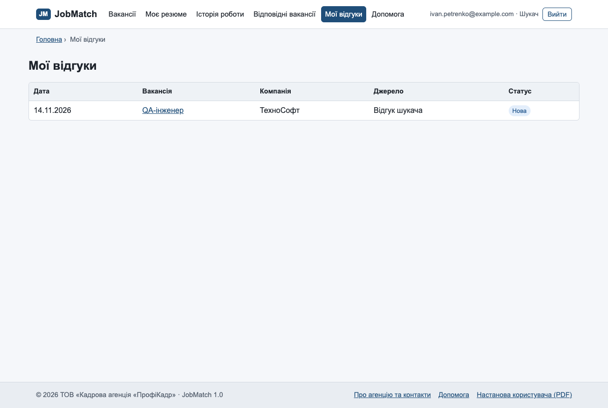{width=15cm}

#### 3.2.7 Т3.1 Ведення профілю компанії (Представник компанії — E1)

1. Представник компанії входить (п. 3.2.2) і натискає «Моя компанія». JobMatch показує профіль: «Місто», «Адреса», «Телефон», «E-mail», «Сайт», «Опис», кількість відкритих вакансій (рис. 16).
2. Представник натискає «Редагувати профіль», змінює поля «Назва» (від 2 до 120 символів включно, унікальна в JobMatch), «Місто», «Адреса офісу», «Телефон», «E-mail», «Сайт», «Опис компанії» і натискає «Зберегти». JobMatch показує профіль з повідомленням «Профіль компанії збережено.».

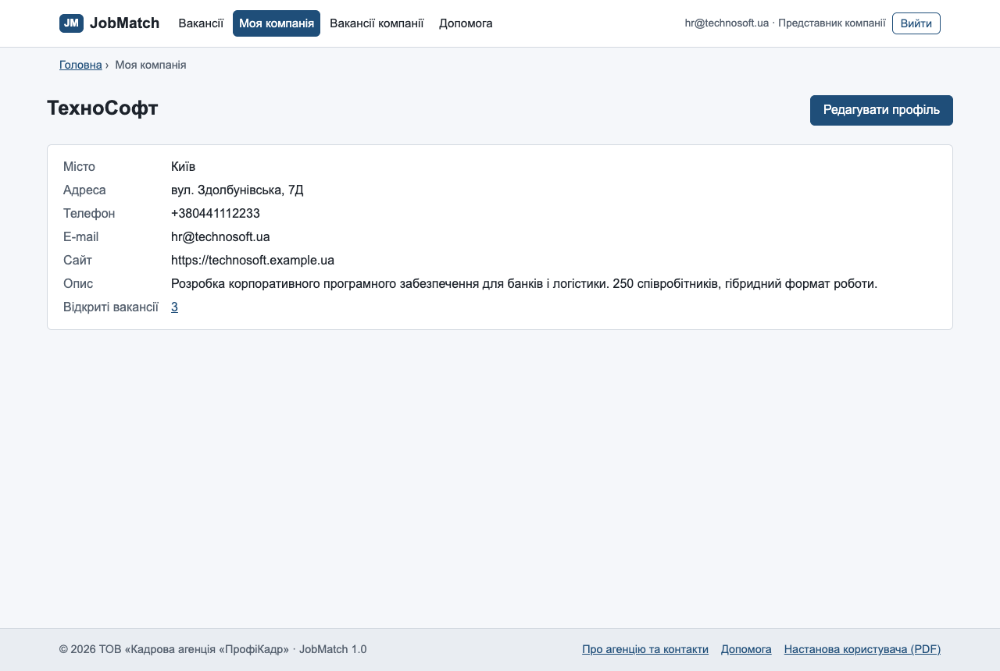{width=15cm}

#### 3.2.8 Т3.2 Публікація і ведення вакансій (Представник компанії — E2)

1. Представник натискає «Вакансії компанії». JobMatch показує таблицю вакансій компанії: «Посада», «Зарплата, грн», «Статус», посилання «Відповідні резюме» і «Кандидатури», кнопки «Редагувати», «Закрити» / «Відкрити», «Видалити» (рис. 17).
2. Представник натискає «+ Нова вакансія», заповнює «Посада», «Зарплата, грн/міс» (від 1 000 до 1 000 000 включно), «Мінімальна освіта» (рівень або «будь-яка»), «Мінімальний досвід, років» (від 0 до 40 включно), «Місто роботи», «Вимоги» (до 2 000 символів включно, без вимог до віку і статі) і натискає «Зберегти» (рис. 18). JobMatch створює вакансію зі статусом «Відкрита» і показує повідомлення «Вакансію «‹посада›» опубліковано.».
3. Представник натискає «Редагувати», змінює поля і натискає «Зберегти» — повідомлення «Вакансію збережено.».
4. Представник натискає «Закрити» — JobMatch змінює статус на «Закрита», прибирає вакансію з каталогу і підбору та показує повідомлення «Вакансію закрито.». Кнопка «Відкрити» повертає статус «Відкрита» — повідомлення «Вакансію відкрито.».
5. Представник натискає «Видалити» і підтверджує дію. JobMatch видаляє вакансію разом з кандидатурами на неї і показує повідомлення «Вакансію видалено.».

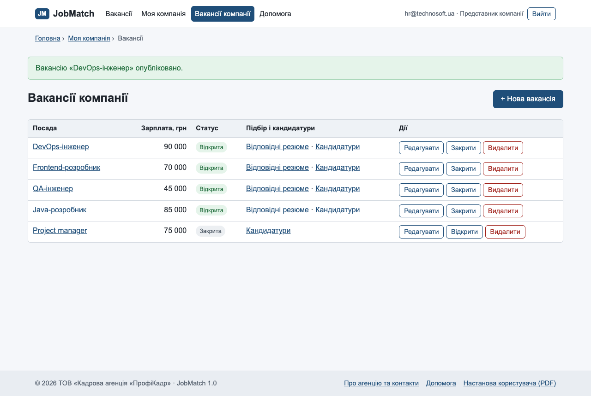{width=15cm}

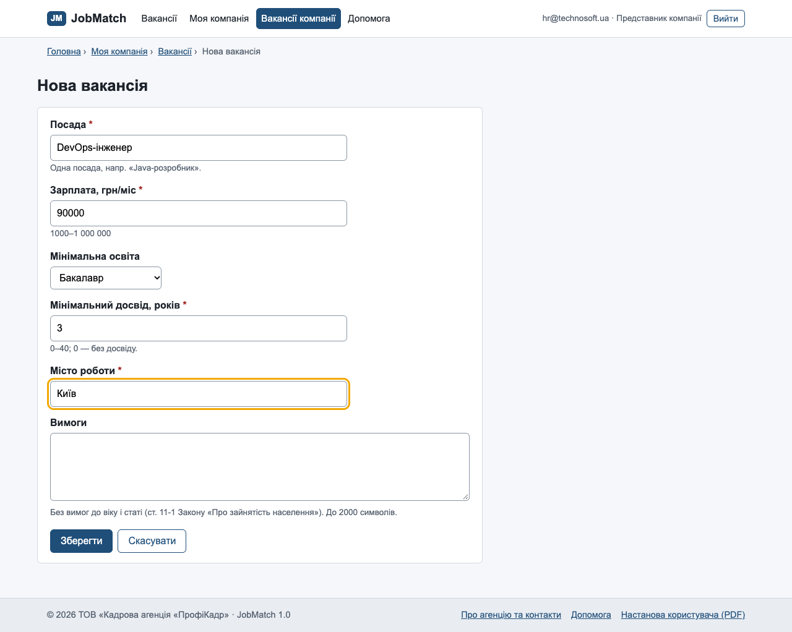{width=15cm}

#### 3.2.9 Т3.3 Перегляд відповідних резюме і рішення щодо кандидатур (Представник компанії — E3, E4)

**Відповідні резюме (E3).**

1. Представник на сторінці «Вакансії компанії» натискає «Відповідні резюме» біля відкритої вакансії. JobMatch показує резюме зі статусом «Шукає роботу» з оцінкою від 50 % включно: «Оцінка», «Кандидат» (ім'я і перша літера прізвища), «Бажана посада», «Бажана зарплата», «Освіта», «Стаж», «Складові» (рис. 19).
2. Представник змінює «Мін. оцінка, %» і натискає «Оновити» так само, як у п. 3.2.5; за порожнього списку натискає «Показати часткові збіги (від 25 %)».

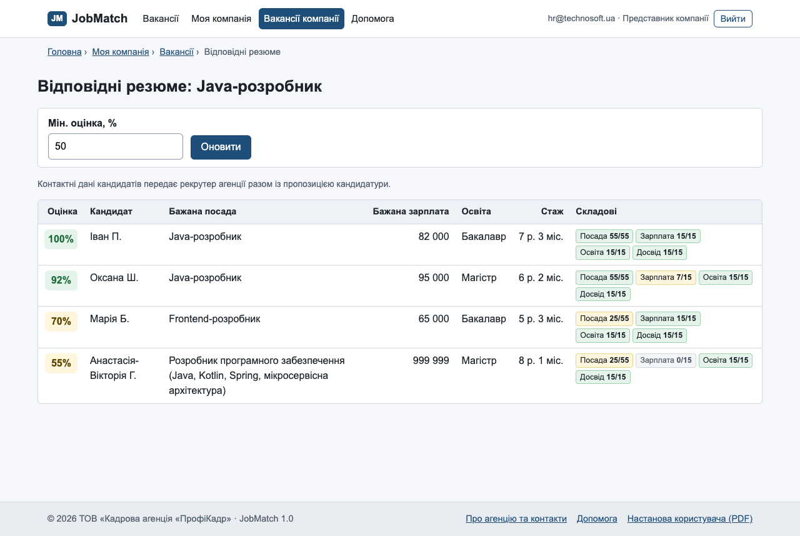{width=15cm}

**Кандидатури (E4).**

1. Представник натискає «Кандидатури» біля вакансії. JobMatch показує кандидатури від найновішої: «Дата», «Кандидат», «Бажана посада», «Стаж», «Освіта», «Джерело», «Коментар рекрутера», «Статус», «Рішення» (рис. 20).
2. Для кандидатури зі статусом «Нова» Представник натискає «Запросити». JobMatch змінює статус на «Запрошено» і показує повідомлення «Кандидата запрошено на співбесіду. Рекрутер агенції отримає оновлений статус.».
3. Або Представник натискає «Відхилити» і підтверджує дію («Відхилити кандидатуру? Статус «Відхилено» остаточний.»). JobMatch змінює статус на «Відхилено» і показує повідомлення «Кандидатуру відхилено.».

Контакти запрошеного кандидата і час співбесіди погоджує рекрутер агенції.

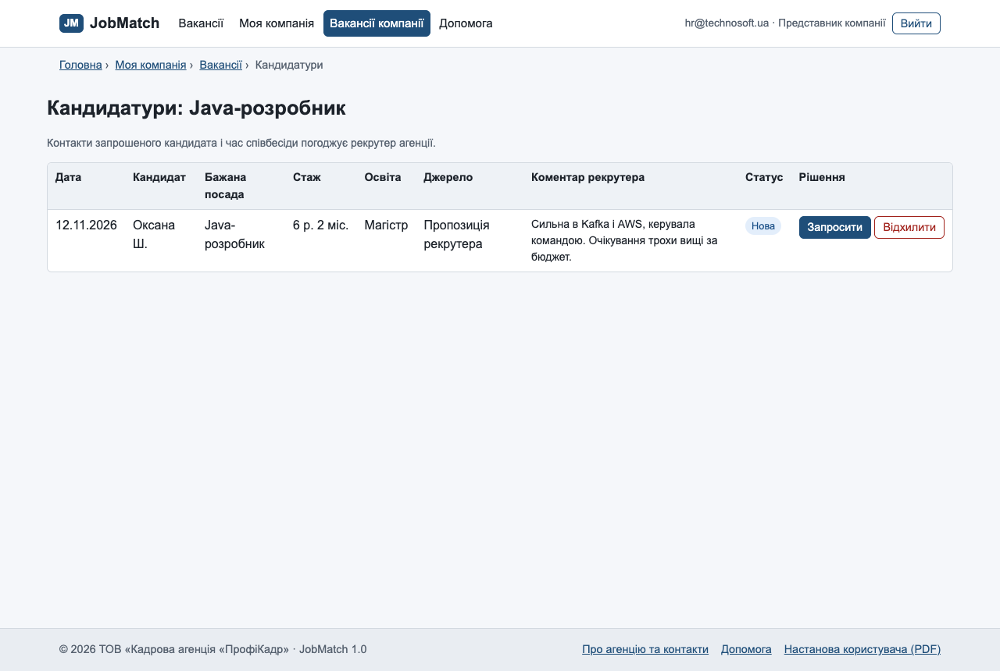{width=15cm}

#### 3.2.10 Т4.1 Підбір і пропозиція кандидатів на вакансію (Рекрутер — R2, M1, R4; критичне завдання)

1. Рекрутер входить (п. 3.2.2). JobMatch показує «Панель рекрутера»: лічильники «відкритих вакансій», «резюме шукають роботу», «нових кандидатур», «запрошено на співбесіду» і таблицю «Відкриті вакансії» (рис. 21).
2. Рекрутер натискає «Підібрати кандидатів» у рядку вакансії (так само — у картці компанії або в картці вакансії). JobMatch показує сторінку «Підбір кандидатів»: параметри вакансії («Зарплата», «Мін. освіта», «Мін. досвід», «Місто», «Статус»), поле «Мін. оцінка, %» зі значенням 50, рядок «Кандидатів з оцінкою від 50 %: N» і таблицю кандидатів «Оцінка», «ПІБ», «Бажана посада», «Бажана зарплата, грн/міс», «Освіта», «Стаж», «Складові оцінки» (рис. 22).
3. Рекрутер натискає ПІБ кандидата. JobMatch відкриває «Картку людини» з історією роботи (рис. 23). Рекрутер натискає «← Назад до підбору» — JobMatch повертає до списку підбору з тим самим порогом.
4. Рекрутер натискає «Запропонувати» в рядку кандидата. JobMatch показує сторінку «Пропозиція кандидата»: кандидат, вакансія, оцінка відповідності зі складовими і поле «Коментар для компанії» (до 500 символів включно; порожнє поле допустиме) з лічильником «N / 500 символів» (рис. 24).
5. Рекрутер вводить коментар і натискає «Підтвердити». JobMatch створює кандидатуру зі статусом «Нова» і джерелом «Пропозиція рекрутера», повертає до списку підбору з тим самим порогом, показує повідомлення «Кандидатуру ‹ПІБ› запропоновано на вакансію «‹посада›» (‹компанія›).» і в рядку кандидата замість кнопки — позначку «Запропоновано: Нова» (рис. 25).
6. Рекрутер повторює кроки 3–5 для інших кандидатів або натискає «← До панелі рекрутера».

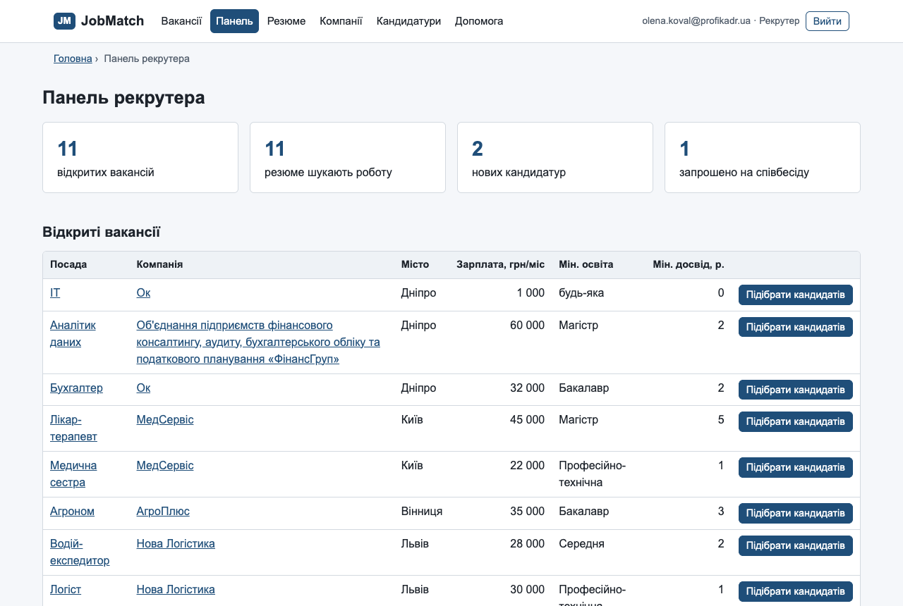{width=15cm}

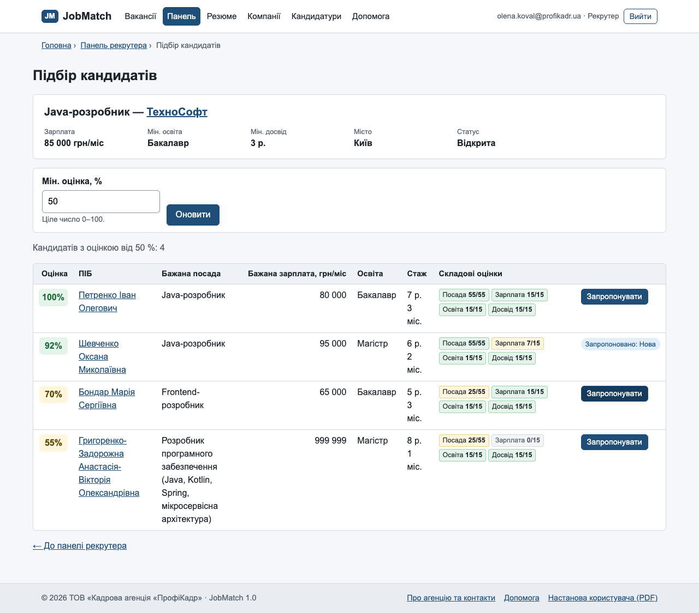{width=15cm}

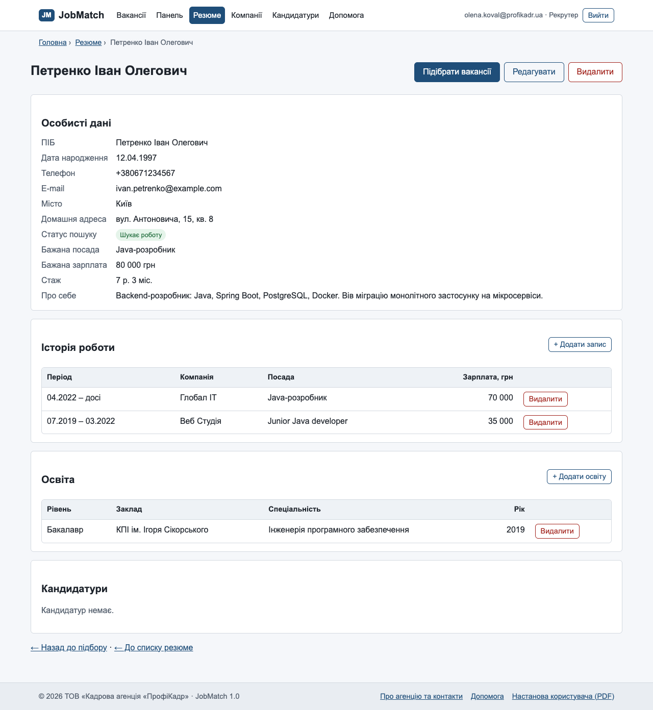{width=14cm}

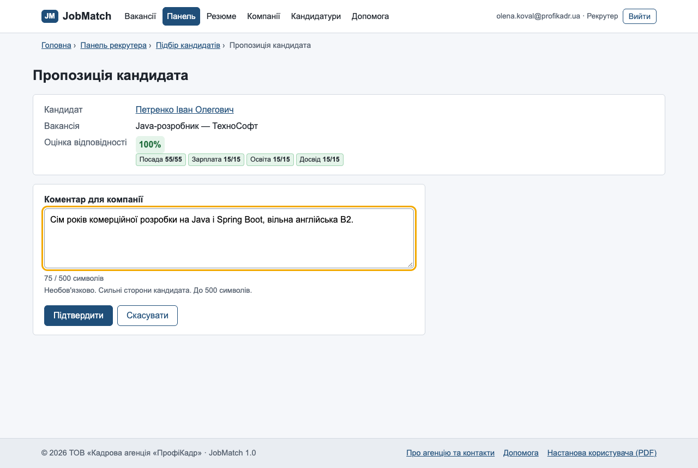{width=15cm}

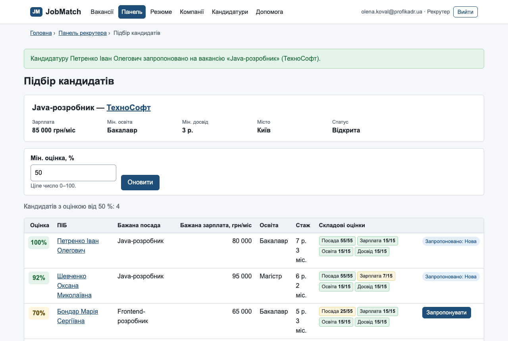{width=15cm}

**Альтернативні ситуації.**

- *Немає кандидатів з оцінкою від порогу N.* JobMatch показує текст «Немає кандидатів з оцінкою від N %.» і кнопку «Показати часткові збіги (від 25 %)» (рис. 26). Рекрутер натискає кнопку — JobMatch показує кандидатів з оцінкою від 25 % включно (рис. 27). Якщо порожній список отримано з порогом 25 % або нижчим, JobMatch радить змінити вимоги вакансії або додати резюме.
- *Зміна порогу.* Рекрутер вводить у «Мін. оцінка, %» ціле число від 0 до 100 включно і натискає «Оновити» — JobMatch перераховує список. Для іншого значення JobMatch показує діагностичне повідомлення і залишає попередній поріг і попередній список (рис. 28).
- *Кандидатура вже існує.* Для кандидата, якого вже запропоновано або який сам відгукнувся, JobMatch показує позначку «Запропоновано: ‹статус›» або «Відгукнувся: ‹статус›» замість кнопки. Якщо кандидатура виникла після відкриття списку (інша вкладка, інший рекрутер, відгук шукача), натискання «Запропонувати» або «Підтвердити» повертає рекрутера до списку підбору з діагностичним повідомленням; дублікат JobMatch не створює (рис. 29).
- *Вакансію закрито.* JobMatch показує повідомлення «Вакансію закрито — підбір недоступний.» і посилання «До відкритих вакансій» (рис. 30). Якщо вакансію закрито після відкриття списку, натискання «Запропонувати» або «Підтвердити» повертає рекрутера до списку підбору з діагностичним повідомленням.
- *Коментар довший за 500 символів.* JobMatch зберігає текст у формі, показує діагностичне повідомлення і не створює кандидатуру (рис. 31); Рекрутер скорочує текст і натискає «Підтвердити».
- *Скасування.* Рекрутер натискає «Скасувати» на сторінці «Пропозиція кандидата» — JobMatch повертає до списку підбору без змін у БД.
- *Вакансію або людину видалено іншим користувачем.* JobMatch показує сторінку «404 — Не знайдено» з кнопками «На головну», «До вакансій», «До панелі рекрутера» (рис. 32).

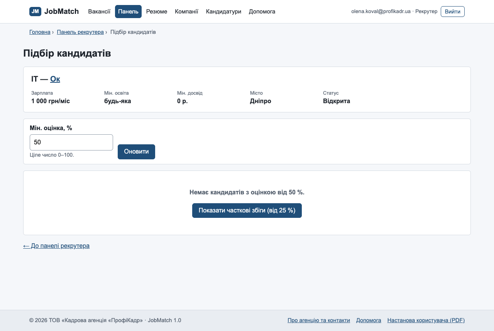{width=15cm}

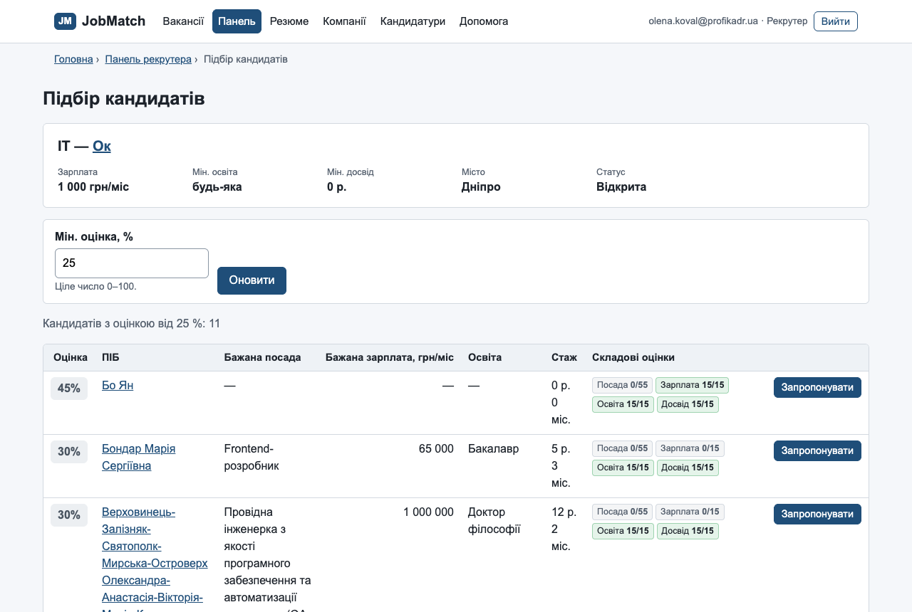{width=15cm}

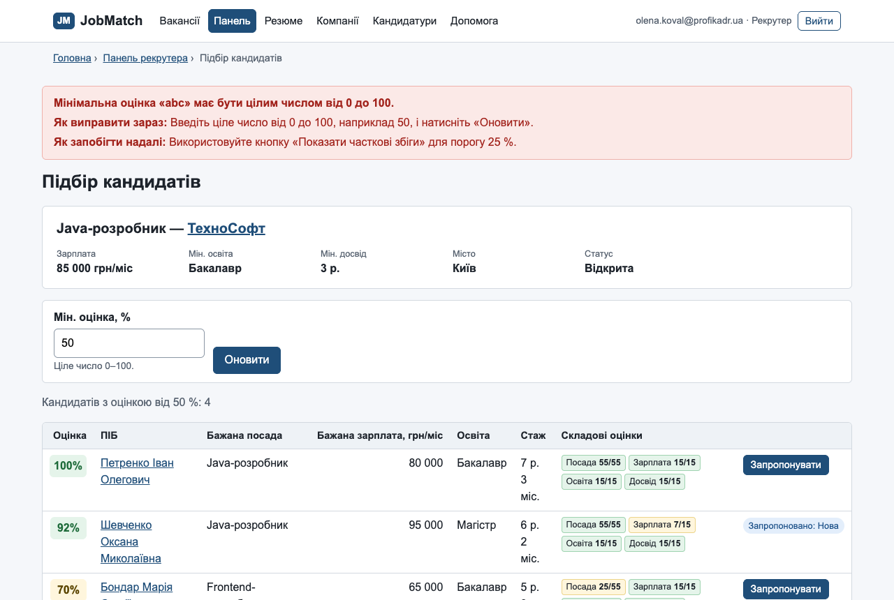{width=15cm}

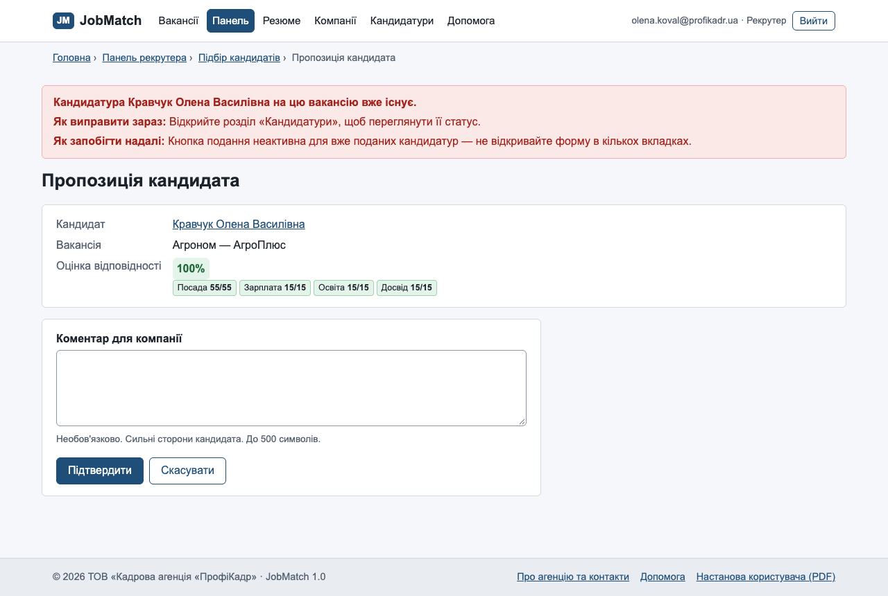{width=15cm}

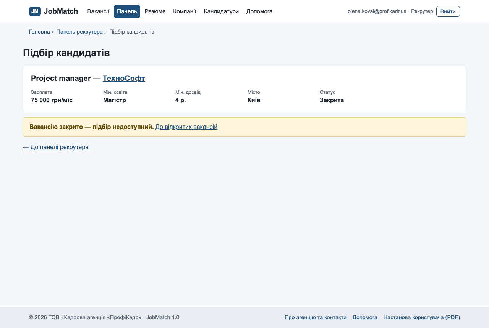{width=15cm}

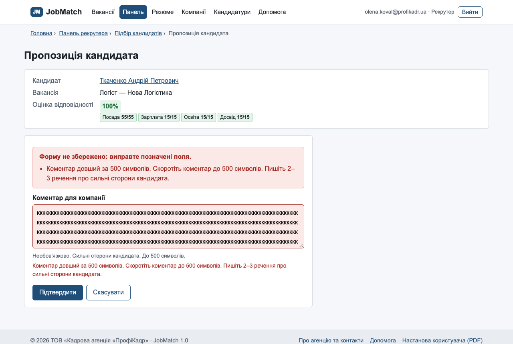{width=15cm}

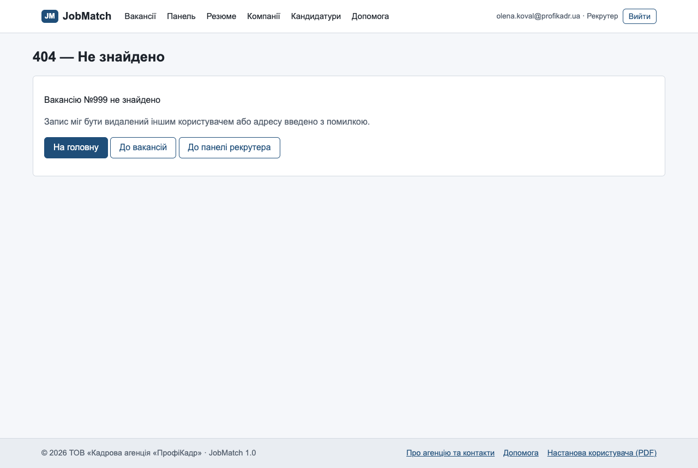{width=15cm}

#### 3.2.11 Т4.2 Пошук людей за критеріями і ведення їхніх даних (Рекрутер — R1, R4, R5)

**Пошук резюме (R1).**

1. Рекрутер натискає «Резюме». JobMatch показує форму критеріїв і всіх людей за прізвищем: «ПІБ», «Бажана посада», «Бажана зарплата, грн/міс», «Освіта», «Стаж», «Місто», «Статус» (рис. 33).
2. Рекрутер заповнює один або кілька критеріїв: «Прізвище або ім'я», «Посада (бажана або з історії)», «Компанія з історії роботи» (частина назви), «Освіта не нижче», «Бажана зарплата від» і «до, грн» (межі включно), «Статус» — і натискає «Знайти». JobMatch показує людей, які задовольняють усі критерії, і рядок «Знайдено резюме: N». Посилання «Скинути» очищує критерії. Якщо «Бажана зарплата від» більша за «до», JobMatch показує діагностичне повідомлення і виконує пошук за іншими критеріями без діапазону зарплати.
3. Рекрутер натискає ПІБ — JobMatch відкриває «Картку людини» (R4).

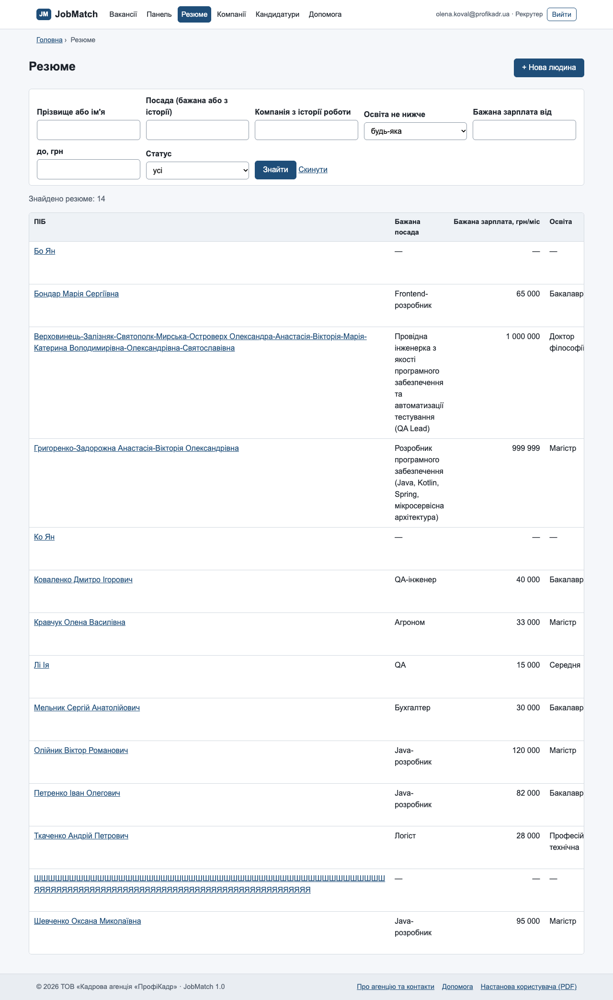{height=19cm}

**Картка людини (R4).** Картка містить кнопки «Підібрати вакансії», «Редагувати», «Видалити», блоки «Особисті дані», «Історія роботи», «Освіта», «Кандидатури» і посилання «← До списку резюме», а для картки, відкритої зі списку підбору, — також «← Назад до підбору» (рис. 23). Для друку Рекрутер натискає Ctrl+P (Cmd+P у macOS); друкована сторінка містить лише дані людини.

**Ведення даних людини (R5).**

1. Рекрутер на сторінці «Резюме» натискає «+ Нова людина», заповнює форму «Нова людина» (поля — як у п. 3.2.4) і натискає «Зберегти» (рис. 34). JobMatch відкриває «Картку людини» з повідомленням «Резюме ‹ПІБ› додано. Додайте освіту та історію роботи.».
2. На «Картці людини» Рекрутер натискає «+ Додати запис» (історія роботи) або «+ Додати освіту», заповнює форму і натискає «Додати». JobMatch показує повідомлення «Запис історії роботи додано.» або «Запис про освіту додано.». Кнопка «Видалити» в рядку запису після підтвердження видаляє запис.
3. Рекрутер натискає «Редагувати», змінює поля резюме і натискає «Зберегти» — повідомлення «Резюме збережено.».
4. Рекрутер натискає «Видалити» і підтверджує дію; вікно підтвердження вказує кількість записів освіти, історії роботи, кандидатур і наявність облікового запису шукача. JobMatch однією транзакцією видаляє людину з пов'язаними даними і показує повідомлення «Резюме ‹ПІБ› видалено разом з освітою, історією роботи та кандидатурами.».

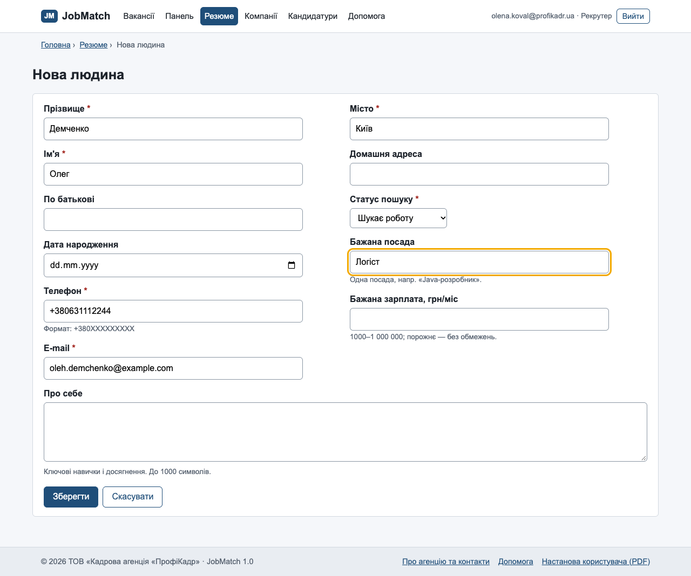{width=15cm}

#### 3.2.12 Т4.3 Підбір вакансій для шукача (Рекрутер — R3)

1. Рекрутер на «Картці людини» натискає «Підібрати вакансії». JobMatch показує сторінку «Підбір вакансій: ‹ПІБ›» з бажаною посадою і статусом людини та відкриті вакансії з оцінкою від 50 % включно: «Оцінка», «Посада», «Компанія», «Зарплата, грн/міс», «Складові», «Кандидатура» (рис. 35).
2. Рекрутер змінює поріг або відкриває часткові збіги так само, як у п. 3.2.10.
3. Рекрутер натискає «Запропонувати» в рядку вакансії і виконує кроки 4–5 п. 3.2.10. Для вакансії з наявною кандидатурою JobMatch показує її статус.

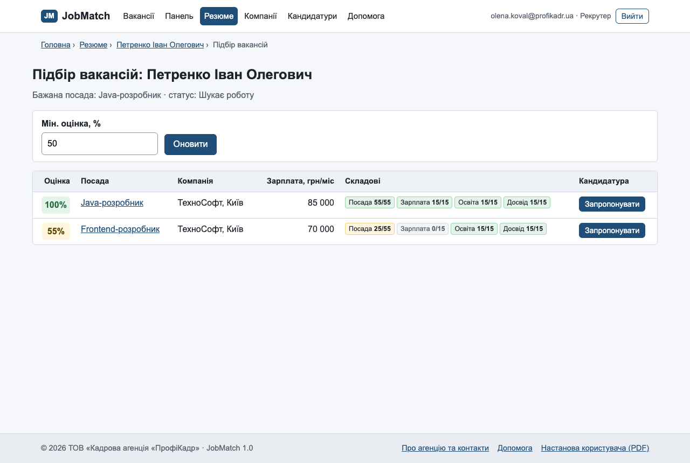{width=15cm}

#### 3.2.13 Т4.4 Ведення компаній-клієнтів і їхніх вакансій (Рекрутер — R6)

1. Рекрутер натискає «Компанії». JobMatch показує компанії за назвою: «Назва», «Місто», «Телефон», «E-mail», «Відкриті вакансії», «Представник». Рекрутер вводить частину назви в поле «Назва компанії» і натискає «Знайти».
2. Рекрутер натискає «+ Нова компанія», заповнює форму (поля — як у п. 3.2.7) і натискає «Зберегти». JobMatch відкриває картку компанії з повідомленням «Компанію «‹назва›» додано.».
3. Рекрутер натискає назву компанії. JobMatch показує картку компанії з даними і таблицею «Вакансії» (рис. 36).
4. У картці компанії Рекрутер натискає «Редагувати» (повідомлення «Дані компанії збережено.»), «+ Нова вакансія» (поля — як у п. 3.2.8; повідомлення «Вакансію «‹посада›» додано.»), а в рядку вакансії — «Підібрати кандидатів», «Редагувати» («Вакансію збережено.»), «Закрити» / «Відкрити» («Вакансію закрито.» / «Вакансію відкрито.»), «Видалити» («Вакансію видалено разом з кандидатурами на неї.»).
5. Для видалення компанії Рекрутер натискає «Видалити» і підтверджує дію; вікно підтвердження вказує кількість вакансій і кандидатур та наявність облікового запису представника. JobMatch видаляє компанію з вакансіями, кандидатурами і обліковим записом представника, зберігає назву компанії в історії роботи людей і показує повідомлення «Компанію «‹назва›» видалено разом з її вакансіями.».

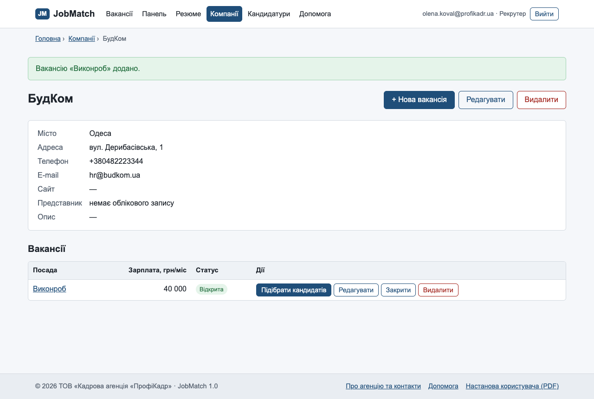{width=15cm}

#### 3.2.14 Т4.5 Реєстрація працевлаштування (Рекрутер — R7)

1. Рекрутер натискає «Кандидатури». JobMatch показує всі кандидатури від найновішої: «Дата», «Кандидат», «Вакансія», «Компанія», «Джерело», «Статус».
2. Рекрутер вибирає у фільтрі «Статус» значення «Запрошено» і натискає «Показати» (рис. 37).
3. Рекрутер натискає «Зареєструвати працевлаштування» в рядку кандидатури. JobMatch показує сторінку «Реєстрація працевлаштування»: кандидат, вакансія, компанія, зарплата, перелік змін і поле «Дата початку роботи» зі значенням поточної дати (рис. 38).
4. Рекрутер вказує дату початку роботи (не пізніше ніж через 90 днів від поточної дати, 90-й день включно), натискає «Підтвердити» і підтверджує дію у вікні браузера. JobMatch змінює статус кандидатури на «Працевлаштовано», додає запис в історію роботи людини, закриває вакансію, змінює статус людини на «Не шукає», відкриває «Кандидатури» з повідомленням «Працевлаштування ‹ПІБ› на вакансію «‹посада›» (‹компанія›) зареєстровано.».

Кнопка «Скасувати» відкриває «Кандидатури» з фільтром «Запрошено» без змін у БД.

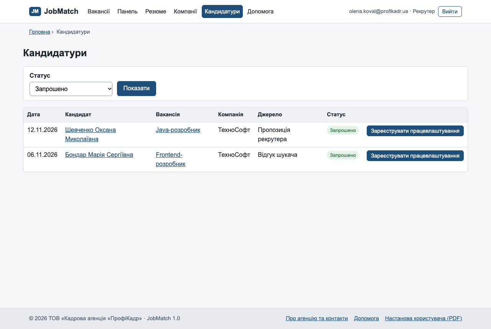{width=15cm}

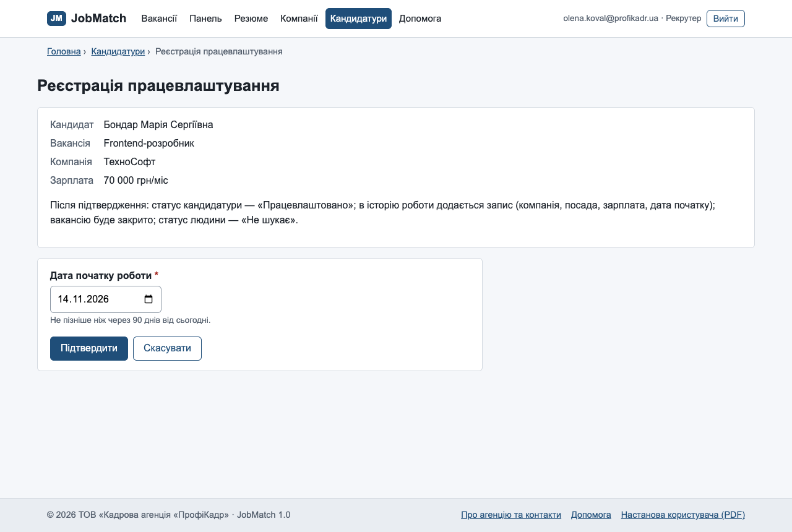{width=15cm}

#### 3.2.15 Обслуговування облікових записів (фахівець Замовника)

Фахівець Замовника виконує SQL-запити:

- у режимі prod — у `psql -h localhost -U jobmatch -d jobmatch`;
- у локальному режимі — після зупинки JobMatch, з каталогу `app`, у консолі H2:

  ```
  java -cp ~/.m2/repository/com/h2database/h2/2.3.232/h2-2.3.232.jar org.h2.tools.Shell \
    -url "jdbc:h2:file:./data/jobmatch;MODE=PostgreSQL;DATABASE_TO_LOWER=TRUE" \
    -user jobmatch -password jobmatch
  ```

Хеш BCrypt нового пароля фахівець отримує командою (утиліта `htpasswd` з пакета `apache2-utils` у Linux або вбудована в macOS):

```
htpasswd -bnBC 10 "" '‹новий пароль›' | tr -d ':\n'
```

Таблиця 3 — Запити обслуговування облікових записів

| Дія | SQL-запит |
|--------|------------------------|
| Створити обліковий запис рекрутера | `INSERT INTO user_account (email, password_hash, role) VALUES ('‹e-mail›', '‹хеш›', 'RECRUITER');` |
| Замінити забутий пароль (за листом на support@profikadr.ua з e-mail облікового запису) | `UPDATE user_account SET password_hash = '‹хеш›' WHERE email = '‹e-mail›';` |
| Деактивувати обліковий запис (звільнення рекрутера) | `UPDATE user_account SET enabled = FALSE WHERE email = '‹e-mail›';` |
| Активувати обліковий запис | `UPDATE user_account SET enabled = TRUE WHERE email = '‹e-mail›';` |

Новий пароль фахівець повідомляє користувачу телефоном; e-mail у запитах подається малими літерами.

#### 3.2.16 Резервне копіювання і відновлення БД (фахівець Замовника)

Регламент (п. 4.2.1 ТЗ): повна копія БД щотижня, у неділю о 23:00; фахівець зберігає 8 останніх копій на носії, окремому від пристрою (сервера) JobMatch, і видаляє старіші копії. Відновлення з копії — до 30 хв включно; втрата даних не перевищує змін після останньої копії.

**Локальний режим (H2).**

Резервне копіювання:

1. Фахівець зупиняє JobMatch (Ctrl+C у вікні терміналу).
2. Копіює файл `jobmatch/data/jobmatch.mv.db` на окремий носій з датою в імені, наприклад `jobmatch_2026-11-15.mv.db`.
3. Запускає JobMatch (п. 3.1.1, крок 4).

Відновлення:

1. Фахівець зупиняє JobMatch.
2. Копіює вибрану копію на місце файлу `jobmatch/data/jobmatch.mv.db` з тим самим іменем `jobmatch.mv.db` (замінює наявний файл).
3. Запускає JobMatch і перевіряє вхід рекрутера та наявність останніх відомих записів на «Панелі рекрутера».

**Повнофункціональний режим (PostgreSQL 16).**

Резервне копіювання (JobMatch не зупиняється):

```
pg_dump -h localhost -U jobmatch -d jobmatch -F c -f /backup/jobmatch_$(date +%F).dump
```

Розклад у `crontab` користувача з доступом до БД (пароль — у файлі `~/.pgpass`):

```
0 23 * * 0 pg_dump -h localhost -U jobmatch -d jobmatch -F c -f /backup/jobmatch_$(date +\%F).dump && ls -1t /backup/jobmatch_*.dump | tail -n +9 | xargs -r rm --
```

Вміст каталогу `/backup` фахівець копіює на окремий носій.

Відновлення:

1. Фахівець зупиняє службу: `sudo systemctl stop jobmatch`.
2. Відновлює БД з вибраної копії:

   ```
   pg_restore -h localhost -U jobmatch -d jobmatch --clean --if-exists /backup/jobmatch_2026-11-15.dump
   ```

3. Запускає службу: `sudo systemctl start jobmatch` — і перевіряє вхід рекрутера та «Панель рекрутера».

### 3.3 Завершення роботи програми

1. **Вихід користувача (U2).** Шукач, Представник компанії або Рекрутер натискає «Вийти» в шапці. JobMatch завершує сеанс і відкриває «Головну» з повідомленням «Ви вийшли із застосунку.». Наступне відкриття сторінки кабінету потребує входу.
2. **Завершення сеансу за неактивністю.** Після 30 хв без запитів JobMatch завершує сеанс; наступний запит до сторінки кабінету відкриває сторінку «Вхід». Незбережені дані форми втрачаються, тому користувач зберігає форму до перерви в роботі.
3. **Гість** завершує роботу закриттям вкладки браузера.
4. **Зупинка JobMatch (фахівець Замовника).** У локальному режимі фахівець натискає Ctrl+C у вікні терміналу, де запущено JobMatch; JobMatch завершує обробку запитів і закриває БД (рядок журналу з `Closing JPA EntityManagerFactory`). У режимі prod фахівець виконує `sudo systemctl stop jobmatch`.

## 4 ПОВІДОМЛЕННЯ ОПЕРАТОРУ

### 4.1 Діагностичні повідомлення

JobMatch показує діагностичні повідомлення двох видів:

- **помилка введення у формі** — червоний блок «Форму не збережено: виправте позначені поля.» з переліком помилок над формою і текст помилки під кожним помилковим полем; JobMatch зберігає введені дані (крім паролів);
- **порушення правила або некоректна дія** — червоний блок, де перше речення (жирним) — сутність помилки, далі «Як виправити зараз: …» і «Як запобігти надалі: …»; JobMatch повертає користувача на попередню сторінку без змін у БД.

Кожне повідомлення має три частини: сутність помилки, як виправити зараз, як запобігти надалі. Дія користувача — виконати другу частину повідомлення і повторити дію. У табл. 4 «‹…›» позначає значення, яке підставляє JobMatch.

Таблиця 4 — Діагностичні повідомлення

| Сторінка / функція | Текст повідомлення | Дія користувача |
|-------|----------------|--------|
| Вхід | Неправильний e-mail або пароль. Як виправити зараз: перевірте розкладку клавіатури та Caps Lock і введіть дані ще раз. Як запобігти надалі: зберігайте пароль у менеджері паролів; якщо забули пароль — дивіться розділ «Допомога». | Ввести дані повторно; за забутого пароля або неактивного облікового запису — написати на support@profikadr.ua |
| Реєстрація | Паролі не збігаються. Введіть однаковий пароль у поля «Пароль» і «Повторіть пароль». Вмикайте показ пароля перед введенням, щоб уникнути описок. | Ввести пароль двічі однаково |
| Реєстрація | Обліковий запис з e-mail ‹e-mail› вже існує. Увійдіть з цим e-mail на сторінці «Вхід» або вкажіть інший e-mail. Використовуйте один e-mail для одного облікового запису. | Увійти або вказати інший e-mail |
| Реєстрація | Компанія «‹назва›» вже зареєстрована. Перевірте назву або зверніться до рекрутера агенції, щоб отримати доступ до профілю компанії. Одна компанія має один профіль у JobMatch. | Перевірити назву; звернутися до агенції (сторінка «Про агенцію та контакти») |
| Реєстрація | Не надано згоду на обробку персональних даних. Позначте поле згоди, щоб створити резюме. Без згоди агенція не може зберігати резюме (Закон України «Про захист персональних даних»). | Позначити поле згоди |
| Реєстрація | Не вказано прізвище, ім'я або домашню адресу шукача. Заповніть поля «Прізвище», «Ім'я» і «Домашня адреса». Поля, позначені *, обов'язкові. | Заповнити поля |
| Реєстрація | Не вказано назву, адресу або e-mail компанії. Заповніть поля «Назва компанії», «Адреса компанії» і «E-mail компанії». Поля, позначені *, обов'язкові. | Заповнити поля |
| Реєстрація | Пароль має містити від 8 до 64 символів. Введіть довший (або коротший) пароль. Не використовуйте прості паролі на кшталт «12345678». | Ввести пароль довжиною від 8 до 64 символів включно |
| Усі форми з полем «Телефон» | Телефон має неправильний формат. Введіть номер у форматі +380XXXXXXXXX (9 цифр після +380). Вводьте номер без пробілів і дужок. | Ввести номер, наприклад +380501234567 |
| Усі форми з полем «E-mail» | E-mail має неправильний формат. Введіть адресу у форматі name@example.com. Перевіряйте наявність «@» і домену. | Виправити адресу |
| Усі форми | Не вказано ‹поле›. Введіть … (перше речення називає незаповнене обов'язкове поле, наприклад «Не вказано місто. Введіть назву міста, наприклад «Київ». Місто використовується в підборі.») | Заповнити вказане поле |
| Усі форми | ‹Поле› довше за N символів. Скоротіть … (наприклад «Поле «Про себе» довше за 1000 символів. Скоротіть текст. Пишіть 3–5 речень про ключові навички.») | Скоротити текст до N символів включно |
| Резюме, Нова людина | Прізвище містить недопустимі символи. Залиште лише літери, апостроф, дефіс і пробіл. Не вводьте цифри та знаки пунктуації. (так само для «Ім'я», «По батькові») | Видалити цифри і знаки пунктуації |
| Резюме, Нова людина | Бажана зарплата менша за 1000 грн. Введіть суму від 1000 до 1 000 000 грн або залиште поле порожнім. Вказуйте суму за місяць до сплати податків. (так само «більша за 1 000 000 грн») | Ввести місячну суму в межах 1 000–1 000 000 включно |
| Резюме, Нова людина | Дата народження не в минулому. Вкажіть реальну дату народження. Перевіряйте рік у календарі. | Виправити дату |
| Освіта | Не вибрано рівень освіти. Виберіть рівень зі списку. Рівень освіти використовується в підборі. | Вибрати рівень |
| Освіта | Рік закінчення раніший за 1950. Введіть рік від 1950 до 2035. Перевіряйте рік у дипломі. (так само «пізніший за 2035») | Ввести рік від 1950 до 2035 включно |
| Історія роботи | Дата початку роботи в майбутньому. Вкажіть дату не пізніше сьогоднішньої. Майбутні працевлаштування реєструє рекрутер. | Вказати дату не пізніше поточної |
| Історія роботи | Дата завершення роботи в майбутньому. Вкажіть дату не пізніше сьогоднішньої або залиште поле порожнім для поточної роботи. Порожнє поле означає «досі». | Виправити дату або очистити поле |
| Історія роботи | Дата завершення раніша за дату початку. Виправте одну з дат. Перевіряйте послідовність дат перед збереженням. | Виправити одну з дат |
| Історія роботи | Зарплата від'ємна. Введіть суму від 0 до 1 000 000 грн або залиште поле порожнім. Вказуйте суму за місяць. | Виправити суму |
| Профіль компанії, Нова компанія | Компанія з назвою «‹назва›» вже існує. Змініть назву (наприклад, додайте місто) або відкрийте наявну компанію через пошук. Перед додаванням компанії перевіряйте список «Компанії». | Змінити назву або відкрити наявну компанію |
| Профіль компанії, Реєстрація | Адреса сайту має неправильний формат. Введіть адресу, що починається з https://. Копіюйте адресу з рядка браузера. | Ввести адресу з https:// |
| Вакансія | Зарплата менша за 1000 грн. Введіть суму від 1000 до 1 000 000 грн. Вказуйте суму за місяць до сплати податків. (так само «більша за 1 000 000 грн») | Ввести місячну суму |
| Вакансія | Досвід більший за 40 років. Введіть кількість років від 0 до 40. Вказуйте мінімально необхідний досвід. (так само «Досвід від'ємний») | Ввести від 0 до 40 включно |
| Резюме (пошук) | Зарплата «від» (‹сума›) більша за «до» (‹сума›) — діапазон зарплати не застосовано. Поміняйте значення місцями або виправте одне з них і натисніть «Знайти». Вказуйте в полі «від» меншу суму, ніж у полі «до». | Виправити межі і натиснути «Знайти» |
| Вакансії, Резюме (фільтр зарплати) | Фільтр зарплати містить нечислове значення «‹значення›» — фільтр не застосовано. Введіть суму цифрами без пробілів, наприклад 30000, і натисніть «Знайти». Використовуйте стрілки поля або вводьте лише цифри. | Ввести суму цифрами |
| Підбір кандидатів, Підбір вакансій, Відповідні вакансії, Відповідні резюме | Мінімальна оцінка «‹значення›» має бути цілим числом від 0 до 100. Введіть ціле число від 0 до 100, наприклад 50, і натисніть «Оновити». Використовуйте кнопку «Показати часткові збіги» для порогу 25 %. (Підбір кандидатів залишає попередній поріг; інші сторінки показують список з порогом 50 %.) | Ввести ціле число від 0 до 100 включно |
| Пропозиція кандидата | Коментар довший за 500 символів. Скоротіть коментар до 500 символів. Пишіть 2–3 речення про сильні сторони кандидата. | Скоротити коментар |
| Підбір кандидатів (кнопка «Запропонувати») | Кандидатура цієї людини на вакансію «‹посада›» вже існує. (для закритої вакансії: Вакансію «‹посада›» закрито — кандидатури не приймаються.) Поверніться до списку підбору і виберіть іншого кандидата або відкриту вакансію. Кнопка «Запропонувати» доступна лише для кандидатів без кандидатури на відкриту вакансію. | Вибрати іншого кандидата або відкриту вакансію |
| Пропозиція кандидата (кнопка «Підтвердити»), Відгук на вакансію | Кандидатура ‹ПІБ› на цю вакансію вже існує. Відкрийте розділ «Кандидатури», щоб переглянути її статус. Кнопка подання неактивна для вже поданих кандидатур — не відкривайте форму в кількох вкладках. | Переглянути статус наявної кандидатури |
| Пропозиція кандидата (кнопка «Підтвердити»), Відгук на вакансію | Вакансію «‹посада›» закрито — кандидатури не приймаються. Виберіть іншу відкриту вакансію у списку вакансій. Перевіряйте статус вакансії «Відкрита» перед поданням кандидатури. | Вибрати відкриту вакансію |
| Кандидатури вакансії (Представник компанії) | Статус кандидатури вже змінено: поточний статус — «‹статус›». Перегляньте оновлений рядок кандидатури — рішення для неї вже прийнято. Оновлюйте сторінку перед прийняттям рішення, якщо вона відкрита давно. | Переглянути оновлений рядок |
| Реєстрація працевлаштування | Працевлаштування можна зареєструвати лише для кандидатури зі статусом «Запрошено»; поточний статус — «‹статус›». Відкрийте «Кандидатури» з фільтром «Запрошено» і виберіть потрібну кандидатуру. Реєструйте працевлаштування після того, як компанія запросила кандидата. | Вибрати кандидатуру зі статусом «Запрошено» |
| Реєстрація працевлаштування | Дата початку роботи не вказана або пізніша за ‹дата›. Вкажіть дату не пізніше ‹дата›. Реєструйте працевлаштування після підписання договору з датою виходу на роботу. | Вказати дату не пізніше поточної дати + 90 днів |
| Реєстрація працевлаштування, Кандидатури вакансії | Кандидатура вже має остаточний статус «‹статус›». Оновіть сторінку, щоб побачити актуальний статус. Остаточні статуси «Відхилено» і «Працевлаштовано» не змінюються. | Оновити сторінку |
| Будь-яка сторінка кабінету чужої ролі | 403 — Доступ заборонено. Ця сторінка недоступна для вашої ролі. Кнопка «На головну». | Перейти на «Головну»; увійти з обліковим записом потрібної ролі |
| Неіснуюча адреса або видалений запис | 404 — Не знайдено. ‹Сутність, наприклад «Вакансію №125 не знайдено»›. Запис міг бути видалений іншим користувачем або адресу введено з помилкою. Кнопки «На головну», «До вакансій», «До панелі рекрутера» (Рекрутер). | Перевірити адресу; перейти за кнопкою до списку |
| Внутрішня помилка сервера | 500 — Внутрішня помилка. Під час виконання дії сталася помилка на сервері. Введені дані не збережено. Повторіть дію через хвилину. Якщо помилка повторюється, напишіть на support@profikadr.ua, указавши час і адресу сторінки. | Повторити дію через 1 хв; повідомити підтримку з часом і адресою сторінки |
| Підбір для закритої вакансії; Відповідні резюме закритої вакансії | Вакансію закрито — підбір недоступний. Посилання «До відкритих вакансій» («До вакансій компанії» для Представника компанії). | Вибрати відкриту вакансію |
| Картка закритої вакансії (Гість, Шукач) | Вакансію закрито — подання кандидатур недоступне. Посилання «До відкритих вакансій». | Вибрати відкриту вакансію |

### 4.2 Повідомлення про виконання дій користувача

Повідомлення про виконання дії JobMatch показує зеленим блоком угорі сторінки (табл. 5); інформаційні тексти порожніх списків — у блоці на місці таблиці (табл. 6).

Таблиця 5 — Повідомлення про виконання дій

| Дія | Повідомлення |
|--------|----------------|
| Реєстрація | Реєстрацію завершено. Увійдіть з указаними e-mail і паролем. |
| Вихід | Ви вийшли із застосунку. |
| Збереження резюме (Шукач, Рекрутер) | Резюме збережено. |
| Додавання / видалення освіти | Запис про освіту додано. / Запис про освіту видалено. |
| Додавання / зміна / видалення запису історії роботи | Запис історії роботи додано. / Запис історії роботи збережено. / Запис історії роботи видалено. |
| Відгук на вакансію | Відгук надіслано. Стан відгуку — у розділі «Мої відгуки». |
| Збереження профілю компанії | Профіль компанії збережено. |
| Публікація вакансії (Представник компанії) | Вакансію «‹посада›» опубліковано. |
| Додавання вакансії (Рекрутер) | Вакансію «‹посада›» додано. |
| Збереження вакансії | Вакансію збережено. |
| Закриття / відкриття вакансії | Вакансію закрито. / Вакансію відкрито. |
| Видалення вакансії | Вакансію видалено. (Представник компанії) / Вакансію видалено разом з кандидатурами на неї. (Рекрутер) |
| Запрошення кандидата | Кандидата запрошено на співбесіду. Рекрутер агенції отримає оновлений статус. |
| Відхилення кандидатури | Кандидатуру відхилено. |
| Пропозиція кандидата | Кандидатуру ‹ПІБ› запропоновано на вакансію «‹посада›» (‹компанія›). |
| Додавання людини | Резюме ‹ПІБ› додано. Додайте освіту та історію роботи. |
| Видалення людини | Резюме ‹ПІБ› видалено разом з освітою, історією роботи та кандидатурами. |
| Додавання / збереження / видалення компанії | Компанію «‹назва›» додано. / Дані компанії збережено. / Компанію «‹назва›» видалено разом з її вакансіями. |
| Реєстрація працевлаштування | Працевлаштування ‹ПІБ› на вакансію «‹посада›» (‹компанія›) зареєстровано. |

Таблиця 6 — Інформаційні тексти порожніх списків

| Сторінка | Текст | Дія користувача |
|-------|------------------|---------|
| Вакансії | За вашими умовами відкритих вакансій немає. Спробуйте прибрати фільтр за зарплатою або містом. | Змінити фільтри або натиснути «Показати всі вакансії» |
| Відповідні вакансії | Немає вакансій з оцінкою від N %. Додайте бажану посаду, освіту та історію роботи в резюме або покажіть часткові збіги (від 25 %). | Доповнити резюме або відкрити часткові збіги |
| Мої відгуки | Ви ще не відгукувалися на вакансії. | Натиснути «Переглянути відповідні вакансії» |
| Вакансії компанії | Вакансій ще немає. | Натиснути «Опублікувати першу вакансію» |
| Відповідні резюме | Немає резюме з оцінкою від N %. | Натиснути «Показати часткові збіги (від 25 %)» |
| Кандидатури вакансії | Кандидатур на цю вакансію ще немає. | Переглянути «Відповідні резюме» |
| Панель рекрутера | Відкритих вакансій немає. | Додати вакансію в картці компанії |
| Підбір кандидатів | Немає кандидатів з оцінкою від N %. | Натиснути «Показати часткові збіги (від 25 %)» |
| Підбір вакансій | Немає відкритих вакансій з оцінкою від N %. | Відкрити часткові збіги |
| Резюме | За цими критеріями резюме не знайдено. Приберіть один із фільтрів або покажіть усі резюме. | Змінити критерії |
| Компанії | Компаній не знайдено. | Змінити запит |
| Кандидатури | Кандидатур з таким статусом немає. | Вибрати інший статус |
| Картка людини, резюме | Освіту не вказано. / Історію роботи не вказано. / Кандидатур немає. | Додати записи |

## Додаток А. Демонстраційні облікові записи

Скрипт `V2__seed.sql` створює демонстраційні облікові записи з однаковим паролем, указаним у коментарі на початку скрипту (`Demo2026!`). Демонстраційні дані призначено для ознайомлення і навчання; перед експлуатацією в режимі prod фахівець Замовника видаляє їх (п. 3.1.2).

Таблиця А.1 — Демонстраційні облікові записи

| Роль | E-mail | Дані |
|------|----------------|--------|
| Рекрутер | olena.koval@profikadr.ua, andrii.melnyk@profikadr.ua, r@pk.ua | — |
| Шукач | ivan.petrenko@example.com | Петренко Іван Олегович, Java-розробник |
| Шукач | dmytro.kovalenko@example.com, maria.bondar@example.com, ya@i.ua | інші резюме |
| Представник компанії | hr@technosoft.ua | «ТехноСофт», Київ |
| Представник компанії | jobs@nova-logistyka.ua | «Нова Логістика», Львів |
| Представник компанії | hr@agroplus.ua | «АгроПлюс», Вінниця |
| Представник компанії | kadry@medservis.ua | «МедСервіс», Київ |
